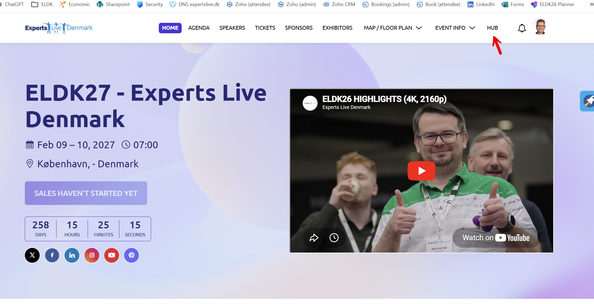
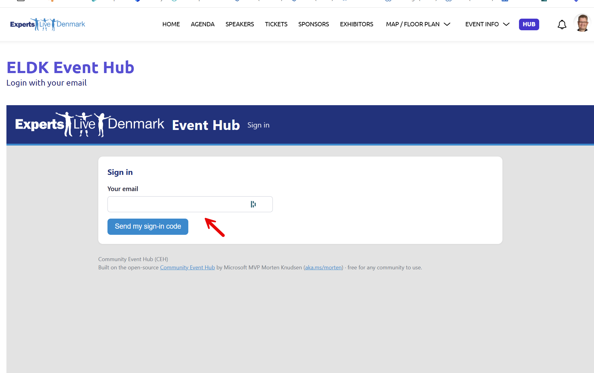
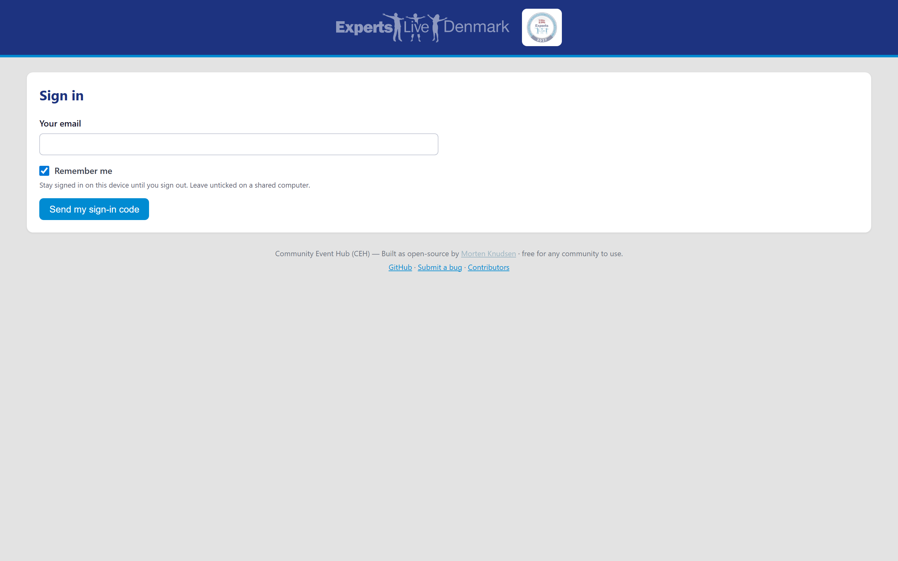
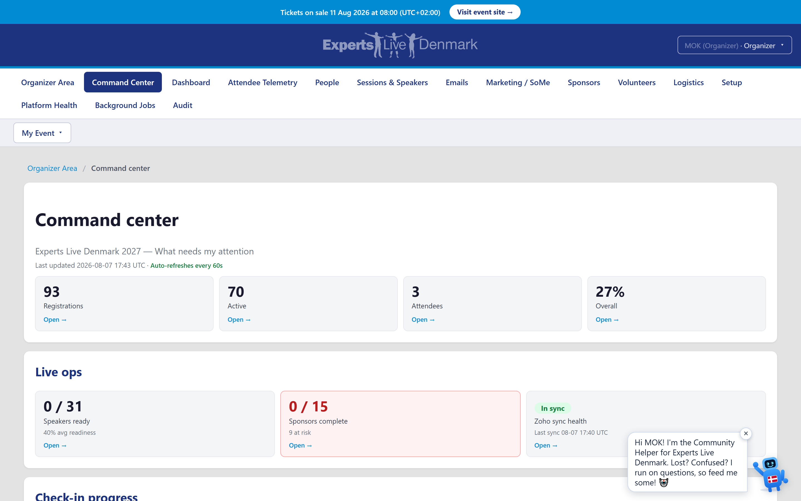
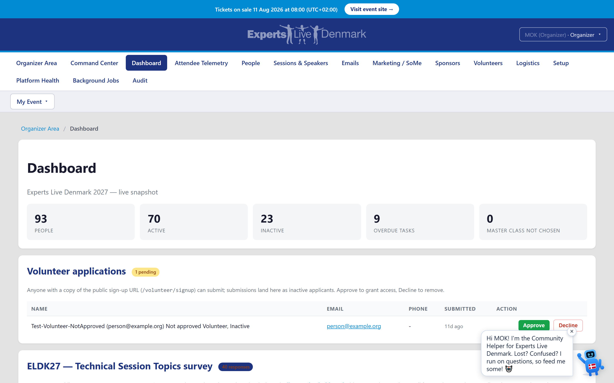
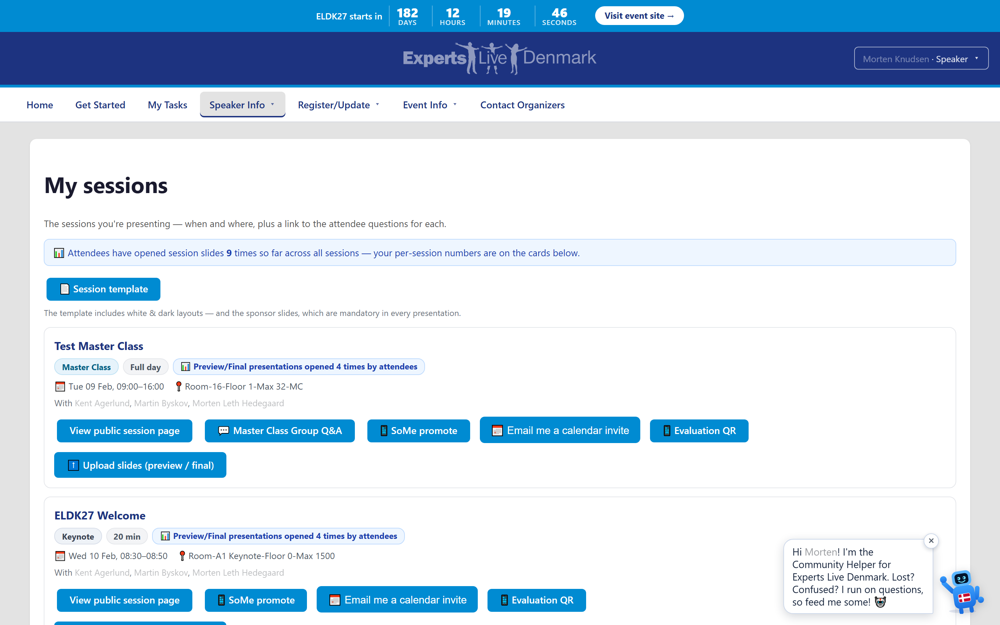
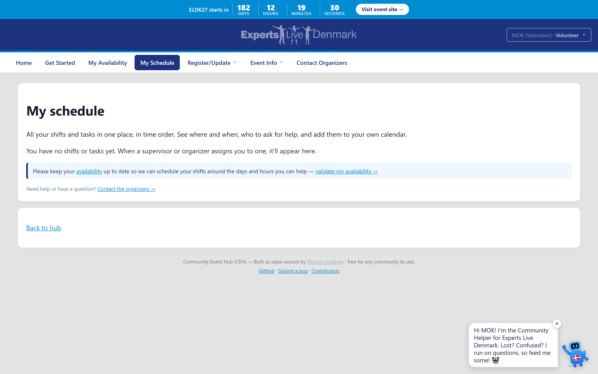
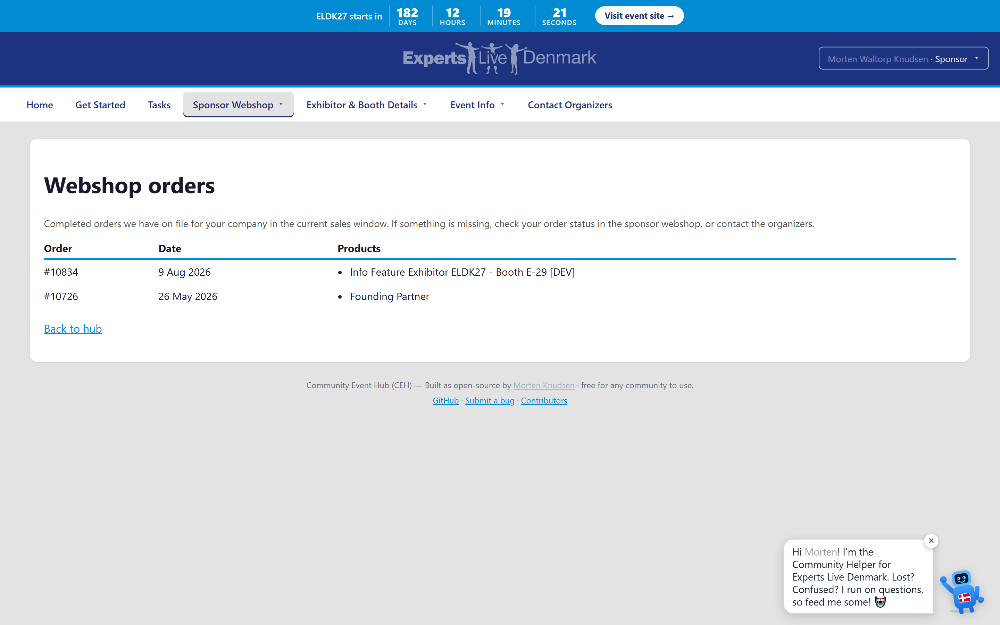
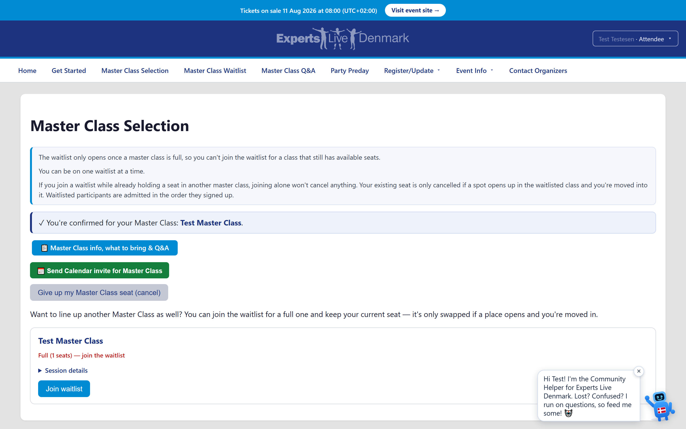

# Community Event Hub (CEH / ELDK27) — Design

This is the **single design document** for the Community Event Hub: how the built system
works — its architecture, data model, integrations, jobs, email, build, infra, deploy, and
operational runbook. It absorbs the former CONCEPT / RUNBOOK / build / design-notes / parity
material into one place. For *what we still want to build* (backlog + status with ◻/🟡/✅
markers) see `docs/REQUIREMENTS.md`. For test procedures (smoke walkthrough, Playwright suites,
Pester) see `docs/TESTS.md`. For the documentation model and the rules about which doc owns what,
see `CLAUDE.md`. Those three — together with `CONTRIBUTING.md`, `internal/`, `config/` and the
maintainers' operator scripts under `tools/` — are the maintainers' internal material and are **not
part of the public template**; references to them below describe how the upstream instance is run.
To set up your own instance, follow the README's *Getting started*.

---

## Table of contents

1. [System overview](#1-system-overview)
2. [Solution shape](#2-solution-shape)
3. [Data model & storage](#3-data-model--storage)
4. [Auth, identity & embedding](#4-auth-identity--embedding)
5. [Jobs (scheduled timers)](#5-jobs-scheduled-timers)
6. [Integrations](#6-integrations)
7. [Email system](#7-email-system)
8. [Feature surface (hubs & organizer areas)](#8-feature-surface-hubs--organizer-areas)
9. [Cross-cutting decisions](#9-cross-cutting-decisions)
10. [Build & local dev](#10-build--local-dev)
11. [Infrastructure (Bicep) & environments](#11-infrastructure-bicep--environments)
12. [Deploy, rollback & zero-downtime](#12-deploy-rollback--zero-downtime)
13. [Governance, branching & publishing](#13-governance-branching--publishing)
14. [Dev → Prod parity](#14-dev--prod-parity)
15. [Operational runbook](#15-operational-runbook)
16. [Testing strategy](#16-testing-strategy)
17. [Configuration & Key Vault reference](#17-configuration--key-vault-reference)
18. [Legacy automation: webhooks & deployment topology](#18-legacy-automation-webhooks--deployment-topology)
19. [Attendee onboarding, party, seat allocation & test policy](#19-attendee-onboarding-party-seat-allocation--test-policy-206223)
20. [Graphics release, Get-Started composition & the resend queue](#20-graphics-release-get-started-composition--the-resend-queue-784-790)
21. [Coupon billing: prepaid pools, invoice confirmation & draft notices](#21-coupon-billing-prepaid-pools-invoice-confirmation--draft-notices-787-794-795)

---

## 1. System overview

CEH is an evergreen, multi-community **ASP.NET Core (Razor Pages, .NET 10)** participant portal plus an
**Azure Functions** job host, sharing one domain library and one Azure SQL database. Every
participant logs in with an emailed PIN, lands on a role-personalized hub, self-services their
pre-event obligations; organizers run the event from an admin hub; sponsors get a company-scoped
portal; timer jobs pull upstream systems and send reminders.

It is a **role-personalized crew-management web app** for a Microsoft-community conference
(first edition: the upstream community's 2027 conference, edition code **ELDK27**, a two-day
event with a master-class pre-day). It replaces a previous spreadsheet + PowerShell + Microsoft Planner
workflow with a single database-backed self-service hub: speakers/volunteers/sponsors see and
manage their own submissions, organizers get one overview instead of five, and data syncs to
subsystems (Backstage / ERP / webshop) rather than living in email threads.

**Evergreen, not per-year.** Application code, repo, Azure resources and namespaces are all
`CommunityHub` / `community-hub` — never `eldk27-hub`. A new edition or community is a **new
`Event` row + JSON config**, never a fork. Three distinct names that must not be conflated:

- **Code / infra name = `CommunityHub`** — namespaces, projects, `CommunityHubDbContext`, the
  Bicep base name. Fixed; not renamed per community. (`EventHub` was rejected — it collides with
  the Azure Event Hubs service.)
- **Product display name = "Community Event Hub (CEH)"** — shown in the layout chrome only.
- **Community name = `Event.CommunityName` data field** (e.g. "Demo Community") — per-edition
  data, never hard-coded.

The year appears in exactly two places: user-facing labels (the active event's display name) and
the frontend hostname. Benefits: ELDK28 is a new *row*, not a new deployment; past data stays
queryable; a returning speaker is the same person across editions; one codebase forever.

**Project history (why Azure).** Zoho Backstage (event-marketing only, can't host crew logic) and
Zoho Creator (low-code, prototyped then dropped) were both rejected; the user wanted to own 100%
of the code in VS Code, true IaC, simple PIN auth, and reusability by other communities. A
WordPress-plugin-on-the-live-webshop option was rejected because a plugin bug could take down
payments. Azure isolates the app, gives first-class Bicep IaC, and is existing home turf. There is
**no fallback system** — this Azure app is the only solution.

**Estimated cost:** ~€25/month per instance (~€50/month dev + prod combined).

A private repository carries the real config; the public mirror
(`community-event-hub`) is the sanitized template (§13).


*Architecture overview: the ASP.NET Core web hub and the Azure Functions job host share one domain library and one Azure SQL database.*


*Architecture detail: integrations (Sessionize / Zoho / webshop / SharePoint), the timer jobs, and the hub embedded inside the public event portal.*

---

## 2. Solution shape

| Project | Type | Role |
|---|---|---|
| `src/CommunityHub.Core` | class library | EF Core `CommunityHubDbContext`, domain entities, services, integrations, email, auth — shared by web + jobs |
| `src/CommunityHub` | ASP.NET Core Razor Pages (+1 MVC API controller) | the web hub (participant / sponsor / organizer pages, Leads API, `/health`) |
| `src/CommunityHub.Jobs` | Azure Functions v4 isolated worker (timer triggers) | scheduled pulls, reconciliation, reminders, watchers |
| `tools/CommunityHub.OneShot` | console CLI | run one job once locally against the same services *(maintainer tooling — not in the public template, and the published solution omits it)* |
| `tests/CommunityHub.Core.Tests`, `tests/CommunityHub.Web.Tests` | xUnit | unit, scenario and page-model tests |

`CommunityHub.Core` is organized into `Config/` (typed config loader + schema validation),
`Domain/`, `Data/` (DbContext + migrations), `Auth/` (PIN generation/verification/session + the
`IIdentityProvider` seam), `Email/` (Brevo SMTP sender + template engine), `Reminders/` (stateless
reminder evaluation), and `Integrations/` (WooCommerce, Company Manager, Zoho, Sessionize clients).

Entry points:
- `src/CommunityHub/Program.cs` — SQL connection composed from a Bicep template + KV password;
  cookie auth `SameSite=None; Secure` for the Backstage iframe; `da-DK` culture; CSP
  `frame-ancestors`; an X-Frame-Options stripping middleware; `ActiveEventNameProvider` DI.
- `src/CommunityHub.Jobs/Program.cs` — same wiring; the Backstage exhibitor API is DI-swapped by
  `TestMode`.

The staged build (8 stages + post-stage features) is **all built and statically reviewed**; the
historical staging plan lives in the source CONTEXT material and is not repeated here as a backlog
(see `REQUIREMENTS.md` for outstanding work).

---

## 3. Data model & storage

- **Azure SQL via EF Core 8**, single `CommunityHubDbContext` (~26 DbSets). Every entity FKs to
  `Event` by `EventId` → multi-edition with no schema change. Participant identity = unique
  `(EventId, Email)`.
- **Migrations are the DB-as-code** (~18 EF migrations), applied **out-of-band**, not at startup.
- **Idempotency guards:** unique `SentReminder(EventId,Recipient,Type,Occasion)`; filtered-unique
  `SponsorLead(EventId,ZohoRecordId)`. FKs use `NoAction`/`Restrict` to avoid multi-cascade-path
  errors.

### Core entities
- **`Event`** — one row per edition (the multi-event design). Carries community identity, dates,
  venue, hotel, form deadlines, the lock date, role list, sponsor rules, and `CalendarSyncEnabled`
  (organizer master switch for calendar sync, default true — see §7a Calendar sync).
- **`Participant`** — one row per person per edition. Fields cover: Name, Email (login key),
  Gender, Mobile, Role, IsActive, `IsTestUser` (test/dummy-data flag — go-live cleanup
  deletes/deactivates WHERE `IsTestUser=true` without touching real registrations; default false),
  MS accreditation (MVP/Expert/RD/MS Employee), award, polo
  request/size, jacket size, verification, packed status, plus `SponsorCompanyId` (external
  Company Manager id, for sponsor scoping), and `CalendarFeedToken` (the per-participant secret
  for the subscribable iCal feed — see §7a Calendar sync; nullable, minted lazily on first hub
  view, unique filtered index, regenerable to revoke). 8 roles, single-role-per-person: Organizer, Speaker,
  Volunteer, Sponsor, Speaker-Sponsor, Video, Photography, VIP — plus **Attendee** added later
  (§6 Zoho) as a sixth participant audience.
- **`LoginPin`** — PIN-hash storage, 15-min expiry, single-use.
- **`HotelBooking`** — modeled as a **check-in/check-out date range** (not per-night columns).
  Nightly room occupancy is *computed* from the range for the hotel room-night forecast; a double
  room shared with a partner counts as **one room**. Carries occupancy (single/double), partner,
  confirmation number (organizer-editable, crew read-only). This is the participant's own
  room-need *preference*; the physical-venue *placement* is the `Hotel` model below.
- **`Hotel`** (multi-hotel management, added 2026-06-15) — an organizer-defined hotel for an
  edition (Name required + Address + ContactEmail + Notes), edition-scoped (`EventId`, cascade
  from `Event`). Rooms rarely fit in one hotel, so attendees are split across several. Distinct
  from `HotelBooking`: a `Hotel` is the venue an organizer *places* people into (one hotel → many
  participants). `Participant` gains **`HotelId`** (nullable FK to `Hotel`, `NoAction` to avoid a
  second cascade path from the `Event` root; index `(EventId, HotelId)` for the group-by-hotel
  query) and **`HotelConfirmationNumber`** (per-person, organizer-set). `HotelManagementService`
  is the single server-side authority (hotel CRUD, assign/clear placement, set confirmation
  number, and `GroupByHotelAsync` → one `HotelGroup` per hotel alphabetical + a trailing
  "Not assigned" group; empty hotels still appear). Organizer pages `/Organizer/Hotels` (CRUD)
  and `/Organizer/HotelAssignments` (assign + group view + confirmation). EF migration
  `MultiHotelManagement`. The hotel calendar invite/email is enriched via the pure, unit-tested
  `HotelEmailContentBuilder` (Core) — the participant's assigned hotel **name + address +
  confirmation number** fold into the venue/subject/body, the per-person number taking priority
  over any legacy `HotelBooking.ConfirmationNumber`; routed through the gated `IEmailSender`
  (DEV-redirected). See §8 organizer area + §7 email.
  **Room-block occupancy (added 2026-06-17):** `Hotel` gains an additive nullable
  **`RoomBlockSize`** (EF migration `HotelRoomBlock`) recording the rooms reserved at that hotel
  (null = not set; a negative input is clamped to 0 by `HotelManagementService`, which now takes
  the size on create/update). The pure, read-only **`HotelRoomBlockService`** (constructor-injected
  EF context only — no clock/I/O) builds a `HotelBlockSnapshot`: per-hotel `HotelBlockLine`
  (block vs. **placed-and-needing-a-room** count — only `HotelBooking.NeedsRoom` placements consume
  the block — with `Remaining`/`Over` floored at 0, an `IsOverBlock` flag, a divide-by-zero-safe
  `Percent`, and a `Confirmed` count), plus the edition roll-up (total block, total room-needers,
  total remaining, **room-needers not yet placed**, hotels-over-block, hotels-without-block, and a
  `PlanLooksOk` that is true only when no block is oversubscribed AND nobody who needs a room is
  unplaced). The hotel list is SQL-translatable; the room-need set is read once and joined in memory
  (same shape as `GroupByHotelAsync`). Organizer page `/Organizer/HotelRoomBlocks` (read-only;
  linked from the Logistics hub) — placement + recording the block size stay on the existing
  Hotels / HotelAssignments pages.
- **`DinnerSignup`**, **`VolunteerAvailability`** — the two other self-service form entities.
- **`DietaryRequirement`** (structured dietary/allergy capture, added 2026-06-16) — own-row-scoped
  structured catering data, **one row per participant per edition PER `DietarySurface`**
  (`SpeakerCatering` = the speaker form's day-catering, `Dinner` = the Appreciation Dinner), so a
  person can have both. Carries a `DietChoice` (None/Vegetarian/Vegan/Pescatarian/Halal/Kosher), the
  **14 EU FIC major allergens as discrete `bool` columns** (count-friendly — the caterer gets
  head-counts, not free text), and a free-text `OtherAllergens` for the long tail. Indexes
  `(EventId, ParticipantId, Surface)` unique (the upsert key) + `(EventId, Surface)` (the per-occasion
  catering roll-up). Event FK cascades; Participant FK is `Restrict` (no second cascade path). The
  legacy `DinnerSignup.AllergyNotes` free-text box is **kept** (re-labelled "anything else") so nothing
  is lost. The Dinner + Speaker forms render the SAME `_DietaryFieldset` partial (bound via the shared
  `DietaryInput`); the pure `DietaryAggregator` rolls a set of rows into per-allergen + per-diet counts.
  EF migration `StructuredDietaryRequirements` (single table; `has-pending-model-changes` = none).
- **Volunteer work structure** (added 2026-06-15) — 5 entities forming a 3-level
  tree plus assignments and a help channel, all edition-scoped:
  - **`VolunteerCategory`** (top) — Name, Description, `LeadParticipantId`
    (nullable FK to the **organizer** who oversees it), `SupervisorParticipantId`
    (nullable FK to the **volunteer** appointed to run it — the appointment row IS
    the management grant, no global role change).
  - **`VolunteerSubcategory`** — belongs to one category (`CategoryId`); `EventId`
    denormalized from the parent.
  - **`VolunteerTask`** — belongs to one subcategory (`SubcategoryId`); Title,
    Description, optional `DueDate` + free-text `Shift`, `Status`
    (`VolunteerTaskStatus`: Open/InProgress/Done/Cancelled). `EventId`
    denormalized so a task list is a single edition-scoped query.
  - **`VolunteerTaskAssignment`** — the many-to-many link Task↔volunteer; unique
    `(TaskId, ParticipantId)`; indexed `(EventId, ParticipantId)` for "my tasks".
  - **`VolunteerHelpRequest`** — the help channel: a volunteer assigned to a task
    raises a request (`TaskId` + denormalized `CategoryId` so the supervisor's
    inbox is a single filter); Message, `Status` (Open/Answered/Resolved),
    Response + audit (`RespondedByEmail`, `RespondedAt`, `ResolvedAt`).
  - All mutations go through one server-side authority, `VolunteerStructureService`
    (in `CommunityHub.Core.Domain`), which enforces the permission model:
    organizer = full across the edition; supervisor = elevated for their own
    category only; volunteer = own assigned tasks + raise help. It throws
    `VolunteerAccessDeniedException` (→ 403) / `VolunteerValidationException` (→
    friendly message). Like `OrganizerActionItem`, FKs to `Participant` and the
    cross-tree FKs use `NoAction` to avoid SQL Server multi-cascade-path errors;
    category→subcategory→task→assignment cascade-delete down the tree.
  - Migration: **`VolunteerWorkStructure`** (5 tables). Additive — feeds the
    existing reminder/calendar model, does not replace `VolunteerAvailability`
    (the shift-availability wizard) or `OrganizerActionItem` (the action queue).
  - **Help-request notification** (added 2026-06-15, no schema change) —
    `VolunteerHelpNotificationService` (in `CommunityHub.Core.Email`) emails the
    owning category's **supervisor** when a help request is raised, with the
    organizer **lead** copied (a separate per-person send so each gets correct
    effective-address/secondary-CC routing). It sends through the shared
    `ParticipantEmailService` → `IEmailSender`, so the **DEV redirect-all-to, the
    kill switch and the per-recipient ring gate apply automatically** — it never bypasses them, and
    uses the shipped `volunteer-help-raised` template. The volunteer's "Ask for
    help" page (`/volunteer/mytasks`) invokes it **best-effort** after the request
    is saved: a mail failure is logged and swallowed (the request already persists
    and shows in the supervisor's in-hub inbox). A category with no supervisor yet
    notifies only the lead.
- **Volunteer Buckets & allocation** (added 2026-06-15, migration
  **`VolunteerBucketsAllocation`**) — extends the structure above **additively** (the
  `VolunteerCategory` is the "Bucket" in the UI; no parallel stack). Schema changes:
  - **`VolunteerCategory`** gains `EldkLeadName` (free-text third-tier go-to person).
  - **`VolunteerBucketSupervisor`** — new join giving a bucket **one or more**
    supervisors (volunteers); unique `(CategoryId, ParticipantId)`. The legacy single
    `SupervisorParticipantId` still counts — `CanManageCategoryAsync` and
    `LoadSupervisorsAsync` union both. `AddSupervisorAsync`/`RemoveSupervisorAsync`
    manage it (organizer-only).
  - **`VolunteerTask`** gains `TimeEnd`, `Criticality` (`VolunteerTaskCriticality`
    Unspecified/NiceToHave/NeedToHave), `ResponsibleTeam`, `EldkLeadName` (per task),
    `ResourcesNeeded` (int), `Prerequisites`, `Expectations`, `Instructions`, and
    `CompletedAt`/`CompletedByEmail`. `MarkTaskCompletedByLeadAsync` is the lead's
    sign-off (status Done + audit stamp); `ReopenTaskAsync` clears it;
    `UpdateTaskDetailsAsync` edits the new fields. `CreateTaskAsync` gained optional
    params for the new fields (existing callers pass `ct:` by name).
  - **`TaskAllocationDraft`** — new per-organizer DRAFT queue (`OwnerParticipantId`),
    unique `(TaskId, ParticipantId)`. **`VolunteerAllocationService`** is the
    task-mapper engine: `LoadCoverageAsync`/`LoadTaskCoverageAsync` return
    `TaskCoverage` (needed vs assigned vs draft → red/green `IsCovered`);
    `AddDraftAsync`/`RemoveDraftAsync` queue a simulation; `CommitAsync` turns the
    queue into real `VolunteerTaskAssignment` rows and clears it; `DiscardAsync`
    resets without assigning. All allocation writes are organizer-only.
  - **CSV import** — `VolunteerPlanParser` (pure, RFC-4180-ish; handles quoted
    multi-line Resource Names) parses the semicolon plan into `ParsedPlanTask`,
    deriving the **Bucket from Responsible Team**. `VolunteerPlanImportService`
    upserts buckets+tasks idempotently under an "Imported plan" subcategory, matches
    Resource Names to existing volunteers by FullName (unmatched reported, never
    created), and fills missing Pre-req/Expectations via the guidance seam. The
    organizer `/Organizer/BucketAllocation` page drives import + gaps + draft→commit.
  - **AI guidance seam** — `ITaskGuidanceGenerator` with `HeuristicTaskGuidanceGenerator`
    (always-on, no secret, deterministic) and `LlmTaskGuidanceGenerator` (Claude
    Messages API over `HttpClient`, model `claude-opus-4-8`). Gated on
    `TaskGuidanceOptions.ApiKey` (bound from the `VolunteerGuidance` config section —
    SECRET, never committed; empty placeholder in `config/volunteer-guidance.sample.json`).
    DI registers the LLM generator only when a key is configured; otherwise the
    heuristic IS the generator. The LLM provider never hard-fails — it falls back to
    the heuristic on any error so import never breaks.
  - **Volunteer view** — `/volunteer/mytasks` now shows each task's
    instructions/pre-req/expectations and the bucket's supervisor(s) + ELDK lead.
- **Hotel coverage** (added 2026-09-22, §1296, migration **`HotelCoverageStandards`**) — how many
  hotel nights the event pays and how many the guest pays, as data rather than code.
  - **The rule is one line:** `covered = clamp(standard(class) + extraNights, 0, bookedNights)`,
    `ownExpense = booked − covered`. **Counts only — no covered-date window.** An earlier design had
    one; it would have had to be chosen, explained to a hotel and re-derived whenever somebody moved
    their check-in, and the hotel only needs the count.
  - **`HotelCoverage`** (pure, `Core/Entitlements`) holds the `HotelCoverageClass` enum, the agreed
    defaults, `ClassFor` (role + speaker category + **derived presenting days**), `Resolve` and
    `NightsBetween`. Speakers split into master-class / pre-day-only / main-only from their linked
    sessions, so a schedule change moves their coverage with no edit; a Community speaker with no
    sessions falls back to main-day (an unfinished agenda is not a decision to stop paying).
  - **`HotelCoverageService`** (EF) owns the two tables and is what every surface calls:
    `HotelCoverageStandards` (one row per edition × class; missing ⇒ the catalog default) and
    `HotelCoverageExtras` (one row per person granted something, with who/when — setting 0 deletes
    the row, so its presence means "was granted", not "was looked at"). `ResolveManyAsync` answers a
    whole list in four queries for the list surfaces.
  - 🔑 **The clamp IS the cap.** "Guest speakers, max 6" needs no special mode: a 6-night standard
    pays 3 for someone who books 3 and 6 for someone who books 8. *Whole stay* is reserved for the
    genuinely uncapped classes (organizer / media / event partner).
  - 🔒 **"Nothing" is a standard, not a veto** — extra nights still apply to a sponsor-brought
    speaker, because a control that accepted the input and discarded it would be worse than none.
  - **Surfaces, all reading the one resolver:** `/Organizer/Settings/HotelNights` (the standards),
    the person's page under People (the extra + the arithmetic), `/Organizer/HotelAssignments`
    (`covered/booked` for every role, and a flag on volunteers still on the standard),
    `_HotelFields.cshtml` (the booking-time line — server-rendered and recomputed client-side, and
    shared by `/Forms/Hotel`, the Get Started step and the inline task row),
    `HotelLogisticsProducer` (the two Excel columns, **in the content key** so §6.4 re-mails the
    hotel when coverage changes) and `HotelEmailContentBuilder` (the same sentence in the mail).
  - **Retired with it:** `SpeakerDayScope.FundedHotelNights` (speaker-only, hard-coded, shown on one
    page), the four static per-role policy strings in the hotel form, and the Guest-nights box on
    `/Organizer/SpeakerReview`. `SpeakerProfile.GuestFundedNights` remains on the entity per the
    additive-only rule but is written and read by nothing.
- **Volunteer assignment gate** (added 2026-09-21, §1295) — one ring-gated switch decides
  whether volunteers get work at all, so an edition can onboard and activate volunteers
  while no assignment can happen.
  - **`VolunteerAssignmentGate`** (`Core/Volunteers`) is the single authority. It reads the
    catalog feature **`volunteer-assignments`** (group Volunteers, **UserImpact**, default
    **OFF at Ring 1**) and answers two questions with the same switch + ring:
    `MayAssignAsync` (may this volunteer be assigned — kill switch AND effective ring ≤
    released ring) and `MaySeeOwnAssignmentsAsync` (may they open `/volunteer/myschedule`).
    `FilterAssignableAsync` is the batch form — it reads the switch and released ring ONCE,
    then resolves each target, for the importer / queue / scenario loops.
  - **It is a constructor dependency, not a page check.** `VolunteerStructureService`
    (required param), `AllocationScenarioService` (required), `VolunteerPlanImportService`
    (required) and `VolunteerAllocationService` (optional, but built from that service's own
    `FeatureGateService` + `RingResolver` when absent, so there is no ungated path). The
    check itself sits in **`VolunteerStructureService.AssignVolunteerAsync`** — the one
    authority both the organizer page and the supervisor dashboard call — and throws
    `VolunteerValidationException`, which both pages already render as a notice.
    🔑 It used to live in `/Organizer/VolunteerStructure`'s page model, which is exactly why
    the supervisor dashboard, the scenario commit and the plan import had no gate at all.
  - **Per-path behaviour on refusal, and why they differ:** the allocation QUEUE leaves the
    draft in place (dormant, re-committable — its existing out-of-ring semantics); an
    allocation SCENARIO refuses the whole commit (it is stamped Committed with no queue left
    to re-commit from, so a silent skip would lose the moves); the CSV PLAN IMPORT imports
    tasks and buckets as normal and holds only the assignment rows, returning
    `AssignmentsHeldOutOfRing` + `HeldNames` which `/Organizer/BucketAllocation` prints —
    "0 people linked" with no reason is the §767 silent-sweep failure.
  - **Volunteer-facing side:** `/volunteer/myschedule` answers **404 on every handler** (GET
    and all POSTs — status, help, shift decisions, calendar invite), and `NavBuilder` takes a
    `volunteerAssignmentsVisible` flag (default **false**) that `_Layout` resolves via the
    gate for volunteers only, in the same pass as the supervisor check.
  - ⚠️ **Why a NEW key rather than `volunteer-tasks` / `volunteer-allocation`.** Those are
    **Queue** surfaces and `FeatureDescriptor.IsRingScoped` is `UserImpact && !TileOnly`, so
    the Settings page renders them "not ring-scoped" **with no ring selector** (§589) — their
    ring gates real behaviour with no GUI control to move it. Re-classifying them would also
    give `_HubGrid` grounds to HIDE the organizer's own Volunteers tiles (those keys badge and
    gate them, and both are catalog-default OFF), locking the organizer out of the page they
    would change the setting from. They keep meaning "which organizer TOOLS are on"; the new
    key means "who gets work".
  - **Rollout:** Settings → Features → Volunteers → turn it on and raise the ring
    (Ring 1 testers → Ring 2 → Ring 3 everyone). A per-feature override or a **Volunteers
    group ring** wins over the catalog default (`FeatureGateService.GetReleasedRingAsync`).
    No schema change, no migration.
- **Onboarding lifecycle** (added 2026-06-15) — adds **columns to `Participant`**
  (no new table), migration **`OnboardingLifecycle`**:
  - **`LifecycleState`** (`ParticipantLifecycleState`: `Inactive`=0 → `Preselected`=1
    → `Active`=2, default `Inactive`) — the **pre-selection gate**, distinct from the
    boolean `IsActive`. `IsActive` stays the withdrawal/cancellation switch; the two
    are orthogonal. **Login now requires BOTH `IsActive` AND `LifecycleState == Active`**
    (added to the predicate in `PinLoginService` + `PinIdentityProvider`), so a
    not-yet-activated queue entry cannot sign in. The migration **backfills every
    pre-existing row to `Active`** so current participants are never locked out.
    Indexed `(EventId, LifecycleState)` for the queue. Organizer hand-add
    (`EditParticipant`) writes `Active` (bypasses the queue); the public volunteer
    interest form writes `Inactive`.
  - **`QueueSource`** (`ParticipantQueueSource`: `Manual`/`SessionizeSync`/
    `VolunteerInterestForm`/`MediaTeamSignup`) — where the row entered the hub; drives
    the queue's source column + filter.
  - **`OnboardingCompleted_Bio` / `_Picture` / `_Hotel` / `_Appreciation` / `_Swag`**
    — five `bit` per-step completion flags the onboarding wizard sets; the organizer
    overview reads them; an organizer can flip one back to 0.
  - **`OnboardingCompleted_BioAt` / `_PictureAt` / `_HotelAt` / `_AppreciationAt` /
    `_SwagAt`** (added 2026-06-15, migration **`OnboardingStepTimestamps`**) — five
    nullable `datetimeoffset` per-step **completed-at** timestamps, stamped together
    with the matching bit and cleared back to null when an organizer re-opens the
    step (so done ⇔ has-a-timestamp stays an invariant).
  - **`PreselectionQueueService`** (in `CommunityHub.Core.Organizer`) — the queue read
    + advance authority: `GetQueueAsync` (non-active rows, optional source filter),
    `PreselectAsync` / `ActivateAsync` (single or multi), forward-only `AdvanceAsync`
    (never demotes, idempotent, event-scoped, one `SaveChanges` per batch; activation
    also flips `IsActive` on). Returns `QueueResult(Matched, Changed)` for honest
    banners — same shape as `ParticipantBulkOperationService`.
  - **`OnboardingStepSets`** (in `CommunityHub.Core.Organizer`, added 2026-06-15) —
    the **per-persona required-step sets**: maps a `PersonaGroup` (reusing
    `OnboardingEmailSets.PersonaFor`) → the ordered subset of `OnboardingStep` that
    persona must complete (speaker = all five; volunteer/media = hotel+appreciation+
    swag; sponsor/organizer = appreciation+swag). Code-defined, no schema. Exposes
    `For`, `Requires`, `DoneCount`, `RequiredCount`, `IsComplete`, `PercentComplete`
    so completion is "all of MY persona's steps", not a fixed checklist.
  - **`OnboardingService`** (same namespace) — `MarkStepCompleteAsync` (wizard sets a
    flag **+ stamps the `*At` timestamp** via injected `TimeProvider`, idempotent),
    `ResetStepAsync` (organizer flip-to-0 **+ clears the timestamp**; on a real 1→0 it
    **hands off to the email system** by raising an `OrganizerActionItem` of type
    `onboarding-step-reset` — the send itself is the email system's job),
    `ResetStepForPersonaAsync(eventId, persona, step)` (the **bulk re-open** sibling —
    re-opens one step for EVERY active/pre-selected person of a persona who currently
    has it done **and** whose persona requires it, looping through the single-row
    `ResetStepAsync` so the timestamp-clearing + per-person email hand-off stay in one
    place; people who never finished the step, or whose persona doesn't require it, are
    untouched; idempotent + edition-scoped; returns a `PersonaResetResult(Candidates,
    Reopened)` for an honest "Re-opened N" / no-op banner), and
    `BuildOverviewAsync(eventId, persona?)` (read-only, **persona-aware**: includes
    `Preselected` + `Active` rows, optionally filtered to one persona; derives a
    per-row `OnboardingStage` (**Preselected / Invited / In-progress / Completed**),
    and returns `OnboardingStageStat` counts, per-step `OnboardingStepStat` (counting
    only people who **require** that step), per-person `OnboardingRow` grid, and an
    overall completion %), and `BuildPendingAsync` / `BuildPendingCsvAsync`
    (`eventId, persona?`) — the **"who hasn't onboarded yet" export**: reuses
    `BuildOverviewAsync`'s persona-aware projection, keeps only rows whose stage is
    **not** `Completed`, computes each person's **missing steps** (`PendingOnboardingRow`),
    orders least-complete-first, and renders CSV via the shared `Export.CsvWriter`
    (columns Name/Email/Persona/Stage/Done/Required/Percent/MissingSteps). Read-only,
    no new table beyond the timestamp columns; the email hand-off reuses the existing
    `OrganizerActionItem` queue.
  - **UIs (mobile-first ~360px, a11y):** organizer `/Organizer/PreselectionQueue`
    (grid + select-all + bulk preselect/activate), participant
    `/Forms/OnboardingWizard` (**persona-driven** wizard — walks the participant's
    `OnboardingStepSets` sequence, showing only the steps that persona needs, writing
    to `SpeakerProfile` bio/photo, `HotelBooking`, `SwagPreference` + the completion
    flags/timestamps), organizer `/Organizer/Onboarding` (**by-stage count tiles** +
    **persona filter** + per-step progress tiles with `role="progressbar"` +
    per-person grid showing each person's stage/persona, with non-required steps
    marked n/a, a per-cell "re-open" hand-off button, a **"who hasn't onboarded
    yet" CSV download** (`OnGetPendingCsvAsync` handler, organizer-gated, UTF-8 BOM,
    carries the active persona filter through `asp-route-persona`), **and — when a
    single persona is filtered — a "re-open a step for the whole group" card**
    (`OnPostReopenPersonaStepAsync` → `ResetStepForPersonaAsync`; a step picker scoped
    to that persona's required steps + a count-aware confirm; redirects back filtered
    to the persona with an honest re-opened/no-op message)).
- **Organizer grid v2** (added 2026-06-15) — migration **`OrganizerGridV2`**, two new
  tables (no `Participant` column changes):
  - **`ParticipantSecretaryToken`** — the write-scoped secretary grant: `Token` (256-bit,
    URL-safe, unique index), `ParticipantId` (single-person scope; cascade-deletes with the
    participant), `ExpiresAt` (time-bound), `RevokedAt` (revocable), `Label`/`IssuedByEmail`/
    `LastUsedAt` (audit). Resolved by `SecretaryTokenService` (issue/list/revoke/resolve);
    `ResolveAsync` returns a valid grant only for an **active** participant (§3 combined rule).
    `GET /s/{token}` (`SecretaryController`) is the entry point.
  - **`ImpersonationAudit`** — append-only acting-as trail: `ActorKind`
    (`Organizer`/`SecretaryToken`), `ActorParticipantId` (null for a token), `ActorLabel`,
    `TargetParticipantId`, `Action` (`start`/`return`/`modify-hotel`/`modify-swag`/
    `secretary-use`), `Detail`. Written by `ImpersonationAuditService`, read at
    `/Organizer/ImpersonationLog`. Indexed `(EventId, CreatedAt)` + `(EventId, TargetParticipantId)`.
  - **`ParticipantActivation`** (in `CommunityHub.Core.Domain`) — the single lifecycle-correct
    "active" rule (`IsActive AND LifecycleState == Active`) as both an in-memory check and an
    EF-translatable expression; the grid's active/inactive filter + status badge use it.
  - **`ModifyOnBehalfService`** — organizer changes to `HotelBooking.NeedsRoom` /
    `SwagPreference.PoloSize` write the **same rows** the participant reads (so the change shows on
    their own view); a late change raises the existing `OrganizerActionItem` queue. Edition-scoped.
  - **Acting-as session mechanics** (organizer "switch to user" + secretary token) — see §4.
  - **UIs (mobile-first ~360px, a11y):** the existing `/Organizer/Participants` grid gains
    persona + sponsor-company filters and per-row Switch / Modify-on-behalf / Secure-link
    actions; new `/Organizer/EditOnBehalf`, `/Organizer/SecureLink` (old
    `/Organizer/SecretaryLink` redirects here),
    `/Organizer/ImpersonationLog`, `/Organizer/ReturnToOrganizer`; the acting-as banner lives in
    `_Layout` (`role="alert"` + "Return to organizer").
- **`ParticipantTask`** — rich task model (title, T-day, date, start/end, criticality, responsible
  team, assignee, owner, resources, shift-or-deadline, due date, priority, status, notes, **Link**,
  `AssignedContactId`, `SponsorCompanyId`). Tasks show in the assignee's hub sorted by due date.
- **`SentReminder`** — the reminder idempotency ledger (recipient + type + occasion).
- **`Attendee`** — Zoho-synced master-class reconciliation rows + booking status,
  plus a nullable `CheckedInAt` (set once when the attendee self-checks-in from the
  "My Event" dashboard; null = not checked in).
- **`SponsorOrder`**, **`SponsorLead`** — WooCommerce orders and sponsor leads.
  `SponsorLead` carries both Zoho-CRM-synced leads (with a `ZohoRecordId`) and
  **hub-captured booth leads** (no Zoho id; `CaptureMethod=ManualBooth` +
  `CapturedByEmail` provenance). The Zoho unique index is filtered
  (`ZohoRecordId <> ''`) so hub-local rows never collide; both kinds share the
  same screening + export path. The heuristic quality screen is split into a pure,
  deterministic `SponsorLeadScoreExplainer.Compute(lead)` (the SINGLE source of truth
  for the 0–100 math) and the thin `SponsorLeadScreeningService.Screen(...)` that
  delegates to it and persists `AiScreenScore`/`AiScreenLabel`. `Compute` returns a
  `SponsorLeadScoreBreakdown` — the starting baseline, each signed factor with a stable
  reason key (`LeadScore.*`, localised in the UI), the raw (pre-clamp) total and the
  final clamped score — so the organizer leads grid can render an expandable
  "why this score" decomposition under each badge that can never drift from the number
  the screen scored (drift-locked by a test that re-runs `Screen` and asserts equality).
- **`SurveyResponse` / `SurveyResponsePick`** — public survey persistence (FK + cascade).
- **`SurveyState`** (added 2026-06-18) — organizer-controlled per-survey admin state, keyed by
  survey **slug** (the JSON basename), **not** scoped to an `Event` (a survey is its own anonymous
  artefact, like `SurveyResponse`). Today it carries the **open/closed** gate (`IsOpen`, default
  `true`) read by the public `/survey/{slug}` page, plus `UpdatedAt`/`UpdatedByEmail` audit. A
  **missing row means OPEN** so existing surveys are unaffected. Unique `(SurveySlug)`. Migration:
  **`SurveyState`** (one table, additive). See §6 "Organizer survey management".
- **`GraphicAsset`** (added 2026-06-15) — one generated/replaced SoMe graphic: `Type`
  (speaker/sponsor/session), `Status` (generated/released — the release gate), `StableKey`
  (edition-unique idempotency identity the SharePoint path derives from), `SharePointPath`/`Url`/
  `StorageItemId`, `IsOrganizerOverridden`, release audit. Unique `(EventId, StableKey)`. See §6.
- **`GraphicsAssetLocation`** (added 2026-06-15) — per (edition, persona group:
  volunteers/speakers/media/organizers) SharePoint pointers (site/drive/root/browse-URL/notes); no
  credentials. Unique `(EventId, PersonaGroup)`. Migration: **`GraphicsAssets`** (2 tables, additive).
- Note: the hub has **no company entity** — `SponsorCompanyId` is just the external Company Manager
  id carried for scoping; company facts are read from Company Manager (§6).
- **`SpeakerProfile.CalendarEmail`** (added 2026-06-27, migration `SpeakerCalendarEmail`) — an
  optional **calendar-only** address (nullable, max 320) plus `CalendarEmailSetAt`, for a speaker
  whose calendar lives on a different mailbox than their contact mail. The static resolver
  `SpeakerProfile.CalendarEmailFor(sessionize, calendarEmail, contactOverride)` picks the calendar
  recipient with a deliberate fallback (explicit `CalendarEmail` → contact override → the Sessionize
  identity email); **only** the `.ics` calendar-invite path resolves through it, while every other
  outbound mail keeps using `EffectiveEmail` (wiring in §6, §141).
- **`VolunteerTask.ExternalKey`** (added 2026-06-27) — an **immutable per-task GUID** minted on
  create and never reused; the stable identity the §151 Excel round-trip upserts on, so a re-import
  matches the row by `ExternalKey` and titles/owners can change without duplicating. The task also
  carries an **auto-generated detailed description** (built from its title via the §151 guidance
  seam), so an organizer-added task is never blank. See §8b.
- **`JobHealthMarker`** (Domain; added 2026-06-27, migration `20260627062221_JobHealthMarker`) —
  **one row per job key** holding `ConsecutiveFailures` + `LastSuccess` / `LastFailure` / `LastError`:
  the durable counter behind the §5 "page only at 2 consecutive failures" job-health gate
  (`Diagnostics/JobFailureTracker`). Additive, one table.
- **Master-class atomic switch (§139, §218).** `MasterClassSignupService.SwitchAsync` moves a seat
  between master classes by **optimistically claiming the target seat FIRST** (`TryClaimSeatAsync` —
  the §218 guarded conditional `UPDATE`, see §19), so the **new seat is secured before the old one is
  released**: a failed claim returns "now full" / "now has a waitlist" and **leaves the original seat
  untouched** (the switch is all-or-nothing), and two concurrent switches can never push a class past
  capacity. No serializable range-lock — the same RCSI-correct `UPDLOCK/HOLDLOCK` claim every seat
  path uses.

### Other stores
- **Survey definitions** as JSON (`src/CommunityHub/App_Data/Surveys/*.json`, loaded + cached by
  `SurveyDefinitionProvider`); editing them needs no code change or migration.
- **Per-edition config** `config/*.<edition>.json` (§17).
- **Runtime uploads + hosted assets in Azure Blob Storage**; SQL holds structured data + URL
  references only, **never binaries**. Three file classes, three homes:
  1. Settings & templates → in the repo, version-controlled (`config/*.json`,
     `templates/emails/`, `templates/assets/`).
  2. Runtime-uploaded files (speaker manual, volunteer handbook, booth artwork, venue map) →
     Blob Storage (private container for crew uploads, public container for hot-linked assets like
     the logo); DB stores only the blob URL/key.
  3. Generated exports (room-night forecast, organizer CSVs) → transient, streamed on demand.

### Seed data
Per-edition seed reads the JSON config (one `Event` row + role list + deadlines). Dev is seeded
with the ELDK27 event + a small set of per-role test participants; **prod gets the real Event row
and real participants via the import paths (Sessionize / WooCommerce / Zoho), never the dev test
participants**.

---

## 4. Auth, identity & embedding

**PIN by email.** Crew never get Azure AD or WordPress accounts.
- User enters email → if it matches an **active** `Participant`, the app generates a
  cryptographically random **6-digit PIN**, stores a **PBKDF2-SHA256 salted hash** with a
  **15-min expiry**, emails the plaintext.
- PIN requests are **rate-limited (5/hour per email)**; the request returns a neutral message so
  the endpoint cannot enumerate registered emails.
- Verification is constant-time; PINs are single-use, expiry-enforced, and **locked after 5 wrong
  tries**. PINs are never logged in plaintext.
- A **magic-link auto-login URL** is a DataProtection-signed, tamper-evident token (no secret in
  the URL); the magic-link sign-in stamps the `EventId` claim like the PIN flow.
- **Two distinct auto-login token kinds — by design.** (1) The **invitation** magic-link
  (`IMagicLinkTokenFactory` / `MagicLinkTokenFactory`) is the existing **reusable**, 14-day,
  DataProtection-signed stateless token used by `/Organizer/SendInvitations`. (2) The **welcome
  auto-login** token (`IWelcomeAutoLoginTokenService` / `WelcomeAutoLoginTokenService`) is a
  **hardened** variant for the welcome email's one-tap CTA — **single-use, short-lived (72h),
  scoped, revocable, audited** — backed by a server-side `MagicLinkGrant` row. The URL token is a
  DataProtection payload `{ GrantId, TokenId, ExpiresAtUtc }` on **its own purpose**
  (`CommunityHub.WelcomeAutoLogin.v1`); the grant persists **only the SHA-256 hash** of the random
  256-bit `TokenId`, so a DB read cannot reconstruct a usable link. `/Login/Magic` tries the welcome
  redemption first (which **consumes** the grant — `ConsumedAt` is stamped, so a second tap or a
  reshared link is refused); a reusable invitation token doesn't redeem on that purpose and falls
  through to the legacy validation path. The grant is **scoped** to one participant + role in one
  edition (a re-roled person's stale link is refused) and **revocable** (`RevokedAt`); the row is the
  audit trail (who/when minted, consumed, revoked). The welcome send itself still goes through the
  fail-closed ring-gated + DEV redirect + kill-switch `IEmailSender` path — the token model adds
  link-level security on top, it does **not** alter recipient gating.
- **Magic-link recovery state** (`/Login/Magic`): when a link fails to authenticate the page is
  **never a dead end**. `MagicModel` distinguishes an **expired/invalid link** (`Login.MagicInvalid`)
  from a **deactivated account** (`Login.MagicInactive`) via separate localized error keys, and
  surfaces a real "request a new sign-in code" affordance. For a *genuine-but-expired* link it calls
  `MagicLinkService.PeekParticipantId` (Unprotects the token **ignoring expiry** — still MAC-gated, so
  a tampered/alien token resolves to null and never recovers anything) to recover the recipient's
  email, then builds a recovery link to the email + PIN page pre-staged with that email **and** the
  intended local `r=` return URL (`MagicModel.RecoveryLink()`), so re-authenticating lands the person
  where the link meant to take them. Peeking **never authenticates** — sign-in still requires a live
  token via `ValidateToken`, and the recovered email is never trusted as identity (the PIN flow
  authenticates). A deactivated account is told to contact the organizers (no false pre-fill, since
  the PIN flow would also refuse it).
- Session = a signed ASP.NET Core auth cookie carrying identity + role + an **`EventId` claim**.

**DataProtection key ring persisted to the shared SQL DB (2026-06-21).** ASP.NET DataProtection
protects both the auth cookie and the magic-link / welcome-auto-login tokens. The key ring is now
persisted to the **shared SQL database** (`AddDataProtection().PersistKeysToDbContext<CommunityHubDbContext>()`
with a **pinned application name** `CommunityHub-EventHub`), backed by a new `DataProtectionKeys` table
(EF migration `AddDataProtectionKeys`, additive — one table). This fixes two things at once:
- **Cookies + tokens survive slot-swap deploys + restarts.** Previously the keys defaulted to per-slot
  `%HOME%`, so every slot swap brought a worker with a *different* key ring and invalidated every
  existing cookie (everyone logged out). The pinned application name keeps the discriminator stable on
  top of the shared store.
- **The web app and the Functions worker share one key ring.** The attendee-welcome **Functions worker
  mints** welcome auto-login tokens that the **web `/Login/Magic` page redeems**; because both processes
  call the same `PersistKeysToDbContext` against the same DB, a token protected by the Jobs worker can
  be unprotected by the web app (the Jobs `Program.cs` wires the same DataProtection + pinned name and
  pulls in the EF DataProtection package for exactly this reason).

**Request/identity flow:** cookie principal → `CurrentParticipant.Current` → every authed page does
the `me is null → /Login` guard and scopes queries by `EventId`. Organizer pages add an in-handler
`Role == Organizer` gate. Sponsor pages scope to the contact's `SponsorCompanyId`.

**`IIdentityProvider` seam.** Identity establishment is isolated behind one abstraction so a future
verified-SSO provider slots in without a rewrite. `PinIdentityProvider` is the shipped
implementation.

**Embedding in Zoho Backstage.** The hub runs inside a Backstage *Embed Widget* (`<iframe>`) on a
participants-only Backstage page (so Backstage already forces a login). Two ways to avoid a second
login:
- **Option A — verified SSO handoff** (designed as a drop-in, not built): only acceptable if the
  identity claim is cryptographically verifiable (signed token/JWT or a Backstage callback). A
  plain `?email=` is forgeable and must never be trusted.
- **Option B — one-tap PIN** (built, the default): inside the embed the participant clicks one
  "Send my code" button; the hub's security never depends on trusting the embed.

**Login email prestage.** `/Login?email=<addr>` **pre-fills** the email field on the login page so the
participant lands with their address already typed and only has to request/enter the PIN. It is a
pure convenience prefill — it never authenticates by itself (a `?email=` is forgeable; security still
rests entirely on the emailed PIN / verified handoff above). It works in **both dev and prod**: the
link uses the environment's own base URL (dev `dev.hub.yourevent.example`, prod `hub.yourevent.example`),
so an invitation generated per environment points at the right host.

Embedding mechanics:
- `Content-Security-Policy: frame-ancestors` allows the Backstage origins (the `zohobackstage.*` /
  `zoho.*` / `zohopublic.*` / `zohoexternal.*` domains) — **not** `X-Frame-Options: DENY`, and
  never `*`. The exact origin list is the `Embedding__BackstageOrigin` app setting (§14).
- The session cookie is `SameSite=None; Secure` so it survives the cross-site iframe.


*The public front door + sign-in. The same surface renders inside the embedding portal's iframe — PIN login and magic-link tokens work in-frame because the cookie is `SameSite=None; Secure`.*

**Acting-as sessions (organizer "switch to user" + secretary token).** Both reuse the *same* cookie
mechanism, which is what makes "act on their behalf" and "modify-on-behalf reflects on the user's own
view" fall out for free: the session is signed in **as the target participant** (target identity +
role + `EventId` claims), so every existing page renders the target's view and every write lands on
the target's own rows — there is no parallel "organizer copy". What distinguishes an acting-as session
from a real login is a set of **marker claims** (`ActingAsClaims`: kind ∈ {Organizer, SecretaryToken},
the acting organizer's participant id, a human label). `CurrentParticipant.FromPrincipal` delegates to
the unit-tested `Core.Auth.ActingAsClaims.Parse`, exposing `IsActingAs` + `ActingAs`.
- **Server-enforced organizer-only.** "Switch to user" and the grid require
  `Role == Organizer **AND NOT** IsActingAs`. The `!IsActingAs` half is the **no-nested-impersonation**
  guard: even an organizer who switched into *another organizer's* view (role still Organizer) cannot
  drive the grid or start a further impersonation.
- **Lands on the user's own hub — full impersonation, not a form.** A successful
  `OnPostSwitchToUserAsync` redirects to the **hub root `/`**
  (`ParticipantsModel.SwitchToUserLandingPath`), i.e. the target's role-personalized
  My-Event view, so the organizer immediately navigates the **whole app as that user**.
  It deliberately does **not** land on `/Organizer/EditOnBehalf` — that 2-field
  hotel/swag page is the separate, lesser **"Modify on behalf"** quick-edit (a distinct
  grid link that stays in the organizer seat), not what "Switch to user" does. This
  landing contract is asserted in `CommunityHub.Web.Tests/SwitchUserImpersonationTests.cs`
  and the Playwright `feature-impersonation.spec.ts` round-trip.
- **Reversible.** The acting-as banner's "Return to organizer" re-issues the organizer's own (un-marked)
  session from the organizer participant id carried in the marker; if that organizer no longer exists /
  is no longer an organizer the session is signed out (fail safe).
- **Audited.** Every start, return, secretary-token use and on-behalf write appends an
  `ImpersonationAudit` row (actor kind + label, target, action, detail); the organizer reviews it at
  `/Organizer/ImpersonationLog`. The trail is append-only.
- **Secretary secure token** mirrors the calendar-feed token (256-bit, URL-safe, unique) but is
  write-scoped: `ParticipantSecretaryToken` is **single-person** (resolves to exactly one participant),
  **time-bound** (`ExpiresAt`), and **revocable** (`RevokedAt`). `GET /s/{token}` resolves a valid grant
  (not revoked, not expired, **active** participant per the §3 combined rule), signs the visitor in as
  that one participant with a `SecretaryToken` marker (so they can never reach organizer areas or start
  an impersonation), and lands them on the onboarding wizard. An invalid/revoked/expired token returns
  404 (no token-existence oracle, same as the calendar feed). The acting session is short-lived and
  non-persistent.

---

## 5. Jobs (scheduled timers)

`CommunityHub.Jobs` hosts timer-triggered Azure Functions (NCRONTAB, UTC). Cron expressions and
on/off switches live in `integrations.<edition>.json → scheduledJobs`; each is `Enabled`-gated,
logs, and returns cleanly. **A web app does not run on a timer** — this Functions app is the
scheduler; consumption plan (a daily job costs almost nothing). WebJobs (ties scheduler to the web
app) and Logic Apps (a separate no-code moving part) were considered and rejected.

| Function | Schedule (UTC) | What it does | Gate |
|---|---|---|---|
| `WooCommercePullJob` | every 30 min | Pull completed shop orders, expand into per-product sponsor tasks, and sync sponsor contacts (Company Manager users, linked by `user_id`) into the hub | `WooCommerce:Enabled` |
| `BackstageSyncJob` | 06:30 | Derive sponsors/exhibitors from completed orders, create missing Backstage exhibitor requests, email coordinator | Zoho/TestMode |
| `AttendeeReconcileJob` | 07:00 | Reconcile Zoho tickets vs Bookings, upsert `Attendee`, send the 3 chasers | `Zoho:Enabled` |
| `ReminderJob` | 08:00 | Seed speaker-deadline tasks (idempotent), then send all due reminders | always |
| SponsorLeads | hourly :15 (CRM pull 05:15, digest 06:15) | Zoho CRM lead pull + digest | gated off by default |
| SponsorUploadWatch | every 15 min | Watch per-sponsor SharePoint upload folders | SharePoint |
| Sponsor/exhibitor provision (in `WooCommercePullJob`) + `SponsorZohoSyncService` | every 30 min (+ a 15-min reconcile) | Create/link exhibitors for booth sponsors, self-heal stale ids, fill-blank social/web reconcile, drift + new-record + error alerts (ring-exempt) | `sponsor-order-pull` (Engine, kill-switch only) |
| `SessionChangeDetectionService` | hourly | Compare Backstage agenda session time/location vs CEH-stored; email affected speaker on a change | feature flag + released ring + date gate (§38e) |
| `ZohoOrderWebhook` (**HTTP**, not timer) | on demand (POST from Zoho Backstage) | Real-time incremental single-order reconcile of the Zoho→CEH mirror when an order/attendee changes (§128); upsert + soft-cancel + reassignment for just that order | `Zoho:Enabled` + `Zoho:WebhookEnabled` + `attendee-reconcile` + valid shared secret |

**Reminders are NOT daily.** The timer *wakes* daily so weekly/milestone rules can be checked, but
whether anything *sends* follows the per-type cadence in `content.<edition>.json → reminders`:
- Speaker milestone deadlines — fire relative to each of the 4 deadline dates (7/1/0 days before +
  overdue).
- Speaker pending-tasks digest — weekly, configured weekday, only if open tasks exist.
- Sponsor overdue chase — weekly, configured weekday.
- General task deadlines — milestone (3/1/0 days), then a **weekly** chase once overdue (not daily).
- Incomplete-form chaser — weekly, from a configured number of days before the form deadline.

**Stateless & idempotent.** The job does not pre-queue emails. Each run it re-evaluates "is today a
send day, and who is due?", sends, and records what it sent in `SentReminder` keyed by
recipient + type + occasion (the deadline mark, or ISO week for weekly). A missed run self-heals on
the next run; nothing sends twice.

`TestMode` makes all upstream integrations **read-only** in DEV (no writes to Zoho / Woo / Company
Manager / Backstage / Bookings).

**Job-health paging (added 2026-06-27, §138).** `ErpWebshopReconcileJob` records a whole-reconcile
crash via `Diagnostics/JobFailureTracker` (backed by the §3 `JobHealthMarker`): a failed run **bumps
the consecutive-failure counter** but **pages only at 2** consecutive failures (so a single transient
blip is swallowed), through the ring-exempt `EngineAlertSender` under the throttle key
`engine-fail:erp-webshop-reconcile`; a success resets the counter. The job **deliberately does not
re-throw** — a crash is recorded and alerted, not bubbled up to fail the Functions invocation.

**§1314 — a failed job's own writes never reach the failure counter.** `JobFailureTracker.RecordFailureAsync` runs in the
failed invocation's scope and shares its `DbContext`; it clears the change tracker first, so the counter is saved even
when the job died on a bad write (it used to re-send that write, fail, and make the gate fail OPEN with the coalesced
"database unreachable" alert, which also held back other engines' alerts for 6 h). `SpeakerProfile.Biography` and
`BackstageBio` are `nvarchar(max)` (migration `SpeakerBioUnbounded`): a bio applied from Zoho Backstage is its editor's
HTML; the speaker forms still cap typed text at 4000.

### Operator-editable job frequency (§509/§510)

The organizer sets a job's cadence on `/Organizer/Jobs` with no deploy. The cron cannot carry this
— Azure Functions binds a `[TimerTrigger]` at **startup** — so the schedule is split in two:

- **Base tick (code).** An interval-driven job is bound to a fast, uniform cron,
  `0 */5 * * * *` (`JobDescriptor.BaseTickMinutes`). It is an *offer* to run, not a cadence.
- **Cadence (database).** `JobRunState.MinIntervalMinutes` — editable on the page, applied by
  `JobsPauseMiddleware`, the one chokepoint every timer job already passes through. A tick whose
  elapsed time since `LastRunAt` is short is skipped.

`JobDescriptor.DefaultIntervalMinutes` marks a job as converted and supplies the cadence until the
operator sets one. **The fallback is load-bearing:** treating an unset row (`0`) as "no limit" would
run a converted job on every base tick — 6× more often than before.

The rule lives in `JobThrottle` as pure arithmetic, apart from the middleware's `FunctionContext`
and database, so `JobFrequencyTests` can exercise it directly.

**Three constraints, each learned from a defect:**

1. **A 30-second grace (`JobThrottle.TickGrace`), or every job runs one tick slow.** `LastRunAt` is
   stamped *after* the middleware's DB round-trips, while the next tick lands on the cron's exact
   clock boundary — so an exact comparison measures 29:59.x against a 30-minute interval, skips, and
   turns "every 30" into every 35. The grace exceeds stamp jitter and stays far below the base tick,
   so two consecutive ticks can never both run.
2. **Clock-anchored jobs are NEVER converted.** "Daily 07:20 UTC" and "hourly at :15" are anchored to
   a wall-clock time; tick+interval would drift the send off the hour. `DefaultIntervalMinutes` stays
   null, and the page hides the input rather than showing one that cannot work.
   **It shows the REASON instead** (§869.3): every unconverted job carries a `FixedTimeWhy`
   sentence — *"It mails people once a day at a chosen hour…"* — because the previous wording,
   *"fixed time — set in code"*, stated the mechanism and withheld the reason, so it read as an
   arbitrary refusal. `JobFixedTimeReasonTests` fails the build on a missing, terse, or
   mechanism-shaped reason, so a new clock-anchored job cannot ship silent.
3. **The page states the EFFECTIVE cadence.** Describing the raw cron would print "Every 5 minutes"
   beside a "Runs every 30" box — two adjacent columns disagreeing about frequency, which was the
   §509 complaint. For the same reason the "LIMITED" badge is suppressed on interval-driven jobs,
   where a value is the cadence rather than a restraint on it.

The floor is enforced **server-side** as well as via `min`/`step`: a value under the base tick is
rejected with a message, never stored to silently do nothing. Catalog invariants in
`JobFrequencyTests` fail the build if a converted job carries a cron other than the base tick, a
default that is not a whole multiple of it, or an hour-pinned (clock-anchored) cron.

**Status (§869.3, 2026-08-05): the split is complete.** Every job whose schedule is a *poll* is now
interval-driven — 24 of them — and each conversion kept its shipped cadence as the default, so no
behaviour changed on the day. The remaining 11 are clock-anchored, manual-only, or already faster
than the floor, and each states why.

**What decides which side a job lands on** — and this is the part worth carrying to the next one:
*a job converts freely when nothing holds state about WHEN it runs.* The dependency is never in the
cron expression itself. Three real examples, all found by looking rather than reasoning:

- **`GetStartedCompletionSweepJob` reads its own tick minute** (`UtcNow.Minute < 5`) to choose
  between a cheap pass and its hourly full sweep. A stored interval is spaced from `LastRunAt`, so
  it drifts against the wall clock — the full sweep would land later each hour until it stopped
  firing at all, silently, with the job still reporting green (§544's exact shape). **Not converted;
  the full-sweep decision must move off the tick minute first.**
- **The e-conomic invoicing jobs are PHASE-locked** at `:40` and `:50` so each reads orders the
  15-minute webshop pull has finished landing. That relationship lives in a comment, not the cron.
- **A TEST pinned a cron string as a proxy for a cadence rule** (§595's "the webshop pull must not
  move with the ERP sync"). It failed on conversion while the rule it protects was intact — the pin
  now asserts `DefaultIntervalMinutes` directly.

⇒ **Grep for what reads the clock before changing what drives it.**

**Do NOT implement this via `%AppSetting%` cron substitution.** Functions supports it, but app
settings **swap with the slot**, so every change would have to be applied to both web slots or a
deploy silently reverts it (§462). The database is the correct home for an operator-editable value.

### Real-time mirror: the Zoho Backstage order-change webhook (§128)

The hourly `AttendeeBackstageSyncJob` is the authoritative FULL reconcile of the one-way Zoho→CEH
mirror (§125). On top of it, `ZohoOrderWebhook` (`src/CommunityHub.Jobs/ZohoOrderWebhook.cs`) gives
**real-time** convergence: Zoho Backstage POSTs to it whenever an order/attendee changes, and it runs
an **incremental, single-order** reconcile via `AttendeeTicketSyncService.SyncOrderAsync` — the exact
same upsert + soft-cancel + reassignment + reappear semantics as the full sync, but scoped to the one
changed order so it never touches the rest of the mirror. The hourly job stays on as the **drift
safety-net** for any missed/duplicated webhooks. It is the first (and only) HTTP-triggered Function in
the otherwise timer-only Jobs worker, and like every other path it **never writes back to Zoho**.

- **Endpoint:** `POST https://<jobs-host>/api/zoho/order-webhook?token=<shared-secret>`
- **Auth:** a shared secret (Zoho Backstage webhooks expose no HMAC/signature), accepted as the
  `token` query param OR the `X-Webhook-Secret` header (both names are config-overridable). The check
  is constant-time; an unconfigured secret rejects every call. Bad/absent secret ⇒ `401`.
- **Responses:** `200` on a processed reconcile OR a deliberate no-op (webhook disabled, jobs paused,
  feature off, or no order id in the payload — drift is then left to the periodic reconcile); `503` on
  a transient condition (no active event yet / Zoho token refresh failed) so Zoho retries.
- **Payload:** parsed defensively (`ZohoWebhook.ParsePayload`) for the changed **order id** across the
  documented Backstage shapes (Event Order / Attendee / Order Request) and common envelopes; the
  current Zoho state for that order is then re-fetched and is authoritative (an order gone from the
  active set ⇒ whole-order soft-cancel).

**Configuration (no secrets in the repo):**

| App setting | Meaning |
|---|---|
| `Zoho__WebhookEnabled` | Master switch for the receiver (default `false`). |
| `Zoho__WebhookSecret` | Shared secret — **Key-Vault-backed app setting**, never committed. |
| `Zoho__WebhookSecretQueryParam` | Query-param name carrying the secret (default `token`). |
| `Zoho__WebhookSecretHeader` | Header name carrying the secret (default `X-Webhook-Secret`). |

**Operator: register the webhook in Zoho Backstage** (one-time, per
<https://help.zoho.com/portal/en/kb/backstage/portal-settings/webhooks/articles/webhooks-in-zoho-backstage>):

1. Mint a strong random secret and store it as the `Zoho__WebhookSecret` app setting (Key Vault) on
   the Jobs Function app; set `Zoho__WebhookEnabled=true`. (Ensure `Zoho__Enabled=true` and the
   `attendee-reconcile` feature is on.)
2. In Backstage go to **Portal Settings → Webhooks → Create Webhook**.
3. Name it (e.g. `CEH order sync`) and set the **Endpoint URL** to
   `https://<jobs-host>/api/zoho/order-webhook?token=<the-secret>`.
4. Select the **Event Order** category and tick **Create, Update, Cancel, Delete**. Add the
   **Attendee** category (**Create, Update, Reassign, Delete**) and **Attendee Status → Cancel** so
   per-ticket changes also drive a reconcile of the owning order. (**Order Request → Place/Approve/Reject**
   is optional.)
5. Save. Use Backstage's **test** action to send a sample payload and confirm a `200`.

---

## 6. Integrations

All integrations are **optional + config-gated** (an `enabled` toggle in
`integrations.<edition>.json`) and secret-name-only (values in Key Vault). A community without a
given integration runs fine on its fallback path.

### WooCommerce (sponsor orders)
- Read-only REST pull from `https://your-wordpress-site.example/wp-json/wc/v3/orders` (status=completed,
  paginated 100/page). Upsert into `SponsorOrder` keyed on order number + product id.
- Each order carries **`_cm_company_id`** order-meta → links the order to its Company Manager
  company; this replaces the old fragile approver-meta correlation.
- **Category-driven product classification** (`sponsor.<edition>.json → productClassification`),
  not fixed product IDs — ELDK27 made each booth its own product (~30 booth products). A product is
  classified by its WooCommerce `Categories` string (name as fallback) into: **booth** (`Tier
  Packages With Exhibitor Booth`, or a `Booth E-NN` name code), **session** (`Sessions`),
  **brandedFeature** (Fruit/Popcorn/Coffee/Name Badge/Attendee Bag/Keynote Video/etc.), **preday**
  (`Pre-day`), or **addon** (Booth Options/Package Handling/etc. — logistics, **no tasks**). Silver
  (`Tier Packages Without Booth (Digital Only)`) matches no booth/session rule → baseline set only.
  A product may match several types; each adds its task set. New booths next year need no config
  change.
- **Task expansion** (`SponsorTaskExpander` + `taskSets` + `deadlineRules`): every sponsor gets the
  baseline `allSponsors` set; booths get a shared `booth` base **plus** a tier set
  (`boothPlatinum`/`boothDiamond`/`boothGold`). Tier read from the category suffix (no suffix →
  Gold). Real per-tier differences: wall size (Platinum 6m / Diamond 5m / Gold 4m / Feature 3m) and
  pre-keynote video (Platinum 3 images, Diamond 1, Gold none). Per-tier wall-spec PDF URL + coupon
  resolved by tier (`boothWallSpecs.tiers`). Deadlines: mostly event-date − N; logo/description are
  order(contract)-date + N with a now+N fallback.
- **Idempotent:** task `SourceKey` = `woo:{orderId}:{productId}:{taskTitle-slug}`.
- Tasks are **per-company**, not per-contact — all contacts of a company see all that company's
  tasks. Never embed an order id, product name, or contact email in a task description.

### Companies, people and roles — e-conomic is the source (§1312, 2026-09-30)
- 🗑 **Company Manager (the old webshop's company plugin) is RETIRED** — no client, no options, no job, no page reads or
  writes it. Removed: `CompanyManagerClient`, `SponsorContactSyncService` (CM → hub contacts), `ErpWebshopContactSyncService`
  (e-conomic → CM, + CEH offboarding) with `ErpSyncCustomerContactJob`, the CM directory pre-load with
  `ShopCompanyDirectoryRefreshJob`, `SponsorPublicNameNormalizer`, `WebshopOwnedFields`, the `/Organizer/SponsorWebshopCompany`
  editor and three SponsorAdmin dashboard actions. The numeric company ids that came from CM stay — they are simply CEH's
  ids now. The columns `Participant.CmUserId` and `SponsorInfo.CmDefaultCoordinatorUserId` are DROPPED (migration
  `DropCompanyManagerIds`), with the dead `erp-webshop-reconcile` switch, the `companyManager` config block, the CM role
  ids in `sponsor.*.json`, the CM contact record in the webshop field map and the `CompanyManager__*` app settings.
- **The company record is `ShopCompany`**: legal / public name, e-conomic customer number, billing identity. Every former CM
  lookup (e-conomic number for invoices and the wizard, public name, the welcome audience's e-conomic mapping in
  `SponsorErpCoordinatorSource`, the webshop invoice's billing reference) reads it; the webshop invoice's Att / Your
  reference is e-conomic's Role:1 contact.
- **People and roles: `ShopErpRoleSyncService`** (job `ShopErpRoleSyncJob`, every 10 minutes; and at once, for one
  customer, when an organizer saves `/Organizer/EconomicContacts` or a sponsor saves Company Details). For every
  `ShopCompany` with an e-conomic number (withdrawn skipped): billing identity follows e-conomic; the `ShopKnownContacts`
  (Source `Economic`) ARE e-conomic's contacts with roles (Role:1 signer, Role:2 coordinator in the contact notes); a linked
  hub contact who is an e-conomic contact carries e-conomic's roles. Only a **signed sponsor** (and a CEH-registered
  company) has its e-conomic contacts created as hub contacts — a potential sponsor's are offered in the company page and
  order-page dropdowns ("k:{id}", made a contact by `ShopCompanyDirectoryService.KnownToContactAsync` when picked, no mail).
- 🔒 **Nothing is removed or deactivated automatically.** For a signed sponsor, mismatches are stored in
  `ShopCompany.ErpRoleWarning` (one per line), shown on `/Organizer/ShopCompany` and mailed to the organizers once when
  new: an ACTIVE CEH signer / coordinator who is not an e-conomic contact, no Role:1 / Role:2 in e-conomic, and an e-conomic
  contact whose name matches a linked person under another e-mail (never created twice). An empty e-conomic answer changes
  nothing.
- **Public company name**: `ShopCompany.PublicName` (filled once from the legal name without its legal form, then the
  organizer's), via `SponsorCompanyNameService` for every sponsor-facing reference.

### e-conomic ERP + sponsor webshop (REQUIREMENTS §7a)
A clean .NET slice of the legacy PowerShell ERP/webshop pipeline, in
`CommunityHub.Core/Integrations/Erp/`. All writes go through one seam,
**`IEconomicErpClient`** — same TESTMODE-vs-live DI swap as the Backstage exhibitor API:
- **`TestModeEconomicErpClient`** (TESTMODE) — no real calls; `CanWrite=false`, so services
  record `WouldCreate`. **`LiveEconomicErpClient`** — reports `CanWrite=false` until the
  e-conomic App-Secret + Agreement-Grant tokens + base URL are configured; the actual REST
  payload/webshop HTTP wiring is the remaining **◻** item (needs operator creds/endpoints —
  config holds secret NAMES only, never values). A write method must throw rather than fake a
  call while `CanWrite` is false.
- 🔴 **Creating an INVOICE is production-only, and it is its own ceiling** (§1119). Every invoice the
  platform has ever raised — the coupon sweep, the coupon prepaid button, the webshop sweep — goes
  through the single method `IEconomicInvoiceClient.CreateDraftInvoiceAsync`, and the live client
  refuses it unless the host is permitted to write to the system
  **`e-conomic invoice creation`** (`Integrations:ExternalWrites:ErpInvoiceCreate`). ⚠️ That is a
  NARROWER ceiling than `Erp`: a non-production host is deliberately allowed to read and write ERP
  customers, contacts and orders while never being able to bill anybody. It needs no setting in
  either environment — an unlisted system falls back to `Integrations:AllowExternalWrites`, which is
  already off outside production and on within it. Reads are never gated: looking a customer up
  changes nothing in e-conomic; creating a draft does.
  🔒 **Why the client and not the callers:** the client is provably every caller, including the next
  one. The gate previously relied on the jobs host swapping in a TestMode invoice client — but the
  web host registers the LIVE client unconditionally, so the "Create Invoice" button on
  *Organizer → Coupon invoicing* was held back only by `Invoicing:DryRun` defaulting to true on a
  host that never sets it. The recurring invoicing sweeps additionally do not START on a TestMode
  host, so they neither invoice nor send their "could not be invoiced" mail from there.
- **Customer create/sync** (`EconomicCustomerSyncService`) — maps a Company Manager company →
  `ErpCustomer` (name ALWAYS resolved through the shared `SponsorCompanyName` public→legal→
  billing→"Company {id}" chain; CVR / currency / VAT zone / existing customer number read from
  the company record). Idempotent via a hub-local **`ErpCustomerLink`** (one per event+company):
  a re-run drives an Update, never a duplicate Create. The link also records the last CVR
  validation outcome for operator visibility.
- **CVR (tax-id) validation on create** (`CvrValidator` + `ICvrValidator`) — a pure-offline
  Danish 8-digit modulus-11 gate is always applied and is a **hard block on first ERP create**.
  An external CVR-register lookup (`IExternalCvrLookup`) is wired behind a disabled-by-default
  toggle; a register outage falls back to the offline pass (never blocks creation on an outage).
  Live register call is ◻.
- **Contact/role create + webshop sync** (`SyncContactAsync`) — maps Company Manager users →
  `ErpContact` with the role derived from the company's `default_signer_id` (Role 1 → Signer)
  and `event_coordination_default_contact_id` (Role 2 → EventCoordinator); requires the company
  to already be linked. Webshop write-back rides the same ◻ live wiring.
- **Order creation from webshop orders** (`EconomicOrderCreationService`) — maps a `WooOrder` →
  `ErpOrder` and creates it idempotently via an **`ErpOrderLink`** (one per event+webshop order).
- **Currency/FX check** (`IFxRateProvider`) — runs before order creation: same-currency → rate
  1; live FX applied when a provider is configured; otherwise a known-currency gate that records
  a null rate and **never fabricates one**; a malformed currency fails the check and blocks
  creation. The applied rate + result are stored on the order link. Live FX endpoint is ◻.
- Config sections (secret NAMES + non-secret endpoints only): `EconomicErp`, `CvrLookup`,
  `FxRates`. All three default disabled, so a community without them runs unaffected.

**ERP → webshop contact reconcile (2026-06-24, REQUIREMENTS §26g).** The .NET port of the
legacy `Sync-ERP-Contacts-to-Webshop.ps1`. All work lives in `ErpWebshopContactSyncService`
(Core) — the **one engine** both the organizer **"Reconcile ERP → webshop"** button and the
scheduled job call, so manual and timed runs are byte-identical. It: **creates a missing
webshop (Company Manager) contact** from an ERP contact (respecting the one-user-per-company
limit so a FASTTRACK override is left alone — `skip-existing-user`, never a duplicate); sets
the company's **default signer / default event coordinator only when empty** (never
overwrites an existing default); and **alerts the organizer** (the configured organizer inbox) when a
company is missing a Role:1 / Role:2 contact. The timer is `ErpWebshopReconcileJob`
(`CommunityHub.Jobs`, **every 30 min**), gated by the **`erp-webshop-reconcile`** feature
flag (off by default, checked across active editions) AND the service's own
`ErpWebshopContactSyncService.CanRun` (so it no-ops until ERP/webshop creds are configured —
no faked writes). Idempotent: a contact that already exists is skipped, so a save on either
side that fires both the write-through and the next timer tick never double-creates.

**Leaving the sponsor group is an EVENT, not an absence (2026-08-21).** The reconcile enumerates
customer **group 1**, so a customer moved to another group used to simply stop appearing — no note,
no change, and the hub went on treating an attendee company as a sponsor indefinitely. After the
ordinary sweep the service now checks every webshop company whose ERP number is *not* in group 1 and,
when the customer is **positively still present** in the full e-conomic customer list, runs the
standard company withdrawal (sponsor status → withdrawn, contacts deactivated, party seats released,
audited, reversible from *Organizer → Sponsors*). e-conomic and Zoho are never written.
🔒 It acts only on a positive finding, never on absence: a number missing from e-conomic **entirely**
is reported and left alone (deleted, renumbered and unreadable are indistinguishable); a failed or
implausibly short customer read does nothing at all; a single-company re-run skips the sweep; and a
company the hub holds as an **established sponsor** (a Zoho sponsor record and/or a booth) is
reported for a human decision rather than withdrawn, because withdrawal deactivates every contact.

**Response-body inspection inside the HTTP pipeline (2026-08-21).** `CredentialFailureAlertHandler`
reads response bodies to catch auth failures hidden behind a 200 (§524). It runs *inside* the handler
chain, where the content is still the live network stream — `HttpClient` buffers only after the chain
returns — so a read that fails part-way leaves the content consumed and unbuffered and the caller's
own read throws `InvalidOperationException: The stream was already consumed`, which names nothing and
is not retryable. The handler therefore **buffers explicitly and rethrows a failed buffering** as the
transport fault it is; only the classify-and-alert half stays fail-soft. Any future handler that
inspects a body must do the same.

### SharePoint (Graph)
Per-sponsor upload folders + a watcher job (SponsorUploadWatch) that detects new sponsor
uploads. The folder listing (`SharePointUploadClient.ListFolderFilesAsync`) follows
`@odata.nextLink` — it pages through every child via the absolute next-page URL Graph
returns, so folders larger than one Graph page are listed completely (the watcher no
longer misses files past the first page).

### Zoho — Backstage / Bookings / CRM
- **Backstage** — ticket orders (per portal/event, paged); exhibitor create via the verified v3
  endpoint `POST /backstage/v3/portals/{portal}/events/{event}/exhibitor_requests` (OAuth scope
  `zohobackstage.exhibitor.CREATE`; needs `backstageExhibitor.defaultBoothCategoryId`). Creates an
  exhibitor *request* pending organizer approval. Known limitation: Backstage has no documented
  find-by-company lookup, so `ExistsAsync` returns false (treats every exhibitor as missing) — the
  coordinator email is the duplicate safeguard. The live exhibitor API is DI-swapped by `TestMode`.
- **Bookings** — master-class appointment reservations; `fetchappointment` is a quirky multipart
  POST, paged 100/run, filtered by a time window around the master-class date.
- **Attendee reconciliation** — two Zoho systems hold two halves of one fact: Backstage orders
  (who bought a `2-day` ticket) and Bookings appointments (who reserved a `master class` seat,
  status ≠ cancelled). `AttendeeReconciler` surfaces and chases **three** mismatches: (1) bought
  ticket, no master-class booking; (2) booked master class, no ticket (commonly an email-mismatch);
  (3) booked >1 master class (`BookingStatus = MultipleBookings`, listing all bookings with cancel
  links). Records are **synced into the hub DB** (`Attendee` table, refreshed each run) so the
  attendee hub is fast and `SentReminder` can dedup; the hub **deep-links** to Zoho Bookings to act
  but never re-implements seat reservation/capacity/waitlists. No auto-merge of identities — a human
  resolves "same person, two emails".
- **Attendee reconcile reworked to the in-hub Master Class (2026-06-24, REQUIREMENTS §26c-3).**
  Now that the Master Class selection is **CEH-owned** (in-hub `MasterClassSignups`, not Zoho
  Bookings), `AttendeeReconcileJob` no longer sources Master Class state from Bookings. The two
  orphaned Bookings-era paths were **removed** — the duplicate-master-class-booking detection (its
  "involved people" mail) and the missing-2-day-ticket chaser — because the pull is already filtered
  to 2-day buyers and an in-hub one-seat signup makes a duplicate impossible; their templates
  (`attendee-duplicate-booking` / `attendee-missing-booking` / `attendee-missing-ticket`) were
  deleted from disk + the email catalog. The **only** chaser left is a 2-day-ticket holder with **no
  confirmed `MasterClassSignups` seat in CEH** → the new **`pending-master-class-selection`** email.
  `Attendee.BookingStatus` / `MasterClassName` are now set from the CEH seat, not the Zoho booking.
- **CRM** — lead pull (gated off by default) into `SponsorLead`.
- Zoho is the **EU** data centre — token endpoint `accounts.zoho.eu`, API `zohoapis.eu`, OAuth
  refresh-token based. Config: a `zoho` block with the EU API domain, Backstage portal id + event
  id, the Bookings service-name regex and 2-day ticket-class regex, and KV secret names.

#### Linked-session drift: how CEH reports what must be changed by hand (§302, §989, §1008)

The Backstage sessions API is **create-only** — there is no update endpoint, and some fields are
refused even on create. So once a session is linked (`Session.BackstageSessionId` is set), a change
in CEH **cannot** be pushed; `SessionBackstagePushService` instead **diffs CEH against the live
Backstage session** and mails an *ACTION NEEDED* line naming the fields in the labels the operator
sees in the Backstage UI (Title / Session Time / Duration / Track / Hall / Session Description /
Speakers).

- **One mail per distinct difference, not per pass.** `DiffHash` (SHA-256 of the joined diff lines,
  truncated) is stored on `Session.ZohoChangeNotifiedHash`. The mail goes out only when the hash
  changes; when the diff set empties, the hash is reset to `null` (self-healing), so a fixed session
  is silently forgotten and a later regression is reported afresh.
- **Description drift (§989).** The abstract is **import-owned** — `SessionImportService` assigns
  `Session.Abstract` on every run — so a speaker's rewrite lands in CEH silently while Backstage
  keeps the old text. Both sides go through **`RichTextCompare`** (`Core/Integrations`), and a
  difference produces the full CEH text as a paste block (§322m: the mail is the operator's
  copy-paste source, so it is never clipped). Empty and stale are distinguished only in the wording.
- 🔒 **Why the comparison is deliberately forgiving.** Backstage's rich-text editor **reformats what
  it stores** — re-wrapping in `<p>`, converting spacing to `&nbsp;`, re-encoding typography. A
  char-for-char compare would therefore differ for ever on a value nobody touched, producing an
  ACTION line the operator **cannot close by acting**. `RichTextCompare.Comparable` strips tags to
  spaces, decodes entities, folds typographic variants (curly quotes/dashes/ellipsis/nbsp/zero-width)
  to ASCII, collapses whitespace and trims. Every fold removes a difference the **editor** made;
  letter case, words and meaningful punctuation are left alone because those are **edits**.
- **Speaker drift (§1008).** The agenda record's `speakers` array is read into
  `ZohoClient.LiveSession.SpeakerRefs` as the RAW identifiers it carries (an id or an e-mail per
  entry) and resolved to e-mails in `SessionBackstagePushService.BuildSpeakerDiff` against the live
  `/speakers` roster (`ZohoSpeakerRoster`, fetched at most once per pass and only when a session
  actually names a speaker by id). The diff is a set comparison on e-mail; the mail prints names,
  with the address alongside because Backstage's picker lists people by name.
  - 🔑 **Additions and removals are judged against DIFFERENT CEH sets, deliberately.** An *attach*
    line names only a speaker the push engine itself would attach (categorised + active, kill switch
    honoured) — attaching an e-mail in Backstage **invites that person** (§326bx), so the mail must
    not instruct an invite the engine refuses. A *remove* line is judged against **every** CEH
    `SessionSpeaker` link, ungated, so an uncategorised-but-real speaker is never reported as an
    intruder. The gate exists to prevent a WRITE; a report is not a write.
  - 🔒 **Four silences, all of them §594 guards:** an ABSENT `speakers` key (⇒ `SpeakerRefs` is
    `null` — unreadable, exactly like tags; a present-but-empty array is a real "no speakers" and IS
    compared); an unusable roster (the speakers pull rides the lenient pager, so an empty list may be
    a failed read — §585); a single live reference that will not resolve; and a session CEH knows no
    speakers for at all. Each returns no line rather than a wrong one.
- **Common for All Tracks (§1011).** `Session.IsCommonForAllTracks` is the plenary marker and
  **overrules `Session.Track`**. ✅ Live-verified (PROD, 2026-08-09, session `ELDK27 Welcome`): Zoho
  has **no such field** — the record is `agenda, created_by, created_time, description, duration,
  featured, hidden, id, language, last_modified_by, last_modified_time, session_type,
  speaker_to_be_announced, speakers, start_time, title, track, venue, venue_to_be_announced`, and the
  per-id GET returns the identical set (unlike the §623 sponsor record). **The chip IS `track: null`**
  — every session showing it has a null track; 16 of 25 live sessions are track-less.
  - ⇒ The diff expects **no track** for a ticked session: already null ⇒ **no line at all** (and so no
    §1002 hourly re-mail); a track still set ⇒ a **closable** "clear the Track field" line.
  - The **create still sends the track** (operator decision) **when the session has one**: the
    sessions API cannot update or delete, so a refused create is worse than a create plus a
    `DescribeCreateGaps` line telling him to clear it. `SessionImportService` also stops reporting a
    Sessionize **Track** deviation for a ticked session — that field is exactly what the tick box
    overrules.
- **§1241 — the speaker's own confirmation gates the IMPORT.** Operator 2026-09-20: *"importer should
  only import if IsConfirmed = true"*. The v2 session object carries `status` / `isInformed` /
  `isConfirmed` (the *Informed & Confirmed* column on the Sessionize grid); CEH read none of them
  until now. `SessionizeSession.IsConfirmed` is parsed and `SessionImportService` skips the row.
  - 🔒 **The DTO default is `true`, and the parser only reads the key when it is PRESENT.**
    `GetBool` cannot tell `false` from absent, and the importer now refuses unconfirmed rows — so a
    view that does not carry the field would otherwise import **nothing at all**, silently. Same
    shape as §326ax: an absent signal must never read as a negative one.
  - ✅ **No release switch.** The flag flipping in Sessionize *is* the release; the next run creates
    the session. Gating the import rather than the push is also the honest place — an unconfirmed
    talk is not part of the programme, so it should not sit in the agenda or the graphics queue.
  - ⚠️ **An already-imported session that goes un-confirmed is LEFT and reported, never deleted** —
    deliberately unlike §1240b's `[NoImport]`. That row was never a session; this one is a real
    session in a transient state, possibly already pushed to Backstage and already carrying attendee
    questions, and the flag can flip back.
  - `status` is **Accepted** on every live row (the endpoint is already filtered to the accepted
    set), so it distinguishes nothing and is not read.
  - 🛑 **`isPlenumSession` is NOT used**, though it looks like a native "common session" flag. Live
    2026-09-20 it was set on a regular Intune-track session (operator: *"is NOT a common track"*),
    so keying off it would have published that session to Backstage with no track. The `Common`
    track stays the signal.
- **The two Sessionize conventions (§1240).** `SessionizeConventions` is the single home for both of
  them, read by the importer AND the push so they cannot drift apart.
  - **`[NoImport]` in the title** (§1240b) ⇒ the row is **skipped by the import entirely** — it is a
    planner-only slot for a session CEH already owns (the sponsor sessions). If one already exists as
    a CEH session it is **removed**, through `SessionDeletionService` so the §327d blockers hold:
    attendee questions / evaluations / master-class bookings refuse the delete and are reported.
    `IsHubAdded` rows are excluded explicitly as well as by key space — the sponsor's real session is
    hub-added, and inverting this rule would delete precisely what it protects. Deletes run AFTER the
    main `SaveChangesAsync` (that service commits, and committing mid-loop would flush half-built
    rows). `SessionDeletionService` is registered in the Jobs host for this.
- **Organizer → Sponsors: what each company bought, real sponsors first (§1359).** `SponsorPurchaseOverview` (Core)
  reads the SAME orders the sponsor-order pull trusts — completed webshop orders (`WebshopOrderArchiveSource`) + signed
  CEH shop orders (`ShopOrderSource`), never cancelled ones — and gives per company: the booth tier only while
  `HasCurrentBoothOrder` backs it (`Tier` is raise-only), the product categories of the CURRENT lines (the stored Zoho
  category set is raise-only too) and every product with its total quantity. Shown as a "Tier & products" column and
  in the Excel download. By default the list hides test (`IsTestData`), withdrawn and inactive companies (every contact
  deactivated; a company with no contacts yet stays — mid-onboarding); "Show test & inactive (N)" brings them back,
  marked, and every sort/page link and action form keeps the choice.
  §1362b: the grid is built from contacts AND tasks, so a company with no `SponsorInfo` and no contacts can be listed by
  its tasks alone — and Withdraw (which marks the record and deactivates contacts) had nothing to change. For such a
  company `WithdrawSponsorCompanyAsync` now retires its open tasks (`TaskClosure.Retire`, `AbandonedOnDeactivation`), and
  the grid's "nothing left to show" test ignores system-closed tasks, so the row drops out. "In progress" is sortable.
- **Public name, website, LinkedIn, X: ONE field each, on the company page (§1360).** `ShopCompany.PublicName /
  Website / LinkedInUrl / TwitterUrl` is the single store; the legal / billing name (`LegalName` — contracts, invoices)
  is a different field and is never touched. Readers go through `CompanyLinks.AllAsync / ForAsync / Of` (public
  sponsor page, AI helper, SoMe variables, LinkedIn organisation lookup, onboarding progress, the sponsor's own forms,
  the links reminder) and the name resolver (`SponsorCompanyNameService` — company-page public name FIRST, then the
  copy, then the legal name without its legal form, upload store, ERP). The sponsor record's `CompanyName / WebsiteUrl
  / LinkedInUrl / TwitterUrl` are a COPY: `ShopCompanyLinks.SyncFromCompanyPageAsync` (every sponsor-order pull)
  rewrites it from the page, so the remaining readers of the copy (Zoho sync/provisioning, ~38 name readers) are at
  most one pull behind and a one-sided write to the copy never wins. Only exception: a BLANK page field takes the
  copy's value once (carried-forward or legacy values are not lost — "we set the public name as one-time if blank").
  Writers already write both (`MirrorToShopAsync`, `ApplyPublicNameAsync`, the organizer company page). Background:
  the copies were kept equal only on a save, so Egiss/RedHat (blank copy) and Truesec (.com vs .dk) drifted. The
  links reminder names the CEH company page instead of "the webshop".
- **Bought sponsor sessions become agenda sessions (§1352).** `SponsorAgendaSessionService` runs at the
  end of every sponsor-order pull (5 min, Jobs host) over the SAME orders the pull trusts — completed
  webshop orders + signed CEH shop orders, never cancelled ones. `SponsorInfo.HasSponsorSession` is
  deliberately not the source: it is raise-only and survives a cancellation. The slot comes from the
  product name (`… timeslot: N (est. time: HH:MM-HH:MM)`, Danish time on the main day → UTC), the room
  per product kind from `sponsor.<edition>.json → agendaSessions.rooms`; no `agendaSessions` block ⇒ off.
  One hub-added `Session` per bought slot, keyed by `Session.SponsorSlotKey` (filtered-unique) with
  `Session.SponsorCompanyId`. Until the sponsor submits the session step the title is
  "<Sponsor>: Session TBD"; afterwards it carries the sponsor's title, abstract, track (else
  `agendaSessions.fallbackTrack`, because Zoho refuses a session without one) and speakers. Every run
  rewrites title, abstract, speakers, room and time from that truth, so organizer edits to those are
  replaced. The TRACK is different: the fallback is used only when the session is created; afterwards
  the session keeps its track (an organizer may set it on the Sessions page) unless the sponsor picks
  one in the hub, which then wins.
  `ExcludeFromSoMeAnnouncements` is always set: the sponsor is already announced as
  `sponsorsession:{id}`, and a TBD title must never post. The session push creates it in Backstage as
  it stands (create-only); a later change surfaces through the §1002 hourly difference mail to info@.
  A slot that is no longer bought is logged as an orphan and never deleted (it may be in Backstage and
  carry attendee data). Test sponsors (`SponsorInfo.IsTestData`) are skipped.
  - 🔒 Matched **anywhere in the title**, case-insensitively — never as a prefix. He moved the
    markers to the END of the title the same day (*"Identity "black belt" session [Placeholder]"*),
    and a prefix rule would have stopped matching silently at exactly that moment.
  - 🛑 **There is NO `[Placeholder]` rule.** One existed for part of 2026-09-20 (imported, held back
    from Backstage) and he **reversed it the same day**: *"i have changed my mind rgr [Placeholder].
    i want it to show on zoho, so change logic and remove that gate"*. A placeholder is an ordinary
    session carrying a working title; it publishes, marker and all, until he renames it in Sessionize.
    ⚠️ The word still appears in live titles, so `SessionizeConventions` and
    `SessionizeConventionsTests` both state the absence explicitly — otherwise the next reader finds
    the word, finds no rule, and "restores" a gate nobody wants.
  - 🔑 **Marker vs. category — the rule for anything added later.** `[NoImport]` may live in the
    TITLE only because that row never reaches an audience. The title is the public display name, so a
    `[Common]` marker would be published ("[Common] Keynote: TBD") — which is why
    common-for-all-tracks is a TRACK. Operator 2026-09-20, ruling out his own suggestion: *"no then it
    comes into displayname in zoho and ceh and we want not that"*. `[Placeholder]` is the live proof:
    it publishes verbatim.
  - **Sessionize track `Common`** ⇒ `IsCommonForAllTracks = true` with `Track` left **NULL** on
    create. This is the one place the flag is set by an import rather than by the tick box; the
    operator's framing is that they are the same thing. Storing the literal would be worse than
    cosmetic — create-if-missing would put a `Common` track into the live agenda, on an API with no
    delete. On an EXISTING row CEH still owns the track, so a move to `Common` is *reported*, and the
    deviation line names the **tick box** rather than reading "Track: Security → Common".
  - 🔴 **§1240d — a common session with no track is CREATED, with no `track` key in the payload.**
    It was briefly *skipped* instead, on the rule that "Zoho's create requires a track". Operator
    2026-09-20: *"these 2 should be created as well, why would you skip them"* · *"but they are both
    common"* — and he was right, because the rule did not survive being checked:
    - It is **his own §569 sentence** (*"you can NOT create a session without a track"*), never an
      observed API rejection — inherited as fact and never separated from evidence.
    - `BuildSessionPayload` **omits `track` entirely** when the id is null, so the payload is valid.
    - §1011 live-verified `track: null` on 16 of 25 live sessions — it is a legitimate state, and
      it is precisely the state a common session belongs in.
    - ⚠️ **The asymmetry is what decides it:** a refused create returns HTTP 400 having written
      **nothing**, so trying costs one reported failure and buys the answer; skipping is a permanent
      manual chore bought with an assumption.
    A blank track on an **ordinary** session still fails — that is a real data gap. A ticked session
    that still carries a real track keeps §1011's behaviour (created *with* it, mail says to clear
    it), and `DescribeCreateGaps` now takes `trackSent` so it never asks him to clear a field that
    was never set (§594). `ResolveOrCreateTrackAsync` still refuses to create a track named `Common`,
    for one typed by hand in the organizer editor.
  - ⚠️ **`Community` is a real track** and is untouched — one letter apart from the marker, and
    swallowing it would silently strip a track off the public agenda.
- **Session type (§1012).** `ZohoOptions.SessionTypeMap` maps CEH `SessionType` → the Backstage
  value, resolved **per session** on create (it was one hard-coded `PushSessionType` for every
  session, so every CEH keynote was created as a Presentation), and `session_type` is now diffed.
  ✅ Live-verified vocabulary: `BREAK`, `KEYNOTE`, `PRESENTATION`, `REGISTRATION`, `WELCOMENOTE`.
  🔒 Only **Keynote** is mapped by default — guessing which CEH type means `WELCOMENOTE` or `BREAK`
  would write a wrong type onto the public agenda through an API that cannot update it. Extend via
  `Zoho__SessionTypeMap__<CehType>`; unmapped types keep `PushSessionType`.
- ⚠️ **This is the §594 boundary, and it is the whole design.** Tags were once diffed the same way
  and had to be removed: the agenda read returns **no `tags` property at all**, so every expected tag
  was permanently "missing" and pasting them in could not clear the mail. Before adding a field to
  this diff, confirm the agenda read actually returns it — an unclosable ACTION line costs more than
  a missing one, because it teaches the operator to ignore the mechanism.
- **Shared with the sponsor path.** `SponsorZohoSyncService.NeedsManualEntry` (§792, company
  description / website / socials) uses the same normalizer, case-insensitively and with a trailing
  slash trimmed for URLs. It had solved this first; the session path carried a weaker private copy
  that stripped tags only, so `<p>&nbsp;</p>` — what the editor stores for a box the operator sees as
  **empty** — read as a filled description and the gap was never reported (the §322l complaint).
  One normalizer, two call-site policies.

#### Signage agenda mirror (REQUIREMENTS §754, 2026-08-01)

The venue screens are driven from a CEH table, not from Zoho at request time. `SignageAgendaSyncJob`
(every 5 minutes, interval-tunable on the Jobs page) calls `SignageAgendaSyncService`, which pulls the
**complete** Backstage agenda via `ZohoClient.GetBackstageAgendaAsync` and upserts it into
**`AgendaActivities`**.

- **Why Backstage and not CEH's own `Sessions`.** Backstage holds every activity on the floor —
  breaks, registration, lunch, the party — which `Sessions` does not model at all. Modelling a break
  as a `Session` would leak it into the public agenda, the speaker pages, evaluation attribution and
  the session-change alerts, so every consumer would need a "…but not this kind" filter.
- **The pull** enumerates `/agendas` for the day count, then `/sessions?day=N` (1-based; a bare
  `/sessions` is a 400), and resolves each session's `venue` → hall name, `track` → track name and
  `speakers` → display names from `/halls`, `/tracks` and `/speakers`. `session_type` (snake_case,
  live-verified) carries the activity type through as a **string** — types are event-configurable in
  Backstage, so an enum would need a deploy whenever the operator adds one.
- **No scope gate, because there is no missing scope.** It uses the same STRICT reads the §301b
  self-heal already relies on in production. 🔒 The Zoho Backstage credentials carry every permission
  CEH needs and always have; the §585 matrix live-probed `agendas/sessions/tracks/halls/speakers` at
  200 against PROD on 2026-07-28. The two config flags that once claimed otherwise
  (`AgendaReadEnabled` / `SpeakerReadEnabled`) are **deleted** — see REQUIREMENTS §754.5. Do not
  reinstate them; a test fails the build if anything shaped like them returns.
- **Upsert on `(EventId, BackstageSessionId)`**, so a title or room change updates the row in place
  and a card keeps its identity — and therefore its page position — instead of jumping mid-rotation.
  `LastSyncedAt` is stamped on every confirmed row (sync health); an activity that vanished from Zoho
  is removed.
- 🔒 **Fail-safes.** Any read failure writes **nothing** and leaves `LastSyncedAt` untouched (a sync
  that stamps itself on failure reports health it does not have). An **empty pull never empties a
  non-empty table** — a failed read and a cleared agenda are indistinguishable, and the cost of
  guessing wrong is 15 blank screens mid-event; it is reported as `RefusedToEmpty` and alerted
  (DEV-silent per §752.9). An empty pull against an empty table is an ordinary success, so an edition
  whose agenda is not built yet does not alert every 5 minutes.
- **Skipped, not guessed:** an activity with no start or no duration is dropped with a count. End
  time is derived (`start + duration`) because Backstage sends no end; a fabricated end would drop the
  activity out of its hour slot, which on a wall reads as a cancellation.
- **Never printed:** an unresolvable speaker e-mail or an unresolved track/hall id renders as nothing
  rather than as raw data — these cards are two metres tall in a public corridor.
- **Manual "sync now"** is the existing `/Organizer/Jobs` trigger (§543): it starts this very timer
  function through the Functions admin endpoint, so the manual path runs the production routine
  rather than a second copy of it. Switch: `signage-agenda-sync` (Event settings, Engine surface, off
  by default).

#### Venue signage screens (REQUIREMENTS §754, 2026-08-01)

Eight anonymous URLs, served by one page model:
`/signage/{portrait|landscape}/{rotate|now|next|feedback}?t={token}`. The **rotate** URL is what goes
into an OptiSigns playlist; it cycles Happening Now → Next → Session Feedback internally. The other
three pin a screen to a single view. `/Organizer/Signage` prints them assembled, mints and rotates the
tokens, holds the six on/off switches and the schedule, exposes the tunable grid/timing values, and
reports agenda sync health.

- 🔒 **The pages never return an error status.** Every refusal — switched off, outside the schedule,
  wrong or missing token, no settings row, a mistyped view segment — renders a **holding screen at
  HTTP 200** (event name + the next thing on the programme). A player has no way to report a failed
  asset to a human; it shows whatever came back, so an error page IS the failure, displayed two metres
  tall. The reason is logged and shown in the admin page, never on the screen.
- **Access** is `SignageAccessService` (pure): one token per ORIENTATION, constant-time compared, with
  a blank stored token treated as *not configured* so an empty column plus an empty query string can
  never authorise anything. Six on/off switches (view × orientation). The schedule is a venue-local
  daily window inside an optional date range; every field is nullable and **unset means always on**,
  and a window whose end precedes its start crosses midnight.
- **Slots** are `SignageSlotBuilder` (pure): full clock hours, "now" = the current hour, "next" = the
  following one, half-open overlap so an activity is in every hour it spans but not in the one it
  ends on. Sort track → room → start → Backstage id (the id, not the title, is the tiebreak — two
  runs of one workshop share a title). Pagination is columns × rows per orientation.
- 🔑 **The data arrives by fetch, carrying the PLAYER's clock.** §5 requires the player's clock to
  drive the rollover with no reload for 12+ hours, so the page re-asks for its content with
  `at=<its own ISO time>` and the server computes the slot with the tested builder. That keeps the
  §5–§7 rules in **one** implementation — a JavaScript copy is what would eventually disagree with the
  speaker's schedule. During an outage the slot stops advancing, which is exactly §9's "keep
  displaying the last successfully retrieved data"; after an hour the page swaps to a clean failure
  state and recovers by itself.
- **Three independent timers** (§7): view rotation, internal page flip, data refresh. The rotation
  advances on its own cycle regardless of which page is showing.
- **Colour** is `SignagePalette`, which returns background/foreground **as a pair** so unreadable
  combinations are unreachable: never white on the community's brand green (~2:1 — what the current OptiSigns
  portrait template does). Rating colours are derived from `EvaluationReportLayout` rather than
  re-typed, so the wall and the speaker's PDF cannot drift; rating 2 is yellow `#E4B400`.
- **The feedback view** reuses the PDF report's hero + distribution (§754.2): the event-wide pooled
  score (no response floor — §754.1), its band **with its range** and no `%` sign, "based on N
  responses", and the four faces with count **and** percentage on a white panel, each bar floored to a
  minimum width so a single response draws a stub rather than vanishing into what reads as missing
  data.

#### Sponsor/exhibitor provision & reconcile engine (REQUIREMENTS §40/§41/§41a/§41b/§49/§56, 2026-06-25)

`SponsorZohoProvisionService` (on the `WooCommercePullJob` order-pull path) and the per-sponsor
`SponsorZohoSyncService` keep the hub's sponsors and their Backstage **exhibitor** records in step.
The engine is **create/link/UPDATE only — it never deletes a sponsor or exhibitor RECORD** (§56:
leads/inquiries/identity are tied to the Zoho id; a delete-and-recreate orphans them irreversibly).
The only Zoho delete it performs is a booth **member** delete (below).

- **Booth sponsors → exhibitors (§40/§41).** A sponsor classified `HasBooth` is created directly via
  `ZohoClient.CreateExhibitorAsync` (`POST …/events/{id}/exhibitors`) instead of only filing an
  approval `exhibitor_request`; the request seam stays as a fallback when the direct create isn't
  available. **Locked Zoho facts (§41a):** the POST requires `exhibitor_category_id` (the *pinned*
  booth-category id — categories are **not** API-listable on this account, so the id lives in config
  `BackstageExhibitor:DefaultBoothCategoryId`, mirrored from `zoho-mapping`), `company_name`,
  `website_url`, `booth_label`, `amount`, `currency_code` and `contact{first,last,email}`, and must
  **drop** `exhibitor_type` (server-derived). A create that returns 2xx **without an id** is treated
  as a FAILURE (Zoho keys on contact email; an existing email yields a no-create 200). The contact comes
  from the Company Manager default coordinator, and — for a company registered through the CEH shop
  (`ceh-…`, no Company Manager record) — from the shop's company contacts (event coordinator, else signer);
  without either, Zoho answers a bare HTTP 400 "unexpected error" (2026-09-29). The contact travels on the
  CREATE only — never on an update (Zoho caps contact e-mail updates at three, §791.5). Every create
  now **logs the HTTP status + trimmed body on failure** and surfaces it to the provision notes →
  the operator alert email, and the fall-through **increments a counter** so a silent failure can no
  longer read as "0 created, 0 skipped".
- **Booth slot / `booth_id` (§41a/§49).** `booth_label` = the `E-NN` slot parsed from the order
  product name (`\bE-(\d{1,3})\b`). Assigning a booth to an EXISTING/linked exhibitor resolves the
  slot **label → `booth_id`** via `GetBoothsAsync` and PUTs that (`AssignExhibitorBoothAsync`) rather
  than re-creating. If the product name carries no slot (booth assigned later), `BoothLabel` stays
  blank and nothing is pushed until a source supplies it. The create never carries the booth (§1163), so an
  exhibitor created this run gets its booth PUT in the same run. Zoho refuses a booth whose **booth category**
  differs from the exhibitor's (400 "The selected booth belongs to a different exhibitor category") — a refusal
  goes into the provision notes with Zoho's reason and counts as skipped, so the drift mail reports it.
- **Contact-email 3× cap (§41a, CRITICAL).** Zoho hard-caps the sponsor/exhibitor **contact email**
  at 3 UPDATE *attempts* (a no-op re-send still counts) then BLOCKS the record. CEH tracks the
  last-synced value in `SponsorInfo.ZohoContactEmail` and sends the email **only when
  `desiredEmail != ZohoContactEmail`**, storing the new value on success — a genuine change is
  allowed, a same-value re-send is never sent.
- **Fill-blank social/web reconcile (§41b).** For `WebsiteUrl` / `LinkedInUrl` / `TwitterUrl` /
  `CompanyDescription` the engine fills **blank targets only, never overwriting a set value**, in
  three directions: CEH ← webshop (Company Manager) → CEH → Zoho (when blank in Zoho) and webshop ←
  CEH. Reading current Zoho state needs a get-by-id (`GetExhibitorByIdAsync`) since the list calls
  return only id+name; the update sends **only the fields it is filling** (and the contact email only
  under the §41a rule). Social URLs live under `company_social_pages.{linkedin,twitter}`; the read is
  hardened to treat both a plain-string and an object-wrapped (`{url:…}`) value as "set", so
  read↔write blank-detection stays symmetric and a second pass never re-pushes.
- **What the sponsor/exhibitor sync WRITES, and what it can only report (2026-08-17).** The engine
  pushes every profile field the Backstage API accepts — on the **exhibitor** record `website_url`,
  `company_overview`, `company_short_description` and `company_social_pages.{linkedin,twitter}`; on
  the **sponsor** record `description` and `website_url`. Each is sent only when it is blank or
  different in Zoho (`NeedsManualEntry`), and never when the hub's own value is blank, so a sync can
  fill and correct but never erase.
  - **Two things are reported by e-mail instead of written, for reasons that are not retryable.**
    **Booth videos and collateral** have no Backstage endpoint at all, and **contact details** are
    deliberately never PUT because Zoho hard-caps contact-email updates at three (a no-op resend
    burns one). These become an actionable hand-entry list to the ops mailbox, stamped so a company
    is listed once per real change rather than once per pass. When there is nothing to report — the
    normal case — no mail is sent.
  - ⚠️ **`company_social_pages` merges; it does not replace.** A key omitted from the payload keeps
    its stored value and `{}` is a no-op, so a link can be blanked to `""` but only the Backstage GUI
    can remove one. The hub can therefore set and change a social link, never delete one — safe only
    because it refuses to push a blank in the first place.
  - 🔒 **Kill switch.** `Zoho:PushExhibitorSocialPages` (default on) turns the social push off in one
    setting with no deploy, restoring the hand-entry route. It exists because a regression on this
    field is *silent* — the API answers 200 and discards the value — which is exactly how it behaved
    from 2026-08-04 until Zoho repaired it on 2026-08-16. **Trust a live read-back, never the 200.**
- **Booth member delete — real Zoho delete (§41a/§56).** Zoho now supports per-member delete
  (`DELETE …/exhibitors/{id}/members/{memberId}` → `200 {"status":"success"}`). On a hub delete the
  member id is resolved by EMAIL (`GetBoothMembersAsync` captures each member `id`) and
  `DeleteBoothMemberAsync` (via `SponsorZohoSyncService.DeleteBoothMemberAsync`) issues the delete;
  the outcome is `Deleted / NotFoundInZoho / SyncDisabled / Error`. It is **fail-soft** (a Zoho error
  never breaks the hub delete) and **belt-and-braces**: the hub also soft-deletes the member
  (`SponsorBoothMember.DeletedAt` tombstone) so the add-only sync never re-pulls a removed email even
  if the remote delete fails; re-adding the same email revives the tombstoned row.
- **Self-heal + drift + cadence (§41).** A stale/missing Zoho id self-heals by re-finding the record
  (never by deleting one); a drift alert + new-record email is raised; the provision/reconcile runs
  on a short cadence so saves on either side don't drift.
- **Engine alerts are ring-exempt (§41/§41a-5).** The order-pull / provision is **Engine-surface,
  NOT ring-scoped** (kill-switch only, processes ALL orders). Its ops/engine/error/drift alert
  emails MUST carry the actual error and be sent **ring-exempt** (`EmailContext.RingExempt`,
  delivered via the dedicated engine-alert sender) — the transport ring-gate otherwise drops them as
  "unknown recipient", which is why earlier alerts never arrived (see §7 Email).

#### Session change-detection engine (REQUIREMENTS §38e/§52, 2026-06-25)

`SessionChangeDetectionService` (hourly job) checks each speaker's session **time/location** in the
Backstage agenda against the value stored on the CEH session and, on a change, emails the affected
speaker. The CEH session stores **both** ids — `BackstageSessionId` (the agenda/session link) and the
`SessionizeSpeakerId`/Sessionize id — so the public-session link and this engine resolve to Backstage,
not Sessionize. Gating is threefold: the feature **kill switch**, the **released ring**, AND a
**date gate** — ring 0/1 fire immediately (for testing), ring 2/3 only after the go-live date
(1 Dec 2026). The **first populate seeds silently** (no email for a value that was simply never
recorded), and with no agenda source the run is a graceful no-op. The engine is **inert until the
agenda is in scope** — it does nothing for sessions/speakers outside the released ring + date window.

**Speaker names from Backstage (§1363).** The speakers API returns the first name as `first_name` (the older `name` key is
blank; it is still read as a fallback), plus `last_name`; `BackstageSpeaker` carries the full name and Zoho's own
First/LastName. Until 2026-10-20 the reader took `name`, so every stored `BackstageName` baseline was the last name alone;
`SpeakerChangeDetectionService.IsLastNameOnlyBaseline` corrects such a baseline quietly (no delta) on the next pass. A real
name change carries Zoho's First/LastName in the delta, and the apply writes them as given instead of splitting the full
name at a space.

**Speaker data: CEH is the master (§1364).** Speakers edit their details in the hub; Backstage is updated BY HAND (the
speakers API is create-only). `SpeakerZohoGapReporter` (job `SpeakerGapReportJob`, feature `speaker-gap-report`) compares
tagline, bio, country, company and skills (accreditation + MVP categories) as CONTENT and mails one line per field, in
two directions: CEH has a value Backstage lacks or holds differently ⇒ `Field (new value in Zoho from hub) -> <hub value>` (set it in
Backstage); CEH is blank but Backstage has a value ⇒ `Field (new value in hub from Zoho) -> <Zoho value>` (catch CEH up — never
"clear it", which would delete data CEH simply never captured). Text compares as plain text ignoring capitals; skills as
a case-insensitive set. Only participants with the **Speaker role** are compared (§1365, `IsReported`): an organizer,
volunteer or sponsor who also speaks never fills the CEH speaker form, so CEH has no company or skills to hold
Backstage's value and the line could never clear. Every linked profile is still stamped with the hash, so a stale stamp
on an excluded profile cannot defeat the dedupe. Hash-deduped: one mail per change of the set; subject "Speakers — Backstage and CEH differ". **Nothing from Zoho is written into CEH:** `SpeakerChangeDetectionService` is off in
code (`DisabledInCode` — no setting; re-enabling is a deploy, the same shape as §1020 for sessions), and approving any
queued Zoho→CEH update (speaker or session) only acknowledges it. The attendee ticket-name sync (§707.22) is unchanged.

### Sessionize (speaker import)
Two interchangeable sources feed **one** upsert core. The upsert semantics live once in
`SessionizeImportService.ImportSpeakersAsync` (match on **email** within the edition, update name +
the speaker bio/social fields, **never delete**, **never change role**, send the welcome
email to new speakers). Rows/speakers with no email are skipped + reported. Imported speakers are all
role Speaker; reclassifying a MasterclassSpeaker is a manual organizer action.

**Which sessions are imported — the ENDPOINT decides, not CEH (verified 2026-09-15).** The import applies
no filter on session status, time or room: `SessionizeApiClient.ParseSessions` keeps every session with
a Sessionize id from the `All` view (the default; `Sessions` if configured), and
`SessionImportService.ImportSessionsAsync` upserts all of them. The scope is therefore whatever the
Sessionize API endpoint is set to expose. The edition's endpoint exposes **scheduled sessions only**
(measured: 15 sessions in both views, all with a time and a room, matching Sessionize's "Scheduled
15/63"); unscheduled accepted sessions never reach CEH. That is deliberate — the operator schedules in the
Sessionize planner first. To stop sessions arriving while planning, switch the **`sessionize-import`**
feature off (Settings → Speakers & sessions); it stops the scheduled pull and the manual pull button, and
the next run after re-enabling catches up. ⚠️ On an EXISTING session the schedule fields (date/time, room,
track, tags) are CEH-owned (§999): a slot moved in the Sessionize planner is reported by mail, not applied.

**Speaker-owned bio + delta/full import modes (2026-06-15).** The bio fields — `Tagline`,
`Biography`, `Blog`, `LinkedIn`, `Twitter`, and `PhotoUrl` (Sessionize `profilePicture`, now stored)
— are **seeded from Sessionize but owned by the speaker** once they edit them on `/Forms/Speaker`.
`SessionizeImportService.ImportSpeakersAsync` takes a `SessionizeImportMode`:
- **`Delta`** (default — the scheduled job, the OneShot CLI, and the organizer "Sync new speakers"
  button): adds **new** speakers and fills a bio field **only when it is empty AND not
  speaker-edited** (`FillIfUntouched`). A speaker's own edit is **never** flushed by a re-import.
- **`Full`** (the organizer **"Full import from Sessionize"** button): force-refreshes **all** bio
  fields from Sessionize (a blank source value clears the field — a true re-seed) and **clears the
  speaker-edited set**. The deliberate operator override.

Per-field speaker-edit tracking lives on `SpeakerProfile`: `SpeakerEditedFields` (a comma-separated
dirty set of the `BioFields` tokens) + `BioLastEditedBySpeakerAt`, with `IsSpeakerEdited` /
`MarkSpeakerEdited` / `ClearSpeakerEdited` helpers. The Speaker page marks a field edited only when
its value actually changes (own-row scoped). Hub-collected fields (Accreditation, IsFirstTimeSpeaker,
Country, Gender, `ContactEmailOverride`) are never touched by **either** mode. The
`/Forms/Speaker` page renders the bio as **pure-CSS tabs** (radio + `:checked ~` sibling selectors,
no JS) — Bio · Tagline · Links & Social · Photo · Sessions — with ARIA `tablist`/`tab`/`tabpanel`
roles, keyboard focus styling, and mobile-first wrapping.

**Speaker contact-email override (2026-06-15).** The matched email is the speaker's **identity** and
the re-import match key — it never changes. A speaker may set a preferred contact address in
`SpeakerProfile.ContactEmailOverride` (nullable, hub-collected). The single routing rule is
`EffectiveEmail => ContactEmailOverride ?? Participant.Email` (instance property + static
`SpeakerProfile.EffectiveEmailFor`); **all** outbound speaker mail and the `.ics` calendar feed
resolve through it. The import writes Sessionize fields only, so a re-import (matched on the identity
email) **never** overwrites the override — same authoritative-vs-imported split as Accreditation /
Country. Reminder delivery uses `EffectiveEmail` while the `SentReminder` idempotency ledger keys on
the **identity** address (`ReminderMessage.RecipientEmail` = identity, `DeliverToEmail` = effective),
so changing the override never re-sends. **Zoho Backstage propagation** is a clean seam
(`IBackstageSpeakerEmailApi`) with a no-op default (`NullBackstageSpeakerEmailApi`, `CanWrite=false`,
**no faked call**) plus a durable upsert queue (`SpeakerBackstageEmailSync`, one Pending row per
speaker per edition); live wiring is **◻ pending** (Backstage has no documented speaker
contact-email endpoint implemented here) — register a live writer and the queue drains, no caller
changes.

**Speaker-bio sync to Zoho Backstage (OUTBOUND hub → Backstage, 2026-06-15).** Mirrors each hub
speaker's bio profile (Tagline → Backstage `designation`, Biography → `description`, plus
Blog/LinkedIn/Twitter) to a Backstage speaker record — the .NET replacement for the prior-year
PowerShell job `tools/legacy-automation/scripts/Sync-Sessionize-Speakers-to-Zoho-Backstage.ps1`.
Same clean-seam pattern as the exhibitor / email APIs: `IBackstageSpeakerBioApi` with a no-op default
(`NullBackstageSpeakerBioApi`, `CanWrite=false`, **no faked call**) and a `SpeakerBioBackstageSyncService`
that builds the request and applies two invariants regardless of the writer:
- **HARD GATE — never publish an unselected speaker.** The push carries a `SpeakerPublishState`; it is
  `Public` **only** when `SpeakerProfile.SelectedForPublish` is explicitly `true`. That column defaults
  **false** (single bit column, `defaultValue:false`, migration `SpeakerSelectedForPublish`) so until the
  lineup is selected every speaker is `Draft` / hidden — never exposed publicly. `BuildRequest` is a pure
  static so a dry-run/test asserts the state with no Zoho call. A Sessionize re-import never writes the
  flag (hub-collected).
- **Inactive by default.** `Backstage:SpeakerBioSync:Enabled` (bound from `BackstageSpeakerBioSyncOptions`)
  defaults **false** — no scheduled/automatic run; a manual opt-in trigger (organizer action / CLI) is the
  only way to invoke `SyncOneAsync` / `SyncAllAsync`. A disabled sync returns `Disabled` and makes no call
  even if a writer is wired and a speaker is selected.
- **Live wiring is ◻ pending (operator config).** The real Backstage portal/event ids + OAuth creds
  (refresh token / client id / secret) are operator config (gitignored `config/` or Key Vault),
  **placeholders only** in committed/public files. With the default Null writer the gated request is built
  (`BuiltOnly`) but no Zoho call is faked. Register a live writer + enable the flag once an endpoint/creds
  exist **and** the lineup is selected — no caller changes. **Live activation is ◻.**

**Speaker Details consolidation + speaker schema (2026-06-24, REQUIREMENTS §26c).** The
scattered speaker self-service fields fold into ONE `/Speaker/Details` page (name + bio/socials
+ photo + accreditation/skills + country + contact email, with **Save** and
**Save & Sync to Zoho**); the old `/Forms/Speaker` 301-redirects to it. The speaker nav drops
the standalone **Bio** item, adds **Speaker Details** + **Help Promote** (→ `/Speaker/Graphics`)
and reorders **My tasks** to sit right after Speaker Details — wired in `NavBuilder` (asserted by
`NavBuilderTests`). New `SpeakerProfile` columns (EF migration `SpeakerDetailsFields`):
`BackstageSpeakerId` + `SessionizeSpeakerId` (the stable id-links), `FirstName`/`LastName`,
`PhotoSharePointPath`, and `MvpCategories` (the multi-select accreditation, mapped to Zoho
skills). `SessionizeImportService` Stage 1 now writes `SessionizeSpeakerId` + names + best-effort
fetches the Sessionize `profilePicture` into SharePoint (`Speakers/speaker-{id}` →
`PhotoSharePointPath`). All hub-collected (Accreditation/Country/override/etc.) — neither import
mode touches them.

**Speaker ring gating (2026-06-24, REQUIREMENTS §26c-1).** Ring numbers are **inverted vs the
operator's words**: in `Ring.cs`, `Broad=3` is LEAST restricted (GA) and the **default**; a person
gets a feature when `personRing ≤ feature.releasedToRing`. So "locked down" = a HIGH ring sitting
ABOVE the feature's release ring. To match the operator's "3 = locked, move to 2 to test" mental
model, speaker features release to **Ring2**: a default-ring-3 speaker is blocked until promoted to
Ring2. Imported speakers default to **Ring 3 / Broad** and the scheduled/API Sessionize import sends
**no email** (`sendWelcome:false`) and does **no Zoho sync**, so importing the real master classes
emails/syncs nobody. *(Still ◻: set Ring explicitly = most-locked on the import speaker-create rather
than relying on the model default; ring-gate `SpeakerBioBackstageSyncService` — today only its config
`Enabled` flag + per-speaker `SelectedForPublish` gate it; release speaker **email** to Ring2.)*

- **API (v2 view endpoints, JSON)** — the primary, hands-off path. `SessionizeApiClient` pulls the
  configured event's view (`Speakers` by default; `All` also supported) from
  `https://sessionize.com/api/v2/<endpoint-id>/view/<view>` and maps each speaker into the same
  `SessionizeSpeaker` shape the Excel parser produces (links split by `linkType` →
  LinkedIn/Twitter/Blog). `SessionizeApiImportService` then runs the shared upsert core.
  Runnable three ways: scheduled (`SessionizeImportJob`, daily 02:00 UTC, **delta**), organizer
  buttons on `/Organizer/SessionizeImport` (**delta** "Sync new speakers" + **full** "Full import
  from Sessionize", handlers `OnPostApiAsync` / `OnPostApiFullAsync`), and the OneShot CLI
  (`import-speakers`, delta). The configured view is the **accepted-speakers** view, so only accepted
  speakers are imported. Scheduled/button pulls never email (`sendWelcome:false`).
  - **The endpoint id is ordinary operator config — NOT a secret.** It is bound to
    `Sessionize:EndpointId` from non-secret config: `integrations.<edition>.json → sessionize.endpointId`
    and/or, for local DEV, the gitignored `config/sessionize.<edition>.custom.json`. The real per-edition
    id stays OUT of the public mirror (private `config/` is denylisted from publish; public docs and
    the template's `config/sessionize.<edition>.custom.sample.json` keep the `REPLACE_WITH_YOUR_SESSIONIZE_API_ID` placeholder), but it is plain config,
    **not** a Key Vault secret.
  - **Emails require an advanced field.** Sessionize omits emails from the default JSON; the organizer
    must enable the "speaker emails" advanced field on the API view, or every speaker is skipped
    (the client emits a clear warning saying so). **Email is the import match key and is mandatory** —
    a speaker with no email is skipped + reported. The email is stored as a normal string in the plain
    `Participant.Email` column (not encrypted, not a secret). See the public how-to in README/§ below.

#### Sessionize → Endpoint admin settings + change handling (Replace/Merge) — 2026-06-15
The endpoint id can be set/edited from the hub at `/Organizer/SessionizeEndpointSettings`
(organizer-gated, mobile-first, a11y) on top of the config-bound default, and an **endpoint CHANGE**
drives a Replace-vs-Merge re-import choice. It is **config + flow only — it never runs an import.**

- **Persistence.** `SessionizeEndpointSetting` (EF migration `SessionizeEndpointSetting`, one row per
  edition, unique on `EventId`) stores the operator endpoint id + `View`, the `EndpointLastChangedAt`
  stamp + `PreviousEndpointId`, and the chosen `SessionizeChangeMode` (`None`/`Replace`/`Merge`) with
  `ChangeModeChosenAt`. The endpoint id is **operator config, not a secret** — placeholders only in
  committed/public files; the real id stays in the saved row / private config, never in the repo.
- **Effective id + live update.** `SessionizeEndpointSettingsService.GetEffectiveEndpointIdAsync` =
  the saved row's id when non-blank, else the config-bound `Sessionize:EndpointId`. On save the
  service updates the in-process singleton `SessionizeApiOptions.EndpointId` (+ `View`) so the live
  `SessionizeApiClient` uses the new id **without a restart**.
- **What counts as a "change".** Setting the endpoint for the **first time** (no prior effective id)
  is **not** a change — there is no already-imported data tied to a prior endpoint. Only an existing
  non-blank id → a **different** non-blank id flags a change (`SaveEndpointResult.EndpointChanged`),
  stamps `EndpointLastChangedAt`/`PreviousEndpointId`, and **resets any prior choice** to `None` so the
  page re-prompts. This is the ELDK26→ELDK27 switch.
- **Replace vs Merge → Full vs Delta.** When a change is flagged the page shows a confirmation prompt;
  `RecordChangeChoiceAsync` persists the choice (it does **not** import) and returns the import mode it
  maps to via the single mapping point `SessionizeEndpointSettingsService.ToImportMode`:
  - **Replace** ⇒ `SessionizeImportMode.Full` — replace existing data, re-import accepted speakers from
    the new endpoint (the **normal production path**; full re-seed, speaker-edited set cleared).
  - **Merge** ⇒ `SessionizeImportMode.Delta` — additive merge (**testing only**); **never flushes a
    speaker's own edits** (honours the speaker delta-sync rule).
  After recording, the page links the organizer to the matching button on `/Organizer/SessionizeImport`
  ("Full import from Sessionize" for Replace, "Sync new speakers (delta)" for Merge) — the deliberate
  two-step keeps the actual write under the operator's hand.

#### Organizer survey management — 2026-06-18
The organizer surface at `/Organizer/Surveys` (organizer-gated, mobile-first ≤360px, a11y) is fronted by
the Sessions & speakers hub `/Organizer/Content` (so the consolidated nav stays short — it is a feature
page reachable in two clicks, not a new top-level entry; `NavBuilderTests` asserts the hub fronts it).

- **One service, one set of numbers.** `SurveySummaryService` (Core, scoped) owns BOTH the response
  **aggregation** (the weighted demand math: rank-1 = 3, rank-2 = 2, rank-3 = 1; track distribution;
  level totals) and the **admin state** (open/close, reset). The public `/survey/{slug}/results` page was
  refactored to read this same service, so the organizer's inline results and the public dashboard can
  never drift. The JSON catalog (tracks/topics) is passed in as a lightweight `CatalogTrack` projection
  (web-layer `SurveyCatalog.From(SurveyDefinition)`), keeping Core free of the web survey provider.
- **Listing surveys.** `SurveyDefinitionProvider.ListSlugs()` enumerates the `*.json` basenames under
  `App_Data/Surveys/`; the page joins each with its response count (`CountResponsesAsync`) and open state
  (`GetOpenStatesAsync`, one query, defaulting missing slugs to OPEN).
- **Open / closed gate.** Persisted in `SurveyState` (keyed by slug, **not** Event-scoped; a missing row
  = OPEN). The public `Survey/Index` page reads `IsOpenAsync` on GET (renders a friendly closed state,
  hides the wizard) **and on POST** (rejects a hand-rolled submit — defense in depth). Results remain
  viewable when closed. Toggling is **POST + anti-forgery**; `SetOpenAsync` upserts the single row and
  writes an audit log line.
- **Reset (destructive).** `ResetResponsesAsync(slug)` loads the slug's `SurveyResponse` rows **with**
  their `Picks` and removes both (the FK cascade also covers picks; the explicit removal keeps the count
  exact + provider-agnostic), scoped strictly to that slug. Gated by **type-to-confirm** (the typed text
  must equal the slug exactly) on top of organizer-only + POST + anti-forgery; the deletion + count are
  logged (`LogWarning`) as the audit trail.
- **Shareable links.** `SubmitUrl`/`ResultsUrl` build the public `/survey/{slug}` + `/survey/{slug}/results`
  links (absolute via the URL helper, relative fallback). The view renders each as a readonly, selectable
  input (works JS-off) with a caret-free **Copy** button that uses the Clipboard API with a graceful
  `execCommand` fallback — no popups, no `Start-Process`.
- **Schema / dev↔prod sync.** EF migration **`SurveyState`** (one additive table `SurveyStates`, unique
  `(SurveySlug)`, `IsOpen` default `true`). CEH **auto-applies migrations on startup**, so the table is
  created on the next DEV deploy and again on the PROD deploy — keep dev↔prod in lock-step per release
  (this migration ships with this change). Purely additive + nullable/defaulted, so it is safe to apply
  to an existing populated DB with zero downtime.
#### Sessionize → import dry-run / preview (REQUIREMENTS §21) — 2026-06-16
Before committing an import, the organizer can preview exactly what would change. `SessionizeImportPreviewService`
reads the **same source** as the real import (the v2 view API via `SessionizeApiClient`, or an uploaded `.xlsx`
via `SessionizeExcelParser`) and replays the **same upsert + bio-merge rules** as
`SessionizeImportService.ImportSpeakersAsync`, but in a **read-only** pass (`AsNoTracking`, no `SaveChanges`).
- **Result.** `SessionizeImportPreviewResult` carries `Fetched/Created/Updated/Skipped` (counted identically
  to the real importer — a row is `Updated` only when the participant NAME changes, else `Skipped`; bio
  changes do not move that counter) plus a per-speaker `Rows` list. Each `SessionizeImportPreviewRow` names
  the action (Create/Update) and the `OverwrittenFields` — the bio fields a **Full** import would replace,
  each flagged `SpeakerEdited` when the speaker had curated it in the hub (the dangerous case). Convenience
  accessors `RowsClobberingSpeakerEdits` / `SpeakerEditedFieldsOverwritten` / `FieldsOverwritten` drive the
  UI's alert.
- **Mode semantics (lock-step with the importer).** A **Full** preview lists every populated field whose
  current value differs from the incoming Sessionize value (replacing an identical value is not flagged),
  including speaker-edited ones. A **Delta** preview overwrites **nothing** (delta only fills genuinely-empty,
  never-edited fields), so it reports `FieldsOverwritten == 0`; it still previews new-speaker Creates and
  empty-field fills.
- **Wiring.** `/Organizer/SessionizeImport` adds Preview buttons — `PreviewApi` (full) / `PreviewApiDelta` /
  `PreviewUpload` (full, file) handlers — that render the counts + a would-overwrite table before any write.
  The real Full import button is gated by the shared `_ConfirmModal`. The page builds the preview only; the
  write stays a separate, explicit click (mirrors the endpoint Replace/Merge two-step).
- **File-based (`.xlsx` upload)** — the fallback / no-network path, unchanged. The organizer exports
  the accepted-speaker list to `.xlsx` and uploads it at `/Organizer/SessionizeImport` (max 5 MB);
  `SessionizeExcelParser` (ClosedXML) locates columns by header name (Email / First Name / Last Name
  / Tag Line), any order. (Speakers only — the **sessions** import below is API-only.)

**Sessions import (linked to speakers; in-hub only) — 2026-06-15.** The API pull also imports
**sessions** from the same v2 view (the `All` view carries both a `speakers` array and a `sessions`
array; the grouped `Sessions`/`GridSmart` views are also accepted). `SessionizeApiClient.ParseSessions`
maps each session to a `SessionizeSession` (id, title, abstract=`description`, room, track resolved from
the `categories`→`categoryItems` ids, start/end, `isServiceSession`, and a **speaker-id array**).
`SessionImportService.ImportSessionsAsync` then upserts a `Session` row **by the Sessionize session id**
within the edition (create-or-update-in-place — same new/changed **delta** semantics as speakers,
**never delete**) and reconciles the **`SessionSpeaker`** many-to-many link set: each Sessionize speaker
id is mapped **id → email** (from the parsed speakers) **→ Participant** (the row the speaker import
created), so a session can link to several speakers and a speaker to several sessions. A speaker id with
no matching participant (emailless/skipped) is **reported + left unlinked**, never dropped silently.
Sessions are **import-owned and in-hub only** — NOT a public/Backstage concern — so there are no
hub-collected session fields to protect; the importer overwrites the imported values and reconciles the
link set to exactly the current Sessionize speakers per session (stale links removed, missing added),
which flushes nothing an organizer owns. The combined `SessionizeApiImportService` runs **speakers
first, then sessions** in one pull (so participants exist to link to), in all three triggers — the
scheduled `SessionizeImportJob` (**hourly**, `0 0 * * * *`), the organizer button on `/Organizer/SessionizeImport`,
and the OneShot `import-speakers` CLI; a session-fetch failure is reported but never fails the
already-committed speaker import (speakers are the critical path). EF migration `SessionizeSessions`
(`Sessions` + `SessionSpeakers`; `Session`↔`Participant` link uses `NoAction` on the participant FK to
avoid a second cascade path to `Participant` from the `Event` root). The **speaker overview**
(`/Organizer/Speakers`) shows each speaker's linked session titles + a total "Sessions imported" header
stat (mobile-first, a11y).

**Speaker-email join from the token-protected `SpeakersEmails` view — 2026-06-20.** Sessionize withholds
speaker email (PII) from the public `Speakers`/`All` views and serves it only through a separate,
token-gated side-view `…/view/SpeakersEmails?s=<token>` returning `{id, firstName, lastName, email}`.
Since email is the mandatory import match key, the client joins it on: `SessionizeApiOptions` gained
`EmailsToken` (the `s=` value) + `EmailsView` (default `SpeakersEmails`); when the token is set,
`FetchSpeakersAsync` also pulls `BuildEmailsUrl()`, `ParseEmailMap` builds `{sessionizeId → email}`, and
`ParseSpeakers(json, emailById)` fills each speaker's blank email by Sessionize `id` **before** the
no-email skip — so the main view supplies bio/links/sessions and the side-view the match-key email. The
`s=` token **gates PII, so it is a secret** (app setting `Sessionize__EmailsToken` / Key Vault, never
committed); blank ⇒ the client expects email inline (older endpoints). The Jobs app binds the
endpoint/token from app-settings config only (no DB override — that is web-app-only). ELDK27 endpoint
`b0eeoqzm` is live in DEV + PROD.

**Pluggable session source — Sessionize now, Zoho Backstage (full source) later (REQUIREMENTS §6, planned).**
Today the session list + schedule come from Sessionize, where room/time are frequently blank (the
finalized agenda lives in **Zoho Backstage**). The design goal is a switchable **session source** so we
can move session sync to the Backstage API
([`v3/get-all-sessions`](https://www.zoho.com/backstage/api/v3/get-all-sessions.html)) **with no
re-architecting**. Decision (2026-06-20): **Backstage becomes the FULL source of sessions** (title,
abstract, room, start/end, speaker links); Sessionize then provides only speaker profiles/bios. Shape:
an `ISessionSource` abstraction with `SessionizeSessionSource` (the current `SessionizeApiClient.ParseSessions`
path) and a future `BackstageSessionSource` (Backstage v3 sessions API), selected **per edition** by an
**organizer Settings interface** — a Settings page where the organizer picks the active session source
(Sessionize | Zoho Backstage), persisted per edition (alongside the existing `SessionizeEndpointSetting`
model), so the switch is config/UI-driven, not a deploy. The importer's existing upsert-by-external-id +
never-delete + speaker-link reconciliation semantics are reused regardless of source. **Not yet built** —
this captures the source contract + the operator switch so the Backstage cutover is a drop-in.

**Session management (hub-only sessions, type/length, room, QR, evaluation) — 2026-06-15.** Sessions are
no longer import-only. The `Session` entity gained `Type` (`SessionType`: `CommunityMasterClass |
CommunityTechSession | SponsorSession`), `Length` (`SessionLength`: `FullDay | TwentyMin | FiftyMin |
SixtyMin`, stored as the int minute value), `IsHubAdded`, room-QR fields (`RoomQrUrl`,
`RoomQrGeneratedAt`), and evaluation fields (`EvaluationFormUrl`, `EvaluationEmailedAt`) — EF migration
`SessionManagement`, with indexes on `(EventId,Type)`, `(EventId,Length)` and `(EventId,Room)` for the
view filters and per-room lookup. Enums are stored as int (`HasConversion<int>()`, consistent with
`Participant.Role`). Four pieces:
- **Defaults for imported sessions.** `SessionDefaultsMapper` (pure/static) derives `Length` from the
  Sessionize start→end duration (nearest of 20/50/60; ≥4 h ⇒ `FullDay`; untimed ⇒ `SixtyMin`) and
  `Type` from length (full-day ⇒ master class, else tech session — the importer never infers
  `SponsorSession`). `SessionImportService` stamps these each run and forces `IsHubAdded=false`.
- **Hub-only sessions.** `SessionManagementService.AddHubSessionAsync` creates a session with a
  **synthetic `hub-<guid>` `SessionizeId`** that the Sessionize upsert (matched by Sessionize id) never
  hits, so a re-import never touches or deletes hub-added sessions. `UpdateSessionAsync` edits
  type/length/room + the QR-eval form URL.
- **Who a session can be linked to (§1366).** The Sessions page's speaker picker comes from
  `SessionManagementService.GetLinkablePeopleAsync`: every **active** (`ParticipantActivation`) Speaker, Organizer
  and Volunteer of the edition, plus anyone with a speaker profile (a sponsor who speaks); a non-Speaker shows its
  role beside the name. Before, the list came from SpeakerProfiles only — which exist once the speaker form is
  filled — so hand-added speakers, organizers and volunteers were missing. Saving accepts any participant of the
  edition. Because the edit form posts only ticked boxes, an **inactive person already linked** stays in that
  session's picker, ticked and marked "(inactive)" — leaving them out would unlink them on the next save.
- **Per-room QR (SharePoint seam).** Same clean-seam pattern as the Backstage/exhibitor APIs:
  `IRoomQrProvider` with a no-op default (`NullRoomQrProvider`, `CanProvision=false`, **no faked call**).
  `ProvisionRoomQrAsync` calls the provider to generate the QR (encoding the room deep-link) and store
  the image on **SharePoint**, then stamps the returned image URL + timestamp onto every session in that
  room. With the Null provider it stamps nothing and returns a "not configured" result. The per-session
  **"Download QR"** action (`/Organizer/Sessions?handler=DownloadQr&id=`) redirects the speaker to the
  stored SharePoint image. **Live wiring is ◻ pending (operator config):** the real SharePoint site /
  drive / root folder + the SPN cert that authorises the upload are operator config (Key Vault /
  gitignored), **not in this repo** — register a live `IRoomQrProvider` (e.g. over the existing
  `SharePointUploadClient`) once wired, no caller changes.
- **Evaluation mail hook.** HappyOrNot is a physical box with **no API**, so per-session results arrive
  **manually**; `SessionEvaluationMailService.EmailResultsToSpeakersAsync(sessionId, resultsText)` emails
  the pasted results to every linked speaker (at their preferred address — `ContactEmailOverride ??
  Email`, same routing as the welcome mail), through the `IEmailSender` seam (so the DEV redirect / ring
  gate apply and test sends never reach real people), and stamps `EvaluationEmailedAt`. The
  **results-text argument was the intended seam** for a future own-devices ingester. ⚠️ **2026-07-31:
  that assumption is now void** — the physical box with no API was replaced by our OWN devices, which
  post directly to our ingest endpoints, so per-session results no longer arrive as pasted text and
  this hook is part of the superseded path (see *Session Evaluation — the current design*). A
  **QR-code evaluation** form URL is stored per session (`EvaluationFormUrl`).
The organizer page `/Organizer/Sessions` (`SessionsModel`, organizer-only) surfaces all of it: a Type +
Length **filter** (querystring-bound), **add a hub session**, **provision a room QR**, an inline **edit**
(type/length/room/eval-url) and **email-evaluation** form per row, the **Download QR** link, and a
**"show evaluate link"** action that mints/reuses the session's `PublicToken` and shows the absolute
`/sessions/{token}/evaluate` URL to encode in the room QR; mobile-first (responsive flex, horizontal-scroll
table wrapper) + a11y (labelled controls, semantic table with off-screen caption). Wired into the organizer
nav as `Nav.OrgSessions` (en "Sessions" / da-DK "Sessioner").

**Session delete (REQUIREMENTS §21 CRUD gap) — 2026-06-16.** `SessionDeletionService` (Core/Organizer) is
the single server-side authority for removing a session, mirroring `ParticipantDeletionService`'s safe
pattern. `DeleteAsync(eventId, sessionId)` is **edition-scoped** and:
- **Cleans speaker links first** — `SessionSpeaker` rows are import-state, not engagement, so they are
  removed with the session (never orphaned). The FK from `SessionSpeaker` → `Session` is `Cascade`; removing
  them explicitly keeps the single `SaveChanges` atomic and the intent clear.
- **Refuses on attendee engagement** — a session with `SessionQuestion`s, `SessionEvaluation`s, or
  `MasterClassSignup`s returns `DeletionStatus.Blocked` with human-readable counts and is left
  untouched, so attendee-supplied data is never silently destroyed. (Those FKs are `NoAction`, so a blind
  delete would fail the FK anyway — this turns that into a clear, safe refusal the UI explains.)
- **Flags imported sessions** — a deleted non-`IsHubAdded` session sets `WasImported=true` so the page warns
  that a re-import (matched on its Sessionize id) will recreate it unless removed in Sessionize too.
`GetBlockersAsync` is the read-only probe the grid uses to decide whether to offer the Delete button
(`Row.CanDelete` = no questions/evaluations/bookings) or a "has attendee data" note. The `OnPostDeleteAsync`
handler is gated by the shared `_ConfirmModal` (`Danger`, named via `data-ceh-summary`); en/da strings under
`Sessions.Delete*`.

**Bulk session + volunteer-task operations (§20 universal CRUD + bulk) — 2026-06-16.** Two pure,
edition-scoped Core/Organizer services extend the multi-select bulk pattern (established by
`ParticipantBulkOperationService`) to the next two high-traffic grids, applying the SAME safe semantics as
their single-row counterparts:
- `SessionBulkOperationService.DeleteAsync(eventId, sessionIds)` deletes a SELECTION of sessions exactly the
  way `SessionDeletionService` deletes one: attendee-engaged rows (questions / evaluations / bookings) are
  **left untouched and counted as `Blocked`**, clean rows are removed with their speaker links, and the count
  of deleted **imported** (non-`IsHubAdded`) sessions is returned for the re-import warning. Engagement is
  probed in three **set-based** queries (not per-row N+1); the whole batch is one `SaveChangesAsync`. Returns
  `BulkResult(Matched, Deleted, Blocked, ImportedDeleted)` with a `Skipped(requested)` helper. The Sessions
  grid offers a checkbox **only on `Row.CanDelete` rows** (engaged rows can't be ticked, keeping the bar
  honest) and a `BulkDelete` handler gated by a live-count confirm modal; en/da strings under
  `Sessions.BulkDelete*`.
- `VolunteerTaskBulkOperationService` adds `ChangeStatusAsync(eventId, taskIds, status)` (idempotent — a task
  already in that status is skipped; returns `BulkResult(Matched, Changed)`) and `DeleteAsync(eventId,
  taskIds)` which is **linked-data-safe**: a task with `VolunteerHelpRequest` history is **kept** (counted as
  `Blocked`) so coordination history is never lost, while clean tasks are removed with their import-state
  `VolunteerTaskAssignment` links — one `SaveChangesAsync`. The volunteer work structure already had full
  single-row CRUD via `VolunteerStructureService`; `/Organizer/VolunteerStructure` now adds a sticky bulk bar
  whose checkboxes (plain — the task rows host their own forms) feed a JS-built hidden form to the
  `BulkStatus` / `BulkDeleteTasks` handlers, confirm-modal gated. Both services are event-scoped (foreign-edition
  ids are silently ignored) and DI-registered in `Program.cs`.
- `HotelBulkOperationService.DeleteAsync(eventId, hotelIds)` (REQUIREMENTS §20, 2026-06-17) deletes a SELECTION
  of hotels exactly the way `HotelManagementService.DeleteHotelAsync` deletes one: every participant placed in
  a doomed hotel is **un-assigned first** (`Participant.HotelId` → null) in one set-based query (not per-row
  N+1) so no foreign key dangles, then the hotels are removed in a single `SaveChangesAsync`. Unlike sessions a
  hotel carries no attendee-supplied data to protect, so nothing is `Blocked`; the result
  `BulkResult(Matched, Deleted, Unassigned)` (with a `Skipped(requested)` helper) reports the un-assign side
  effect so the banner is honest. Event-scoped (foreign-edition ids silently ignored), DI-registered in
  `Program.cs`. `/Organizer/Hotels` adds a select-all + per-row checkbox + a `BulkDelete` handler gated by a
  live-count confirm modal; en/da strings under `OrgHotels.BulkDelete*` / `OrgHotels.SelectRow`. No schema change.

**Speaker delete + sponsor company-facts delete (REQUIREMENTS §22 CRUD sweep) — 2026-06-17.** Two more pure,
edition-scoped Core/Organizer services close the remaining delete gaps on the high-traffic organizer grids,
both mirroring `SessionDeletionService`'s delete-safely shape (probe → refuse-on-engagement → clean →
one `SaveChangesAsync`):
- `SpeakerDeletionService` "un-speakers" a person: a speaker is a `Participant` (role Speaker /
  MasterclassSpeaker) plus an optional `SpeakerProfile`, and `DeleteAsync(eventId, participantId)` removes
  the **profile only** (bio / photo / accreditation / publish flag / contact override) so they stop being a
  speaker, while the **participant row — identity, login, logistics — is never touched** (removing the whole
  person stays `ParticipantDeletionService`'s job). It is **agenda-safe**: a speaker still linked to a
  `SessionSpeaker` returns `DeletionStatus.Blocked` with the session count (the running order is never
  silently orphaned); a clean speaker has their profile removed plus the stale `SpeakerBackstageEmailSync`
  propagation artifact cleaned with it. `DeleteManyAsync` is the bulk counterpart (set-based session-link
  probe, one `SaveChanges`, `BulkDeleteResult(Matched, Deleted, Blocked)` + `Skipped`), and
  `GetBlockingSessionCountAsync` is the read-only probe driving `Row.CanRemove`. `/Organizer/Speakers` adds a
  per-row **Remove from speakers** button (bespoke confirm modal naming the speaker) and a **bulk** remove
  button (live-count confirm modal), each posting a hidden out-of-grid form (the grid is already wrapped in
  the set-flag `bulkForm`, so nested forms are avoided); en/da strings under `Speakers.Remove*` /
  `Speakers.BulkRemove*` / `Speakers.OnAgenda`.
- `SponsorInfoDeletionService` deletes a stale `SponsorInfo` company-facts row (the one-row-per-company
  logos/description/website/tier that drives the public `/Sponsors` page; sponsor **contacts** are
  `Participant` rows already covered by the Participants grid). `DeleteAsync(eventId, sponsorInfoId)` is
  **live-company-safe**: it refuses (`DeletionStatus.Blocked` + active-contact count) while the company still
  has any **active** sponsor contact in the edition (its public card is live), and removes only a genuinely
  orphaned row. `GetActiveContactCountAsync` is the probe; `/Organizer/Sponsors` computes the orphan set
  (facts rows whose company id is not in the active-contact set) into a **Stale company facts** section, each
  row deletable behind a bespoke confirm modal posting a hidden `DeleteFacts` form; en/da strings under
  `SponsorFacts.*`. Both services are DI-registered in `Program.cs`; no schema change.

**Pre-selection queue delete (REQUIREMENTS §21) — 2026-06-16.** Queue rows ARE `Participant`s (Inactive /
Preselected lifecycle), so `/Organizer/PreselectionQueue` reuses the shared `ParticipantDeletionService`:
`OnPostDeleteAsync` hard-deletes a clean row and **safely falls back to deactivate** if the row somehow has
dependent data (never orphans links) — the same semantics as the Participants grid delete. Confirm-modal
gated; en/da strings under `Queue.Delete*`.

**Go-live test-data cleanup (REQUIREMENTS §1) — 2026-06-18.** The `Participant.IsTestUser` flag (column +
migration, 2026-06-14) is actioned by `TestDataCleanupService` (Core, edition-scoped, DI-registered).
`PreviewAsync(eventId)` lists every `IsTestUser` row of the edition (ordered by role then name), each
flagged `WouldHardDelete` by probing `ParticipantDeletionService.GetHardDeleteBlockersAsync` (empty
blockers ⇒ clean ⇒ hard-delete). `CleanupAsync(eventId)` snapshots the test ids then, per row, calls
`HardDeleteAsync` and **falls back to `DeactivateAsync`** when it returns `HardDeleteBlocked` — so a test
row that picked up engagement during the rehearsal is kept-but-deactivated rather than destroyed, and a
test row can never orphan real data. It is idempotent (a re-run finds only the kept/deactivated rows and
re-applies the safe outcome) and never touches a non-test participant. The organizer page
`/Organizer/TestDataCleanup` (`[Authorize]` + organizer-role gate, linked from the Setup hub) renders the
preview table (name/email/role/outcome) + a count-aware `_ConfirmModal` posting the `Cleanup` handler, then
re-reads the preview to reflect the post-cleanup state. No new deletion logic (reuses the proven
`ParticipantDeletionService`); no schema change; en/da strings under `TestCleanup.*`.

### Session Evaluation — the current design (SUPERSEDES the 1–5 rating below) — 2026-07-31

Feedback is collected on a **four-point forced-choice scale** — dark green 4, light green 3, yellow
2, red 1 — from **two channels that are one instrument**: a battery-powered four-button device in
each room, and a per-session QR page offering the same four choices plus an optional free-text
comment to the speaker. Same ratings, same weights, same threshold, same score; the channel is
recorded for diagnostics only and is never reported as a separate figure.

**Why four and not five.** The scale has **no neutral midpoint**, deliberately: with an even number
of options every respondent lands on the positive or the negative side, whereas a neutral option
absorbs a large share of responses and blunts the result. Rating 2 is therefore a *negative*
response for every reporting purpose, notwithstanding that its colloquial phrasing reads as neutral.
The numeric rating is the stored value; colour and label are presentation mappings resolved at
render time, so relabelling never invalidates history.

**Attribution is the core mechanism.** Every response carries two timestamps that are not
interchangeable: the **collection** timestamp (when the button was pressed — drives attribution and
every metric) and the **received** timestamp (when the backend accepted it — diagnostics and
duplicate detection only). Devices cache offline and upload when connectivity returns, so **late
data is normal operation**: a press belongs to the session running at its collection time no matter
how much later it arrives. The chain is **device → room → session**; a session's collection window
opens at its scheduled start and closes **30 minutes** after its scheduled end, and where that grace
tail overlaps the next session's start, **the session actually in progress wins**. Ingestion is
idempotent on a device-generated record id, so a retried batch cannot inflate counts.

**The score.** A **0–100 index**, `Σ(weight × count) / responses`, with linear weights
100 / 66⅔ / 33⅓ / 0 — the normalised-mean (POMP) construction, which assumes only rank order and
does not flatter positively-skewed feedback. Published alongside it: the **positive share** (the
proportion pressing either green) and the **response count**, which is never omitted — a score
without its sample size is not interpretable. **Below 10 responses no score is published** (the
field is null, never zero), because one response would otherwise move the result by more than ten
points. Interpretation bands accompany the number everywhere: **80–100 Very strong · 60–79 Strong ·
40–59 Mixed · 0–39 Weak**. The figure is labelled an *index*, never a percentage.

**Aggregation names two different figures.** *Pooled* recomputes from the raw responses of every
session in scope ("what was the average attendee's experience?" — the event headline); *mean
session* averages the individual session scores, excluding those below the threshold ("how good was
the programme?"). They differ, both are legitimate, and neither may appear under a shared label.

**Storage.** Raw responses are stored and every metric is derived at query time; no computed score
is authoritative, and responses are **append-only** — corrections are new rows or flags, never
edits. That is what makes recomputation after late data safe to run repeatedly, and what allows the
weighting or the bands to change without invalidating history.

**Surfaces.** Organizers register the devices and watch their health — last-seen (never a live
connection: the units sleep), battery, signal, and the count of records a unit is holding but not
uploading, which is the one that catches silent failure. Speakers see their own session's results
**inside the hub**, not in a separate system: the hub pulls them over a service credential and
authorises with its existing "is this my session?" rule, so there is no second login. Free-text
comments reach the session's own speakers and organizers only — never a public scoreboard, an
aggregate endpoint, or venue signage.

**The QR channel.** Each session carries **one permanent code of its own**, generated inside the
platform rather than by an outside renderer — no session token leaves our infrastructure to be drawn,
and there is no third-party URL that has to still exist at print time. The code is bound to the
**session, not the room or the schedule**, so moving a session to another room or another hour leaves
already-printed material valid; that is the whole reason for the choice, because printing happens
before a programme stops moving. There is consequently no way to regenerate a code: doing so would
invalidate signs already on walls, with nothing to say which. Deleting a session revokes its code,
which then resolves to an honest "not found" rather than collecting orphan feedback.

Rendering avoids any platform imaging library, so nothing about it is tied to the operating system it
happens to run on, and the encoded address is deliberately the shortest route in the system — every
extra character raises the module density of a symbol that has to scan from the back row. Error
correction is set well above the minimum, because these are printed objects that spend a day being
creased, smudged and photographed at an angle.

The page a scan opens is anonymous, names the session and its speakers, and offers the same four
options as the room unit plus an optional comment to the speaker. **The two channels are one
instrument**: a scan and a button press write the same record and score identically. Feedback is
accepted during the session and for a grace period after it ends — people rate on their way out — and
the window is re-checked when the answer is submitted, not merely when the page was drawn, because a
page can sit open on a phone long after the window shuts. Outside the window the page **refuses and
says which reason applies**, still naming the session, rather than accepting input it will not count:
a form that appears to work but discards the result is worse than an honest refusal, and it is worse
precisely because the person walks away believing they were heard.

**The report, and how an external system collects it.** A session's report is a **PDF generated on
request** — nothing is filed, so it always reflects the data as it stands, and late data simply
produces a newer version. **One assembly path serves both the organizer download and the outbound
pull**, so the two can never drift into different documents; this matters because the report becomes
the permanent record once raw responses are purged at twelve months. External systems collect it
over a read-only endpoint authorised by a **service credential**: a key held only as a salted hash,
sent in a request header rather than a URL, **scoped to a single event**, revocable without a
deployment, and rotatable with a window during which the old key keeps working so a consumer can
switch over on its own schedule. Every refusal looks identical from outside, so a key holder cannot
discover which other events exist.

Because reports are generated rather than filed, supersession is signalled by a **version identifier
derived from the data the report is made of** — the responses behind it, the event-wide figure it
prints alongside, and the session's own details — rather than from the file. It changes exactly when
a recomputation would change the figures, and not otherwise, so a consumer polling repeatedly is
told "unchanged" until something genuinely moved, and can ask for the version alone without a
document being generated. Two alternatives were rejected for concrete reasons: a version based on
generation time would report a change on every single request, and one based on response counts
alone would miss a session being retitled or moved to another room.

---

**(SUPERSEDED 2026-07-31 by the design above — retained for history; the 1–5 path is being retired
and holds no data.)** **Per-session attendee evaluation (HappyOrNot-style public rating + organizer dashboard) — 2026-06-15.**
A quick public rating, distinct from the pre-event attendee *questions* (§ below): a new `SessionEvaluation`
entity (EF migration `SessionEvaluations`) holds a **1–5 `Rating`**, an optional `Comment`, a soft per-attendee
de-dup `VoterKey`, and an `IpHash` — edition-scoped, FK to `Session` with `NoAction` (the `Event` cascade
already covers sessions + evaluations), with a **filtered-unique** index on `(SessionId, VoterKey)` (the
one-per-attendee/session upsert key — NULLs, i.e. cookie-less submits, never collide), plus `(EventId,SessionId)`
and `(EventId,IpHash)` indexes for the dashboard and the rate-limit. `SessionEvaluationService` is the single
authority:
- **Public token is SHARED with the ask page.** `EnsurePublicTokenAsync` / `ResolveByPublicTokenAsync` mint/resolve
  the **same** `Session.PublicToken` the ask page uses (one unguessable 256-bit token addresses both
  `/sessions/{token}/ask` and `/sessions/{token}/evaluate`), so the room QR encodes the evaluate URL without a
  second secret.
- **Public submit (no auth), one rating per attendee/session (soft).** `SubmitPublicEvaluationAsync` validates the
  rating range, caps the comment, and **upserts on `VoterKey`** (a same-device re-rate updates the existing row,
  never stacks a duplicate); a cookie-less submit just adds a row. Returns null for an unknown token (→ 404).
- **Organizer results dashboard.** `BuildDashboardAsync(eventId, type?, room?)` returns **per-session** aggregates
  (count, rounded average, anonymous comments newest-first) and **per-room** roll-ups (session count, total ratings,
  average), plus edition totals — **filterable by `SessionType` and room**; `ListRoomsAsync` feeds the room filter.
The public page `/Sessions/Evaluate` (`EvaluateModel`, `[AllowAnonymous]`) renders a mobile-first (~360px) smiley
scale (radio-group, keyboard-navigable, `aria-label`led) + optional comment, with the **same spam-resistance as the
ask / survey forms** — a honeypot (`Website` → silent 200, no write), a soft IP-hash rate-limit, and a per-session
`HttpOnly`/essential **voter cookie** (`ceh_eval_{sessionId}`) carrying the de-dup token. The organizer dashboard
`/Organizer/SessionEvaluations` (`SessionEvaluationsModel`, organizer-only) renders the per-room + per-session
tables with smiley averages and collapsible comment lists, mobile-first + a11y (scoped table headers, off-screen
captions, `role="status"` summary); wired into the organizer nav as "Session evaluations".
**✅ 2026-07-31 — the "own devices via API" future arrived, and it did NOT reuse these rows.** The
device programme is built on the four-point model described above, with its own ingest endpoints,
its own append-only response store and its own scoring. Writing device presses into a 1–5 table
would have produced two different scores for the same session; the two scales cannot be reconciled
by arithmetic, so this path is superseded rather than extended.

**Public sessions overview — 2026-06-15.** A read-only, no-login page `/Sessions`
(`Sessions/IndexModel`, `[AllowAnonymous]`) lists the **active edition's** sessions for anyone to browse,
backed by `PublicSessionsService` (in `CommunityHub.Core.Reminders`). The service resolves the active
event the same way the public volunteer-signup page does (`Events.Where(IsActive).OrderByDescending(Id)`),
projects each non-service `Session` to a `PublicSessionRow` (title, abstract, Type/Length, room, track,
start/end, the linked speaker name(s), and the two public deep-links a session may expose), and applies
the filters: **Type**, **Length**, **Room** (case-insensitive exact), and a free-text **search** over
title / abstract / speaker / room / track. It returns a `PublicSessionsView` (rows + the distinct-room
facet + a total/match count) or **null** when there is no active event (the page renders a friendly empty
state; a no-match filter renders zero rows but keeps the total/facets). Rows are ordered scheduled-first
(by start), then room/title. Each row deep-links to the session's **master-class logistics page**
(`/MasterClass/{PublicSlug}`, surfaced only for `CommunityMasterClass` rows that have a minted slug) and
its **public ask page** (`/sessions/{PublicToken}/ask`, when a token has been minted). Service sessions
(breaks/lunch) are excluded; the page is edition-scoped so another edition's sessions never leak.
Mobile-first (single-column session cards, 2-up filter grid ≥640px) + a11y (`role="search"` filter
form with labelled controls, `role="status"` live result count, semantic list). Reachable from the
primary nav for every signed-in role and from a small anonymous nav for visitors; nav label
`Nav.Sessions` (en "Sessions" / da-DK "Sessioner").

**Public speaker lineup — 2026-06-15.** A read-only, no-login page `/Speakers` (`Speakers/IndexModel`,
`[AllowAnonymous]`) lists the **active edition's** published speakers, backed by `PublicSpeakersService`
(in `CommunityHub.Core.Reminders`, same active-event resolution). **The HARD GATE lives in the query's
`Where` clause:** a speaker is included ONLY when `SpeakerProfile.SelectedForPublish == true` AND the
participant `IsActive` AND holds a speaker role (`Speaker`/`MasterclassSpeaker`). `SelectedForPublish`
defaults **false** (the same flag the Backstage bio sync gates on — §6), so until the organizer selects the
lineup the service returns a `PublicSpeakersView` with an **empty** speaker list and the page renders a
"lineup coming soon" empty state; a selected speaker appears automatically with no second switch. Each
`PublicSpeakerRow` carries name, tagline, `PhotoUrl`, and the linked non-service session titles (ordered by
start); a missing photo renders a two-initial monogram (`PublicInitials.From`). Returns **null** when there
is no active event. Edition-scoped (another edition's selected speakers never leak). Mobile-first (1-up
cards, 2-up ≥560px) + a11y (semantic list, photo `alt`, `role="status"` count). Anonymous nav label
`Nav.Speakers` (en "Speakers" / da-DK "Talere"). **No schema change** — reuses the existing
`SpeakerProfile.SelectedForPublish` + `PhotoUrl` + `Tagline` fields.

**Public landing & detail pages (front door + session/speaker detail + cross-linking) — 2026-06-15.**
The site root and the per-item detail pages that make the public programme deep-linkable. **No schema
change** — all read-only projections over existing `Event` / `Session` / `SpeakerProfile` fields.
- **Landing at `/`.** The root `IndexModel` is now `[AllowAnonymous]` and serves two audiences from one
  route: an **anonymous** request renders the public landing branch (`IsAnonymous=true`, `Landing` set
  from `PublicLandingService`); a **signed-in** participant gets the unchanged role hub (the hub branch
  still redirects genuinely-gated data to Login, e.g. the first-run `/Welcome` hop). `PublicLandingService`
  (in `CommunityHub.Core.Reminders`, same active-event resolution) returns a `PublicLandingView` with the
  edition name/dates/`PreDayDate`/venue, the **non-service session count**, and `HasSelectedSpeakers`
  computed from the **same §6 hard gate** as the speakers page — or **null** when no event is active (the
  view shows a friendly empty state). **Simplified landing (2026-06-20):** the public front door is now a
  deliberately minimal landing — the event hero (name + `IndexModel.FormatDateRange` + venue) plus exactly
  **two buttons**: a big primary **"Sign in to Event Hub"** (`/Login`, the existing hub PIN/magic-link
  sign-in) and below it a smaller secondary **"Tickets & programme (event site)"** linking to the public
  Zoho Backstage event site. That secondary URL is read from the active edition config
  (`placeholders.eventSiteUrl`, surfaced on `IndexModel.EventSiteUrl`); when the placeholder is blank the
  button is **hidden** (no dead link). The previous public-nav clutter — the blurb and the four cards into
  `/Sessions` / `/Speakers` / `/Sponsors` / master classes, plus the old Visit-event CTA — was **removed**
  from the landing surface (those pages remain reachable by direct URL / from the signed-in hub; only the
  landing was simplified). Mobile-first (~360px, full-width stacked buttons), accessible (semantic
  heading, focusable links, visible `:focus-visible` ring, AA contrast), English-only. The
  `[AllowAnonymous]` is what lifts the old `[Authorize]` bounce — anonymous visitors reach the landing in
  place rather than being redirected to Login; routing/auth are otherwise unchanged.
- **Session detail `/Sessions/{id:int}`.** `Sessions/DetailModel` (`[AllowAnonymous]`) →
  `PublicSessionsService.GetByIdAsync(id)`: resolves one non-service session **scoped to the active
  edition** (404 otherwise, so an old-edition or service-session id can't be poked), projecting a
  `PublicSessionDetail` with title/abstract/Type/Length/room/track/time, the master-class slug + ask
  token, and the speaker list as `PublicSessionSpeaker(ParticipantId, Name, IsPublished)`. The route
  `{id:int}` constraint keeps it distinct from the two-segment ask route `/sessions/{token}/ask`. The
  session-list rows now link the **title** to this page.
- **Per-session `.ics` (2026-06-15).** `PublicSessionCalendarController` (`[AllowAnonymous]`) serves
  `GET /Sessions/{id:int}.ics` → `PublicSessionsService.BuildIcsAsync(id, host)`, which calls
  `GetByIdAsync` (same active-edition / non-service / real-id gate) and returns `null` when the session
  isn't publicly resolvable **or has no `StartsAt`** (an unscheduled talk → 404). It reuses the existing
  `IcsCalendarBuilder.BuildFeed` (the same builder as the per-user feed) to emit a single
  `METHOD:PUBLISH` VEVENT with a **stable UID `session:{id}@{host}`** (re-download updates, never
  duplicates), `LOCATION` = "Room, Venue", and a description of speaker name(s) + truncated abstract; no
  `ORGANIZER`/`ATTENDEE` address (a public talk, not a personal invite). `PublicSessionDetail` gained a
  `VenueName` field (from the active `Event.VenueName`) for the location line. The detail page renders an
  "Add to my calendar" download link **only when the talk is scheduled**. `Cache-Control: no-store` so a
  moved/renamed talk re-downloads fresh.
- **Speaker detail `/Speakers/{id:int}`.** `Speakers/DetailModel` (`[AllowAnonymous]`) →
  `PublicSpeakersService.GetByIdAsync(participantId)`, which enforces the **same hard gate as the
  lineup** (selected + active + speaker role in the active edition) — an unselected, withdrawn, or
  non-speaker id 404s. Returns a `PublicSpeakerDetail` (name, tagline, `Biography`, photo, sessions).
- **Cross-linking + the gate.** `PublicSessionRow.Speakers` and the detail speaker list both carry
  `IsPublished` (the §6 gate, evaluated per speaker as a correlated `SpeakerProfiles.Any(...)`); the
  views link a speaker name **only when published** and render an unpublished co-speaker as plain text —
  so a session can list a co-speaker honestly without ever exposing an unselected one. `PublicSpeakerRow`
  / `PublicSpeakerDetail` sessions are `PublicSpeakerSession(SessionId, Title)` so the speaker pages link
  each session back to its detail page. All pages mobile-first + a11y; landing/detail copy is bilingual
  via `Landing.*` / `SessionDetail.*` / `SpeakerDetail.*` resx keys (en + da-DK).
- **Public day-by-day agenda `/Agenda` (2026-06-17).** `AgendaModel` (`[AllowAnonymous]`) →
  `PublicAgendaService.BuildAsync()` (in `CommunityHub.Core.Reminders`, same active-event resolution as
  the other public pages). The service runs ONE flat, SQL-translatable projection of the active edition's
  **non-service** sessions into `RawAgendaSession` rows (id/title/type/length/room/track/start/end + the
  raw speaker-name list), then hands them to the **pure** `PublicAgendaBuilder.Build(displayName, rows)`,
  which: drops the **unscheduled** talks (no `StartsAt` → not on a timetable) while counting them
  (`UnscheduledCount`), groups the rest by **venue-local day** (`DateOnly.FromDateTime(StartsAt.Date)`,
  i.e. the date in the talk's own offset, matching how Sessionize publishes the grid), orders the days
  chronologically and, within a day, orders items by **start → room → title** (deterministic), joining +
  alphabetising each talk's speaker names for display. Returns a `PublicAgendaView` (display name +
  ordered `PublicAgendaDay`s + scheduled/unscheduled counts, `IsEmpty` helper) or **null** when no event
  is active. **No schema change** — read-only over existing `Session` fields. The page renders one
  `<section>` per day (sticky day heading) with time-labelled `<article>` slots that deep-link the title
  to `/Sessions/{id}`; it complements (does not replace) the flat, filterable `/Sessions` list. The
  public front door (`/`) gained an **Agenda** card linking it. Mobile-first + a11y (per-day landmarks,
  screen-reader time label, `role="status"` summary); bilingual via `Agenda.*` / `Landing.Agenda*` resx
  keys (en + da-DK). Keeping the day-grouping pure (no DbContext) is what makes the ordering / grouping /
  drop-unscheduled logic directly unit-testable.
- **Complete public nav + URL-persisted filters (2026-06-18).** The anonymous public nav in
  `_Layout.cshtml` (the `else` branch shown to signed-out visitors) now links the whole public site —
  **Agenda · Sessions · Master classes · Speakers · Sponsors · Contributors** — using the existing
  `Nav.*` resx keys (added `Nav.Agenda` / `Nav.MasterClasses` / `Nav.Contributors`, en + da-DK). "Master
  classes" is a deep-link to `/Sessions?FilterType=CommunityMasterClass` rather than a new index page:
  the public `Sessions/IndexModel` already binds `FilterType`/`FilterLength`/`FilterRoom`/`Search` with
  `[BindProperty(SupportsGet = true)]` and the filter `<form method="get">` re-renders selected values
  via `asp-for`, so a filtered/searched view is **already URL-persisted** (shareable + bookmarkable) and
  the deep-link pre-selects the master-class type on render. `/Resources` is intentionally left in the
  signed-in nav — it is `[Authorize]` per-role practical info, not a public page. No schema change.
- **Event-local timestamps on the public pages (2026-06-18).** A pure helper
  `CommunityHub.Core.Config.EventLocalTime` is the single authority for showing a moment in the EVENT's
  local time instead of raw UTC. It resolves the per-edition timezone from `event.<edition>.json →
  dates.timezone` (surfaced on `EditionDates.Timezone`), accepting an **IANA id** (`Europe/Copenhagen`,
  works on .NET 10 Windows via ICU and on Linux) **or** a Windows id, trying an IANA↔Windows swap before
  giving up and **falling back to UTC** (never throwing) for a blank/unknown zone. `Format` returns
  `local-time + zone-label` (e.g. `2027-02-03 14:00 UTC+01:00`); `ZoneLabel` shows the GMT offset or the
  plain `UTC` label at offset zero. Wired into the **MasterClass logistics** page (`UpdatedLocal` — the
  "last updated" stamp) and the **survey-results** page (`LatestResponseDateLocal` /
  `LatestResponseTimeLocal` — the "latest response" KPI). Both page models load the timezone best-effort
  (a broken/missing config logs a warning + falls back to UTC, never 500s the public page). No schema
  change.
- **Site-wide topbar ticket banner is event-config-driven (2026-06-19, REQUIREMENTS §10).** The topbar
  ticket copy used to be the hardcoded `Layout.TicketInfo` resx literal, which silently went stale (it
  read "2028" once). It is now driven from the active edition config: a new **`ticketSale`** sibling
  block in `event.<edition>.json` (`enabled` / `opensAtLocal` / `ticketUrl` / `afterOpen`), parsed onto
  `TicketSaleConfig` by the existing `EventEditionConfigLoader` (null when the block is absent). A pure,
  clock-injected **`TicketBannerBuilder.Build(TicketSaleConfig?, timezoneId, now)`** turns that into a
  `TicketBannerView (Visible, Message, Href, Suppressed, OpensAt)`:
  - **Before** `opensAtLocal` → `Visible`, plain text **"Tickets on sale in 2d 04:13:22"** — a
    **LIVE COUNTDOWN** since §995 (no link yet). It replaced the absolute "…&lt;date&gt; at
    &lt;time&gt; (&lt;zone&gt;)" copy, whose `(UTC+02:00)` label was the tell: an absolute time is
    meaningless without a zone, and a duration needs none.
    - 🔒 **`OpensAt` carries the INSTANT to the browser; the string is only the first paint.**
      `_Layout` emits `data-ticket-countdown="<ISO-8601>"` and a small inline script re-renders the
      span every second. A server-rendered duration would be stale the moment it was sent — this
      banner sits on a long-lived, cacheable layout, so "in 2 days" would still say that tomorrow.
    - Seconds are always shown (a minutes resolution ticking once a second looks frozen);
      days are split out (`2d 04:13:22`, not `52:13:22`); `aria-live="off"` so it is not announced
      every second; the script no-ops when the span is absent. At zero it says "Tickets are now on
      sale" and stops — it cannot render the LINK (the URL is not in the DOM), so the next page load
      produces the linked state.
    - ⚠️ `OpensAt` is null in every other state, and a test pins that — nothing else may tick.
  - **At/after** the open moment → `Visible` "Tickets are now on sale" (an `Href` link when `ticketUrl`
    is set), **unless** `afterOpen=hide`, which returns `Suppressed` so the topbar renders nothing.
  - **Absent / disabled / unparseable** → the `Fallback` view (not visible, not suppressed) so
    `_Layout` keeps its static `Layout.TicketInfo` literal — purely additive, nothing breaks.
  `opensAtLocal` is a zone-less Danish wall time interpreted in `dates.timezone` via the existing
  `EventLocalTime` (DST-correct — Aug = CEST/UTC+2, Feb = CET/UTC+1; **no new tz lib**). `_Layout.cshtml`
  injects the ambient `TimeProvider` + the loader/options (same singletons the `/Resources` page uses),
  computes the view inside a `try/catch` (a broken config can never 500 the whole site — it falls back to
  the literal), and renders the link / text / suppressed / fallback branches. The bar is **mobile-first**
  (the existing `.topbar` flex-wraps on ~360px; the link variant only adds white/underline styling, no
  fixed height). English-only. No schema change.
- **Survey-results empty-state headline + Contributors roles/photos (2026-06-18).** The survey-results
  empty state gained a prominent `Results.NoResponsesHeadline` headline (en + da) above the existing
  invite line. The public **Contributors** page (`ContributorsModel`) renders each credited person with
  an **avatar** — their `PhotoUrl` image when set, otherwise their initials via the pure
  `ContributorsModel.Initials` (first + last word, single-letter for one-word names, `"?"` for blank) —
  plus their **role** and the existing name/LinkedIn link, in a mobile-first flex row. An optional
  nullable `PhotoUrl` was added to the `Contributor` record so a headshot URL can be supplied later with
  **no schema change** (none committed today, so everyone falls back to initials). The contributor list
  remains hand-curated in the page model (it changes ~once a year).

**Public sponsors page — 2026-06-15.** A read-only, no-login page `/Sponsors` (`Sponsors/IndexModel`,
`[AllowAnonymous]`) lists the active edition's sponsor companies **grouped by tier** (Platinum → Diamond →
Gold → Feature → "Other supporters"), backed by `PublicSponsorsService`. Sponsors are public, so there is
**no publish gate** — every `SponsorInfo` row for the edition is shown. The display name resolves through the
shared `SponsorCompanyName` fallback chain (the per-company `SponsorUploadLocation.CompanyName` captured at
order-pull time → §1315 `SponsorInfo.CompanyName` → the shop company's public name, legal name as the legal fallback →
the unresolved-name marker); the logo uses `SponsorInfo.LogoRasterPath` normalised to a root-relative
URL (non-browser-renderable vector formats `.eps/.ai/.pdf` are dropped so the page falls back to an initials
monogram, never a broken image). §1315: a logo stored as a SharePoint URL (403 for anyone outside the tenant) is served
through the anonymous `/sponsor-logo/{company}` (`PublicSponsorsService.PublicLogoPath` / `SharePointLocation`: the
drive-relative folder + file of the URL, listed and downloaded with the file store; raster types only — an SVG is never
served from the hub's origin; only an Active sponsor of the active edition; listing cached 10 min, file 30 min); the
sponsor start page uses the same; the optional link surfaces only an absolute http(s) `SponsorInfo.WebsiteUrl`.
Note the SoMe `GraphicAsset` of `Type=Sponsor` is **internal-only** (§8) and is deliberately **not** used
here — the public logo is the sponsor-uploaded raster, not the internal SoMe graphic. Returns **null** when
there is no active event; an active event with no sponsors renders zero groups (a "sponsors coming soon"
empty state). Edition-scoped. Mobile-first (2-up grid, 3-up ≥560px, 4-up ≥820px) + a11y (per-tier
`<section>`, logo `alt` / monogram fallback, `role="status"` count). Anonymous nav label `Nav.Sponsors`
(en "Sponsors" / da-DK "Sponsorer"). **Schema:** EF migration `SponsorPublicListing` adds
`SponsorInfo.Tier` (a `BoothTier`, default `None`) + `SponsorInfo.WebsiteUrl` (nullable) + an
`(EventId, Tier)` index — the only two additive columns.

**Sponsor tier auto-population from the order pull (REQUIREMENTS §7) — 2026-06-18.** The public sponsors
page groups by `SponsorInfo.Tier`; that tier is now populated automatically by the order pull rather than
needing a manual organizer set. `SponsorOrderPullService.RunAsync` already classifies every WooCommerce
line item to a `BoothTier` (for task expansion); per company it now tracks the **highest** booth tier seen
and upserts it onto the company's `SponsorInfo` row. Ranking is centralised in the new pure
`BoothTierRanking` (`Weight`/`HighestOf`: Platinum 4 → Diamond 3 → Gold 2 → Feature 1 → None 0), the SAME
order the public page renders — one authority, no drift. The upsert is **raise-only + idempotent**: it
creates the facts row lazily (so a sponsor shows publicly as soon as their booth order lands, before they
open their self-service page) and otherwise only stamps when `Weight(computed) > Weight(stored)`, so an
organizer's manual upgrade is never silently downgraded on a later pull and a re-run is a no-op; a
`None`-tier order never creates a row. No schema change (reuses the `SponsorPublicListing` columns).

**"Become a sponsor" CTA (REQUIREMENTS §21) — 2026-06-17.** The same public `/Sponsors` page now renders a
prospective-sponsor call-to-action. The href is built by the pure `BecomeSponsorCtaBuilder.Build(options,
eventDisplayName)` (no DB/clock/I/O) from a config-bound `BecomeSponsorOptions` (`BecomeSponsor` section,
registered via `Configure<>` in `Program.cs`, injected into `Sponsors/IndexModel` as `IOptions<>`):
precedence is a configured external `ContactUrl` (a hosted prospectus/form, opened in a new tab) **over**
`ContactEmail` (which yields a `mailto:` with the event name URL-encoded into a `subject` via
`EmailSubjectFormat` / a default `"Sponsorship enquiry — {0}"`); when **neither** is set the builder returns
`null` and the page renders **no CTA** (no dead link). It shows in both the "coming soon" and populated
states. **No secret** (a sponsorship contact is public) but the shipped `appsettings.json` carries only a
**blank placeholder** so no real address reaches the public mirror — operators set it per edition in private
config. **No schema change.** Mobile-first; copy bilingual via `Sponsors.Become*` resx keys (en + da-DK).

**Master-class public logistics page — 2026-06-15.** Built on `Session` + `SessionType.MasterClass`.
Schema additions (migration `MasterClassFeatures`): `Session.{PublicSlug, LogisticsText,
LogisticsUpdatedAt, LogisticsUpdatedByEmail}` (filtered-unique index on `PublicSlug`).

> **RETIRED 2026-06-28 — Zoho Booking participant sync.** The original §6c design also added a
> one-way Zoho Booking → hub participant sync (`MasterClassBookingSyncService` /
> `IMasterClassBookingFetcher` / the `MasterClassParticipant` link entity / `Session.BookingEndpointUri`
> + `BookingLastSyncedAt`). It was **always gated off** (Null fetcher, never wired for ELDK27) and is now
> **removed** — CEH OWNS master-class seats + waitlist via `MasterClassSignup` (see the Master Class
> signup engine). Migration `RetireZohoMcBookingSync` drops the table + the two `Session.Booking*`
> columns; the session-deletion/bulk-delete guards and the data-freshness dashboard now read
> `MasterClassSignup` instead.
- **Public logistics page.** `MasterClassLogisticsService` mints an unguessable URL-safe `PublicSlug`
  (144-bit, lazy on first "show public link"), resolves it to a read-only view, and applies edits gated
  by `CanEditAsync` (TRUE for an **Organizer** in the edition, or a participant **linked as a speaker of
  that session**). The page `/MasterClass/{slug}` (`MasterClass/IndexModel`, `[AllowAnonymous]`) renders
  the published text to **anyone with no auth** (logistics text is HTML-encoded with line breaks
  preserved — no sensitive data); a signed-in eligible viewer additionally sees an inline edit form whose
  POST **re-checks the scope server-side**, so there is **no anonymous write path** (spam-resistant by
  construction). The organizer session view + the speaker hub both expose a **"show public link"**
  affordance (the speaker hub adds a "My master classes" card listing each linked master class with its
  public link + an edit/view shortcut).
- **Master-class seats.** Seats + waitlist are CEH-owned via `MasterClassSignup` (see the Master Class
  signup engine) — the legacy Zoho Booking participant sync was retired (see the note above).

**Public how-to — get a Sessionize API endpoint id:** in Sessionize open the event → **API/Embed** →
create a new API endpoint → name it → choose **JSON** → include all built-in fields → enable the
**speaker emails** advanced field (required, or every speaker is skipped) → configure the
**accepted-speakers** view → **save** → copy the endpoint id. The URL shape is
`https://sessionize.com/api/v2/<your-event-id>/view/All` (or `/view/Speakers`); the `<your-event-id>`
segment is the endpoint id. It is ordinary operator config (not a secret): put the real id in your
private `integrations.<edition>.json` / gitignored custom config; keep the
`REPLACE_WITH_YOUR_SESSIONIZE_API_ID` placeholder in the public mirror.

**Attendee questions per session (pre-event, public, hub-only) — 2026-06-15.** Attendees can ask a
question for a session before the event via a PUBLIC, no-login page. A new `SessionQuestion` entity is
linked to `Session` (FK `NoAction` on both `Session` and the responder `Participant`, since the `Event`
root already cascade-deletes the edition's sessions + questions — a second cascade path would be
ambiguous to SQL Server) and carries: optional `AskerName`/`AskerEmail` (anonymous asks allowed),
required `QuestionText` (≤2000), `IpHash` (soft rate-limit, never PII'd back), `Status`
(Open→Answered→Closed), and the response (`ResponseText`, `RespondedByParticipantId`/`Email`,
`RespondedAt`). The public page is addressed by an **unguessable per-session token**
`Session.PublicToken` (256-bit URL-safe, filtered-unique index so the many NULLs before first-mint don't
collide), minted on demand — NOT the sequential id, so the URL `/sessions/{token}/ask` cannot be
enumerated. EF migration `SessionQuestions` (adds the table + the `Sessions.PublicToken` column/index).

One server-side authority, `SessionQuestionService` (in `CommunityHub.Core.Domain`), enforces the
visibility model in one place regardless of caller: PUBLIC submit (no auth) lands the question in the
hub ONLY and never auto-public; ORGANIZERS see/answer everything in the edition
(`LoadAllForEventAsync`); a SPEAKER sees/answers only sessions they're linked to via `SessionSpeaker`
(`CanAccessSessionAsync` / `LoadForSessionAsync` / `LoadMySessionsAsync`), and because the per-session
read returns the same set to every linked speaker, a co-speaker's response is visible to the others on
the same session. It throws `SessionQuestionAccessDeniedException` (→403) /
`SessionQuestionValidationException` (→friendly message). Spam handling mirrors the public survey:
the page (`/sessions/{token}/ask`, `[AllowAnonymous]`) has a CSS-off-screen honeypot (`Website`; any
non-empty value → silent 200, no write) and a soft per-IP rate-limit (`CountRecentByIpHashAsync`, 8/hr,
SHA-256-truncated hash). UIs are mobile-first + a11y: the public ask page, organizer
`/Organizer/SessionQuestions` (all questions grouped by session + each session's shareable ask link),
and speaker `/Speaker/Questions` (own sessions, co-speaker-visible replies). Use case: masterclass
logistics / topics attendees want covered.

### Brevo (email transport)
SMTP relay `smtp-relay.brevo.com:587` STARTTLS, sender `info@your-domain.example`. The SMTP **username is
a Brevo-issued login (e.g. `8xxxxxx@smtp-brevo.com`), not the account email**; credentials in Key
Vault. See §7.

### SoMe graphics & SharePoint asset store
The hub generates social-media graphics for speakers and sponsors, stores graphics + speaker pictures on
SharePoint, and lets speakers self-share — built as a **clean seam + stub for every external system** so
the engine, schema and gates are real and tested offline while real creds/site/URLs stay operator config.

- **Face gate — a speaker graphic is complete or it does not exist (§1304).** The sweep
  (`SoMeBundleBuildService`) builds a track GIF / session graphic only when EVERY speaker has a matched
  photo; otherwise it counts the subject as waiting and, if a released generated graphic exists,
  un-releases it and marks it (`InputHash = FaceGateRetiredHash`). A complete rebuild re-releases only
  what the gate retired — organizer overrides and manual un-releases are never touched. `FaceGateVersion`
  is part of the speaker hashes (not sponsor ones), so its introduction rebuilt every speaker graphic once.
  At publish time an un-released graphic is a hard block (the send-time approval gate), logged as
  `§1304 CRITICAL` and mailed once per post and reason to the SoMe notification list
  (`some-graphic-blocked`, ring-exempt). The sweep logs each rebuilt graphic by name. Previously a
  missing photo became an empty ring and the hash (ids + names only) never noticed the photo arriving.

**Code shape** (`CommunityHub.Core/Integrations/Graphics/`):
- **`GraphicCompositor`** — pure **SixLabors.ImageSharp** (Apache-2.0 3.1.x line; **not** the
  commercial 3.2+/4.0 split-license line) compositing. Merges a template background PNG + a speaker photo
  / sponsor logo + a name/title and returns PNG bytes. **No System.Drawing** (no libgdiplus on Linux App
  Service). Degrades gracefully: if the host has no font it still composites the image without the text
  overlay rather than throwing.
- **`ISharePointFileStore`** (seam) — store bytes under a stable key-derived path, return a download URL,
  delete by path. `NullSharePointFileStore` (`CanStore=false`) is the default; `GraphSharePointFileStore`
  (wraps the existing `SharePointUploadClient`: Graph client-credentials, cert-preferred, byte
  upload/delete) is selected **only** when `Graphics:SharePoint` is configured (site URL present) **and**
  the upload client has SPN creds. Selection happens in the web `Program.cs`.
- **`ISpeakerPictureFetcher`** (seam) — fetch a Sessionize-provided picture URL **down** to bytes;
  `HttpSpeakerPictureFetcher` is the default (tolerant: blank/failed fetch → null). The service stores the
  bytes on SharePoint so the hub holds the copy, not just a foreign URL.
- **`ISocialShareGateway`** (seam) — builds LinkedIn/X **drafts** (prefilled text + composer-intent URL);
  `DraftOnlySocialShareGateway` is the default and **cannot post** (`CanPost=false`). Per-user OAuth
  posting is a future slice; even when wired the "I'm speaking" button always yields a draft.
- **`GraphicsService`** (orchestrator) — generate (composite → store → upsert by stable key, status
  `Generated`), the **release gate**, the **overrule** (replace bytes at the same stable path, keep the
  link), the visibility queries (speaker sees only `Released` + never sponsor; sponsor surface is always
  empty of sponsor graphics), the **fetch-and-store picture** path, and the **share-draft** builders.
- **`AssetLocationService`** — per-persona-group SharePoint location admin (pointers only, no creds).
- **`IBrandingGraphicsProvider`** (consumer contract) — a **read-only seam that EXPOSES publishable
  branding graphics** for a downstream consumer. The §19 SoMe scheduling queue **is now that consumer**
  (`SoMeQueueService` calls this from its auto path — see §19); the contract stays generic so any other
  consumer can use it too. For a speaker / session / sponsor it
  returns a `BrandingGraphicRef` (stable key, type, **image ref** in the exact shape a `SoMePost.ImageRef`
  expects, file name, and a ready **draft text**). **The gate is already applied:** a speaker / session
  graphic is exposed **only once released**; a sponsor graphic is exposed because it is internal-only. The
  default `BrandingGraphicsProvider` reads the `GraphicAsset` rows + resolves the speaker/session display
  strings and builds the draft via the same `GraphicsService` share-draft builders, so a consumer never
  reaches into the graphics tables or re-implements the gate. **Direction:** Graphics exposes; the consumer
  calls — Graphics never references a SoMe type, so the two slices stay decoupled. The draft text is built
  from a caller-supplied `BrandingEventContext` (event name / dates / public ticket URL) so the provider
  hard-codes nothing.

**Schema** (EF migration `GraphicsAssets`, see §3): `GraphicAsset` (`Type` speaker/sponsor/session,
`Status` generated/released, `StableKey` edition-unique idempotency identity, `SharePointPath`/`Url`/
`StorageItemId`, `IsOrganizerOverridden`, release audit) + `GraphicsAssetLocation` (per (edition,
persona group): site/drive/root/browse-URL/notes).

**The stable-key contract.** `GraphicStableKey` builds a deterministic key (`speaker:{id}`,
`session:{sid}:speaker:{pid}`, `sponsor:{companyId}`); the SharePoint path/file name derive from it. A
regenerate **upserts by the key**; an **overrule replaces the bytes at the same path** and sets
`IsOrganizerOverridden` (so a later regenerate won't clobber the human design) — the hub→SharePoint link
never changes.

**Gates & visibility.** Speaker/session graphics default `Generated` and are **hidden from the speaker
until an organizer releases** them (mirrors the §6 `SelectedForPublish` bio gate). Sponsor graphics are
**internal-only** — the named `GetSponsorFacingAsync` returns empty by construction so the invariant can't
be violated by accident.

**Surfaces.** `/Speaker/Graphics` (released graphics: download + LinkedIn/X share drafts + the "I'm
speaking at ELDK27" announcement draft), `/Organizer/Graphics` (review/release queue + overrule upload +
internal sponsor graphics), `/Organizer/AssetLocations` (per-persona SharePoint links). All mobile-first
(~360px) + a11y (labels, `role="status"/"alert"`, new-tab hints).

**Release → notification (REQUIREMENTS §436).** The "your graphics are ready — Open Help Promote" mail
(`speaker-graphics-ready`) hangs off the RELEASE, not a clock. One Core service,
**`SpeakerGraphicsReadyNotifier`**, owns the mail (render, ring gate, ledger, audit) and is called from
**three** places, registered in BOTH hosts:

| Trigger | Where | Scope |
|---|---|---|
| Organizer clicks **Release** | `/Organizer/Graphics` (web host) | the released asset's speaker |
| SharePoint pull auto-releases | `SpeakerGraphicsSyncJob`, quarter-hourly (Functions host) | `ReleaseAllGeneratedAsync`'s reported speaker ids |
| Daily catch-up sweep | `SpeakerGraphicsReadyJob` 08:30 UTC (Functions host) | every speaker with a released graphic |

`ReleaseAllGeneratedAsync` returns **`ReleasedGraphics(Count, SpeakerIds)`** rather than a bare count,
because after the flip every row reads `Released` and "who did this run release?" is no longer derivable.
Idempotency is the *unchanged* ledger key `graphics-ready:{participantId}` — that, not the narrowing, is
what stops the three triggers mailing a speaker twice, and what stops the trigger change re-announcing to
everyone already notified. A narrowing list is an optimisation only; an EMPTY (non-null) list means "this
release affected nobody" and does nothing, while `null` means the full sweep. The catch-up job's
`JobCatalog` entry is named **"Speaker graphics ready (catch-up)"** so the organizer Jobs page does not
claim to be when speakers hear about it.

**Sharing a graphic as a NATIVE image (REQUIREMENTS §437).** The two publish paths differ by what token
signs the post, and the difference is not fixable in the UI:
- **Event company page** — `SoMeDispatchService` → `LiveLinkedInPostPublisher` runs LinkedIn's
  `/rest/images?action=initializeUpload` → binary PUT → `content.media.id`, so the post carries a true
  native image (since §324). An upload failure fails the publish rather than silently posting text-only.
- **Speaker's own profile** — a share LINK carries plain text only (§326ac), so any URL in it is unfurled
  into a preview CARD; a native image would need the Images API with the MEMBER's token, i.e. the app
  consent ruled out in §326w. `/Speaker/Graphics` therefore leads with **"Post with the picture"**, whose
  single click downloads the PNG (via the `/speaker-graphic/{id}` proxy), copies the full post text
  (`execCommand`, synchronous — the async clipboard API loses the race against `target=_blank`) and opens
  `GraphicsModel.EmptyComposerUrl` — deliberately parameterless, since a `url=`/`text=` param is exactly
  what re-creates the card. The old share-intent route stays as the secondary "Share as a link card".

**Operator config (flagged ◻/🟡 — never committed).** `Graphics:SharePoint` (site/drive/root) +
`SharePoint` SPN creds (Key Vault) for the live store; the persona-group SharePoint links (operator-entered
in the admin page); per-user LinkedIn/X OAuth for posting. Until set, the null store / draft-only gateway
keep everything inert with nothing faked.

### Post text: composed at PUBLISH time, never stored resolved (2026-08-05)

A scheduled post is written months before it goes out, so **what it says must be decided when it
publishes, not when it was planned.** The model that makes that work:

- **One stored field: the BODY.** It holds the organizer's own words, including any `{tokens}` they
  typed. A second column survives only so the planner can recompose a post nobody has touched without
  ever overwriting an edited one — the editor shows a single field.
- **Everything else is a variable.** `{Organizers}`, `{EventTags}`, `{SponsorTier}`, `{Speakers}` and
  the rest resolve from settings and event data **at publish time**, through the same resolver the
  editor's preview uses — so the preview shows exactly what will publish.
- **Session announcements tag their speakers (§1224, 2026-09-14).** The Type 2 template and every
  imported session wording carry `🎤 With {Speakers}` directly under `{IntroText}`. None of them did
  before, so master class, panel and technical session posts named nobody. `{Speakers}` renders a
  LinkedIn mention for a speaker with a stored `LinkedInPersonUrn` and the plain name otherwise, and
  it is **required** by `SoMeEmptyVariableGate` — a session with no resolvable speaker is held, never
  published with a bare "With". Existing bodies (wordings, template overrides, unpublished posts in
  both text columns) were rewritten by migration `SoMeSessionBodiesTagSpeakers`; published posts are
  left as the record of what went out. Type 1 (track) posts tag the same way: the shipped default now
  uses `{Speakers}`; the imported track wordings and queued track posts already did.
- **The organizer credit is an ordinary variable.** It used to be appended at publish time, which
  made it the one value that was not in the body, not editable and not movable — and, because it
  bypassed the variable pipeline, not eligible for @-mention resolution either. `{Organizers}` now
  lives in the template and in every body, and resolves through the same path as everything else.
- **The PLANNER seeds a post with the TEMPLATE, not a rendering of it.** This is the rule the whole
  model rests on, and it is the one that was quietly broken: the scheduler resolved the template and
  stored the *result*, so a post was frozen the moment it was planned. Every token is written to the
  row as a token.
- **One deliberate exception: the AI opening line.** `{IntroText}` is a generative call, so it cannot
  be resolved late — re-running it at publish would spend a round-trip per post and publish a
  paragraph nobody approved. It is drawn ONCE at plan time, stored in its own column, and read back
  as an ordinary value at compose time. The call-to-action phrase is stored the same way and for the
  same reason. Null is an ordinary state for both: the token empties and the renderer closes the gap.
- **An unresolved token never blocks a post.** At compose time an unknown token is refused; at
  publish time it is preserved verbatim, logged and the post still goes out — a silent
  non-publication is far worse than a visible gap.

> **Why this shape.** The earlier model composed once and never recomposed, freezing whatever was
> true on planning day. Editing a post captured the footer as literal text, so a later change reached
> the un-edited posts and silently skipped the edited ones. Storing only the body removes that class
> of defect by construction rather than by discipline.
>
> ⚠️ **And "by construction" is exactly what it was not, until 2026-08-06.** The design above was
> real, the editor and the publisher both honoured it — and the *planner* did not, so every post it
> minted arrived pre-frozen. A post whose speaker list was empty on planning day said "Meet our tech
> legends:" above a blank line and **could never repair itself**. The lesson is that a late-resolution
> guarantee has to hold at the WRITE sites too, not just at the read sites; the two halves had drifted
> for months without a test noticing, because the test asserted the frozen output was correct.

**Readiness is asked in one place** (`SoMeApprovalGate`), for a single-sponsor post and a sponsor-tier
post alike: a sponsor owes **both** their social-media text and a logo, and the refusal names what is
missing so it can be chased. The dispatcher consults the same gate at send time — approval is a
moment, eligibility is a state.

**Emptiness is a blocker, and it is derived from the post's own content.** `SoMeEmptyVariableGate`
reads the variables the body actually uses and blocks on any that resolve **empty**, so a new
template with a new variable is covered the day it ships. A **known-but-empty** value is missing (⇒
block); an **unknown token** is a template typo, which is published verbatim rather than hidden
behind a post that never goes out. A short explicit optional list covers the values a template is
built to drop — the "Tag:" line for a sponsor with no mentionable contact, an empty action catalog.
- 🔴 **Some dependencies sit one level BEHIND the text, and the general rule cannot see them.** A
  session post prints the AI teaser, never `{SessionAbstract}` — yet the abstract is what the teaser
  is written *from*. An empty one yields not a shorter post but an **invented** one, made permanent by
  the teaser reuse. `SoMeApprovalGate` therefore carries an explicit check for the session's
  description. The general rule is the floor, not the ceiling.
- **Co-presented formats need 2+ linked speakers** (master class, panel discussion — §1060(m)): one
  linked speaker usually means the others were never linked, and would announce the wrong people.
  **One-speaker override (§1218, 2026-09-13):** `Session.SoMeSingleSpeakerConfirmed` lets an organizer
  confirm that one speaker is correct. It lifts **only** that rule, only for **exactly one** linked
  speaker (zero stays blocked), and lives on the session so every post for it is covered. The post
  editor offers the button when `SoMeApprovalGate.SingleSpeakerOverrideAsync` says the rule applies —
  the gate, not the page, decides — and confirming does not approve. Un-confirming re-blocks at send
  time via the dispatcher's gate check.

**A subject can be excluded outright**, which is different from being blocked. `SoMeTitleExclusions`
matches operator-authored **title patterns** (one per line, `*` wildcard, anchored, case-insensitive)
and the planner drops those sessions from subject collection alongside test data — so nothing is
proposed at all, rather than proposed and held forever. The setting is deliberately a *setting*: an
inferred rule ("titles containing Test") would eventually delete a real talk, and nobody chose it.
The settings page lists the titles a pattern matches today, and a blank list excludes nothing.

**Test data is asked in one place too** (`TestDataScope`), because it was previously asked nowhere.
A participant carries `IsTestUser`; a sponsor company carries `IsTestData`, and where that is unset
a company counts as test when it has contacts and **every** contact is a test user. The planner, the
variable resolver and both graphics builders all consult it, so a fixture cannot be announced,
listed in a tier, or rendered into a graphic.
- ⚠️ **`IsActive` is not a proxy for it.** A test account is normally active — that is the point of
  a fixture — so filtering on activity catches test rows only by luck.
- 🔒 **"Every contact" rather than "any contact"** is deliberate: a real, paying sponsor may carry
  test contacts alongside real ones (the operator's own firm does), and the stricter reading would
  delete a genuine sponsor from the campaign — a §842.5 contract breach caused by a tidy-up. A
  company with no contacts is not test either; that is the state every newly signed sponsor is in.

**Every value in a post is a token in the body — including the organizer credit.** The credit once
lived outside the body: the editor stripped it on load and on save, and the publisher stapled it back
on. That produced a post whose stored words were not the words that published, and it eventually did
exactly what that arrangement always risked — a post went to the company page with **no organizer
credit at all**, after a preview that showed one.
- 🔒 **The invariant is now structural, not procedural.** The editor stores the body verbatim and the
  preview renders that same body through the same resolver the publisher uses. Preview and publish
  cannot disagree, because there is only one text and one code path — rather than two that are
  expected to stay in step.
- 🔑 **Nothing about the credit justified special-casing it.** The one apparent difference — it
  @-mentions people — is the same mention pipeline the speaker variable uses.
- ⚠️ **A retired token keeps resolving.** Names are retired from the *offered* list only; a body
  pasted from an older post must never publish a literal `{…}`. The renderer closes a gap silently,
  which is precisely what makes that failure mode expensive to detect.

**A track waits for its line-up to settle, and "settled" needs three facts, not one.** A track post
lists a whole track's speakers, so it is incomplete until that track's sessions have arrived. The
readiness signal is the **latest** of: the track's own newest session, the **edition's** newest
session, and the **Call for Speakers close date** — plus a seven-day settle period, still floored by
the speaker-announcement date where one is set.
- 🔴 **A quiet track is not necessarily a finished one.** Measured when the per-track rule first
  shipped: every track scored as settled, because each held only its confirmed master classes from
  months earlier. "Nothing new for six weeks" was read as *the line-up has finished* when it meant
  *the intake has not started*, and from inside a single track those are indistinguishable.
- 🔑 **The missing fact is edition-wide, and no track can know it.** Whether the Call for Speakers
  has landed is a property of the whole import; a track's own silence is not evidence about it. There
  is no per-track rule that could have worked.
- 🔒 **Per-track behaviour survives.** Once the wave is over, a track still receiving stragglers
  pushes its readiness out further than one that has gone quiet — the correction adds a floor rather
  than flattening every track onto one day.
- 🔒 **Not "the import job has run since the deadline".** A run that imported nothing is not evidence
  the line-up arrived; it is a rumour of it. The arrival of sessions is the fact, and it is already
  in the table the rule reads — so no run marker and no job change were needed.
- ⚠️ **Residual limit, stated rather than papered over:** this makes the campaign wait for the
  intake, not appear from a broken one. With the sync dead the tracks still become announceable a
  settle period after the deadline, naming whatever the hub already had. That is a silent job, which
  job-silence alerting catches; no scheduling rule can see it from the inside.
- ⚠️ A blank close date restores the arrival-only signal, blind spot included — said on the settings
  page where the field is empty rather than left to be rediscovered.

**A category can be announced as a burst instead of a spread**, and the difference is expressed as a
*window* rather than a *floor*. `SpeakerAnnouncementFrom` is a floor: it says "not before this" and
leaves the even spread free to choose the day. `MasterClassAnnouncementFrom` is a window opening:
master-class round 1 is placed as an **explicit round**, filling forward from the date at the normal
posts-per-day, so the confirmed master classes land as one recognisable run instead of one a month
for six months. Both are per-edition settings — the mechanism belongs to the platform, the date
belongs to the edition — and both are now editable on the SoMe settings page. A blank window means
"no opinion" and restores the ordinary spread.

**The window also moves rows that already exist**, which is the half a planner cannot do. The planner
only creates posts that do not exist yet, and auto-approval freezes everything the operator has
accepted — so a window that steered only *new* posts would leave the queue disagreeing with the rule
that produced it. `SoMeSchedulePlanner.RetimeIntoWindow` is a pure pass over the stored rows: it packs
the unpublished round-1 master-class posts into the window, **in both directions** (a post that had
drifted months out comes back), writing nothing but `ScheduledAtUtc` — the words, the picture, the
approval and the plan state are untouched, because a re-time is not a re-plan.
- 🔒 **Idempotent by construction.** The order is taken from the posts' *current* slots, so a second
  run sees the order the first produced, assigns the same slots and reports nothing. It is a fixed
  point, not a shuffle that settles — which matters because the scheduler runs on a timer and a post
  the operator read yesterday must not be somewhere else today.
- ⚠️ **The per-day ceiling still wins.** Master classes fill *around* the posts already holding slots
  that week rather than evicting them, so a busy window carries the tail into the following days.
- 🔒 **No room ⇒ the post keeps the slot it has.** Never dropped; same reasoning as the planner's
  late-is-better-than-never pass.
- The run message names the count, because this is the one thing a run does to posts already
  approved, and moving them silently would be worse than not moving them.

**Planning is one transaction.** The planner discards its own un-accepted proposals and plans them
again (§848.2). Those two halves must commit together: when the delete was committed first and the
replacements composed afterwards, anything throwing in between left the queue **emptied**. This is
not hypothetical — an AI-intro call that hung did exactly that, taking the queue from 83 posts to 5.
The failure mode is now "nothing changed" rather than "everything gone".

> **On the AI opening line specifically.** It is the one value composed at PLAN time (see above), so
> it is also the one that can fail at plan time. Every failure resolves to null and the post composes
> without an intro — but that guarantee has to include the failure endpoints actually exhibit, which
> is **hanging**, not throwing. `HttpClient` reports its own timeout as `TaskCanceledException`,
> a subclass of `OperationCanceledException`; a catch filter that excludes cancellation in order to
> respect host shutdown will silently let every timeout through. The two are told apart by asking
> whether the *caller's* token was cancelled, and the client is bounded well below the default 100s
> because the planner makes one call per post.

### LinkedIn company-page SoMe scheduling queue (REQUIREMENTS §19)

An organizer-curated **scheduled-post queue** that publishes to the event's LinkedIn **company page** on a
timer (a "social-media calendar"). It is **distinct from §18's `ISocialShareGateway`**: that builds per-user
DRAFT share-intent links a speaker finalizes himself; THIS is the scheduled queue that publishes to the
event's own company page. Same clean-seam-+-null-stub design tenet — the queue, schedule, gates, tagging,
pre-alert and notifications are all real and tested offline; only the actual LinkedIn POST is inert until the
operator wires it.

**Schema** (EF migration `SoMeQueue`, see §3):
- **`SoMePost`** — one queued post: `Type` (`SoMePostType`: Sponsor/Speaker/AdHoc), optional links
  (`ParticipantId`/`SessionId` soft pointers with `NoAction` FKs; `SponsorCompanyId` external id),
  `ScheduledAtUtc`, `Status` (`SoMePostStatus`: Queued/Published/Failed), `IsActive` (the
  publish-or-not toggle, distinct from status), `AutoText` + `ManualTextOverride` (the override wins via
  `EffectiveText`; **both hold TOKEN bodies, never renderings** — see "composed at PUBLISH time" above),
  `IntroText` + `ActionPhrase` (the two values drawn once at plan time and read back at compose),
  `ImageRef`, `Tags` (newline-separated handle/URN list → `TagList`), `AutoGenerated`,
  and the dispatch audit (`PublishedAtUtc`, `ExternalPostId`, `LastError`, `SpeakerPreAlertSent`). Indexed
  `(EventId, Status, IsActive, ScheduledAtUtc)` for the dispatcher's due-query.
- **Organizer mails show the post as published (§1313).** `SoMeMailPreview` (scoped, both hosts) builds the text with the
  publish composer (`SoMePostComposer.ValuesForAsync` + `Resolve`; `SoMeEmptyVariableGate` names a missing value) and the
  picture with THE resolver the publish uses (`ResolveImageAsync` moved here from `SoMeDispatchService`, which now
  delegates: §917 current subject graphic, then the GraphicAssets store, then the media library). Used by the T-5 speaker
  pre-alert (it printed the raw template), the 24-hour notice (it had no text at all), the auto-approval notice and the
  publish notice (it only named the file). The picture goes as an attachment (`SendWithAttachmentsAsync`: first address
  To, the rest CC); videos are named, not attached.
- **`SoMeSettings`** — one row per edition: `Enabled`, `CompanyPageUrlOrOrgId` (operator config, NOT a
  secret — placeholder only in committed files, like the Sessionize endpoint id),
  `SpeakerPreAlertOrganizerEmail`, `NotificationEmails` + `NotifyOnPublish`. **The LinkedIn OAuth access
  token is intentionally NOT a column** — it is a Key Vault secret (`linkedin-some-access-token`) read by
  the live publisher only.
- **The event's LinkedIn page** — `EventLinkedInPage.Url` (`/company/<your-event-page>`) is the ONE link a person
  follows or opens: the follow card on the speaker and sponsor announcement pages (`_LinkedInFollowCard`), the
  announcement mail's follow invite (`SoMeAnnouncementNotifier.FollowBlock`) and the speaker share text
  (`GraphicsService`). It is deliberately not `CompanyPageUrlOrOrgId`: that holds the numeric organization id the
  publisher posts as, and the numeric URL sends a visitor to a login page. (2026-10-01: three hand-copied URLs had
  drifted, and two of them linked a slug that LinkedIn answers with 404.)

**Code shape** (`CommunityHub.Core/Integrations/`):
- **`ILinkedInPostPublisher`** (gated seam) — `NullLinkedInPostPublisher` is the default (`CanPublish=false`,
  throws if called, **no faked post id**). A live publisher (LinkedIn UGC/Posts API,
  `w_organization_social`, post to `urn:li:organization:{id}`) returns a real post id; no caller changes.
- **`SoMeQueueService`** (curation authority) — create speaker/sponsor/ad-hoc posts, fine-tune text/image,
  Active/Inactive toggle, reschedule, **Preview** (`SoMePostPreview` = the exact `EffectiveText`/image/tags
  + a `WillPublish` flag = Active && Queued + an `AwaitingApprovedGraphic` flag), and `RefreshAutoAsync`
  (re-populate auto text/tags/image; a no-op when `AutoGenerated` is off — static wins; never touches the
  override). **The auto path is wired to the §18 graphics contract** (see below).
- **The auto-branding ↔ graphics link (§18↔§19).** `SoMeQueueService` consumes `IBrandingGraphicsProvider`
  (constructor-injected; **optional** — null = no image is attached, the post stays "awaiting"). When a post
  is `AutoGenerated`, `PopulateAutoAsync` (used by create + `RefreshAutoAsync`) pulls `SoMePost.ImageRef`
  from the provider for the linked speaker / session / sponsor — a Speaker post with a `SessionId` prefers
  the per-session graphic and falls back to the speaker graphic; a Sponsor post takes the internal sponsor
  graphic. **The release gate is the provider's**, already applied: a gated / un-released / missing graphic
  comes back `null`, so the auto path attaches **no image** rather than a broken ref and the post reports the
  derived **`SoMePost.IsAwaitingApprovedGraphic`** = `AutoGenerated && ImageRef is blank` ("awaiting approved
  graphic"). **Override / auto-off win:** an image is only filled when `ImageRef` is currently blank (a
  manually-set image is never clobbered), and an `AutoGenerated = false` post never consults the provider at
  all (static wins, refresh is a no-op). **One-way dependency:** SoMe consumes the graphics contract; Graphics
  never references a SoMe type. **No schema change** — `IsAwaitingApprovedGraphic` is `[NotMapped]` (derived).
- **`SoMeDispatchService`** (publish authority) — for an edition: send the T-5 speaker pre-alerts, then
  publish every due Active Queued post through the gated publisher. **Idempotent: the post status is the
  sent-marker** — a published post flips to Published with an `ExternalPostId`, so a re-run never re-posts
  (same contract as the `SentReminder` ledger); a failure flips to Failed + records `LastError`, never
  silently dropped. Gated: posting requires `Enabled` + a configured page + `CanPublish` — otherwise due
  posts are SKIPPED and left Queued, nothing faked.
- **`SoMeTagBuilder`** (pure) — the compliance authority: `ForSponsor` = signer + event coordinator +
  resolved company name (`SponsorCompanyName.Resolve` public→legal→billing chain); `ForSpeaker` =
  organizers only.
- **`SoMeTextComposer`** (pure) — default auto bodies for speaker/sponsor posts.
- **`SoMeSettingsService`** — per-edition settings upsert (token never persisted here).
- **`SoMeDispatchJob`** (`CommunityHub.Jobs`, NCRONTAB `0 */5 * * * *`) — runs the dispatcher every 5 min
  for each active edition; the short cadence is needed because posts fire at exact times and the T-5
  pre-alert needs ~5-minute granularity (the daily reminder job is too coarse).

**Compliance / tagging limit (the rule that bites).** The LinkedIn API **cannot tag an external speaker**
from a company-page post (they are not members of the posting organization and the Posts API has no
person-mention for non-connections). So a **speaker post tags organizers only**, never the speaker —
instead the **T-5-minute pre-alert** emails the designated organizer 5 minutes before publish so they can
manually insert the speaker's real LinkedIn handle. A **sponsor post** tags the signer + event coordinator
+ the sponsor company (name via the `company_name_public` chain).

**Surfaces.** `/Organizer/SoMeQueue` (list + Preview + Active/Inactive + reschedule + fine-tune + ad-hoc
compose), `/Organizer/SoMeSettings` (enable/disable, company page, pre-alert organizer, notification array
+ toggle). Both organizer-gated, mobile-first (~360px) + a11y. All outbound (pre-alert + publish
notifications) goes through `IEmailSender`, so the DEV redirect / ring gate / kill switch apply.

**Audit (§1216, 2026-09-12).** `SoMeDispatchService` writes one audit row **per post** it publishes
(`some.post-published`) or fails to publish (`some.post-failed`): category Engine, source Job, target
`SoMePost` + id, the type and first 100 characters of the published text in the summary, schedule time
and LinkedIn id (or the error) in the detail. Written after the post's status is saved, so the
status-as-sent-marker idempotency means a re-run writes no second row. `SoMeDispatchJob`'s per-run count
row (`some-scheduling`) is unchanged. `IAuditTrail` is an optional constructor dependency — best-effort,
it never fails the publish.

**Operator config (flagged 🟡 — never committed).** The LinkedIn company-page URL / organization id
(operator config, placeholder only) and the LinkedIn OAuth access token (Key Vault secret
`linkedin-some-access-token`). Until both are wired + posting is enabled, the Null publisher keeps the
queue inert with nothing faked.

#### One exclusion rule, one graphic answer, one guard (§1178, 2026-09-12)

**`SoMeSubjectScope`** is the single answer to *"may this subject be announced?"*, shared by the
planner, both graphics builders and the guard. A session is out when any of these holds:

| Rule | Set by |
|---|---|
| `Session.UsedForTesting` | the **"Mark as TEST session"** button on `/Organizer/Sessions` |
| `Session.ExcludeFromSoMeAnnouncements` | the **"Exclude from social media"** button beside it |
| `Session.IsTestData` | nothing — kept only so pre-existing seeded data still behaves |
| `SoMeSettings.ExcludedSessionTitlePatterns` | his own wildcard title list |
| every speaker on it is a test user | derived (mixed sessions keep their place) |

Service sessions are deliberately **not** in this set — every caller already filters them as "not a
session at all", and folding them in would make the set mean two things.

Before §1178 these were spread over four services with four different definitions, the **graphics
sweep having the narrowest** — so a session nothing else in the campaign would touch could still be
rendered into the track GIF that goes on the company page.

**Graphic resolution.** `SoMeSubjectGraphic.Effective(map, post)` is the dispatcher's rule as a
function: for a subject-owned post (types 1–4) the subject's CURRENT graphic wins and the stamped
`ImageRef` is only a fallback; for a Type 5 or ad-hoc post the stamp IS the answer. The queue badge,
the Post calendar, the sponsor/speaker announcement preview, `/some-post-media` and the dispatcher all
call it, so a preview and a publish cannot disagree.

🔒 **Release is the BRANDING gate, not the ANNOUNCEMENT gate.** `GraphicsService.InitialStatusFor`
returns `Generated` for `GraphicAssetType.Sponsor` alone — sponsor artwork is internal-only and feeds
`BrandingGraphicsProvider` — and nothing ever releases it. `SoMeSubjectGraphic` therefore admits a
sponsor row on `FileName`, while track / session / tier artwork keeps its Released gate unchanged.
Sponsor rows are **not** auto-released: that would change which artwork the branding surfaces pick up.

**`SoMeQueueGuard`** runs first in every planner run, before subject collection — a surviving post for
an excluded subject would otherwise read as "already handled". Any queued, unpublished post whose
subject key is excluded is **tombstoned (§853)**, which is also what stops the planner re-proposing it;
the reason travels into the planner's own message. Published posts are never touched, and a removal is
reversed by clearing the flag and pressing Restore in the post editor.

**§1347 (2026-10-18) — withdrawn sponsors and test contacts.** `TestDataScope.NotAnnounceableSponsorCompanyIdsAsync`
= test companies ∪ `WithdrawnSponsorCompanyIdsAsync` (a company with sponsor rows and **none** `Active`).
The planner (types 2–4), the tier list (`SponsorTierValuesAsync`), the capacity report and the guard's
`sponsor:` keys (reason "withdrawn") all read it. Before, only the dispatcher's publish-time
`RevalidateSubjectAsync` stopped a withdrawn sponsor. `SponsorValuesAsync` also drops `IsTestUser`
contacts from `{SponsorSigner}`/`{SponsorEventCoordinators}`, because a real company can carry seeded test
contacts and the mixed-company rule (§905) deliberately keeps it real.

**§1348 (2026-10-18) — lapsed booth tier.** `TestDataScope.LapsedBoothTierSponsorCompanyIdsAsync` returns
companies with a booth package (Gold/Diamond/Platinum) and no row with `HasCurrentBoothOrder`. That is
the one entitlement field rewritten on every pull; `SponsorPackage` is raise-only (§1163). The set joins
`NotAnnounceableSponsorCompanyIdsAsync` (so planner, tier list, capacity and guard follow it, guard reason
"booth tier lapsed"), and the bundle sweep drops it from the tier GIF only: the single sponsor graphic
also feeds branding and is kept. It is safe for new sponsors because the same pull (WooCommerce + signed
CEH shop orders) sets both the package and the flag. The case it was built for is a Gold sponsor whose
booth was cancelled and which remains a founding partner.

#### One post per subject per round, and no Type 5 churn (§1201/§1203, 2026-09-12)

**`SoMeQueueGuard.RemoveDuplicatesAsync`** runs beside the exclusion guard, keyed on
`(TemplateKind, SubjectKey, Occurrence)`. The **round is half the key**: the same subject on several
dates is not a duplicate but a separate run, and for Type 5 those dates are the operator's deck. The
keeper is ordered *published → accepted → active → lowest id*, and a losing post that has itself
published is left alone — two posts that both went out are two facts. Losers are tombstoned, not
deleted.

**§848.2's discard now skips `SoMeTemplateKind.EventPost`.** The discard exists so the *spread* can be
recomputed as subjects arrive; a Type 5 date is fixed input (§834.4), so re-planning it every tick
achieved nothing and cost identity — each rebuild issued a new `Id`, so ids climbed past 321,000 in an
edition of a few dozen posts and every link already mailed pointed at a row that no longer existed.
PROD confirmed the fix: `created 50 (31 event posts)` → `created 19 (0 event posts)`, run after run.

### Sponsor Get-started chase list (§1210, 2026-09-12)

`SponsorGetStartedReport.NotCompletedAsync(eventId)` → one row per in-scope company that has not
finished the wizard: company name (the canonical `SponsorCompanyNameService` chain, one query),
its **event coordinators** (name + email — §7c's audience, so a signer-only contact is not offered),
progress over the EVALUABLE steps (§250's honest denominator), and the open step keys. Rendered at
`/Organizer/SponsorGetStarted`, linked from the Sponsors page.

🔒 **Completion is `SponsorWizardService`'s answer, never a re-implementation** — the same object the
sponsor's own page renders and §250's digest chases with. One wizard build per COMPANY (it is
company-scoped, so building it per contact would repeat the same answer), and scope comes from
`SponsorZohoScope.MayPushToZoho` so test and withdrawn companies are out by the same stored flag that
governs Backstage.

🛑 **A company with NO coordinator is reported, flagged and sorted first** rather than dropped. It is
the worst case: the wizard cannot even be built, and the reminder mails have no recipient either, so
nothing at all is chasing that company (§854).

#### One round count, and a dated round is a round (§1207, 2026-09-12)

**`SoMeCategoryRules.EffectiveRounds(rule, roundStarts)` = `max(rule.Rounds, highest dated round)`**,
used by `Windows()`, by the planner's `RoundsOf` and by the settings page, so the count, the windows
and the boxes on screen cannot disagree.

⚠️ **The engine had two sources of truth for "how many rounds".** §1195 seeds a new rule's `Rounds`
from the legacy `SoMeCadenceSettings.Occurrences` (so a configured edition keeps its choice), while
`RoundSeeds` seeds the round DATES from the `SoMeSettings` columns — `SpeakerTracksRound3From` among
them. An edition whose posting-frequency page still said **2** got `Rounds = 2` **and** a dated round
**3**; `Windows` iterated `1..Rounds` and dropped it. The date was entered, stored and displayed, and
nothing planned it. It cannot stick high: `SaveAsync` deletes round rows above the saved count.

⇒ **The legacy cadence table is no longer read by the planner at all.** It remains the SEED for a new
rule and nothing more; `Times()` and its `sessionTimes` local are gone. `/Organizer/SoMeCadence` keeps
its route and its inbound link (the reachability guardrail is right — a page that exists must be
reachable) but no longer offers an editable second number: it states where rounds live and links on.

🔴 **Same family, found beside it:** sponsor speaker sessions were gated on `sessionTimes > 0` — the
ORDINARY session cadence — so turning Type 2 off silently cancelled a separate category, and that
category's own `Enabled` switch governed nothing. It is now gated on
`RoundsOf(SponsorSpeakerSessions)`.

#### Which category a post belongs to — 2a / 2b / 2c (§1209, 2026-09-12)

`SoMeCategoryRules.CategoryOf(kind, subjectKey, masterClassSessionIds)` maps a post to its
`SoMeAnnouncementCategory`. Three categories share `SoMeTemplateKind.Session`, so the KIND cannot
answer it: a `sponsorsession:` key is 2c, a `session:` key whose id is a master class is 2a, and
anything else is 2b — the fallback deliberately being the category **without** its own earlier window,
since a wrong guess would point at the wrong rule. The caller resolves the master-class ids once per
page (§889), and the label comes from `SoMeCategoryRules.Label`, the settings page's own.

#### `Session.IsTestData` — a legacy flag, now visible and clearable (§1208, 2026-09-12)

**It is not how a test session is defined.** "Mark as TEST session" writes `Session.UsedForTesting`;
the only writer of any `IsTestData` in the application is the Sponsors page, for `SponsorInfo`
(§905.1). 🔴 But `SoMeSubjectScope` reads the session one as an exclusion and PROD rows carry it, so a
session could be absent from the entire campaign — no track post, no session post, speakers stripped
from the graphics — with nothing on any page saying why. The Sessions grid now shows it when set and
offers **Clear legacy test flag**. Clear-only by design: a second control meaning "test session" is
what produced the ambiguity, so the remedy is a way out, not another way in.

#### Every re-time takes `now` (§1213, 2026-09-12)

All four passes that move an existing post — §928's master classes, §1144/§1205's overdue push,
§1179's blackout and §1183's window move — now receive `now`, and `MoveOutOfWindowAsync` clamps its
window start to it (`Later(window, now)`). It was the only one that did not, and
`SoMeSchedulePlanner.RetimeIntoWindow` packs from `windowStartUtc` while comparing only against the
window and the event — so a window that had already opened could place a post in a day that was gone.

⚠️ **Recorded honestly: this is a latent hole that was closed, not the cause of the reported
past-dated post.** §1183 shipped the same day as that report, and the tests pass with the clamp
reverted (§1144's push re-dates an overdue proposal first). A post dated in the past is a PLACEMENT
question, never an approval one — §1068 approving a backdated post is the operator's own rule
(*"if a post has NOT been published yet and points to the past, then it must approve and publish
it"*), so the only place it can be prevented is where the date is chosen.

#### Track artwork is reconciled with the tracks that exist (§1214, 2026-09-12)

`SoMeBundleBuildService.ReconcileTrackGraphicsAsync` runs after the track builds, comparing the stored
`GraphicAssetType.TrackBundle` rows against the **live** track set (and against the input hashes the
sweep just computed).

- **A track with no sessions left** — deleted, retracked, or excluded by §1178 — no longer appears in
  the build query at all, so nothing used to retire its asset and `SoMeSubjectGraphic` kept serving
  the old GIF. Its asset is now **un-released** (`Released` → `Generated`), which is precisely the gate
  that class reads. 🔒 The file and row survive: the track returning releases it again, and the
  condition is often a mid-edit move between tracks.
- **An `IsOrganizerOverridden` asset is never rebuilt** (`GenerateTrackBundleAsync` returns it
  untouched) and is never retired either — both correct, both his decision. What was missing is that
  nothing said when the line-up behind it changed. The computed hash is compared with `InputHash` and
  a mismatch is **reported by name** on the sweep result and in the log. ⚠️ An asset with no recorded
  hash is not reported: it predates the column, so a mismatch would be an upgrade artefact, and a
  false alarm on his own artwork is how a warning gets ignored.

Both surface on `BundleResult` (`TrackGraphicsRetired`, `StaleOverriddenTracks`) rather than living
only in the log. ◻ Session graphics have the same override-staleness gap; only tracks are covered.

#### One readiness answer for every screen (§1206, 2026-09-12)

**`SoMeReadiness`** answers *"is this post ready, and if not, in a few words, why?"* for the queue, the
post calendar and the SoMe settings page. It asks `SoMeApprovalGate` — one query per post — and is
therefore scoped to **held** posts only (not approved, not published, not tombstoned): an approved
post's state already says it is ready, a published one is history.

Three renderings of one answer: `HeldReasonsAsync` (post id → the gate's full sentence, a ready post
simply **absent** rather than present-and-empty), `Short` (the action clause, with the reassurance tail
cut and the subject kept — §1204's grouping key), and `Chip` (a table-cell label: *graphic missing*,
*logo missing*, *sponsor text missing*, …, falling back to *not ready* rather than guessing).

⚠️ **What this replaced was two screens describing one condition differently.** The queue's only
readiness signal was `AwaitingGraphicPostIds` — one blocker out of a dozen — so a post waiting on a
sponsor's social text or a session description rendered as healthy; that is the real cause behind
§1193's *"when i click activate nothing happens"*. The calendar's `held — not approved` covered both a
post nobody has got to and a post nobody **can** approve, which is §335: the symptom of the second is
that nothing happens. `SoMeAnnouncementQuery.ForEventWithReadinessAsync` is the calendar's opt-in path,
kept separate from `ForEventAsync` so the per-post cost never lands on a caller that does not need it.

🔒 **Readiness gates APPROVAL, never PLACEMENT.** The planner has never refused to plan an unready
subject — a held-back post is a planned post with a date, a seat in the capacity report (§1199) and a
date §1205 keeps honest. Operator 2026-09-12: *"i prefer to see them inside the plan, as i can then
also see capacity"*.

#### Overdue posts, and the ones that are held back (§1144/§1205, 2026-09-12)

`PushOverduePostsAsync` moves a queued, unpublished post whose slot has passed onto the next free one
(`SoMeSchedulePlanner.RetimeIntoWindow` from `now`, so weekends, the §1179 blackout, the per-day
ceiling and every other post are all obstacles).

⚠️ **It had required `IsActive` — i.e. already APPROVED — which is the inverse of the case it was
written for.** A post blocked on a logo or social text never passes `SoMeApprovalGate`, so it is never
active, so it was never movable: it sat in the past indefinitely, holding a seat in a month that had
already gone. §1205 drops that condition. *Approval is a different question from whether the date is
still true* — and an overdue date is a mis-sold seat, which is exactly what §1199 measures.

What the pass may **not** re-date, each named with its reason (§854) rather than counted:

| Left alone | Why |
|---|---|
| `PlanState.Scheduled` | §848.2 — an accepted slot is the operator's |
| `SoMeTemplateKind.EventPost` | §834.4 — the date is his deck's input |
| nothing free before the event | the capacity wall (§1199), named with the posts |

🔑 **What actually reaches this pass is not most of the queue.** §848.2's discard runs first and throws
away every un-accepted, un-approved, template-built proposal, so those are re-planned from `now` on
the same tick and can never be overdue. The survivors are the ones that had no mechanism at all: a
post the operator **edited**, one he **approved** that then slipped, an **accepted** one, and Type 5.

### HTTP resilience — TransientFaultRetryHandler (2026-06-27, §138)

`Integrations/TransientFaultRetryHandler` is a **dependency-free `DelegatingHandler`** that retries a
failed HTTP call with **bounded, jittered exponential backoff**. It retries **only** transient
failures — `5xx`, `408`, `429`, and network-level exceptions — never a `4xx` the caller caused. It is
wired onto **`CompanyManagerClient` in all three hosts** (web, Jobs, OneShot) so every Company Manager
read/write rides the same policy. On top of it, `ErpWebshopContactSyncService` wraps **each company in
its own try/catch**, so one company's failure is logged and skipped rather than aborting the whole
reconcile.

### Venue images — server-proxied live SharePoint images (2026-06-27, §146)

A reusable proxy that surfaces **live** venue/booth images straight from a SharePoint folder without
copying them into the repo. `Integrations/Graphics/VenueImageService` (Core) lists/serves a configured
folder via the existing `ISharePointFileStore`, enforcing a **folder allowlist**, a `SanitizeFileName`
path-traversal guard, an `IMemoryCache` TTL, and an app-credential download. The web
`VenueImageProvider` façade fronts it for page models, and **`GET /venue-image/{folder}/{file}`** streams
a single image, **falling back to a committed `wwwroot` copy** when SharePoint is unset. The whole
feature is **inert until `Graphics:SharePoint:VenueRootFolderPath` is set** (§17) — until then only the
committed fallback is served. The sponsor **"Our Booth"** page consumes it.

**Calendar-email routing (§141).** With the new `SpeakerProfile.CalendarEmail` (§3), the `.ics` paths —
`CalendarInviteEmailService` and `ParticipantCalendarBuilder` — now resolve their recipient through
`SpeakerProfile.CalendarEmailFor` (calendar override → contact override → identity), while **all general
outbound mail keeps using `EffectiveEmail`**. Setting a calendar address therefore moves only the
invites, never the contact mail.

### AI Community Helper — grounded conversational assistant (2026-06-27, §149/§152)

A role-aware chat assistant (renamed from "Otto") that answers from **grounded** event content, never
free-floating model knowledge. The grounding is assembled by **`IAiHelperGroundingBuilder`**, which
composes role-scoped content from a set of **optional** providers (each provider is constructor-optional,
so a host missing one still builds safely):

- **`IAiHelperOrganizerOpsProvider`** (organizer-only) — operational context exposed solely to
  organizers.
- **`IAiHelperPublicInfoProvider`** (all roles; web impl `WebAiHelperPublicInfoProvider`) — the
  **published** speakers + skills + sessions + the schedule, for every role plus organizers. Two
  invariants: a **publish HARD GATE** (a speaker is grounded only when `SelectedForPublish` is true,
  mirroring §6) and **authorization-at-retrieval** (content is gathered under the caller's identity at
  query time, not pre-baked), so nothing unpublished or out-of-scope can leak into an answer.
- **`IAiHelperSharePointGroundingProvider`** (`SharePointGroundingProvider`, a Core concrete in the
  `VenueImageService` mould) — grounds from an **operator-curated SharePoint folder**. It lists the
  folder via `ISharePointFileStore`, emits one `Reference: <file>` section per file, caches for
  **~15 min** (`IMemoryCache`), and is bounded by **MaxFiles 12 / PerDocCharCap 6000 / TotalCharCap
  30000**, behind a `CanRead` gate and a build-safe optional ctor. Drop or replace a file on SharePoint
  and the helper reflects it within the cache window — **no deploy** (§152). Inert until
  `Graphics:SharePoint:GroundingFolderPath` is set (§17). The curated `organizers.md`
  ("Contact-the-organizers") rides this folder (§149).
- **`Documents/DocumentTextExtractor`** — the extractor each curated file is run through: **md/txt**
  (BOM-stripped), **docx** (`DocumentFormat.OpenXml`), **pdf** (`UglyToad.PdfPig`, added to
  `CommunityHub.Core.csproj`), and **xlsx** (`ClosedXML`, cell text via `GetString` — **not**
  `GetFormattedString` — with clean time cells and HTML stripped). It honours a **NEVER-throws
  contract**: an unsupported, empty, or corrupt file returns `null`, never an exception, so one bad
  document can't break grounding.

---

## 7. Email system

### 7.0 WHEN each mail goes out — the complete cadence map (§707.8, 2026-07-30)

Every outbound mail is either **event-driven** (sent inside the request that caused it — seconds) or
**job-driven** (a timer decides who is due). This table is read from the code, and the job column is
pinned against each job's real `[TimerTrigger]` by `JobCadenceWordsMatchCronTests`.

**A. EVENT-DRIVEN — sent immediately, in the same request (seconds, not minutes)**

| Mail | Trigger |
|---|---|
| `masterclass-confirmed` / `masterclass-waitlisted` | the attendee picks or joins a waitlist (`/Attendee`, `/MyMasterClass`, Get-Started wizard) |
| `masterclass-cancelled` | the attendee gives up a seat — the receipt for their own click |
| `masterclass-question-posted` / `-instructions-updated` | a question is posted / a speaker edits instructions |
| `task-allocation-committed` | an organizer commits an allocation batch |
| `travel-reimbursement-paid` · `group-photo-invite` · `app-game-gift-reminder` · `session-evaluation-results` · `hotel-confirmation-guest` | an organizer presses the button on the relevant page |
| `pin-signin` · `calendar-*` · `hotel-calendar-selfsend` | the person asked for it (all ring-EXEMPT) |
| `sponsor-lead-reply` | an organizer replies to a lead (ring-exempt) |

**B. JOB-DRIVEN — a timer decides who is due**

| Mail | Job | Job runs | Who is due |
|---|---|---|---|
| `task-deadline-reminder` | `ReminderJob` | **daily 08:00 UTC** | ONLY on the due day, then repeats at the organizer's interval — **settable per role** (2026-08-05) |
| `getstarted-digest` | `ReminderJob` | daily 08:00 UTC | not finished Get Started, every role (§1227) — repeats at the organizer's interval (default 14 days), **settable per role** (2026-08-05) |
| `getstarted-deadline-reminder` | `ReminderJob` | daily 08:00 UTC | **one-shot**, before the configured speaker deadline |
| attendee **party** + attendee **Master Class** task chasers | `ReminderJob` | daily 08:00 UTC | **every 14 days** from the task's creation |
| `hotel-cutoff-reminder` | `ReminderJob` | daily 08:00 UTC | **3 days before** a hotel release deadline (organizers) |
| `masterclass-selection-invite` | `AttendeeBackstageSyncJob` | every 10 min | a new 2-day ticket holder, once |
| `pending-master-class-selection` | `AttendeeBackstageSyncJob` | every 10 min | invited **≥14 days** ago and still not selected |
| `masterclass-offer` / `masterclass-promoted` | `AttendeeBackstageSyncJob` · `WaitlistOfferExpiryJob` · `ZohoWebhookDrainJob` | 10 min / expiry / **1 min** | a seat freed and a waitlisted attendee is next |
| `welcome*` (all personas) | `WelcomeReconcileJob` | every 10 min | newly provisioned and in ring |
| `sponsor-leads-digest` | `SponsorLeadsJob` | hourly at :15 | RealTime prefs hourly; Daily prefs on the 06:15 run |
| `speaker-graphics-ready` | `SpeakerGraphicsReadyJob` | daily 08:30 UTC | graphics just released |
| `session-time-location-changed` | `SessionChangeDetectionJob` | every 5 min | a detected change, **after** an organizer approves it |
| any failed send | `FailedMailRetryJob` | every 20 min | retries transient failures |

🔑 **The 08:00 UTC job is the day's big send** — historically ~70 of ~96 daily mails. A task reminder
therefore arrives **the morning of the due date**, never earlier.

### 7.0a Can an organizer change these?
> ⚠️ **This section used to read "Cadence: NO, not for the reminder mails … none of the mail-driving
> jobs is interval-driven."** That was true when written and is now false in both halves. It is
> corrected rather than deleted because a doc that argues with the product is the same defect as a
> page that argues with itself — and this one had survived three changes that each disproved it.

- **How often a JOB runs: YES, every timer job** (2026-08-05). Each one carries a **frequency box**
  on `/Organizer/Jobs`; the cron is only a fast base tick and `JobsPauseMiddleware` enforces the
  operator's interval, so a change takes effect with **no deploy**. There is no longer a class of
  job that answers "ask for a deploy".
- **How often a MAIL repeats: YES, per mail — and since 2026-08-05 per mail × ROLE.** A recurring
  mail (one that chases a goal until it is done) carries a *"Repeat every N days"* box on
  `/Organizer/Settings`, measured from the **last send to that person**, never a calendar window.
  A mail shared across roles resolves **per-role → all-roles → shipped default**, so the Get Started
  chase can run at one interval for sponsors and another for speakers. `0` = send once, ever; a role
  returns to the shared value with **"Follow the all-roles interval"**.
  *(Confirmations and receipts have no box: they fire once because the thing they report already
  happened, so a repeat control there would govern nothing.)*
- **Audience: YES.** `/Organizer/Settings` sets the ring per **mail × role** — that is the control
  that decides who receives it (§707.6).
- **On/off: YES.** Each email feature switch, plus the global *Outbound email* master.

### 7.0b The two organizer-review mails (2026-08-05)
Work waiting on an organizer is reported by **two** jobs, deliberately not one — they were split
because a single cadence had to be wrong for one of them:

| Mail | Job | Cadence | Dedup |
|---|---|---|---|
| **Speakers held from the Zoho flow** | `SpeakersHeldJob` | every **10 min** | a durable **content hash** of the held set (`JobRunState.LastContentHash`) — one mail per CHANGE, silence while nothing moves |
| **Volunteers awaiting review** | `VolunteersAwaitingReviewJob` | **weekly** | none — a weekly mail about an untouched queue *is* the reminder |

Both go to the ops mailbox via the ring-exempt `EngineAlertSender`, are DEV-silent, and share the
`digest-emails` feature key (the key is a live DB row; only the display wording changed). The speaker
mail body is `SpeakerApprovalService.BuildPendingMailHtml`, so it carries the one-click approve-all
buttons — and the import job no longer sends its own copy, because two senders with one hash would
double-mail every import.

🔒 **Why the hash is a COLUMN and not the alert sender's throttle:** that throttle lives in process
memory, so every deploy would re-mail a queue nobody had touched, and it releases on a timer whether
or not anything changed.

All email renders through a small **template engine** (`EmailTemplateRenderer` +
`EmailTemplateProvider` + `BrevoEmailSender` behind the `IEmailSender` seam). An email = a branded
`_layout.html` table-based shell + a per-type content template dropped into it. The renderer splits
the `Subject:` first line and substitutes `{{token}}` placeholders (e.g. `{{firstName}}`,
`{{taskTitle}}`, `{{dueDate}}`, `{{taskListHtml}}`, `{{roleGuidance}}`, `{{boothWallSpecUrl}}`); an
unknown token is left blank and logged, never a crash. Templates live in `templates/emails/`
(version-controlled config, not code — see `templates/emails/README.md` for the token list and
Outlook-safe rules). Email images must be served from a **public Blob URL** (email can't embed repo
files); `event.<edition>.json → community.logoUrl` points there.

**Supported variables (single source of truth).** The exact, code-verified token set per template —
which sender fills each token and at what `file:line` — lives in `templates/emails/README.md`
("Supported variables"). Two distinct substitution layers exist and must not be confused: the branded
**`{{token}}`** layer (this engine, every `templates/emails/*.html` file) and the organizer-authored
**`{Token}`** layer (single-brace, broadcast subject/body only — see the broadcast section below).
Tokens never invented in docs: there is no `{{fullName}}`/`{{senderName}}` and no booth tokens wired
today (they resolve blank); the README marks those explicitly.

**HTML-encoding contract — "encode at the seam" (REQUIREMENTS §10c-4).** The renderer is the single
authority for token safety: when it substitutes a `{{token}}` into the **HTML body**, the value is
**HTML-encoded** (`WebUtility.HtmlEncode`), so a person/company/task value containing `<`, `&` or `"`
renders as readable text and can never break the markup or inject content — senders pass **raw** values
and must **not** pre-encode (doing so would double-encode now that the seam encodes). The exception is a
small **raw-HTML token set** whose values are deliberately sender-built HTML fragments and pass through
verbatim: membership is by the **`Html`/`Block` naming suffix** (e.g. `leadListHtml`, `taskListHtml`,
`messageHtml`, `descriptionBlock`, `notesBlock`) **plus the explicit set `{bodyContent, dueText}`** —
see `EmailTemplateRenderer.RawHtmlTokens` / `IsRawHtmlToken`. Inside such a fragment the sender still
encodes its own untrusted leaf values (e.g. `BuildLeadListHtml` HTML-encodes each lead's name/email).
The renderer-internal `{{bodyContent}}` (the already-rendered, already-encoded content fragment) is in
the raw set so it is not double-encoded when placed into the layout. The email **`Subject` header** is a
text header (no HTML context) and is returned **un-encoded**; the same token can therefore appear plain
in the `Subject:` line and encoded in the body. New fragment tokens should follow the `…Html`/`…Block`
convention so they are raw by default; new free-text tokens get encoding for free.

**Reminders are fully settings-controlled across four layers** (on/off, cadence, wording,
recipients) with zero code changes:
- **On/off** — each reminder type in `content.<edition>.json → reminders` has an `enabled` flag.
- **Cadence** — weekly vs milestone, weekday, day-offsets, overdue behaviour (same JSON block).
- **Wording** — each reminder names a `template`; editing the `.html` edits what it says.
- **Recipients** — a `recipients` block per reminder: `primary` (keyword `subject` = the person
  the reminder is about); `cc`/`bcc` arrays of literal addresses or keywords (`organizers`,
  `owner`); `replyTo`; and `escalateTo` + an escalate trigger (`escalateAfterDaysOverdue` /
  `escalateAfterFormDeadline`). Keywords resolve at send time; an unresolvable recipient is skipped
  and logged. Sponsor reminders expand to **every** Event Coordinator (Company Manager role 2);
  Signers never get task reminders; booth staff only for tasks assigned to them.

**Built-and-wired emails today:** PIN sign-in code (inline), task-deadline reminder
(`task-deadline-reminder.html`), the three attendee chasers (missing-booking / missing-ticket /
duplicate-booking), the welcome email (`welcome.html`, role-aware `{{roleGuidance}}`, idempotent
via `SentReminder`, triggered on Sessionize import of new speakers **and on the manual
participant-create / send-welcome path** — see §8), the magic-link **invitation** (`invitation.html`,
sent by `/Organizer/SendInvitations`), the manual **task reminder** (`task-manual-reminder.html`,
sent by `/Organizer/SpeakerReminders`), and the **travel-reimbursement-paid** confirmation
(`travel-reimbursement-paid.html`, sent by `/Organizer/TravelReimbursements`). These last three were
the former hand-rolled-HTML holdouts; they now render through the shared `EmailTemplateProvider` so
branding is consistent and multi-tenant-clean (no hard-coded team sign-off or brand colour in C#).
Template files present but not yet wired to every sender: `incomplete-form-chaser.html`,
`speaker-deadline-reminder.html`, `speaker-pending-tasks.html`, `sponsor-overdue.html` (these route
through the same engine + `SentReminder` dedup once wired).

### E-mail CTA buttons — the VML bulletproof pattern (§375, operator-verified 2026-07-26)

**Every CTA button in every template uses a two-half pattern, and both halves always ship together.**

- **Why.** Outlook on Windows renders HTML with the **Word engine**, not a browser engine. Word
  **ignores `border-radius`** (square corners) and **repaints link text with the Office theme colour**
  (red instead of white). Phones and webmail use WebKit/Blink and honour both — so a broken button
  looks *perfect* on the phone you happen to check. Three separate fixes were each believed to have
  worked before someone opened one on a desktop: `border-radius:999px` on the `<td>`,
  `color:#ffffff !important` on the `<a>`, and a nested `<font color="#ffffff">`. **Word obeys none
  of them.**
- **The pattern:** `<!--[if mso]><v:roundrect … arcsize="50%" stroke="f" fillcolor="…"><w:anchorlock/>
  <center style="color:#ffffff;…">Label</center></v:roundrect><![endif]-->` for Outlook, and the
  ordinary filled-pill `<a>` behind `<!--[if !mso]><!-- -->` for everyone else.
- **Load-bearing details** (each is easy to "tidy away" and each breaks it): `arcsize` makes the
  pill; the explicit `color:#ffffff` on the `<center>` is what stops Word repainting the text; and
  VML **cannot auto-size**, so a FIXED `width` is required — derived from the label length (min
  200px), or long labels clip.
- **A token inside these MSO conditionals is correct** — they are markup Outlook parses, not
  documentation. Contrast with the rule in the next paragraph.
- **Guarded by tests:** `EmailButtonBulletproofTests` (a template with a pill anchor must carry a
  matching `v:roundrect`, and each `roundrect` must keep arcsize + white colour + fixed width) and
  `EmailTemplateCommentTokenTests` (no `{{token}}` in an ordinary HTML comment — see below).

**Never put a `{{token}}` in an HTML comment (§374).** The renderer substitutes across the whole
file, comments included. `_layout.html` once documented its own tokens in a comment — including the
BODY token — so the entire rendered e-mail was injected *inside that comment*, and a live attendee
received the mail rendered twice with developer prose in the middle. A second instance put a
magic-link URL into the message source. Name tokens in prose, without braces.

**PROD has zero `EmailTemplateOverrides` rows** (verified 2026-07-26), so the template FILES are what
production sends — a file edit really does reach the inbox. A saved DB override would beat both file
layers and silently make template edits invisible.

### Welcome email for all roles with one-click auto-login (DEV-only)

A second, distinct welcome path (separate from the once-ever `welcome.html` above): the
**welcome-with-login** email (`WelcomeWithLoginEmailService` in `CommunityHub.Core/Reminders/`,
template `welcome-login.html`). It is the onboarding nudge for the brand-new Hub — sent to **every
role**, mobile-first (~360px), single CTA, **HTML + plain-text** (a `multipart/alternative`), and it
explains how the Hub fits alongside Zoho Backstage.

- **Real auto-login (magic-link), not a `?email=` prefill — and HARDENED single-use.** The CTA —
  *"Open my Event Hub — signs you in automatically"* — points at `/Login/Magic?token=…`, carrying a
  per-recipient token. Unlike the reusable invitation magic-link, the welcome CTA uses the
  **hardened** `IWelcomeAutoLoginTokenService` (shipped impl `WelcomeAutoLoginTokenService`, in Core):
  the token is a **DataProtection-signed** payload `{ GrantId, TokenId, ExpiresAtUtc }` on its **own
  purpose** (`CommunityHub.WelcomeAutoLogin.v1`), backed by a server-side `MagicLinkGrant` row that
  stores **only the SHA-256 hash** of the random 256-bit `TokenId`. Following the link redeems the
  grant at `/Login/Magic` (tried before the legacy path), which **consumes** it (`ConsumedAt` is
  stamped) — so it is **single-use**: a reshared or re-tapped link is refused. The grant is
  **short-lived** (default **72h**, vs the invitation's 14 days), **scoped** to one participant + role
  in one edition (a re-roled person's stale link is refused), **revocable** (`RevokedAt`) and the row
  is the **audit trail**. No secret travels in the URL beyond the random id, and a DB leak cannot be
  replayed (only the hash is stored). The URL is built from the **per-environment base URL**
  (`Request.Scheme`/`Request.Host`), e.g. dev `https://dev.hub.your-event.example`.
- **Per-role copy.** One role-specific line per recipient via `WelcomeWithLoginEmailService.RoleLine`
  — every `ParticipantRole` (Organizer / Speaker / MasterclassSpeaker / Volunteer / Sponsor /
  Attendee / Video / Camera) has a distinct, non-empty line. Plus the Backstage explanation and the
  "brand-new this year, reply with feedback" framing.
- **DEV-ONLY hard guard.** The send is refused unless the host is Development, read via the Core
  `IEnvironmentInfo` seam (web adapter `HostEnvironmentInfo` over `IHostEnvironment.IsDevelopment()`).
  This is a **code-level gate, independent of `Email:RedirectAllTo`** — even a misconfigured redirect
  cannot leak this email from a non-DEV host. In DEV the normal redirect (all mail → the DEV test
  address) still applies, so test sends never reach real people. The organizer page
  (`/Organizer/SendWelcomeLogin`) also hides the send control and refuses early outside DEV.
- **Re-sendable + recorded.** Deliberately *not* idempotent (so it can be tested repeatedly): each
  send stamps `Participant.WelcomeWithLoginSentAt` with the send time, so the DB records who was sent
  and when, without gating a re-send. (Contrast the once-ever `WelcomeEmailService`, which dedups via
  `SentReminder`.)
- **Plain-text part.** `IEmailSender` gained a `SendAsync(to, subject, html, text, ct)` overload;
  `BrevoEmailSender` sends it as a true `multipart/alternative` (text + HTML `AlternateView`s).

### Attendee login auto-provisioning + welcome (off by default, 2026-06-21)

An **off-by-default** feature that turns synced 2-day-ticket holders into **active, login-capable
Attendee participants** and emails each newly-created holder a one-click magic-link welcome — so an
attendee can sign in and use their hub without an organizer hand-creating accounts. It runs as the tail
of the Backstage attendee sync (`AttendeeBackstageSyncJob`, which keys attendees on the ticket id), not
as a separate timer.

- **Provisioning.** `AttendeeWelcomeProvisioningService.ProvisionAsync(eventId)` reads the synced
  `Attendee` rows with `TicketStatus.TwoDay` (a non-empty email) and, for each holder that does **not**
  already have a `Participant` in the edition (matched case-insensitively on email), creates one ACTIVE,
  login-capable Attendee-role participant (`IsActive = true`, `LifecycleState = Active` — deliberately
  the opposite of the legacy booking-queue `Inactive` state, which BLOCKS sign-in). It returns the ids
  of the participants it **created**, so the caller welcomes exactly the new people.
- **Idempotent.** A holder who already has a participant (any role) is skipped, so re-runs create
  nothing and the welcome is **never re-sent** to an existing attendee.
- **Welcome to new holders only.** For each newly-created id the job calls
  `WelcomeWithLoginEmailService.SendForAttendeeProvisioningAsync(pid, baseUrl)` — the same hardened,
  single-use magic-link welcome described above; a per-recipient send failure is logged and does not
  abort the loop.
- **Ring-aware by construction.** New participants are created at **Ring1**, both so the attendee can
  see the (Ring1-released) hub features and so the central email ring-gate does not drop the welcome (an
  unknown / Broad recipient would be dropped below the DEV release ceiling).
- **Double-gated, deliberately opt-in.** The block runs only when the `attendee-welcome` feature is on
  (catalog: `FeatureGroup.Attendees`, **Advanced, DefaultEnabled `false`**, `DependsOn`
  `attendee-reconcile` + `outbound-email`, default released ring **Ring1**). Because it sends real mail
  to real attendees *en masse*, it is never auto-enabled by a deploy — an organizer turns it on
  deliberately — and every send still passes the central email **kill-switch + ring-gate** chokepoint
  in `BrevoEmailSender` (§8a).

### Universal sponsor-email audience rule — coordinator-only (REQUIREMENTS §7c)

Every email to a sponsor company goes to **all of that company's EVENT-COORDINATOR contacts**;
**signer-only contacts never receive sponsor mail**; a contact who is **both** signer and coordinator
**still** receives it (because they are a coordinator). A company can have **several** coordinators and
several signers.

- **Per-contact role flags.** Two independent booleans on the mirrored sponsor `Participant`:
  `IsSigner` and `IsEventCoordinator` (either, both, or neither). Migration
  `SponsorContactRoleFlags` adds both `bit` columns (default `false`) plus an
  `(EventId, SponsorCompanyId)` index for the resolver's company-scoped lookup. Schema note in
  `infra/DEV_TO_PROD_PARITY.md`.
- **Unique-identifier contact link (id-based, never name).** `Participant.CmUserId` (nullable `int` = the
  Company Manager / WordPress `user_id`) is the unique identifier linking a CM contact to its hub row.
  `SponsorContactSyncService` **writes `CmUserId` from the CM user's `user_id` on BOTH create and update** of
  a sponsor `Participant` — mirroring the operator's external sync, which links a user by `user_id` and a
  company by `company_id`, never by name. The `user_id` parse is tolerant (CM sends it as a string `"68"` on
  `/companies/{id}/users`, a number on `/users/{id}`). Correlation back to CM **prefers `CmUserId`** (it is
  surfaced on each `SponsorRecipient`); `SponsorCompanyId` (CM company id) stays the company key; **email is
  used ONLY for the ERP→CM bridge** (e-conomic and WordPress share no common id). Migration
  `SponsorContactCmUserId` adds the column + an `(EventId, CmUserId)` index; nullable + backfilled by the next
  sync (no data migration). **Companies/contacts are never correlated by name.**
- **Single shared resolver.** `SponsorRecipientResolver` (`CommunityHub.Core/Email/`) is the **one**
  authority for "who receives this sponsor email": given a company (+ edition) it returns the active
  coordinator contacts — signer-only excluded, both-roles included, all coordinators returned, deduped
  by email. A pure `Select(contacts, erpCoordinatorEmails)` overload carries the whole rule (unit-tested
  without a DB); the DB `ResolveAsync(eventId, companyId)` overload feeds it the company's
  `Role == Sponsor` rows plus the e-conomic Role-2 set. A contact is included when it is active, has an
  email, and **either** carries the manual `IsEventCoordinator` flag (organizer override) **or** its
  email is in the e-conomic Role-2 set. It **only picks the audience** — `BrevoEmailSender`'s
  redirect/ring/kill-switch gating still gates every actual delivery.
- **Every sponsor email path routes through it.** Sponsor **task-deadline reminders**
  (`TaskReminderBuilder`) fan a sponsor task's reminder out to the company's coordinators instead of to
  whoever the task is assigned to (which could be a signer-only contact), with each coordinator deduped
  independently (the `SentReminder` occasion key carries the address). The organizer **sponsor
  broadcast** (`/Organizer/Broadcast`) drops non-coordinator sponsor rows before the pure audience
  filter, so the previewed list equals the sent list. The **welcome/intro** path runs through
  `SponsorWelcomeEmailService` (below). `sponsor-overdue` is the same engine + `SentReminder` dedup and
  uses the resolver once wired to a sender.
- **Per-user coordinator audience comes from e-conomic ERP roles (READ-ONLY).** Company Manager exposes
  **no** per-user roles and **cannot be extended** to add them: `CompanyManagerClient.GetCompanyUsersAsync`
  (`GET /companies/{id}/users`) returns only `user_id` / `user_email` / `full_name` / `display_name`, and
  roles exist only as the company-level single-default pointers on `GET /companies/{id}`
  (`default_signer_id`, `event_coordination_default_contact_id`). So the per-user coordinator audience is
  resolved **read-only from e-conomic**, which holds per-contact roles. The chain (mirrors the operator's
  external `Sync-ERP-Contacts-to-Webshop.ps1`, read side only):
  - **`EconomicRoleClient`** (`CommunityHub.Core/Integrations/Erp/`, behind `IEconomicRoleClient`) GETs an
    e-conomic customer's contacts (`GET /customers/{number}/contacts`, following `pagination.nextPage`) and
    parses each contact's `notes` field (`Type:N;Role:1,2`) via the regex `Role:([0-9,\s]+)` into a role-id
    set per email. **Role 1 = Signer, Role 2 = Event Coordinator.** Auth is the e-conomic
    `X-AppSecretToken` + `X-AgreementGrantToken` headers (Key Vault by name on `EconomicErpOptions`; base URL
    defaults to `https://restapi.e-conomic.com`). **STRICTLY READ-ONLY** (only GETs) and **fail-soft** (any
    error / disabled → empty result, never throws).
  - **`SponsorErpCoordinatorSource`** (`CommunityHub.Core/Email/`, behind `ISponsorErpCoordinatorSource`)
    bridges the hub's `SponsorCompanyId` (the CM company id) → `erp_customer_number` (read from
    `CompanyManagerClient.GetCompanyAsync`) → the e-conomic Role-2 email set. Returns `null` ("unavailable,
    fall back") on any gap (disabled / company not mapped / no Role-2 contact / read error).
  - **The resolver** treats the Role-2 set as the **primary** audience source, matched to the company's hub
    `Participant` rows by email, with the manual `IsEventCoordinator` flag honoured as an additive organizer
    **override**. **Fail-soft fallback:** when the ERP source is disabled or returns `null`, the resolver uses
    the manual flags alone — which `SponsorContactSyncService` seeds **set-only** from the CM single
    `event_coordination_default_contact_id` (signer → `IsSigner`, coordinator → `IsEventCoordinator`; never
    clears, so an organizer's manual coordinator survives a re-sync) — so the feature still works.
  - **Opt-in.** `EconomicRoles:Enabled` (default false). When false the DI-registered `NullEconomicRoleClient`
    + `NullSponsorErpCoordinatorSource` are inert and the resolver behaves exactly as the flag-only fallback —
    existing behaviour unchanged. **We never guess role data;** ERP writes stay OUT OF SCOPE (the
    `EconomicErpClient` write methods remain `NotImplemented` — writes live in the operator's external scripts).
    **◻ Operator step:** set `economicRoles.enabled = true` and populate the read-only e-conomic tokens
    (`economic-app-secret-token` + `economic-agreement-grant-token`) in the CEH Key Vault.

### Sponsor welcome/intro resend + reset (organizer)

`SponsorWelcomeEmailService` (`CommunityHub.Core/Reminders/`) wraps the idempotent
`WelcomeEmailService` (one welcome per contact, tracked in `SentReminder` `ReminderType="welcome"`) and
the resolver. The organizer surface `/Organizer/SponsorAdmin/Welcome` (mobile-first, organizer-gated)
lists each sponsor company with its coordinator count, signer-only count (informational), and how many
coordinators have already been welcomed, and offers: **Resend** (per company) / **Resend to all
sponsors**, and **Reset flag** (per company) / **Reset all** — Reset deletes the matching `welcome`
`SentReminder` rows for the company's coordinators so the next Resend actually fires (no other reminder
type is touched). Sends go only to coordinators via the resolver; delivery is still ring-gated at the sender.

### `send-sample-emails` review command (OneShot, CLI-only)

`tools/CommunityHub.OneShot` gained a `send-sample-emails --to <address> [--sponsor <name>]` command.
It renders **every** shipped template under `templates/emails/*.html` (skipping the `_layout` partial)
through the **real** `EmailTemplateProvider`/`EmailTemplateRenderer` with realistic sample data
(a sample coordinator address), prefixes each subject with `[SAMPLE]`, and sends each via the
configured `IEmailSender` (so the DEV redirect + the sender's gating apply). It runs **only** when invoked from
the CLI — never during build or test. The template directory is resolved to an absolute path (walking
up to `<root>/templates/emails`) so the command works regardless of launch directory.

### Email-template "Send test to address" (organizer, ring-exempt) — 2026-06-24

`/Organizer/EmailTemplates` gained a **"Send test to address"** action: an organizer types any mailbox
and the selected template's rendered content is sent there as a **real** send to validate copy
end-to-end (e.g. previewing the new `pending-master-class-selection` mail to a ring-1 test attendee).
It is deliberately **exempt from the rollout-ring gate** — a content review must reach the typed
address regardless of that address's effective ring — while the DEV redirect and the global kill
switch still apply underneath (it goes through the same `IEmailSender`). Organizer-gated,
edition-scoped.

### Organizer email center — broadcast (audience filters + reusable templates)

The organizer **broadcast** (`/Organizer/Broadcast`) composes one message and sends it individually
(branded `broadcast.html` shell, personal "Hi {firstName}," header) to a chosen audience. The
**Email Center** (`/Organizer/EmailCenter`) sits alongside it for template preview, a test-send to
self, and the delivery ledger. Both are organizer-gated and event-scoped.

- **Reusable message templates** are **code constants** (`BroadcastTemplates.BuiltIn` in
  `CommunityHub.Core/Email/`) — *blank*, *generic announcement*, *friendly reminder*, *welcome /
  introduction*. The organizer picks one (the `LoadTemplate` handler fills Subject + Message), then
  **edits it freely** before previewing/sending. **No schema / no migration**: there is nothing
  per-edition to persist because the loaded text is always customised in place. If persisted custom
  templates are ever needed, that is the only thing that would warrant a table.
- **`{Token}` substitution** (`BroadcastTemplates.Substitute`, single-brace, case-insensitive) is
  applied to the organizer's subject + body **per recipient**: `{FirstName}` (falls back to "there")
  and `{EventName}` (the edition display name). An unknown token is left **verbatim** (a mistyped
  `{Foo}` survives rather than vanishing). Distinct from the branded shell's own `{{token}}` layer —
  the shell still renders the greeting header, so the built-in bodies deliberately do **not** repeat
  "Hi {FirstName},". The compose form carries an **inline supported-variables legend** (a `<details>`
  listing each token with a one-line meaning, an example, and a **click-to-insert** button that drops
  the literal `{Token}` at the caret in whichever of Subject/Message was last focused — progressive
  enhancement, works with JS off). The legend is **driven by `BroadcastTemplates.TokenHelp`**, so it
  can never advertise a token the send path does not resolve; the meaning/example/chrome strings are
  en+da localized (`Broadcast.Token*` resx). `BroadcastTokenLegendTests` asserts the documented set
  equals the engine's actual token set and that each example contains its own `{Token}` literal.
- **Audience filters** (`BroadcastAudienceFilter.Resolve`, a pure function) narrow the candidate
  rows: by **role group** (any subset of `ParticipantRole`), optionally **attendees** (reconciled
  from Zoho — always treated as active, no role/test flag), by **status**
  (`ActiveOnly` (default) / `InactiveOnly` / `All`, applied to participant roles only), and an
  **exclude-test-users** toggle (default **on**, so a real broadcast never mails the synthetic
  `IsTestUser` go-live cast). The result is deduped by email (case-insensitive; a participant wins
  over an attendee with the same address) and ordered for a stable preview.
- **Preview = what is sent.** The page loads the rows and hands them to the same `Resolve` call used
  by the send loop, so the previewed **recipient count + recipient list** (email / first name /
  group, capped at 200 for display) is exactly the set the send iterates. Send remains resume-safe:
  one `SentReminder` row per delivery keyed `broadcast:<subject-slug>`, so re-sending the same
  subject only mails recipients not yet in the ledger, and per-recipient failures are counted without
  aborting the batch.
- **Test-send path intact.** The DEV redirect of all mail to a single test inbox
  (`Email:RedirectAllTo`), the global kill switch and the per-recipient ring gate apply unchanged —
  the broadcast goes through the same `IEmailSender`.
- **Mobile-first + a11y.** The audience controls are a `<fieldset>`/`<legend>`; the role checkboxes a
  labelled `role="group"`; the recipient list a captioned `<table>` inside a `<details>`; status
  messages carry `role="status"`; the preview `<iframe>` is sandboxed + titled. A reusable `.sr-only`
  utility was added to the layout.

**Change notifications:** editing a hotel/dinner/shift record **after** the event lock date emails
the organizers flagged `[LATE CHANGE]`; edits before the lock date send nothing.

### 7a. Email system build-out (REQUIREMENTS §10a)

Built on the existing center: the shared `IEmailSender` + `EmailTemplateProvider` + the resume-safe
`SentReminder` ledger + the DEV redirect / ring gate / kill switch are reused, not duplicated.

- **Central audit log via a decorator.** `LoggingEmailSender` (in `CommunityHub.Core/Email/`)
  **decorates** `BrevoEmailSender` and is registered as the `IEmailSender` everything resolves, so no
  call site can bypass it. It writes one **`EmailLog`** row per send (category, the original To, the
  post-redirect *actual* To, CC, participant, name, subject, success/error) then delegates. It reuses
  the sender's own `BrevoEmailSender.ResolveDelivery` so the logged outcome matches the real
  redirect/kill-switch gate. A send failure is logged **then re-thrown** (preserving the throw-on-failure
  contract); a log-write failure is swallowed (an audit miss must never drop mail). The decorator is a
  singleton and opens a fresh scoped `CommunityHubDbContext` per write via `IServiceScopeFactory`. Rich
  fields come from an ambient **`EmailContext`** (`IEmailContextAccessor`, `AsyncLocal`-backed) a caller
  sets in a `using` just before sending. Organizer view: `/Organizer/EmailLog`, edition-scoped, newest
  first, **filter by name OR email** (substring) + category; indexed on `(EventId, SentAt)`,
  `(EventId, ToEmail)`, `(EventId, ParticipantId)`. **No FK** to Event/Participant — it is an audit
  trail that must survive a delete (and a bootstrap mail has `EventId 0`).
- **Participant routing in one place.** `ParticipantEmailService` resolves the **primary To** =
  `SpeakerProfile.EffectiveEmailFor(identity, override)` and the **CC** = the participant's
  `SecondaryEmail` (10a-5), sets the `EmailContext`, renders the template and sends. It is the single
  seam for the manual re-send (10a-2), the onboarding set (10a-1) and the step-reset reminder (10a-6).
- **Onboarding sets + auto-send (10a-1).** `OnboardingEmailSets` maps `ParticipantRole` → a
  `PersonaGroup` (organizer / speaker (incl. Master Class) / volunteer / media-team (video+camera) /
  sponsor) → an ordered list of `(stepKey, templateName)` (code-defined, no schema). `OnboardingEmail`
  templates `onboarding-getting-started.html` + `onboarding-your-tasks.html` are shipped.
  `OnboardingEmailService.SendOnboardingSetAsync` sends each **not-yet-sent** email, recording each in
  the `SentReminder` ledger keyed `onboarding` / `onboarding:{step}` on the **identity** address — so a
  second activation pass never re-sends. The activation hook: `PreselectionQueueService.AdvanceAsync`
  now returns the **newly-activated ids**, and `ParticipantActivationService.ActivateAndOnboardAsync`
  (used by the single + bulk Activate buttons on `/Organizer/PreselectionQueue`) activates **then**
  auto-sends, no approval. The pure queue state-machine stays email-free + independently testable.
- **Persona-aware scheduled reminders (10a-4).** `ReminderMessage` gained `Persona`, `ParticipantId`,
  `RecipientName`, `Cc`; `TaskReminderBuilder` fills them (persona from the assigned role, CC from the
  secondary email); `ReminderEngine` sets the `EmailContext` (category `task-deadline:{Persona}`) around
  each send and passes the CC. Same daily job (08:00 UTC), same 14/7/3/1 milestones, same idempotency.
- **Step-reset consume (10a-6).** `OnboardingStepResetEmailService.SendPendingAsync` drains OPEN
  `OrganizerActionItem`s of type `onboarding-step-reset` (raised by `OnboardingService.ResetStepAsync`),
  emails the person (`onboarding-step-reset.html`, step label parsed from the action summary), then
  **resolves** the item so it is consumed exactly once (a re-run finds nothing → idempotent). Wired into
  the nightly `ReminderJob` and exposed as a "send now" button on `/Organizer/ActionQueue`.
- **Speaker Q&A question digest (REQUIREMENTS §21).** `SpeakerQuestionDigestService.SendPendingAsync`
  emails each speaker a digest of the **open** (unanswered) `SessionQuestion`s on the sessions they are
  linked to. `BuildPendingDigestsAsync` is a pure read: it joins open questions → `SessionSpeaker` →
  active speakers (Speaker / MasterclassSpeaker), edition-scoped, and reduces to one `SpeakerDigest`
  per speaker (open-question count, distinct-session count, and a **fingerprint** = the highest
  open-question id). The send routes through `ParticipantEmailService.SendTemplateToParticipantAsync`
  (`speaker-question-digest.html`) so it reuses the established effective-To + secondary-CC routing AND
  the ring-gated `LoggingEmailSender` — there is **no new mail path**, and nothing reaches a real
  speaker until their address passes the ring gate. Idempotency keys on the `SentReminder` ledger
  (`speaker-question-digest` / `upto:{fingerprint}` on the **identity** address, mirroring
  `CalendarInviteEmailService`): a run with the same open set is a no-op; a brand-new question raises
  the fingerprint → a fresh occasion → one updated digest; answering/closing a question shrinks the open
  set but never raises the fingerprint, so it never re-sends. Wired into the nightly `ReminderJob`
  alongside the deadline reminders + step-reset consume. The speaker `/Speaker/Questions` page surfaces
  a live open-count + a digest note (en + da-DK). **No schema change** (reuses `SessionQuestion` +
  `SentReminder`).
- **Test-send to an arbitrary address (REQUIREMENTS §21).** Alongside the existing "send a test copy
  to me" handler, `/Organizer/EmailCenter` has a `TestSendToAddress` handler that test-sends the
  selected (rendered, sample-token) template to **any** address the organizer types. Because the
  outbound path is kill-switch-gated (and DEV-redirected), a naive send could silently go nowhere — so
  the decision is made up front by the pure `EmailTestSendPlanner` (Core, `CommunityHub.Core/Email/`,
  constructor-injected `IOptions<EmailOptions>`, no DB/clock/I/O). It validates the address (a single
  .NET-parseable bare address — a display form like `Foo <a@b>` is rejected) and then reuses the
  sender's own `BrevoEmailSender.ResolveDelivery` so the preview can never disagree with the send,
  returning an `EmailTestSendPlan` with one of four honest outcomes: `InvalidAddress` (nothing sent),
  `DroppedByKillSwitch` (a **no-op** reported as such — never a green success — naming the dropped
  target), `WouldRedirect` (sent, but the message names the real
  redirect mailbox so the organizer knows where to look), or `WouldDeliver` (lands as typed). The
  handler only calls `_emailSender.SendAsync` when the plan `WillSend`; the kill switch is applied to
  the **post-redirect** address exactly as the sender does (the per-recipient RING gate is applied by
  the sender itself at send time). Organizer-gated + event-scoped like the rest of the center. **No schema change.** New UI
  strings (`EmailCenter.TestToAddress*`) are en + da-DK.
- **Resend-on-failure from the Email Log (REQUIREMENTS §20 Participant).** A FAILED `EmailLog` row that
  captured a participant + a template gets a one-click **Re-send** on `/Organizer/EmailLog`.
  `EmailResendService` (Core, `CommunityHub.Core/Email/`) loads the row edition-scoped, asserts it is a
  failure with a `ParticipantId` AND a `TemplateName` (`IsResendable`), and re-sends through the existing
  `ParticipantEmailService.SendTemplateToParticipantAsync` (category `manual-resend`) — so the retry
  reuses the effective-To + secondary-CC routing AND the ring-gated `LoggingEmailSender`, writing
  its **own fresh log row** (the retry is itself audited). It is **NOT** idempotency-gated (the organizer
  explicitly chose to retry; the `SentReminder` ledger is untouched). The outcome is an honest enum
  (`Sent` / `NotFailed` / `NotResendable` / `ParticipantGone` / `NotFound` / `Failed`) the page maps to
  the shared `_Flash` toast via `ActionResultSummarizer` — a raw/broadcast/PIN row (no template/person)
  is reported as not-resendable, never a fake success. To make a faithful re-send possible, the
  `EmailContext` carries an optional `TemplateName` that `ParticipantEmailService` sets and
  `LoggingEmailSender` records on the row (raw sends leave it null). `EmailResendService` is registered
  scoped in `Program.cs`.
- **Schema delta.** One migration `EmailSystem`: `EmailLog` table + `Participant.SecondaryEmail`
  (nullable nvarchar(320)); plus migration `EmailLogTemplateName` adds the additive nullable
  `EmailLog.TemplateName` for resend-on-failure (above). `has-pending-model-changes` = none.
- **Mobile-first + a11y.** Email Log filter is a `role="search"` form with labelled inputs, a captioned
  table + `.sr-only` caption, `role="status"` count; the Email Center "send to a person" panel is a
  `<fieldset>`/`<legend>`; the Profile secondary-email field is labelled + `type="email"` validated.

### Engine/ops alert email path — ring-exempt (REQUIREMENTS §41/§41a-5, 2026-06-25)

Engine surfaces (the sponsor order-pull, the sponsor/exhibitor provision + reconcile, the
session-change engine, the cross-cutting failure handler) need to email the **operator**, not a
participant — and they must NOT be silenced by the participant **ring gate**. The problem: the
ring-aware `BrevoEmailSender` drops a recipient outside the released ring, and an operator/ops
address is "unknown" to the ring resolver, so engine alerts were being dropped as "unknown
recipient" (the reason earlier alerts never arrived).

- **`EmailContext.RingExempt`.** A new flag on the ambient `EmailContext`; when set, the sender's
  ring gate is bypassed for that send. `RedirectAllTo` + the global kill-switch still
  apply on top — ring-exempt only skips the *ring* decision, never the safety floor.
- **Engine-alert sender.** Engine alerts are emitted through the dedicated alert path with
  `RingExempt` set, so an ops failure/drift/new-record/error alert reaches the configured operator
  recipient regardless of any ring state upstream.
- **The error is IN the email (§41a-4).** Every engine/error/drift/alert email carries the **actual
  error message** (the upstream HTTP status + trimmed body), not a "see logs" pointer — Zoho create
  methods surface the body to the provision notes → the alert. The operator works from the email.
- **Cross-cutting failure alert.** A failure anywhere in the engine job raises a single
  cross-cutting alert (ring-exempt) so a job that throws can no longer fail silently.

### Calendar sync (per-user subscribable iCal feed)

Speakers, volunteers and organizers can **sync their reminders / deadlines to their own calendar**.
The mechanism is a per-user, token-secured, read-only iCal feed — add it once and it auto-updates.

- **Endpoint:** `GET /calendar/{token}.ics` (`Api/CalendarController`, anonymous). Returns a valid
  RFC 5545 `VCALENDAR` (`METHOD:PUBLISH`, `X-WR-CALNAME`, `REFRESH-INTERVAL`/`X-PUBLISHED-TTL` so
  clients re-poll). `Cache-Control: no-store` keeps every poll live. An unknown/revoked token →
  **404** (never reveals whether a token existed). The feed is built fresh from the DB on each
  request, so new reminders, moved deadlines and completed items sync on the client's next poll —
  there is no separate sync store.
- **Token security:** `Participant.CalendarFeedToken` is a 256-bit cryptographically-random,
  URL-safe (no `+`/`/`/`=`) bearer secret, **minted lazily** on first hub view by
  `CalendarFeedTokenService.EnsureTokenAsync`, looked up via a **unique filtered index**, and
  **regenerable** (`RegenerateTokenAsync`) to revoke — a previously-shared URL then 404s. Resolution
  is active-participants-only. The token is the credential (calendar clients fetch without a
  session); it scopes the feed to **exactly one participant's own items** and nothing else.
- **Feed contents (`ParticipantCalendarBuilder`):** one `VEVENT` per item, role coverage falling
  out of the data, not a per-role branch — speaker milestone deadlines (the dated `ParticipantTask`
  rows the `SpeakerDeadlineSeeder` creates), the participant's assigned dated tasks (organizers,
  volunteers), sponsor-company-scoped tasks for a matching sponsor contact, and `VolunteerAvailability`
  shifts (all-day informational entries — shift times are not modelled). Deadlines are all-day
  (`DTSTART;VALUE=DATE`) with `VALARM` reminders **7 and 1 days before** due. Every item has a
  **stable `UID`** (`task:{id}@{host}`, `shift:{volId}:{slug}@{host}`) so a re-fetch UPDATES the
  entry instead of duplicating it; the single-item "Download .ics" reuses the same UID, so
  download-then-subscribe never doubles up. The owner's e-mail used for `ORGANIZER`/`ATTENDEE` is the
  speaker's **`EffectiveEmail`** (`SpeakerProfile.ContactEmailOverride ?? Participant.Email`) — so a
  speaker who set a preferred contact address gets their calendar invites there. Non-speakers / unset
  override fall back to `Participant.Email`. *(delivered 2026-06-15 — see §3 data model + §7 email.)*
- **UI:** the hub landing (`/Index`) shows an **"Add to my calendar"** card for speaker / masterclass
  / volunteer / organizer roles, with the `webcal://` subscribe URL + copy button + a "Subscribe"
  link + collapsible Outlook/Google/Apple instructions, plus a per-item **"Download .ics"** link on
  each dated pending task (the `OnGetCalendarItem` page handler). Mobile-first (~360px): controls
  go full-width below 380px. The base URL is **per-environment** — derived from the request host
  (`Request.Scheme`/`Request.Host`), so dev and prod each emit their own URL with no extra config.
- **Reuse:** the shared `IcsCalendarBuilder` gained `BuildFeed(...)` (multi-VEVENT `METHOD:PUBLISH`
  + VALARM + RFC 5545 CRLF line endings and 75-octet line folding) alongside the existing single
  `BuildVEvent(...)` used by the e-mailed hotel/dinner/group-photo invites.

**Calendar sync enhancements (2026-06-15):**
- **Short canonical route:** the feed is served at **`GET /cal/{token}.ics`** (canonical) with
  `GET /calendar/{token}.ics` kept as an alias so already-shared subscriptions keep working
  (both `[HttpGet]` on `CalendarController.GetFeedAsync`). The hub now advertises the `/cal/` URL.
- **.ics invite on activation:** `CalendarInviteEmailService.SendActivationInviteAsync` sends one
  calendar-invite email when a person is activated — an RFC 5545 `VEVENT` (`METHOD:REQUEST`) for the
  edition itself (all-day, pre-day→end-date, stable UID `event-{eventId}-{email}`), routed to the
  speaker **effective address** (override ?? identity) and sent via the existing
  `IEmailSender.SendWithIcsAsync` so the **DEV redirect / ring gate / kill switch apply unchanged**. It is
  **idempotent** via the `SentReminder` ledger (type `calendar-invite`, occasion `activation`, keyed
  on identity), and wired into `ParticipantActivationService.ActivateAndOnboardAsync` so it fires
  alongside the persona onboarding set for each newly-activated id.
- **Organizer enable/disable switch:** `Event.CalendarSyncEnabled` (bool, **defaults true**, EF
  migration `CalendarSyncSetting` with SQL default `1` so existing editions stay enabled). When OFF:
  `CalendarFeedTokenService.ResolveParticipantIdAsync` returns null → the feed **404s** for the whole
  edition (token value preserved, so re-enabling restores access without re-minting); the hub's
  "Add to my calendar" card is hidden (`IndexModel` skips token minting); and the activation invite
  is skipped. Toggled on the organizer-gated page **`/Organizer/CalendarSettings`** (mobile-first,
  a11y; no new table — the flag lives on the edition row).
- **AUTO-invite switch, decoupled from the manual option (§257, 2026-07-10):** `Event.AutoCalendarInvitesEnabled`
  (bool, **defaults FALSE**, EF migration `AutoCalendarInvitesFlag`, additive `bit` default `0`) gates the
  four AUTOMATIC calendar-invite pushes — the Dinner RSVP (`DinnerFormService`), the Hotel booking +
  organizer placement (`HotelCalendarInviter` from `HotelFormService` / `Organizer/Hotels`), and the
  Master-Class confirmed seat (`MasterClassEmailService.SendConfirmedAsync`). When **OFF (the default)** none
  of these attaches a `METHOD:REQUEST` invite; each confirmation e-mail instead carries a manual
  **"Add to calendar"** Google/Outlook link block (`CalendarLinkBuilder.AddToCalendarHtml`, which opens a
  pre-filled event and pushes nothing). When an organizer turns it **ON**, those flows attach the `.ics`
  invite exactly as before. This is DELIBERATELY separate from `CalendarSyncEnabled` (which governs the
  user-initiated "Email me a calendar invite" actions and the add-to-calendar links): the operator wanted the
  manual option to stay available while the automatic push is off, so the two switches are independent. Both
  live on `/Organizer/CalendarSettings`. The `.ics`-attach paths retain full coverage via tests that set the
  flag on; the default OFF behaviour is covered by `HotelCalendarInviterAutoInviteTests` +
  `HotelEmailContentTests` + `CalendarLinkBuilderTests`.
- **Feed preview on the settings page (2026-06-18):** `ParticipantCalendarBuilder.BuildPreviewAsync`
  returns the same dated items `BuildFeedAsync` emits (it reuses the identical `BuildItemsAsync` query),
  flattened to a read-only `CalendarPreviewRow` (Summary / Date / AllDay / Location) ordered by date.
  `CalendarSettingsModel.OnGetAsync` calls it for the organizer's OWN `ParticipantId`, and the page
  renders a captioned, horizontally-scrollable preview table so an organizer can confirm what their
  subscribable `.ics` contains before sharing the URL. Own-row scoped, never throws (empty list for an
  unknown participant), read-only — **no schema change**.
- **Assigned volunteer tasks now in the feed (Top-8 #8):** `ParticipantCalendarBuilder` adds a
  volunteer's **assigned** `VolunteerTask` rows (via `VolunteerTaskAssignment`) that carry a due date
  and are not `Cancelled`, as all-day VEVENTs with stable UID `voltask:{id}` (a 1-day-before VALARM;
  the free-text shift/time-end window goes in the DESCRIPTION since the catalogue is config-driven).
  `BuildSingleVolunteerTaskAsync` powers the per-shift "Download .ics" on `/volunteer/myschedule`,
  scoped to the volunteer's own assignment. No schema change.

**Open-in-calendar links (2026-06-24, REQUIREMENTS §26b/§26a).** "Add to calendar" must **open the
calendar entry**, not download a file. `CalendarLinkBuilder` (`CommunityHub.Core/Email`) builds two
**prefilled web-calendar URLs per event** — **Outlook** (`outlook.live.com/.../deeplink/compose`) and
**Google** (`calendar.google.com/calendar/render?action=TEMPLATE`) — from a title/start/end/location,
and the `.ics` stays as the Apple/other fallback. Every single-item `.ics` handler (key-date/schedule
route, hub task, volunteer task, master class, party) now serves **inline** (no `filename`) and the
public-session link drops `download=""`, so the OS hands the file to the calendar app instead of
saving it. The Key Dates panel (`Calendar.cshtml`) is **grouped by month** with headers; the
`/schedule/{id}.ics` fallback is emitted only for a real entry (`Id > 0`, so `/schedule/0.ics` can't
404), and the subscribe link the copy button shares is the plain **`https`** feed URL (Google/Apple/
Outlook "subscribe from URL" won't follow the `webcal://` → http → https redirect chain; `webcal://`
is kept only as the one-click Apple/Outlook affordance).

### Get-started wizards — a true in-wizard stepper (REQUIREMENTS §28/§32/§43/§44/§148, 2026-06-27)

The single "Get started" wizard now serves **every** role as a **genuine in-wizard stepper** — each
step's form renders **inline in one host page**, no longer a link-out to a standalone form. The generic
host is **`/Forms/Wizard`**: it renders the current step's own fields-partial inside one form, with
**Prev / Next**, a **Step X of N** indicator and a percent-complete bar. **Save & next** runs that
step's shared service and then **PRG-advances to the next still-incomplete step** (a redirect after
post, so a refresh never re-submits); a validation failure **re-renders the same step** with its
messages.

- **One shared service per form (`Forms/Steps/XxxFormService`).** Each form's
  **validate + persist + side-effects** are extracted into a single `XxxFormService` shared by **both**
  the standalone page (now a thin shell that just calls the service) **and** the inline
  **`XxxStepHandler`** (an `IWizardStepHandler` the host invokes), so the inline step and the standalone
  page behave identically.
- **Advance-in-sequence loop fix (§148).** The stepper advances to the **next step in sequence that is
  not yet done**, so "Save & next" can never bounce back onto a completed step or loop on a not-done one
  — it always moves forward through the persona's ordered set.
- **Entitlement-scoped steps (§44a, unchanged).** A step appears only when the participant is
  **entitled** to it, from role **and** what they bought/were granted — resolved by
  `CommunityHub.Core.Entitlements.OrderEntitlements`, the SAME authority that gates the self-service
  forms. Profile is always step 1; logistics steps (hotel / travel / swag) appear only for an entitled
  (supported) participant; the volunteer availability step is volunteer-only; a multi-hat person gets
  exactly the union their effective entitlement set grants. `FormEntitlementGate` enforces the same on
  the form page-model `OnGet`/`OnPost`, so a form a person isn't entitled to is genuinely DENIED, not
  merely hidden.
- **Auto-complete from saved data (§44b, unchanged).** Every step (and its standalone page) is marked
  done **once there is ≥1 persisted save for it** — completion is *read from each page's data*, never a
  separate "mark complete" flag, so wizard state and the task list always agree. Steps are numbered +
  counted so "Step X of N" always equals the displayed list.
- **The PROFILE step's rule — `Core/Forms/ProfileCompletion` (§945, 2026-08-07).** Done =
  **FullName + Email + Phone**, all non-blank (`Trim()`, which EF translates, so it stays a SQL query —
  a single space is not a phone number). Operator: *"if full name, email, phone is set … then it is
  completed"*.
  🔴 **The rule used to exist TWICE** — `RoleWizardService` (progress bar) and
  `ProfileFormService.IsDoneAsync` (step view) each carried their own `Phone != null && Phone != ""`.
  They agreed by coincidence; two answers to "am I finished?" is the §939 defect, which showed a
  finished volunteer 90% and sent them looking for work that did not exist. One expression now, called
  by both, with a test asserting they never disagree in the half-filled states.
  🔴 **Phone is now REQUIRED at save for EVERY role, superseding §262** (which required it of
  volunteers only). §262 left a dead end: completion always tested phone for all roles while validation
  did not, so a speaker could save, be told it saved, and watch the step stay incomplete for ever —
  with the field labelled "optional" while the progress bar treated it as required. The label and the
  HTML5 hint in `_ProfileFields` now say "required" for everyone.
- **Why a step is not done — §949 (2026-08-07).** A pending step used to be a chip without a tick and
  nothing else: correct, and unactionable. `RoleWizardStep.MissingFields` now carries **stable field
  KEYS** (`FullName` / `Email` / `Phone`) — not prose, because `CommunityHub.Core` cannot know the
  request language and the hub ships en + da-DK. The view composes them via `RoleWiz.Missing` +
  `RoleWiz.Field.<key>` into `WizardStepperCard.Blocker`, and the **shared** `_WizardStepper` partial
  renders it on any pending card — so speaker and sponsor wizards inherit the capability the moment
  they can name a field. Profile is the first caller, not a special case.
  🔒 **The reason is derived from the SAME `ProfileCompletion` rule that decides done-ness**, off one
  projection: a second, parallel test of the fields is exactly the two-copies defect above, and it
  would drift into naming a field that is already filled in. Invariant, asserted: a step is incomplete
  **if and only if** it names ≥1 outstanding field — so a done step carries no stale instruction.
  🔑 **The "no name" state is `""`, not `null`** — `Participant.FullName` is non-nullable, so a rule
  testing only for null would miss every real pre-staged row (§941).
- **Old entry points are thin redirects.** `/Forms/SpeakerWizard` and `/Forms/GetStarted` now redirect
  into the generic `/Forms/Wizard` host, so existing links keep working.

#### The WELCOME step — step 1 for every role (REQUIREMENTS §680, 2026-07-31)

Every role's plan opens with a read-only **welcome** step: a thank-you, a short introduction to the
event, and the list of what the participant will find in the hub. It asks nothing and stores nothing.

- **Copy is CONFIG, not markup.** `config/welcome/<edition>/<role>.md`, one file per welcomed role,
  derived from that role's welcome *e-mail* minus the Get-Started CTA and the support block (both
  meaningless to someone already inside the wizard). `WelcomeCopyStore` (Core) resolves it through
  `ConfigPaths`, caches one read per role per process, substitutes `{{firstName}}` /
  `{{eventDisplayName}}` / `{{eventCodeParens}}` — the SAME values the welcome mail uses, so the two
  cannot greet the same person differently — and `WelcomeFormService` (web) renders it with the same
  Markdig pipeline the content-hub pages use. Token values are **HTML-encoded at the substitution
  seam**: the copy is trusted in-repo markdown, but a participant's name is imported data.
- **All FOUR wizard services emit it first** — speaker, role, sponsor and attendee — each gated on
  `WelcomeCopyStore.Exists(role)`, so a role with no copy (organizer, and any future role) simply has
  no welcome step and the rest of its wizard is untouched. The store is an OPTIONAL constructor
  argument, so a service constructed without it behaves exactly as before.
- **`Done: true`, always** — the §400 deadlines precedent: a step that asks nothing must never hold
  the progress bar below 100%.
- **`WizardModel.IsFirstRun` decides where an unqualified `/Forms/Wizard` lands.** Because the host
  lands on the first *incomplete* step, an always-Done step at the START would be skipped past on the
  very first visit — the one visit it exists for. A plan that opens with `welcome` and has **no
  non-informational step Done** lands on step 1. `welcome` and `deadlines` are the informational pair,
  so an always-Done deadlines step cannot suppress the welcome. An explicit `?step=` always wins, and
  a returning participant resumes where they left off.
- **No task mirror.** `WizardStepTaskSeeder.MapStep` has no case for the key, so the step is never
  mirrored into a `ParticipantTask` and never pruned — Get Started and tasks stay the two different
  things §684.25 settled they are.
- **Packaging is load-bearing.** The `.md` files are shipped by an explicit `None Include` in the web
  csproj (and both test csprojs). Without it they are absent from the published bundle, `Exists()`
  answers false for every role, and the step silently disappears in Azure while working locally.

### Role-tagged schedule / key-dates (2026-06-20)

A generic, organizer-editable, role-filtered event schedule that replaces the old static
`EditionScheduleEntry` config.
- **Data:** `ScheduleEntry` (EF migration `ScheduleEntries`) — `{EventId, StartsAt (DateTimeOffset,
  Europe/Copenhagen), EndsAt?, AllDay, Title, Location?, Roles (CSV: `all`/`organizer`/`volunteer`/
  `speaker`/`media`/`attendee`/`sponsor`), Notes?}`, index `(EventId, StartsAt)`. `ScheduleRoles` maps a
  `ParticipantRole` to its keyword (`Video`+`Camera` ⇒ `media`, `Speaker`+`MasterclassSpeaker` ⇒
  `speaker`) and `Applies(csv, role)` does the per-row filter (empty/`all` ⇒ everyone).
- **Service:** `ScheduleService` — `GetForRoleAsync` (role-filtered), `EnsureSeededAsync` (persists a
  6-day move-in→main default + the three pre-day timed events Party 16:00 / Group photo 17:30 [all
  except sponsors] / Appreciation Dinner 18:00 on first organizer visit), `BuildDefault` derives the
  matrix from the edition `Day1`/`Day2`. `EventLocal` resolves the edition timezone for the offset.
- **Display:** `_KeyDates.cshtml` renders the viewer's role-filtered rows as a compact table (when ·
  title+location · who · per-row **+ calendar** link to `GET /schedule/{id}.ics`, `.RequireAuthorization`,
  scoped to the viewer's edition + `ScheduleRoles.Applies`).
- **Sync:** `ParticipantCalendarBuilder` appends the role-matched schedule entries to the personal feed
  (UID `sched:{id}@host`) **and** each speaker's own accepted session(s) via the `SessionSpeakers` join
  (UID `session:{id}@host`, `My session: {title}` + room, 1-day VALARM).
- **CRUD:** `/Organizer/Schedule` (organizer-gated; role checkboxes, all-day/timed), reached from the
  **Logistics** hub; registered in `NavBuilderTests.FeaturePageToHub` (Schedule → Logistics) so the
  consolidated nav stays ≤ its cap.

---

## 8. Feature surface (hubs & organizer areas)

Each role lands on a hub built around what that person needs to do. The screenshots below are
captured headlessly against a locally-run instance seeded with synthetic demo data.

| Organizer command center | Organizer dashboard |
|---|---|
| [](img/organizer-command-center.png) | [](img/organizer-dashboard.png) |

| Speaker hub | Volunteer "My schedule" |
|---|---|
| [](img/speaker-hub.png) | [](img/volunteer-schedule.png) |

| Sponsor portal | Attendee "My Event" |
|---|---|
| [](img/sponsor-portal.png) | [](img/attendee-my-event.png) |

*The role-gated hubs: organizer command center + live dashboard, the speaker milestone tracker, the volunteer schedule, the sponsor portal, and the attendee "My Event" home.*

**Navigation / information architecture — two role-gated groups.** The signed-in top nav is split
into two clearly separated, role-gated groups instead of one flat list that mixed personal and admin
items:
1. **Participant / "My event" group** — the always-visible primary `nav` (`aria-label` `Nav.MyEvent`):
   Home, plus a **minimal, role-targeted** set of the self-service entries each role actually needs
   (the menu was deliberately trimmed per role — see "Per-role participant menus" below).
2. **Organizer / "Organizer area" group** — a distinct second-level management bar (`nav.manage-bar`)
   rendered as a no-JS disclosure dropdown (native `<details>`/`<summary>`, so it carries
   `aria-expanded` for free, is keyboard-operable, and **collapses to a single toggle on ~360px** with
   the admin list flowing inline rather than overflowing the phone viewport). It is now a **lean**
   menu — a few prominent overview entries + 8 hub landings + the audit log — rather than every tool
   inline (see "Lean organizer menu" below).

The split + gating is computed server-side by the pure, unit-tested **`CommunityHub.Core.Navigation.NavBuilder`**
(`NavModel`/`NavGroup`/`NavItem`): `Build(role)` returns the participant group for everyone and **only**
appends the management group when `role == Organizer`. A non-organizer's `NavModel` therefore never
contains a single `/Organizer/*` item — the gate is genuine server-side composition, not a CSS hide
(covered by `NavBuilderTests`). `_Layout` renders from the model and resolves each item's label from a
resx key (`Nav.*`) so i18n stays in the view; no route is renamed or removed — links are only regrouped
and a few existing-but-unwired organizer pages are surfaced.

**Lean organizer menu → hub landings + button-grid (2026-06-21).** The management group is now a short,
hub-level menu instead of ~35 flat links: the prominent overview entries (Organizer home, Command
center, Dashboard, Find person — `null` `SectionKey`) plus **8 hub landings** and the standalone
**Acting-as / impersonation log**. The 8 hubs are **People** (`/Organizer/People`), **Sessions**
(`/Organizer/Content`), **Comms** (`/Organizer/Comms`), **Marketing/SoMe** (`/Organizer/SoMe`),
**Sponsors** (`/Organizer/SponsorAdmin/Index`), **Volunteers** (`/Organizer/Volunteers`),
**Logistics** (`/Organizer/Logistics`) and **Setup** (`/Organizer/Setup`). Each hub is a thin
card-link landing page that **fans out to its feature pages via a shared button-grid component** — the
`_HubGrid` partial (`Pages/Shared/_HubGrid.cshtml`) rendered over an `IEnumerable<HubTile>`, where
`HubTile(Href, Title, Description?)` (`Pages/Shared/HubTile.cs`) is pure view data: one full-card link
per feature page with a title, a one-line description and an "Open →" affordance. The `.hub-grid` /
`.hub-tile` styles are defined **once in `_Layout`** so every hub looks identical, and each hub page
just declares its own tile list (e.g. People → Participants, Pre-selection queue, Onboarding,
Attendees, Action queue). The top-level menu therefore stays short while every existing feature page is
still reachable in two clicks; no route is renamed or removed (the deep-links all still resolve, just
reached via their hub). `NavBuilderTests` covers the consolidated hub set + the organizer gate.

**Hub card guards.** `BreadcrumbHubCardCoverageTests` parses each section hub's tile list and requires
every target to resolve to `Organizer ▸ that hub` in `BreadcrumbBuilder.FeatureToHub`, so a card added
without a map entry fails the build rather than rendering a root-only trail. The Marketing / SoMe hub is
additionally capped by `SoMeHubMergeReachabilityTests` — **8 cards** since §1215 added *Posting
capacity* (2026-09-12; was 7 after §914's merge) — and a page merged off the hub must stay linked from
the card that absorbed it.

**Attendee telemetry — registration-question headings (§1217, 2026-09-12).** The ticketing platform's
custom fields arrive as generic keys and are titled in `AttendeeTelemetryService.FriendlyFieldLabels`,
mapped by the answers each key actually holds: `single_choice` → *Type of attendee*, `single_choice_1` →
*Attendee interest / primary track*, `single_choice_2` → *Job role of attendees*, `single_choice_3` →
*How did attendee learn about the event?*, `multiple_choice` → *Have you attended before?*. Unknown keys
fall back to a prettified key. The free-text job title typed by the attendee is a separate card
(`JobTitleLabel`), so no two panels share a heading.

**Per-role participant menus — minimal + targeted (2026-06-21).** The participant menu is no longer a
union of every form; each role gets a deliberately trimmed list of exactly what it needs:
- **Attendee** — a MINIMAL menu: Home + the in-hub Master Class chooser (`/Attendee`) + My plan
  (`/Attendee/MyPlan`, the personal saved-sessions agenda) + Waitlist (`/Attendee/Waitlist`). My tasks,
  My profile, Resources and the public Sessions list are intentionally not shown to attendees.
- **Speaker** — My sessions (`/Speaker`, the per-speaker hub that also routes to attendee
  questions / evaluations / SoMe graphics per session), Bio (`/Forms/Speaker`), Calendar, an
  Event-logistics fold-out, and Contact organizers. The old long flat speaker list is dissolved.
- **Volunteer** — My schedule (the single home for assigned shifts AND tasks), My availability
  (now the Get Started step `/Forms/Wizard?step=availability`, §939; the standalone page shares the same
  `VolunteerAvailabilityFormService`), the Supervisor dashboard **only when the volunteer actually supervises
  a bucket** (`isVolunteerSupervisor`, so a non-supervisor never lands on a dead-end), and an
  Event-logistics fold-out. The shift-signup wizard moved out of the volunteer menu (it becomes an
  anonymous survey).
  🔴 **§1346 — availability saves apply directly, first save AND every later change.** The first save
  e-mails the volunteer lead (`AvailabilityModel.NotifyEmail`) the full table; a change writes only the
  changed days and e-mails the lead a "What changed" old→new table above the full table. A later change
  used to be enqueued as a §59 Volunteer Update delta, but the wizard host never renders the service's
  `Notice`, so the volunteer re-opened the form, saw her old values and re-submitted ~20 times. The
  delta apply path (`ApplyVolunteerAvailabilityUpdateAsync`) still exists, but nothing enqueues a
  Volunteer delta any more and the PROD queue was drained on 2026-10-15.
  🔒 **Operator rule (2026-10-15): no approval queue for volunteer availability, and the lead hears of
  EVERY change.** The two write paths and their notification: the availability form
  (`VolunteerAvailabilityFormService.SaveAsync` → `NotifyLeadAsync`, first save + every change) and the
  public signup page (`Signup.cshtml.cs` → its own `NotifyLeadAsync`, full table on every submission).
  A new path that writes `VolunteerDayAvailability` must notify the lead too. Deletion paths
  (participant deletion, edition purge) are not volunteer changes and do not notify.
- **Sponsor** — Sponsor Webshop / Exhibitor & Booth / Leads fold-outs (the Zoho exhibitor-dashboard
  links + the in-hub failover pages), Sponsor tasks, Sponsor event logistics and Contact organizers.

Two mechanisms keep these menus tidy: **fold-out sections** — an optional `NavItem.SectionKey` (a
`Nav.Section*` resx key, e.g. `Nav.SectionEventLogistics`) that `NavGroup.Sections()` buckets into
ordered, named collapsible sub-groups (first-seen order preserved) so secondary entries
(event-logistics, sponsor webshop, leads) tuck under a heading instead of crowding the top level. ⚠️
**"First-seen order" makes a section's POSITION in the bar an emergent property of where its first
`items.Add` sits in `NavBuilder`, not a declared order** — so the way to move a fold-out left or right
is to move its earliest leaf, and adding a new leaf too early silently drags the whole section
forward. §944 (2026-08-07) is exactly that: "Register/Update" was moved left of "Event Info" for
volunteers by relocating one attendee-telemetry `items.Add` from the shared evergreen block into the
volunteer block after the Register forms. `NavBuilderTests.Volunteer_register_menu_sits_left_of_event_info`
pins the resulting SECTION order so it cannot drift back. — and
an **`External` flag** on `NavItem` (`bool External`) that marks a link as off-site (e.g. the Zoho
exhibitor-dashboard URLs, the sponsor buy-services webshop) so `_Layout` opens it in a **new tab** and
the hub stays open behind it; internal hub routes leave it false (same-tab). Both are pure view data —
no route renamed/removed; `NavBuilderTests` asserts the flattened sections equal the flat item list
exactly (no link dropped or duplicated).

**Welcome** — a one-time per-participant landing page per edition.

**Evergreen, every-role pages** (`[Authorize]`, shown to every signed-in role in the primary nav):
- **My profile** (`/Profile`) — a participant views/edits their own basics. Reuses the existing
  `Participant.FullName` + `Participant.Phone` fields (no schema, no migration); `Email` (sign-in
  identity) and `Role` (organizer-set) are shown read-only. Every read/write is scoped to the
  signed-in participant's OWN row (`Id == me.ParticipantId && EventId == me.EventId`) — a participant
  can never load or save another person's profile. The header greeting reads the name from the
  session cookie (stamped at login), so a changed name shows everywhere after the next sign-in; the
  profile page itself always shows the saved value. Name is required + trimmed (≤200), phone optional
  + trimmed (≤40, nulled when blank).
- **Resources** (`/Resources`) — a shared, read-only page of practical info / links / downloads the
  organizers maintain for all crew (venue + floor plan, event site, exhibitor/crew guide, "email the
  organizers", etc.). **Content is pure config, not a database row** — it lives in
  `event.<edition>.json → resources` (a sibling of `edition`) and is read through the existing
  `EventEditionConfigLoader` (`ResourcesConfig` / `ResourceSection` / `ResourceLink`). The loader
  defensively drops links missing a label or url and sections with no title and no links, so the page
  never renders a dead/blank entry; a missing/broken/empty block renders a friendly "nothing here
  yet" empty state (never a 500). `ResourcesConfig.IsEmpty` is the empty-state signal. Same content
  for all roles by design. `config/event.<edition>.json` is publish-denylisted, so the real links
  stay private; the public mirror degrades to the empty state until a community fills in its own block.

**Role hubs** (each personalized by `ParticipantRole`):
- **Speaker** — tasks + overdue-only reminders; collect/maintain hotel (with .ics), appreciation
  dinner (with .ics), swag/polo, travel-reimbursement claim, lunch participation, speaker info
  (accreditation, country, first-time). Generated milestone deadline tasks feed the reminder engine.
  The ELDK27 milestone deadlines are **absolute dates** (configured in
  `speaker-deadlines.<edition>.json`, seeded daily by `ReminderJob`):
  - **Submit title + abstract — 20 Jun 2026** *(masterclass speakers only)*.
  - **Verify bio + photo in the hub — 1 Oct 2026**.
  - **Upload draft preview deck — 20 Jan 2027**.
  - **Upload final deck — 3 Feb 2027**.

  *(There is no "Confirm A/V + room" task.)*

  A dedicated **Speaker hub** (`/Speaker/Index`, speaker/master-class-speaker only) presents those
  milestone tasks as a self-service journey: a `SpeakerMilestoneService` (Core) read-model loads the
  speaker's `speakerdl:`-keyed deadline tasks and derives per-milestone status + a live countdown
  (`DaysUntilDue`, overdue/due-today) and overall progress (done/total/percent/overdue, "next up");
  the page renders a progress bar + per-milestone cards with a scoped **mark-done / reopen** toggle
  (`ToggleAsync` re-asserts the `(EventId, ParticipantId, speakerdl:)` scope so a speaker can flip
  only their own milestones). It seeds deadline tasks on entry (idempotent, same `SpeakerDeadlineSeeder`
  as `/Index`) so a freshly-imported speaker never sees an empty tracker, and is deliberately decoupled
  from how those tasks are dated (absolute vs offset), so it keeps working whatever deadline model is in
  effect. Mobile-first (single-column cards, full-width actions at ~360px). The service is registered in
  `Program.cs` DI.

  Beyond the milestone tracker, the Speaker hub (REQUIREMENTS §20 Speaker) also surfaces four
  self-service blocks, all read-only and own-row scoped:
  - **"My sessions"** — a new Core `SpeakerSessionsService.GetMySessionsAsync(eventId, participantId, role)`
    returns the signed-in speaker's OWN (non-service) sessions in this edition. **Own-row scope is
    server-enforced** by the SHARED predicate `SpeakerSessionScope.MineAsSpeaker(eventId, participantId)`
    (`Core/Data`): same edition AND `!IsServiceSession` AND `SessionSpeakers.Any(ss => ss.ParticipantId
    == participantId)`, so a speaker can never see another speaker's other sessions; a non-speaker role
    returns an empty list. **REQUIREMENTS §428 — one predicate, deliberately:** the deck-upload gate
    (`SpeakerPresentationService.UploadAsync`), the upload page's slot list, this list and
    `/Speaker/Evaluations` all call it. The upload gate previously spelled the check out WITHOUT the
    service-session clause, which made a service-flagged session **uploadable but invisible** — a deck
    could be filed against something the page said did not exist. Adding the clause back in one more
    place would have left the same class of drift available; sharing the predicate removes it. Each row
    carries room, start/end, a master-class flag
    (`Type == CommunityMasterClass`), the open-question count
    (`Questions.Count(q => q.Status == Open)`), and the co-speaker names (the viewer excluded). The card
    shows time/room (with clear "to be scheduled" / "room to be assigned" placeholders), the master-class
    badge, a per-session link to the speaker's attendee-questions page (`/Speaker/Questions`, with the
    open count), and — only when the speaker is selected for publish — a link to the public session page
    (`/Sessions/{id}`).
  - **"My session ratings"** (`/Speaker/Evaluations`, 2026-06-17) — a new Core
    `SpeakerEvaluationsService.GetMyEvaluationsAsync(eventId, participantId, role)` projects the
    post-session attendee evaluations (`SessionEvaluation`, the HappyOrNot-style 1–5 rating + optional
    anonymous comment gathered via the room-QR public page) for the signed-in speaker's OWN sessions only.
    **Own-row scope is server-enforced** with the SAME filter as "My sessions" (`EventId == eventId` AND
    `SessionSpeakers.Any(ss => ss.ParticipantId == participantId)`, non-service sessions only); a
    non-speaker role returns an empty result. Each session row carries the rating count, the rounded mean
    (`null` until the first rating), the master-class flag and room, and the non-blank comments **newest
    first**; the payload also rolls up an overall cross-session count + average. The page (linked from a
    Speaker-hub card + the speaker nav, `Nav.SpeakerEvaluations`) shows a per-session smiley/score plus the
    anonymous comments, mobile-first + a11y (`role="status"`, per-comment rating `aria-label`), en + da-DK.
    The same evaluations already feed the organizer dashboard (`SessionEvaluationService.BuildDashboardAsync`)
    and the organizer-triggered results email (`SessionEvaluationMailService`); this is the speaker's
    always-on self-service view of the same data for their own talks. Read-only; **no schema change**
    (projects over existing `Session` / `SessionEvaluation` fields). The comments are anonymous —
    `SessionEvaluation` never stores attendee identity, so nothing here exposes who rated.
  - **Public-profile preview** — gated on the §6 hard gate: the hub resolves `/Speakers/{id}` (via
    `Url.Page("/Speakers/Detail")`) and shows the preview link ONLY when the speaker's
    `SpeakerProfile.SelectedForPublish` is `true` (which is exactly when `/Speakers/{id}` resolves rather
    than 404s). While unselected the hub explains the preview unlocks at line-up announcement and links to
    `/Forms/Speaker` to polish the bio/photo.
  - **Calendar reminders** — reuses the per-person `.ics` feed (`CalendarFeedTokenService.EnsureTokenAsync`
    → `webcal://{host}/cal/{token}.ics`, the same feed the volunteer My-schedule uses), shown only when the
    edition's `Event.CalendarSyncEnabled` is on; token-minting failures are logged and degrade gracefully.

  These services are registered in `Program.cs` DI. All four blocks are read-only and add **no schema
  change** (they project over existing `Session` / `SpeakerProfile` / `SessionEvaluation` / `Event` fields).
- **Volunteer** — interest sign-up (unconfirmed); a confirmed-only view (congrats mail, hotel,
  dinner, swag, lunch, assigned tasks with sync-to-calendar). The in-hub shift form is the single
  3-step `/Forms/VolunteerWizard` (shifts → role/hours → review), which writes `VolunteerAvailability`
  and wires the follow-up tasks; the older single-page `/Forms/Volunteer` was retired (2026-06-14) so
  there is one canonical path. The public, login-free `/volunteer/signup` page remains the external
  recruitment entry point. **Volunteer work structure** (2026-06-15) adds three pages on top of the
  shift wizard, all driven by `VolunteerStructureService`:
  - `/Organizer/VolunteerStructure` — the organizer tree-management page: create/rename/delete
    categories, set the lead (organizer) and **appoint the supervisor** (volunteer), add/remove
    subcategories and tasks, assign volunteers, and see per-category coverage. Organizer-only.
  - `/volunteer/supervisor` — the supervisor dashboard: for the categories a volunteer supervises,
    manage subcategories/tasks, assign volunteers, and answer help requests. Scoped server-side to
    exactly their categories; a volunteer who supervises nothing sees an empty-state.
  - `/volunteer/mytasks` — the volunteer "My tasks" view: assigned tasks grouped Category →
    Subcategory, update own progress, and **"Ask supervisor for help"** (raises a `VolunteerHelpRequest`
    on the task, routed to the category's supervisor with the lead able to see it; on save it also
    fires `VolunteerHelpNotificationService` to **email the supervisor + CC the lead**, best-effort).
    The hub home page surfaces the assigned-task count and a supervisor-dashboard link when the
    volunteer runs a category.
  - `/volunteer/myschedule` — the volunteer **unified "My schedule" / "My day"** (REQUIREMENTS Top-8 #8 /
    §20 Volunteer; 2026-06-15). ALL of a volunteer's assigned tasks flattened into ONE **time-ordered**
    list (dated first by due date, then shift window, then title; undated last), each entry showing
    where/when (bucket + subcategory, due date, free-text shift window) and the **go-to people** (the
    bucket's supervisor(s) via `LoadSupervisorsAsync` + the ELDK lead). The aggregation is the pure,
    unit-tested **`CommunityHub.Core.Volunteers.VolunteerScheduleBuilder`** (`VolunteerSchedule`/
    `VolunteerScheduleEntry`). The page reuses the same in-page progress update + "ask for help" as
    `/volunteer/mytasks`, and adds a **personal calendar**: the per-user feed (`/cal/{token}.ics`) now
    also carries a volunteer's assigned dated tasks (stable UID `voltask:{id}`, cancelled excluded —
    see §7a Calendar sync), plus a single-shift `.ics` download handler scoped to the volunteer's own
    assignment. **No self event-check-in** (out of scope — Zoho Backstage). Volunteer-only in the nav.
  - `/volunteer/myshifts` — the volunteer **self-service shift management** page (REQUIREMENTS §20
    Volunteer "Shift availability + decline/swap + per-task instructions"; 2026-06-16). For each shift a
    volunteer is assigned (the same `VolunteerScheduleBuilder` entries, now carrying the per-shift
    `DecisionStatus`/`DecisionNote`), they can **confirm** they can take it, **decline** it, or **request a
    swap**, each with an optional note, and read the shift's **per-task instructions**. All writes go through
    the pure, unit-tested **`CommunityHub.Core.Volunteers.VolunteerShiftService`**, which loads the
    `(EventId, ParticipantId, TaskId)` assignment from the session-supplied participant id (never the client)
    and **403s** if the volunteer is not assigned — `Decline`/`SwapRequested` stamp the assignment and raise
    ONE coordinator-visible item per volunteer on the existing organizer action queue (new type
    `OrganizerActionItemService.TypeVolunteerShiftReassign` = `volunteer-shift-needs-reassignment`,
    summarising all their flagged shifts); `Confirmed`/withdraw clear the decision and resolve the item when
    nothing is left. The decision lives on `VolunteerTaskAssignment` (additive columns `DecisionStatus` int,
    `DecisionNote` nvarchar(1000), `DecisionAt` — migration `VolunteerShiftDecision`); the assignment is
    never deleted (a coordinator reassigns). **No self event-check-in / live headcount** (out of scope — Zoho
    Backstage). Volunteer-only in the nav.
- **Sponsor** — `/Sponsor/Portal` is the **single self-service home** (REQUIREMENTS §20 Sponsor;
  2026-06-16): one Sponsor-role-gated page scoped to the signed-in sponsor's `SponsorCompanyId` that
  aggregates company profile + raster logo (resolved public name via the shared `SponsorCompanyName`
  chain, monogram initials fallback) + booth **tier**, booth/logistics quick-links (floor-plan /
  exhibitor-guide from the event-edition config + a link to `/Sponsor/Logistics`), the shared
  <!-- Exhibitor guide hidden 2026-06-20: placeholders.exhibitorGuideUrl set to "" in
       event.eldk27.json, so the (already-guarded) exhibitor-guide links disappear from the Sponsor
       Portal, Sponsor Logistics, /Resources and the booth lead-app task. The URL is an OPTIONAL
       placeholder — nothing hard-requires it — so the operator simply re-adds the value to bring the
       links back. The /Resources "Guides & downloads" section (whose only link was the guide) was
       removed from config so it no longer renders an empty section. -->

  **deliverables checklist** (`_ChecklistCard` over `ParticipantChecklist`), a **read view of leads**
  (visible count + the most-recent few, junk excluded), and **order/invoice status** read straight from
  the ERP link entities (`ErpCustomerLink` / `ErpOrderLink`): an order with an `ErpOrderNumber` shows its
  invoice, one without shows *pending*, and when no ERP customer link carries a number the page says
  *invoicing not configured yet* — it never fabricates an invoice/amount (the live e-conomic seam is gated,
  REQUIREMENTS §7a). All read-only aggregation in the unit-tested Core service
  `CommunityHub.Core.Integrations.Sponsors.SponsorPortalService` (`SponsorPortalView`); the page model only
  resolves the company id, enforces the role gate, and renders. The portal **links out** to — and does not
  replace — the existing deep pages: `/Sponsor/Index` (full company details + orders + contacts, where a
  contact marks tasks complete/reopen scoped to their `SponsorCompanyId`), `/Sponsor/Tasks`,
  `/Sponsor/Logistics`, and `/Sponsor/Contact`. A sponsor with no `SponsorCompanyId` sees a "contact the
  organizers" message; a non-sponsor hits the server-side access gate.
  `/Sponsor/CaptureLead` lets booth staff capture leads in-hub (`SponsorLeadCaptureService`
  → a `ManualBooth` `SponsorLead` row, screened on the way in, surfaced in a recent-leads list and
  out the existing leads export); mobile-first single-column form, Sponsor-role only.
  `/Sponsor/Leads` shows the company's leads-download API/token setup **and** a
  **no-API-key in-hub leads list** (REQUIREMENTS §20 Participant): the sponsor's own
  captured leads (scoped to their `SponsorCompanyId`, Junk/Ignore hidden, newest first),
  each with one-tap `mailto:` / `tel:` contact links so they can follow up without the
  API or a script. The link shaping is the pure `SponsorLeadContactLinkBuilder` (Core,
  `CommunityHub.Core/Integrations/Sponsors/`, no DB/I/O): a `mailto:` is emitted only for a
  syntactically-plausible address with a URL-encoded, CR/LF-stripped pre-filled subject (no
  mail-header injection); a `tel:` is reduced to dialable digits + a single leading `+`; a
  lead with neither is rendered as uncontactable. No schema change (reuses `SponsorLead`).
- **Attendee** — two pages. `/Attendee/Index` is the focused master-class status +
  deep-link to Zoho Bookings. `/Attendee/MyEvent` is the **"My Event" dashboard**:
  a mobile-first home consolidating a live countdown / "happening now" badge
  (computed from the `Event` row's dates), the master-class status line, the
  practical info (pre-day + conference dates, venue as a map link), and **self
  check-in**. The dashboard view-model is computed by the pure, unit-tested
  `AttendeeDashboardBuilder.Build(record, EventPracticalInfo, now)` in
  `CommunityHub.Core/Attendees/` (no DbContext / no clock, so the date windows are
  testable); the page model only loads data, renders, and persists. **Self
  check-in** (`OnPostCheckInAsync`) stamps `Attendee.CheckedInAt` once, idempotently,
  and re-validates the window server-side (ticket-holder + event-live) so a stale
  page cannot force an out-of-window check-in. Booking itself still stays in Zoho
  Bookings — the hub deep-links out and never re-implements seat reservation.
  **Personal schedule (§20 Attendee My-event, 2026-06-16):** `MyEvent` additionally
  renders a **My sessions** card, the **full agenda**, per-session **ask / evaluate**
  deep-links, and a **quick-links** strip (Hotel / Swag / Lunch + public agenda). The
  agenda data comes from the SAME `PublicSessionsService.BuildAsync` projection the
  public `/Sessions` page uses (active-edition + published-speaker gate), and the
  per-attendee shaping is a second pure, unit-tested builder
  `MyEventScheduleBuilder.Build(publicSessions, record)` in
  `CommunityHub.Core/Attendees/` (no DbContext / no clock). It marks the session(s)
  the attendee booked as **mine** by matching the reconciled `Attendee.MasterClassName`
  (a comma-separated list when double-booked) against the public session titles,
  case-/whitespace-insensitively, and shapes each row's links: `/Sessions/{id}`
  (always), and `/sessions/{token}/ask` + `/sessions/{token}/evaluate` only once the
  session's public token exists. Read-only aggregation — no schema change, no write.
  **Personal session plan — "My plan" (2026-06-17):** `/Attendee/MyPlan` lets a
  signed-in participant curate their OWN running order by SAVING the talks they want
  to attend across the whole agenda. Backed by a **new `SavedSession` entity** (one
  additive table — `EventId` + `ParticipantId` + `SessionId` + `CreatedAt`; unique on
  `(EventId, ParticipantId, SessionId)` so a save is idempotent; FKs to Participant +
  Session are `NoAction` because the `Event` root already cascade-deletes both; EF
  migration `AttendeeSavedSessions`). The logic lives in the pure
  `AttendeePlanService` (`CommunityHub.Core/Attendees/`, constructor-injected
  DbContext + `TimeProvider`): `ToggleAsync` saves/removes idempotently and **refuses
  to save a session that is not in the participant's own edition** (or a service
  session / unknown id), so a stale page can never create a cross-edition bookmark;
  `GetSavedSessionIdsAsync` drives the Save/Saved toggle state; `BuildPlanAsync`
  projects the saved talks via a translatable navigation join (so a deleted session
  **self-heals** out of the plan) and hands them to the pure `AttendeePlanBuilder` for
  ordering (scheduled-first by start time → room → title; unscheduled talks after).
  **Own-row scoped + server-enforced** — every read/write filters on
  `EventId == eventId && ParticipantId == participantId`, so one participant can never
  see or change another's plan. The page itself reuses `PublicSessionsService.BuildAsync`
  for the browse-and-add list. It is a private bookmark list only — it never books a
  seat (booking stays in Zoho Bookings) and is never shown publicly. Read-only on the
  browse side; the only writes are the participant's own save/remove. Mobile-first + a11y +
  en/da. Covered by `AttendeePlanServiceTests` (Core) + `AttendeeMyPlanPageTests` (Web).

  **My-plan calendar export (.ics) (2026-06-17):** the My plan page offers an "Add my
  plan to my calendar" download that exports the participant's own **scheduled** saved
  talks as an RFC 5545 `METHOD:PUBLISH` VCALENDAR. `AttendeePlanService.BuildPlanIcsAsync`
  reuses `BuildPlanAsync` then maps each scheduled saved talk to a `CalendarItem` (title →
  SUMMARY, room → LOCATION, speaker name(s) + the `https://{host}/Sessions/{id}` deep-link
  → DESCRIPTION, a 1-hour fallback when no end time is set, and a single same-day pop-up
  VALARM before the talk) and hands them to the **existing** `IcsCalendarBuilder.BuildFeed`
  — the same builder behind the per-user feed and the per-session public `.ics`, so the
  file validates identically. Each VEVENT carries a stable `plan-session:{id}@{host}` UID
  so a re-download **updates** the calendar in place (a moved talk shifts, a removed talk
  drops off) rather than duplicating. **Unscheduled** saved talks are excluded (nothing to
  put on a calendar); when the plan has **no** scheduled talks the method returns `null`
  and the page renders a friendly "nothing to add yet" note. Served straight from the
  authenticated page via the `OnGetIcsAsync` (`?handler=Ics`) handler scoped to the
  signed-in participant — **own-row scoped**, no token route and no schema change — as a
  `text/calendar` attachment (`my-plan.ics`, `Cache-Control: no-store`). The owner
  ORGANIZER/ATTENDEE resolves to the signed-in participant's own name + address.

**Unified participant checklist** (REQUIREMENTS Top-8 #7 / §21 Participant; 2026-06-15). The Hub-home
"what's still needed" list is now a SHARED component so the Hub home, the **Tasks page** (`/Tasks`) and
the attendee **My-event** page render one identical "what do I still owe" view instead of competing
landing surfaces. Two parts:
- **Core builder** `CommunityHub.Core.Participants.ParticipantChecklistBuilder` (`ParticipantChecklist`/
  `ChecklistRow`) — pure read over `ParticipantTask`: splits pending/completed, flags **overdue** with a
  day-count (open + past due, against an injected `TimeProvider` so it's deterministic in tests), covers a
  sponsor contact's **company-scoped** tasks (`AssignedParticipantId == null && SponsorCompanyId == mine`),
  and centralises the `SourceKey → form page` deep-link map. It never mutates (the Hub's form-auto-task
  backfill, which DOES write rows, stays on the Hub page).
- **Shared partial** `Pages/Shared/_ChecklistCard.cshtml` (model `ParticipantChecklist`) — renders the
  pending/completed tables + overdue badges, mobile-first + en/da via `@Localizer`, self-contained styles.
  A page that has a per-task `.ics` handler passes its name via `ViewData["ChecklistIcsHandler"]` (the Hub
  passes `CalendarItem`); other hosts simply omit the download link. Covered by `ParticipantChecklistBuilderTests`.

**Organizer hub** (in-handler `Role == Organizer` gate):
- Participants (`/Organizer/Participants`) — filter by role/active, toggle `IsActive` (blocks login).
  **Bulk operations**: tick several rows and *deactivate*, *reactivate*, or *change role* in one
  action. The mutation runs in `CommunityHub.Core.Organizer.ParticipantBulkOperationService`
  (`DeactivateAsync` / `ReactivateAsync` / `ChangeRoleAsync`), which is **event-scoped** (ids from
  another edition are silently ignored — an organizer can only act inside their own event),
  **idempotent** (re-running a deactivate or re-assigning the role a row already has changes nothing),
  and commits the whole batch in one `SaveChangesAsync`. It returns a `BulkResult(Matched, Changed)`
  so the page reports an honest banner (`N participant(s) deactivated, M already in that state, K not
  found.`). No schema change — it only writes the existing `IsActive` / `Role` fields. The page wraps
  the grid in **one** `<form>`: checkboxes post together for a bulk handler, while the per-row toggle
  button targets its own handler via `formaction` (no invalid nested forms). Mobile-first: the bulk
  bar wraps/stacks at ~360px.
  **Search / sort / pagination (server-side, REQUIREMENTS §21).** The grid also takes a free-text
  `Search` (matched over `FullName` + `Email`), a `Sort` column key (`name|email|persona|status`) with
  a `Desc` direction, and a 1-based `PageNo` — all `[BindProperty(SupportsGet=true)]` so links and
  bookmarks keep their state. `LoadAsync` applies the search `Where`, **counts the filtered set**, then
  resolves the page through the shared `CommunityHub.Core.Organizer.GridPaging.Resolve(page, size,
  total)` (clamps the page into `1..TotalPages`, caps size at `MaxPageSize`, computes the SQL `Skip`),
  and finally orders + `Skip`/`Take`s **in the database** — the page never materializes the whole
  edition. Every sort carries an `Id` tiebreak so paging is deterministic. The column headers are
  `<a>` links that toggle direction and carry `aria-sort`; per-row and bulk redirects thread
  `Search/Sort/Desc/PageNo` through so an action returns you to the same place. **Confirm-modal on
  bulk:** the three bulk buttons are `type=button` that open one shared, accessible confirm dialog
  (`role=dialog`, focus move, Esc/backdrop close) showing the **live selected-row COUNT**
  (`OrgGrid.BulkConfirmBody`) before the form is submitted to the chosen `?handler=`; the server still
  re-validates the selection (empty selection is a safe no-op with a "pick at least one" banner).
  **Participant search is one authority — `ParticipantSearchService` (REQUIREMENTS §20 Organizer,
  delivered 2026-06-16).** The filter + sort rules above no longer live inline in the page-model: they
  are factored into a focused, **pure, read-only** `CommunityHub.Core.Organizer.ParticipantSearchService`
  so the grid and the global search can never drift. `Parse(...)` normalizes the loosely-typed query
  strings (unknown sort → name, unparseable status → active, blank text/company → null) into a trusted
  `ParticipantSearchRequest`; `Query(eventId, request)` returns the deferred, event-scoped,
  filtered+sorted `IQueryable<Participant>` (status via `ParticipantActivation.IsActiveExpr` so "active"
  == who can log in; role; **persona** collapsing related roles via `RolesFor`; sponsor company;
  free-text on name+email; `Id`-tiebroken ordering). `ParticipantsModel.LoadAsync` now just calls
  `Parse` → `Query` → `CountAsync` → `GridPaging.Resolve` → `Skip/Take`. A second method
  `GlobalSearchAsync(eventId, text, limit)` powers a dedicated **global "find a person fast"** page
  `/Organizer/FindPerson` (`FindPersonModel`, real-organizer-only + not-acting-as, server-enforced):
  an event-scoped free-text match on name+email returning at most `DefaultGlobalLimit` (clamped to
  `MaxGlobalLimit`) name-ordered `PersonHit`s, each with a lifecycle-correct `IsActive` flag and a jump
  to `/Organizer/EditParticipant` (or "open in the full grid"). The page is mobile-first + a11y (labelled
  `role="search"` box, `role="status" aria-live="polite"` result region with a live count, captioned
  results table) and localized (`Find.*` / `Nav.OrgFindPerson` / `OrgPeople.FindPerson` in
  `SharedResource[.da-DK].resx`); it is a **prominent** organizer-nav entry and a People-hub card.
  Query-time only — **no schema change**.
  **Speakers** (`/Organizer/Speakers`) and **Attendees** (`/Organizer/Attendees`) use the same
  `GridPaging` helper and the same search/sort/paging shape; Speakers' "Apply to selection" bulk is
  confirm-modal-gated identically, while Attendees stays **read-only** (Zoho-reconciled) so it has no
  bulk writes. Strings are localized (`OrgGrid.*` / `OrgAttendees.*` / `OrgSpeakers.*` in
  `SharedResource[.da-DK].resx`). The list/sort wiring is provider-agnostic SQL; **note:** the EF
  *InMemory* test provider mis-orders some string columns (e.g. `Attendee.Email`), so the grid tests
  assert on collation-stable columns + direction-reversal rather than exact alphabetical email order.
  **Sponsors / Leads / Sessions (delivered 2026-06-16)** complete the sweep on the same `GridPaging`
  contract and `OrgGrid.*` strings (no new resx keys, no schema change — all query-time):
  - **Sessions** (`/Organizer/Sessions`) — the "All sessions" table takes `Search` (matched in SQL
    over `Title` + `Room` + any linked speaker name via `SessionSpeakers.Any(...)`), a `Sort` of
    `title|type|length|room` with `Desc`, and a 1-based `PageNo`; `LoadAsync` filters → counts →
    `GridPaging.Resolve` → orders (with an `Id` tiebreak) → `Skip/Take` in the database, so the
    per-row joins (speakers, booked-count) only touch the current page. The page is POST-heavy (Add /
    Edit / ProvisionQr / EmailEval / master-class actions return `Page()`), so a small Razor
    `GridStateFields()` helper re-emits `Search/FilterType/FilterLength/Sort/Desc/PageNo` as hidden
    inputs in every inline form, keeping the organizer on the same filtered/sorted page after an action.
  - **Sponsor leads** (`/Organizer/SponsorAdmin/Leads`, section 4) — adds `Search` (name / email /
    sponsor company id) + `Sort` (`captured|name|company|status`, default `captured` **descending** =
    newest first) + `PageNo` on top of the existing `ShowHidden` / `SponsorFilter` filters; the
    per-lead actions (Processed / Interest / Ignore / Junk / Reply) thread the full state through their
    redirect (`GridRoute`) so an action returns you to the same place. Ignore/Junk stay hidden by default.
  - **Sponsors** (`/Organizer/Sponsors`) — the roster is grouped per company in memory (one edition's
    sponsors is a small, bounded set), then **searched** (company id or any contact name/email),
    **sorted** (`company|contacts|open|done|overdue|total|nextdue`) and **paged** through the same
    `GridPaging.Resolve`; the header company/contact counts stay totals over the whole set. Each company
    row's id is a **drill-down link** to `/Organizer/Participants?SponsorCompanyFilter={id}&RoleFilter=Sponsor&ActiveFilter=all`,
    reusing the Participants grid's existing GET-bound filters — no new endpoint.
  `/Organizer/EditParticipant` adds/edits one person: in addition to name/email/role/active it now
  exposes the **`SponsorCompanyId`** field (set or clear the Company Manager / WooCommerce company a
  sponsor contact belongs to, for sponsor-area scoping), and a **welcome hook** — a "Send the welcome
  email now" tick on create plus a "Send/Resend welcome email" action on edit. Both route through
  `WelcomeEmailService.SendWelcomeAsync`, which is idempotent via the `SentReminder` ledger (same
  guarantee as the Sessionize import path), so a person is never welcomed twice.
  **§941 pre-staging (2026-08-07):** the create form is reached from a **`+ New participant`** button
  rendered in the **Participants page header** — above both the desktop table and the mobile card
  list, so one element serves both layouts and neither can be missed. The create branch asks for
  **`FirstName` + `LastName`** and composes them into the single stored `FullName` **in
  `OnPostAsync`** (not in the view, so a post that bypasses the form lands in the same shape);
  composition fires only when `Id is null` **and** `FullName` was not supplied, which is what keeps
  the edit path — which posts no first/last — from blanking an existing name. The **edit** branch
  deliberately keeps one `FullName` box: an existing row stores one string, and splitting it guesses
  wrong for compound surnames and mononyms. No schema change; `Participant` still has one name column.
- Data grids — `/Organizer/DataGrid` (Participant + HotelBooking inline edits, CSV export) and
  `/Organizer/TasksTable` (task inline edits, CSV export) via `CsvWriter`. Attendee data is
  intentionally **not** editable (Zoho-synced).
- Event overview (`/Organizer/Overview`) — `CommunityHub.Core.Organizer.OrganizerOverviewService`
  builds an `OrganizerOverview` snapshot: a **read-only cross-role aggregation** over the entities that
  already exist for the edition. It surfaces participation counts by role (`RoleCount`), task completion
  overall + per assignee-role + per category (sponsor vs. general) (`CompletionRate`), **speaker
  milestone-deadline progress** (tasks assigned to (masterclass) speakers grouped by title →
  done / overdue / of-N-speakers, `MilestoneProgress`), **volunteer-structure coverage** (of the
  `VolunteerTask` rows, how many have ≥1 assignment vs. open, per category, excluding `Cancelled`,
  `VolunteerCoverage`), sponsor task + lead totals, attendee check-in count, and the **"needs
  attention"** integers (overdue tasks, unassigned volunteer tasks, open `VolunteerHelpRequest`s,
  pending volunteer applications). Every query is **event-scoped** and the service **never writes** —
  calling `BuildAsync` twice yields the same numbers; it is distinct from `ReportingService`
  (operational form-completion + shift coverage) and the Action Queue. **No schema change** — pure
  aggregation, no new table / migration. The page is mobile-first (single-column → wrapping grids at
  ≥560px) and accessible (progress bars carry `role="progressbar"` + `aria-valuenow` with a visible
  numeric caption — never colour alone; the "needs attention" region is `role="list"` with each tile a
  `role="listitem"`; tables use scoped header cells). **Clickable attention tiles (2026-06-18):** the
  four "needs attention" tiles are now anchor links that deep-link into the grid pre-filtered to exactly
  the rows each number counts — Overdue → `/Organizer/TasksTable?StateFilter=Open&Sort=due`, Unassigned
  volunteer tasks + Open help requests → `/Organizer/VolunteerStructure`, Pending volunteer applications
  → `/Organizer/Participants?RoleFilter=Volunteer&ActiveFilter=inactive`. These targets mirror the
  Command-center `AttentionTiles` link map (`CommandCenterService`, the verified source of truth), and a
  `OverviewTileLinksTests` static guard locks the markup to those routes. Each tile carries a per-tile
  `aria-label` with the count. **No schema change** (markup + CSS only).
- Command center (`/Organizer/CommandCenter`) — `CommunityHub.Core.Organizer.CommandCenterService`
  builds a `CommandCenterSnapshot`: the **actionable landing** that answers "is the event on track and
  what do I do next" at one glance. Where `OrganizerOverviewService` is the exhaustive cross-role
  *report* (§11 above), the command center is the *triage* view — it deep-links every number to the grid
  that lets you act on it. It surfaces total/active registrations + attendee count, **onboarding
  completion %** overall and per persona (reusing `OnboardingService.BuildOverviewAsync` so the numbers
  match the Onboarding page exactly, ordered most-outstanding-first), **hotel / swag / lunch / dinner
  headcounts**, **session status** (scheduled = has `StartsAt` + `Room`, service sessions excluded) and
  **sponsor status** (count + sponsor-task %), a prioritized **"what needs my attention"** call-out of
  eight clickable tiles (overdue tasks, due-today, unassigned volunteer tasks, open help requests,
  pending volunteers, attendee reconciliation mismatches, open action items, unscheduled sessions —
  each warns while > 0, reads calm at 0, and carries the page + pre-filter query that lands on exactly
  the matching rows), plus the literal **today's / overdue tasks** list (≤15, overdue flagged). The
  snapshot exposes `AllClear` (no attention tile > 0 and no overdue/today task) for an honest empty-event
  state, and `GeneratedAtUtc` for a "last updated" stamp. Read-only, event-scoped, **never writes**;
  calling `BuildAsync` twice yields the same snapshot. **No schema change** — pure aggregation over
  existing entities, no new table / migration. It is distinct from `OrganizerOverviewService` (the full
  report) and `ReportingService` (operational form-completion / shift coverage). The page is the
  prominent **Command center** entry in the organizer-nav leading bucket (§21 nav grouping), mobile-first
  (two-column stat grid on ~360px phones → wrapping grids at ≥560px) and accessible (per-persona progress
  bars carry `role="progressbar"` + `aria-valuenow` with numeric captions; the all-clear banner is
  `role="status"`, access-denied is `role="alert"`; every tile is a full-card link with an `aria-label`
  carrying its label + count). Localized en + da-DK.
- Comms cockpit (`/Organizer/Comms`) — `CommunityHub.Core.Organizer.CommsCockpitService` builds a
  `CommsCockpitSnapshot` (REQUIREMENTS §20 Organizer "Comms cockpit"): the single place that schedules /
  sends / tracks all outreach, consolidating the previously-fragmented comms tools. It is a **read-mostly,
  edition-scoped aggregation** over data that already exists, reusing three sources: the **`EmailLog`**
  audit (every outbound email after the redirect/ring/kill-switch gate — its `Success`/`Error` are read straight
  through, so a ring- or kill-switch-dropped row is reported `Dropped`, a hard failure `Failed`, never `Sent`),
  the **`SoMePost`** LinkedIn scheduled-post queue (§19) and the **`SentReminder`** ledger. The snapshot
  carries: a unified **`Timeline`** of `CommsTimelineItem`s over both channels (email + SoMe), ordered
  future-scheduled-first then newest-first, windowed to the last 30 days + capped; per-recipient
  **`WhoGotWhat`** (`WhoGotWhatRow`, grouped by `ToEmail`, sent/dropped/failed counts, undelivered-first)
  and per-campaign **`Campaigns`** (`CampaignRow`, grouped by `EmailLog.Category`) — both the **real**
  outcome, never optimistic; **`UpcomingScheduled`** (the next Active-Queued posts that have not fired);
  **`ResendCandidates`** (`ResendCandidate`, one per participant — the most-recent participant-linked
  undelivered email, since a resend needs a person to target); and honest headline counters +
  `AllDelivered`. SoMe outcome mapping: `Published`→Sent, `Failed`→Failed, an **Inactive** Queued post →
  `Dropped` (it will never fire), an Active Queued post → `Scheduled`. The **only write** is the resend,
  performed by the page (not the service) through the existing per-person `ParticipantEmailService`
  (category `manual-resend`) so routing (effective To + secondary CC), branding and EmailLog auditing all
  behave identically — and the resend re-appears on the same cockpit. **No schema change** — pure
  projection, no new table / migration. Distinct from `CommandCenterService` (it extends the
  "attention" idea into comms) and from the Email Center / Email Log / Broadcast / SoMe-queue pages it
  links out to (it consolidates, never duplicates). Mobile-first (wrapping stat grid + horizontally
  scrollable tables on ~360px), accessible (`role="status"` live regions on the counters / banners /
  empty-states + the resend confirmation, captioned tables, `role="alert"` access-denied), localized en +
  da-DK.
  - **§818 — UNSTAMPED MAIL (`EventId = 0`).** `LoggingEmailSender` writes `EventId = ctx?.EventId ?? 0`,
    so any send whose ambient `EmailContext` names no edition lands on **event 0** — and because every
    query above is edition-scoped, such a row rendered **nowhere** in the organizer UI (375 rows in
    six weeks). Event 0 is not "another edition", it is **no** edition, which is why reading it here
    cannot leak one edition's mail onto another's page. The snapshot now also reads the unstamped rows
    in the same 30-day window and **partitions them by AUDIENCE, not by `EventId`** — where the
    audience is read from the mail's own TEMPLATE IDENTITY via
    `EmailTemplateCatalog.IsInternalMailboxMail(EmailLog.TemplateName)`:
    - a **registered** template that is not an internal-mailbox mail ⇒ it is that person's mail and
      is **folded into the ordinary views** — `WhoGotWhat` already groups by `ToEmail`, so it lands
      on their row. It can never become a `ResendCandidate`: those require a `ParticipantId`, which
      an unstamped row does not have.
    - no template identity, an unregistered one, or an internal-mailbox one ⇒ **ops mail** → its own
      `OpsMail` list + `OpsMailSent` /
      `OpsMailFailed` / `OpsMailTotal` counters, rendered in a **separate card** and never merged into
      the participant tables or counters (§815.1 — the two audiences must stay distinguishable; 252
      engine alerts folded into the timeline would bury the participant mail the page tracks). Ops
      mail is ring-**exempt** by construction, so a "drop" there is not the system obeying a ring
      (§650) — dropped and failed are therefore counted together as *did not arrive*.

    🔒 **NEVER partition this on the RECIPIENT ADDRESS.** That was the first implementation, it passed
    every unit test, and the first DEV render showed the section EMPTY beside 25 live engine alerts —
    they go to the operator's mailbox, which is also the organizer's own participant address, so all 25 were filed as
    his personal mail (§818.5). A blank template counts as ops deliberately: ops senders carry no
    template identity (PROD 2026-08-04 — all 364 ops rows have none, every `session-eval` row has
    one), and a participant's mail inside a labelled ops section is a far milder error than an alert
    hidden inside one person's row.
    `/Organizer/EmailLog` reads `EventId == eventId || EventId == 0` for the same reason (its tile
    promises *"the full delivery log of every email sent"*), marking unstamped rows **ops**.
    The two send sites that were losing the stamp — `SessionEvaluationMailService` and
    `EvaluationReportReadyMailService` — now set the context **per recipient** rather than once around
    the recipient loop, carrying `eventId` + `participantId` + name. Ring-neutral:
    `BrevoEmailSender.ShouldRingDropAsync` gates on the recipient ADDRESS and consults `ParticipantId`
    only when the address is unknown.
- Exports & run-sheets (`/Organizer/Exports`) — `CommunityHub.Core.Organizer.OrganizerExportsService`
  (REQUIREMENTS §20 Organizer). On-site operations run on paper, so this is the **download + print** surface
  for five offline artifacts, each a **pure, read-only, edition-scoped projection** of existing entities:
  **attendee list** (`AttendeeListRow` ← `Attendee`), **lunch headcount** (`LunchHeadcountRow` per pre-day +
  `LunchPersonRow` who-eats-which-day ← `LunchSignup`), **room/session sheets** (`RoomSheetRow` ← `Session` +
  `SessionSpeaker`, service sessions excluded, ordered room→start; the existing `Session.RoomQrUrl` +
  `Session.PublicToken` are **rendered** for printing onto a room sheet, never a check-in surface),
  **volunteer rota** (`VolunteerRotaRow` ← `VolunteerTaskAssignment`, cancelled tasks excluded, carrying
  bucket/subcategory/task + due/shift/time-end), and **badge data** (`BadgeRow` ← active, non-test
  `Participant`: name/role/sponsor-company id — the minimal badge-printer/mail-merge field set, no contact
  details). **§326bh added two catering artifacts:** the **dinner run-sheet**
  (`DinnerHeadcountRow` seats = confirmed people + plus-ones, and `DinnerPersonRow` ← `DinnerSignup` joined to
  its `DietaryRequirement` row for `DietarySurface.Dinner`, merging the structured `OtherAllergens` with the
  legacy `DinnerSignup.AllergyNotes`), and the **catering dietary roll-up** (`DietaryCountRow`), which is the
  first and only production consumer of `Domain.DietaryAggregator` — before it, structured allergy/diet
  capture was a **write-only** table and no allergen count ever reached a caterer. Both filter
  `Participant.IsActive` like their lunch/swag siblings; the roll-up additionally restricts the Dinner
  occasion to `Rsvp == Yes`, so its allergen and diet counts always reconcile with the run-sheet's seats
  (a diet filled in by someone who then declined must not reach the kitchen order). An occasion with no rows
  is omitted rather than printed as zeros — which is why `SpeakerCatering` does not appear while nothing
  writes it.
  🔒 **§946 — WHO COUNTS is now `IsActive && !IsTestUser` on EVERY artifact here, not just the badge
  export** (operator 2026-08-07: *"IsTestUsers should not count towards these logistics"*). The lunch,
  dinner, dietary and rota builders previously filtered `IsActive` alone, so every simulation account
  was a meal ordered and a seat laid. **The predicate is the FLAG, never the ring** — his explicit
  correction (*"dont map against ring 1 - but the flag IsTestUsers"*): §940 makes Ring 1 imply the flag
  but not the reverse, and the seeded `test-*@` accounts are `IsTestUser` on the DEFAULT ring, so a
  ring-based filter would have missed the majority of test data. ⚠️ The two error directions are not
  equal — over-counting buys a meal nobody eats, under-counting leaves a real person without one — so
  the filter excludes rows that are FLAGGED and never guesses at who looks synthetic.
  The screen page renders each as a captioned table; the page model serves the **same** projection
  as CSV via the shared `Export.CsvWriter` (UTF-8 BOM so Excel reads Danish names) through one GET handler
  per artifact. The view is **print-optimized** — an `@media print` block hides the app chrome + the
  download/print buttons (`.ex-no-print`) and drops colour so a browser **Print → PDF** produces a clean
  run-sheet. It introduces **no event check-in / live-headcount** capability (out-of-scope §20): the lunch
  numbers are the preference already collected. Read-only, **no schema change** — distinct from
  `OrganizerOverviewService` / `CommandCenterService` (which aggregate into counts); this flattens to
  row-level artifacts. Organizer-gated server-side (page + every CSV handler re-checks the role); linked from
  the **Logistics hub** (`/Organizer/Logistics`) and the organizer Index (kept off the top-level nav so the
  consolidated menu stays short). Mobile-first ~360px (tables scroll horizontally; cards stack), accessible
  (captioned tables, labelled/`aria-label`'d download buttons, `role="alert"` access-denied), en + da-DK.
- Data freshness (`/Organizer/DataFreshness`) — `CommunityHub.Core.Organizer.DataFreshnessService`
  (REQUIREMENTS §21 Organizer [M] "last synced at"). Answers a different question than the count
  dashboards: *is each data source still being fed, or has a sync silently stopped?* For each
  `FreshnessFeed` (Email ← `EmailLog.SentAt`; AttendeeSync ← `Attendee.LastSyncedAt`;
  SponsorLeads ← the later of
  `SponsorLead.CapturedAt` / `LastSyncedAt`; SpeakerImport ← `SpeakerProfile.LastSessionizeImportAt`;
  SessionImport ← `Session.LastSessionizeImportAt`; SessionQuestions ← `SessionQuestion.CreatedAt`;
  SessionEvaluations ← `SessionEvaluation.CreatedAt`; SoMePublished ← `SoMePost.PublishedAtUtc`) it
  resolves a **single max-timestamp server-side** (one `MaxAsync` per feed — no client-side nested
  `Select`/`OrderBy`, so it is SQL-translatable) and emits a `FreshnessRow(Feed, LastActivityUtc,
  StaleAfter)`. The row computes its **age** relative to the snapshot's `GeneratedAtUtc` (clamped to
  zero on clock skew) and an **`IsStale`** flag (`age > StaleAfter`); a feed with **no data** is a
  distinct state (`HasData=false`), never flagged stale, so a fresh edition does not light up red. The
  per-feed `StaleAfter` windows are plain constants (recency hints, not SLAs; no config/secret). The
  snapshot rolls up `StaleFeeds` / `HasStaleFeeds` for the page banner. Read-only, **no schema change** —
  distinct from `OrganizerOverviewService` / `CommandCenterService` (counts) and `CommsCockpitService`
  (the comms timeline): this is the per-source recency view. Organizer-gated server-side; linked from the
  **Logistics hub** (kept off the top-level nav so the consolidated menu stays short). Mobile-first ~360px
  (table scrolls horizontally), accessible (captioned table, `role="status"` banner, per-row state pill),
  en + da-DK.
- Dashboard (`/Organizer/Dashboard`) — `ReportingService` `DashboardReport`: form-completion rates,
  participants by role, task status + overdue count, sponsor completion, attendee-mismatch count,
  volunteer shift coverage, pending volunteer applicants, survey summary. CSS bar charts, no chart
  library.
- Sessionize import (`/Organizer/SessionizeImport`) — §6.
- Action queue (`/Organizer/ActionQueue`) — the read/resolve surface over the
  `OrganizerActionItem` table. Self-service form handlers (Hotel, Dinner) call
  `OrganizerActionItemService.RaiseIfLateAsync` when a participant edits an
  **already-submitted** record inside the late-change window
  (`LateChangeWindowDays` = 14 days before `Event.LockDate`); first-time
  submissions and early edits stay quiet, and after the lock date the forms are
  read-only so no edit reaches the queue. The service upserts one open row per
  (event, type, participant) — repeat edits refresh the summary rather than pile
  up. The page lists open items grouped by type with live counts, supports
  mark-resolved-with-note / re-open (both edition-scoped so an organizer can never
  touch another edition's item), and CSV-exports the open list via `CsvWriter`.
  The organizer landing page (`/Organizer/Index`) shows the open-item count as a
  badge. No schema change was needed — the `OrganizerActionItem` table + its
  index shipped earlier (migration `20260525161523_OrgActionsAndTravelPaid`); this
  feature wired the until-now-dormant table to writes and a UI.
- **Participant change-request after lock** (✅ 2026-06-17) — a second PRODUCER of
  action-queue items, this time participant-initiated. Once `Event.LockDate` passes
  the Forms/* pages are read-only; rather than leave that a dead end, a locked form
  shows a **"Request a change"** link (shared `_RequestChangeLink` partial) to
  `/Forms/RequestChange?topic=<topic>`. The pure `FormChangeRequestService`
  (`src/CommunityHub.Core/Reminders/`) validates the free-text message (required,
  ≤1000 chars) and the participant's edition membership, then upserts ONE open
  item of type `change-requested:<topic>` (a per-topic suffix under the
  `OrganizerActionItemService.TypeChangeRequestedPrefix` family, so each form keeps
  its own row while `LabelFor` still labels the whole family "Change requested
  (after lock)"). It reuses `UpsertOpenAsync`, so it is idempotent per
  (event, participant, topic) and edition-scoped, and surfaces in the SAME Action
  Queue grid with no organizer-side changes. **No new table, no email send** — the
  queue IS the hand-off (organizers follow up through existing comms). The page
  reads the participant's own open requests back via `GetOpenForParticipantAsync`
  (a `StartsWith('change-requested:')` filter, SQL-translatable). Unlike
  `RaiseIfLateAsync`, a change REQUEST is never window-gated — it must always go
  through, since post-lock is exactly the dead end it fixes. The lock itself stays
  authoritative: this is a recourse, not a self-unlock back door.
- Domain management areas (per the concept): speakers, sponsors, volunteers, organizer tasks, hotel
  (rooming-list export + confirmation import + updated calendar invite), travel reimbursement,
  swag, Bella group event (lunch/dinner overviews, booth overview), group photos, app-game sponsor
  participation.

**Hotel room-night forecast** — distinct feature: from all bookings' check-in/check-out ranges,
compute per-night room counts (double-with-partner = 1 room) and export the date→rooms table for
the hotel.

**Public anonymous pages:** `/volunteer/signup` (`[AllowAnonymous]`, creates a pending
`Volunteer` with `IsActive=false`; honeypot + plausible-email + `(EventId,Email)` dedup; organizer
Approve/Decline), and `/survey/{slug}` + `/survey/{slug}/results` (JSON-defined survey catalog,
3-step wizard, server-validated picks, public weighted-results dashboard for Call-for-Speakers).

### 8a. Feature customization & controlled rollout (kill switches)

The framework that makes every optional capability explicitly enable/disable-able per edition, so
nothing non-core "just happens" and each integration can be turned on and tested independently.

- **One catalog = source of truth.** `CommunityHub.Core.Settings.FeatureCatalog` is a static,
  immutable list of `FeatureDescriptor(Key, DisplayNameKey, DescriptionKey, Group, Tier,
  DefaultEnabled, DependsOn)`. The GUI renders it, the gate reads its defaults, and a classification
  test asserts over it. **Core** capabilities (search / view / edit / auth / public pages) are
  deliberately NOT listed — they are never gated. Only **advanced** capabilities (and the email
  controls) appear. Advanced features default **OFF** (opt-in); the lone exception is the
  outbound-email master switch, which defaults **ON** (so the hub mails on day one — turning it off
  is the global kill). Adding a capability is a one-line catalog entry; the gate, GUI row and test
  coverage follow.
- **Tiers & groups.** `FeatureTier { Core, Advanced }`; `FeatureGroup { Email, SpeakersSessions,
  Sponsors, SocialMedia, Surveys, Reminders, Attendees }` (the GUI chapters, rendered in enum order;
  `Attendees` added 2026-06-17 for the attendee-reconcile gate).
- **Persisted kill switch.** One `FeatureSetting(EventId, FeatureKey, Enabled, UpdatedAt,
  LastUpdatedByEmail)` row per (edition, feature), unique-indexed, upserted. A missing row means
  "use the catalog default", so a fresh edition behaves exactly as declared without seeding. EF
  migration `FeatureSettings` (additive — one new table; `has-pending-model-changes` reports none;
  the app auto-migrates on startup). No secrets here; per-feature endpoints/ids stay in their own
  typed rows (`SoMeSettings`, `SessionizeEndpointSetting`, …).
- **Gate service.** `FeatureGateService.IsFeatureEnabledAsync(key, eventId)` reads the persisted
  switch then falls back to the catalog default (pure, EF-backed, SQL-translatable single-key
  lookup). `AreAllEnabledAsync(eventId, ct, params keys)` is the combined "both must be on" helper
  the web + jobs share (e.g. a digest needs `digest-emails` **and** `outbound-email`).
  `FeatureSettingsService` overlays the per-edition state onto the catalog for the GUI (grouped
  states, upsert, unmet-dependency detection).
- **Gates live in the jobs/services AND their manual web triggers, not just the UI.** Two job
  shapes: **edition-scoped** jobs gate per active edition inside their per-edition loop
  (`ReminderJob` → `reminder-jobs`, with a finer `digest-emails`/`outbound-email` gate on the digest
  sends; `SoMeDispatchJob` → `some-scheduling`; `SessionizeImportJob` → `sessionize-import`;
  `SponsorLeadsJob` → `sponsor-leads`; `AttendeeReconcileJob` → `attendee-reconcile`), and
  **fleet-wide** jobs whose engine is not edition-scoped run only while ≥1 active edition has the
  feature on, else no-op (`BackstageSyncJob` → `backstage-sync`; `WooCommercePullJob` →
  `sponsor-order-pull`; `SponsorUploadWatchJob` → `sponsor-upload-watch`). Each logs "feature X
  disabled — skipped" and performs no work/sends. The **matching in-request web triggers honour the
  same per-edition switch** so GUI state == actual behaviour: the organizer Sessionize Excel/API
  import (`SessionizeImportModel` + the Speakers-grid Excel import) and the "Sync now" lead pull
  (`LeadsModel.OnPostSyncNowAsync`) and the master-class booking sync (`SessionsModel.OnPostSyncBookingsAsync`)
  return a clear "feature disabled" result instead of running. Dry-run *previews* on the Sessionize
  page are left ungated (no side effects) so an organizer can preview before enabling.
- **Email kill switch = first-class.** `EmailOptions.KillSwitch` (config / `Email__KillSwitch`) is
  the process-wide hard stop, enforced in `BrevoEmailSender` — the single chokepoint every send
  path (web + jobs) passes through, including the outcome `LoggingEmailSender` records. When on,
  `ResolveDelivery` returns `allowed=false` for **every** recipient (whatever their ring), so
  SMTP is never touched and the audit log records a kill-switch drop. The per-edition
  `outbound-email` feature gate sits on top for edition-scoped control. The redirect +
  rings-only audience rules (§9) still hold underneath.
- **Operator BCC on actually-sent mail (2026-06-20).** `EmailOptions.BccAllTo` (config /
  `Email__BccAllTo`, default empty) adds one operator address as a **BCC on every mail that truly goes
  out** — and only those. In `BrevoEmailSender` the bcc is added at the **dispatch tail** of each send
  overload (plain / cc / multipart / ics), i.e. AFTER the ring gate AND the redirect/kill-switch
  decision have already let the mail through; a ring-dropped, redirected-away or
  kill-switched mail produces no send at all, so the operator never gets a copy of something that did not
  send. The bcc recipient is the operator (organizer, ring0) and is added directly (not
  re-ring-filtered), but it never bypasses the gating of the **primary** recipient; it is
  de-duplicated against addresses already on the message. Empty in DEV/tests ⇒ behaviour unchanged. All
  send paths now funnel through one `protected virtual DispatchAsync(MailMessage, …)` seam (the single
  point after gating) so a test double can capture the exact on-the-wire message without a relay.
- **GUI.** `/Organizer/Settings` (organizer-only, server-enforced; linked from the Setup hub to
  keep the nav short — `NavBuilder` `FeaturePageToHub`). Renders the catalog grouped into chapters;
  each advanced feature has an Enable/Disable toggle; a disabled feature is shown **dimmed with a
  small "Disabled" label** (never hidden). The email chapter also surfaces the (read-only,
  infra-managed) redirect and a config-kill-switch banner. Mobile-first (~360px), a11y,
  en + da-DK.

#### Release rings (controlled progressive rollout) — §23, 2026-06-19

On top of the kill switch, a **release RING** gates every feature per resource — the same model in
dev and prod (no environment branching; a person's ring IS their access level). Replaces the earlier
dev/test/prod stage + `#Test=On` idea.

- **`Settings.Ring` enum** `Ring0`(dev) < `Ring1`(test-internal) < `Ring2`(test-design-partner) <
  `Broad`(=Ring3, GA). `Settings.Rings` carries `Default = Broad`, the ordered `All` list,
  `Effective(contactRing, companyRing)` / `Effective(resourceRing)`, `IsActiveForRing(effective,
  releasedTo) = effective ≤ releasedTo`, and `Label`.
- **Resource ring.** `Participant.Ring` (per person) and `SponsorInfo.Ring` (company default for its
  contacts), both `int`-mapped, DB default 3 (Broad) with `HasSentinel(Broad)` so an explicit earlier
  ring is always persisted (never reset to Broad). **Effective ring of a sponsor contact =
  `contact.Ring ?? company.Ring ?? Broad`** (contact supersedes; a contact on the default inherits an
  earlier company ring); other roles = own ring or Broad.
- **RING 1 IMPLIES TEST DATA — `Settings.TestUserRule` (§940, 2026-08-07).** Assigning **Ring 1** to a
  person also sets `Participant.IsTestUser`. 🔴 Before this, NOTHING in the application ever wrote that
  flag — only the SQL seeds (`tools/seed-demo.sql`, `Sync-CehParity.ps1`) and the scenario seeder did,
  and all of them select rows by the `test-*@` **naming convention**. A role-simulation account named
  anything else was a Ring-1 account that `Integrations.TestDataScope` (§905) read as a **real person**,
  so it could be announced on the public company page. `TestUserRule.AssignRing(participant, ring)` is
  now the ONLY way a ring is written, and every entry point routes through it: `ResourceRingService`
  (the ring admin), `ParticipantBulkOperationService.SetRingAsync` (the People-grid bulk action) and
  `SpeakerApprovalService` (one-click + bulk approve). The **sponsor-company** ring is an entry point
  too — a contact on the platform default inherits the company ring, so `SetSponsorCompanyRingAsync`
  applies the rule from each contact's EFFECTIVE ring (`TestUserRule.ApplyEffectiveRing`); a contact
  explicitly narrowed to another ring keeps their own ring and is left alone.
  🔒 **Strictly one-way:** moving OFF Ring 1 never clears the flag — auto-clearing would promote rows
  created as test data into the real exports and the public surfaces, which is §940 reversed. An
  organizer converting a test account into a real person clears it by hand. 🔑 Re-applying Ring 1 to
  someone already on it **repairs** a missing flag and counts as a change, so the bulk action doubles
  as the repair tool. Backfilled by data-only migration `BackfillRing1IsTestUser` (both paths: own ring
  = 1, and sponsor contacts on the default under a Ring-1 company; `Down` is deliberately empty —
  flagged rows are indistinguishable from seeded ones, so an undo would destroy correct state).
  ◻ Ring 0 (dev) is NOT swept in — his rule named Ring 1, and the platform already labels Ring 1
  "Test" / Ring 2 "Design" (`Rings.RingFlagLabel`); open question in REQUIREMENTS §940a.
- **`RingResolver`** (EF-backed, SQL-translatable) is the ONE resolver the GUI, engines and
  schedulers/jobs all call. `GetEffectiveRingAsync(participantId)` joins the sponsor company default
  for sponsor contacts; an unknown participant fails OPEN to Broad. Pure rule exposed as
  `EffectiveForContact(contactRing, companyRing)` for reuse + test.
- **Feature released-to ring.** `FeatureSetting.ReleasedToRing` (per edition; DB default 3 +
  `HasSentinel(Broad)`) + `FeatureDescriptor.DefaultReleasedToRing` (catalog default). The ring-aware
  gate `FeatureGateService.IsFeatureActiveForRingAsync(key, eventId, effectiveRing)` =
  `IsFeatureEnabledAsync && effectiveRing ≤ GetReleasedRingAsync`; the convenience
  `IsFeatureActiveForParticipantAsync(key, eventId, participantId, RingResolver)` resolves the
  effective ring first. Identical in dev + prod.
- **OPERATOR RULES (catalog).** RULE 1: the descriptor default released ring is **Ring0** (lowest) so
  a NEW feature never auto-exposes in prod; every EXISTING feature is explicitly pinned to **Broad**
  (guardrail — the live site stays visible) and resource/person default is Broad. RULE 2: every
  **outbound-email** feature (`outbound-email`, `welcome-email`, `magic-link`, `reminder-jobs`,
  `digest-emails`) is pinned to **Ring1** (mail reaches only ring 0 + 1). RULE 3 (updated per §234,
  operator 2026-07-07): audience control is **RINGS-ONLY** — no `Email:OnlySendTo` allowlist exists
  (WON'T-FIX by operator decision); the DEV `RedirectAllTo` + the global kill switch are the only
  gates alongside the ring model.
- **RINGS GATE ALL EMAIL AT THE SENDER (2026-06-19).** The ring check is enforced INSIDE
  `BrevoEmailSender` — the single `SendAsync`/`SendWithIcsAsync` chokepoint EVERY send path funnels
  through (Broadcast, `WelcomeWithLoginEmailService`, reminder/digest jobs, PIN, onboarding, re-send).
  Before any send, for each recipient address (primary + every CC) it: (1) resolves
  address→participant in the **active edition** (from the ambient `EmailContext.EventId`) via
  `RingResolver.TryGetEffectiveRingByEmailAsync` and computes the effective ring
  (`contact.Ring ?? company.Ring ?? Broad`); (2) reads the **email-release ring** =
  `FeatureGateService.GetReleasedRingAsync("outbound-email", eventId)` (Ring1 today — **read, never
  hardcoded**, so it stays configurable); (3) **DROPS + logs** (`Email RING-DROP: <addr>
  effectiveRing=<r> > emailReleaseRing=<r>`) any KNOWN recipient whose effective ring is OUTSIDE the
  release ring. So with email@Ring1 a ring2/ring3 sponsor/speaker is dropped at the sender even when
  the Broadcast/WelcomeWithLogin path calls `SendAsync` directly — no path can bypass it. The sender
  (a singleton) opens a fresh DI scope per send for the scoped `RingResolver` + `FeatureGateService`
  (exactly as `LoggingEmailSender` does for its audit write); both `Program.cs` (web + Jobs) wire the
  `IServiceScopeFactory` + `IEmailContextAccessor` ctor.
- **FAIL-CLOSED, rings-only (§234, operator 2026-07-07).** An **unknown** address (no
  participant/sponsor contact in the edition) is **dropped by the ring gate** — there is NO
  `Email:OnlySendTo` allowlist (never implemented; WON'T-FIX by operator decision). Ops/engine mail
  to non-participant addresses (the operator, info@) rides the explicitly ring-exempt path
  (`EmailContext.RingExempt` / `EngineAlertSender`) instead. A **resolve error**
  (or a missing/zero active edition→exception) FAILS CLOSED: the send is dropped (never leaks to an
  unverified recipient) and the exception is swallowed so the send loop never crashes.
  `RedirectAllTo` (DEV) + the kill switch are left fully intact (the ring gate sits in front of them).
- **Schedulers gate per resource.** A per-resource send loop resolves the resource's effective ring
  and consults the gate, skipping out-of-ring recipients (e.g. `SpeakerQuestionDigestService` takes
  optional `FeatureGateService` + `RingResolver`; when wired in production DI a speaker only receives
  the `digest-emails` digest when their effective ring ≤ the released ring — null in focused unit
  tests so legacy behaviour is unchanged).
- **GUI.** `/Organizer/Settings` adds a per-feature "Released to ring" selector beside each kill
  switch (`OnPostReleaseRingAsync` → `FeatureSettingsService.SetReleasedRingAsync`).
  `/Organizer/ResourceRings` (organizer-only) assigns a ring to each sponsor company / sponsor
  contact / speaker / volunteer (`ResourceRingService`), showing the resolved effective ring.
  Mobile-first, a11y, en (i18n keys under `Rings.*` + `Settings.*Ring*`).
- **EF migration `ReleaseRings`** (additive — three `int` columns `Participants.Ring`,
  `SponsorInfos.Ring`, `FeatureSettings.ReleasedToRing`, all default 3; `has-pending-model-changes`
  reports none; the app auto-migrates on startup). Initial ring DATA (specific people/companies) is
  applied later in the admin, never in code/config.

#### Generalized release lifecycle — groups carry the ring; one rollout GUI — §23a, 2026-06-20

The per-feature ring above generalizes into ONE lifecycle model (operator-accepted 2026-06-20) that
also covers **email templates** (by sub-group) and, later, **tasks** — surfaced on one organizer
Rollout grid. Two axes stay strictly separate:

```
                 TWO INDEPENDENT AXES  (do NOT conflate them)

   ENVIRONMENT  (where the CODE + SCHEMA live)         RING  (audience rollout WITHIN one environment)
   ───────────────────────────────────────────        ──────────────────────────────────────────────
        dev  ──CI/CD deploy──▶  prod                    Ring0 ─▶ Ring1 ─▶ Ring2 ─▶ Broad(GA)
        (one build/SHA per env)                         inner    test     design   everyone
                                                                          partner
   Answered by the BUILD STAMP (v + git sha).          Answered by the RING DATA per (EventId,key).
   "Is the feature's code here yet?"                    "How far is it rolled out HERE?"
            │                                                   │
            └────────── only per-env difference is the ─────────┘
                        CEILING:  DEV caps at Ring1 (Email:MaxReleaseRing); PROD uncapped.
   ⇒ NO per-feature version. Build stamp = code; ring data = rollout. (Rings are not a version ledger.)
```

**Group ring + per-feature override (the control model).** Each `FeatureGroup` carries ONE lifecycle
ring its features inherit; a feature may override with its own special ring:

```
   GROUP                         group ring     feature                         effective ring
   ────────────────────────────  ──────────     ────────────────────────────    ──────────────
   Email                         (unset)        outbound-email     [Ring1]       Ring1   (catalog)
                                                welcome-email   [override Ring2]  Ring2   (override)
   Sponsors                      (unset)        sponsor-leads      [Broad]       Broad   (catalog)
   Reminders                     (unset)        digest-emails   [override Ring2]  Ring2   (override)
   Event settings                (unset)        group-photo-invites [Ring1]      Ring1   (catalog)

   effective ring(feature)  = perFeatureRingOverride ?? groupRing(effectiveGroup) ?? catalogDefault
   effective group(feature) = perEventGroupOverride  ?? catalogHomeGroup
```

🔒 **The middle term is currently INERT, and that is a load-bearing fact (§700, verified
2026-07-29 against BOTH editions).** `FeatureGroupSettings` holds **zero rows** in dev and prod, and
`GroupDefaultRing` returns `Ring1` for **every** group with no variation. So in practice every
feature resolves by its own override or by its catalog default, and **re-homing a feature between
groups cannot change who receives its mail**. That is what made the §700 Batch A re-homing safe; it
is a property to re-verify, not to assume, because one organizer setting a group ring arms it again.

**Lifecycle = promote one number, or re-home one feature.**

```
   create ──▶ declared DIRECTLY in its role group (or "Event settings") @ its own ring
                         │  test with Ring0/Ring1 participants
                         ▼
   PROMOTE the feature (or its group) through the cycle:  Ring0 ─▶ Ring1 ─▶ Ring2 ─▶ Broad
                         │
                         ▼
   Broad = GA  ⇒  the YELLOW "not-yet-Broad" badge disappears (quiet/normal state)
```

> **§700 — the "born in Incubation, graduate later" model is RETIRED.** `FeatureGroup.Incubation`
> was a birthplace whose exit nobody ever took, so it became a parking space: 14 shipped, daily-use
> features sat under a heading reading *"Incubation (test)"* and so read as provisional. Re-homing
> as a GRADUATION MECHANISM is gone; re-homing as an organizer action still exists (the "Move to
> group" control), and it still carries the §694.4 hazard above.

**The gate (engine seam, unchanged caller API).** `FeatureGateService.GetReleasedRingAsync(key,
eventId)` now resolves `perFeatureOverride ?? groupRing(effGroup) ?? catalogGroupDefault`; every
caller (GUI, jobs, `BrevoEmailSender`) is unchanged. `IsFeatureActiveForRingAsync` /
`...ForParticipantAsync` still = `enabled && effectiveRing ≤ releasedRing`. Back-compat: existing
per-feature ring settings migrate to per-feature **overrides** (zero behaviour change on deploy);
organizers "clear override" to adopt the group ring.

**Email templates by sub-group (planned increment).** The ~22 disk templates (no catalog today) fold
into a few lifecycle sub-groups (onboarding / reminders / sponsor / broadcast / transactional), each a
catalog feature with a ring; `BrevoEmailSender` resolves the template's sub-group from
`EmailContext.TemplateName` and applies the same ring drop (`Email RING-DROP (template …)`) alongside
the global `outbound-email` gate. **Tasks** ring-gating is deferred (no release key today — candidate
units `ParticipantTask.SourceKey` / `VolunteerCategory`).

**GUI (`/Organizer/Settings` → Rollout).** Per group: a group-ring selector. Per feature: enable/kill,
a ring override (with an "inherit group" option), a group reassignment (graduate), and a **yellow
"not-yet-Broad" badge** that shows the ring cap whenever the effective ring ≠ Broad and disappears at
Broad/GA. A **build stamp** (`v<ver> (<sha>) · <Env>`) shows which code is deployed. Organizer-only,
mobile-first, en. **NEW-FEATURE RULE (§700):** a new feature is declared directly in the group it
belongs to — its ROLE (`Speakers` · `Sponsors` · `Volunteers` · `Attendees` · `Organizers`) or the
generic `EventSettings` for anything not tied to a role — and carries its own ring, born at Ring1,
never Broad.

**Content pages follow the switches — the `[feature:key]` directive (§351-5, 2026-07-26).** The
operator-authored content-hub markdown could describe capabilities the edition had turned off, because
the features-per-role tables were a static list with nothing tying them to the flags. A content line
prefixed `[feature:some-key]` is now resolved against the edition before rendering:
**ON ⇒ the prefix is stripped and the line stays; OFF ⇒ the line is dropped.** The directive is removed
from the markdown in *both* branches, so it can never reach Markdig as literal text.

- **A line PREFIX, not an HTML-comment fence** (as `internal-only` uses). The unit that must disappear
  is a TABLE ROW, and an HTML comment inside a markdown table terminates it — the §348 defect, where
  every row after the comment rendered as literal `| cell | cell |`. A prefix lives inside the line it
  governs and cannot break the construct around it.
- **`ContentMarkdownRenderer.BuildFeatureLookupAsync`** resolves each distinct key ONCE per page (a key
  repeats across rows) into a synchronous lookup passed to `TryRender`. Callers: `/Info/{slug}` (the
  viewer's edition, plus a separate lookup for the `-speaker` supplement file) and the anonymous public
  `/About` (the active edition, resolved per request).
- **Fail-open, deliberately.** An unknown key, a null gate, or no active event ⇒ the line SHOWS.
  Falling back to catalog defaults would blank most of the tables (advanced features default OFF) on a
  page whose job is to describe the product. The safety net for the resulting typo risk is a test:
  every key used in a shipped content file must exist in `FeatureCatalog`.
- **Scope rule:** tag only keys that govern a **user-visible surface** (e.g. `sponsor-leads`, which
  gates three nav items and the organizer page). `TileOnly` and Engine keys gate a tile or a job, not
  the capability, so tagging a row with one would hide content that is really there.

### 8b. Allocation pipeline — availability → role-routed queues → silent draft → batched commit (BUILT, §150/§151, 2026-06-27)

The generalized allocation workflow is **built**. It extends the volunteer **allocation-draft**
primitive (§3 `TaskAllocationDraft` + `VolunteerAllocationService`) into a full **propose → queue →
commit** pipeline that is **silent until commit** and routed by responsible team.

- **Availability auto-assign.** `AvailabilityAutoAssignEngine` runs at **step 2** and **proposes**
  assignments from each person's stated availability (`VolunteerDayAvailability`); it is **generalized
  over the target role**, so the same engine proposes volunteer *and* organizer allocations.
- **Role-routed queues.** `ResponsibleTeamRouter` maps a task's **Responsible Team** to a queue:
  **`ELDK-Volunteers` → the volunteer queue**, the **configured organizer team band(s) (e.g. `ELDK`) →
  the organizer queue**, and **anything else → tracked-only** (recorded but not surfaced as an
  actionable queue).
  `OrganizerAllocationService` + the **`/Organizer/OrganizerAllocation`** page mirror the existing
  volunteer allocation queue for the organizer side.
- **Silent 3-stage lifecycle.** Each allocation moves **proposed → queued → committed** and is
  **completely silent until commit** — **no email** on a proposal or on draft edits, so an organizer can
  build and reshape the plan without notifying anyone.
- **One commit email.** `CommitNotificationService` is the **sole** notification path: on **commit** it
  emits **batched, per-person** notifications (one mail per assignee summarizing their tasks),
  **ring-gated** through `IEmailSender`. Nothing else in the pipeline mails.

**Allocation scenarios (§129) — generic stage → simulate → commit.** A NAMED, persisted, auditable
reshuffle layered on the same models (no parallel stack): `AllocationScenario` + `AllocationScenarioMove`
(migration `AllocationScenarios`), driven by `AllocationScenarioService`. A scenario has a `Kind`
(`VolunteerAllocation` / `DropOutBackfill`; `HotelAllocation` is the modelled phase-2 — the move already
carries `HotelId`), an owner, a `Status` (Draft/Committed/Discarded) and its staged moves (each an
Assign/Unassign of a person to a task). `SeedDropOutBackfillAsync` auto-creates a backfill scenario with
one Unassign per task the dropped person covers. `SimulateAsync` is **strictly read-only** — it computes
per-task before/after coverage deltas (live ± staged vs `ResourcesNeeded`), under-staffed **gaps**,
over-capacity **breaches**, and same-due-date **double-booking conflicts**, surfaced as a "what breaks"
gate — and **writes nothing**. `CommitAsync` applies every move to the live `VolunteerTaskAssignment`
table inside one transaction (the execution-strategy + a relational transaction; a no-op on the in-memory
test provider), stamps `Committed`/`CommittedAt`/`CommittedByEmail` (the audit), **refuses an empty
scenario**, and **gates over-capacity** behind an explicit acknowledgement; `DiscardAsync` marks it
Discarded with no live effect. Organizer-only; surfaced at `/Organizer/AllocationScenarios` (Volunteers
hub) with an "assign me" quick action.

**Task management (§151).** Alongside the pipeline: a task gets an **auto-generated detailed
description** from its title via the guidance seam (`HeuristicTaskGuidanceGenerator` always-on,
`LlmTaskGuidanceGenerator` when a key is configured); **any organizer** can edit any task; and
`VolunteerTaskExcelService` provides a **`.xlsx` export/import round-trip** that upserts on the immutable
`VolunteerTask.ExternalKey` GUID (§3), so a re-import updates in place and never duplicates. The full
**304-task import is operator-run** (not a scheduled job). All allocation/task writes are
organizer-only, server-enforced, edition-scoped.

> **Still future:** the fully generic **stage → simulate → commit** *scenario* layer (one engine for
> hotel placement, drop-out re-planning and shift assignment with a before/after diff) remains a
> forward-looking generalization on top of this pipeline.

---

## 9. Cross-cutting decisions

- **Email gated everywhere** — DEV `RedirectAllTo` redirects ALL outbound mail to the DEV test
  address; PROD audience control is **rings-only** (per-recipient ring gate + `Email:KillSwitch` in
  `BrevoEmailSender`; no static allowlist — §234). This gating is CEH-only — do not generalize.
- **Embedding** — CSP `frame-ancestors` + `SameSite=None; Secure` to run inside the Backstage iframe.
- **Resilience** — EF retry for Azure SQL serverless cold-start; cheapest tier + auto-pause.
- **Zero-downtime prod** — S1 plan + staging slot, deploy → warm-up → swap; DEV is B1.
- **Secret hygiene** — Key Vault only; PINs/keys hashed; a raw API key is shown once.
- **Config as JSON** — every event-/community-/edition-specific value lives in JSON; no value in a
  config file may also be hard-coded; config is validated on load against its `_schema` key and
  fails fast; secrets are KV references by name only.
- **No fragile deps** — own all the code; integrations are external REST clients, optional + gated.
- **GDPR** — crew/sponsor PII lives in Azure SQL (DK/EU); keep SQL private, enforce TLS, restrict
  firewall, never export PII to repo or logs.
- **Legacy automation is not a hub task** — flows the prior-year PowerShell already automates
  (Webshop→Backstage sponsor/exhibitor sync, ERP customer/contact sync, currency check,
  master-class reconciliation) must not be surfaced as sponsor "tasks". The legacy reference
  material is the source-of-truth for editorial decisions (task lists, classification rules), not
  the hand-written JSON.

### 9a. Internationalization (i18n) — English + Danish

Participant-facing UI copy is localized with ASP.NET Core's built-in resource-based
localization. **Resources + markup only — no schema/DB involvement, no per-request data.**

- **Resource store.** One shared resource, two cultures, in `CommunityHub.Core`:
  `Resources/SharedResource.resx` (English = default + invariant fallback) and
  `Resources/SharedResource.da-DK.resx` (Danish). Keys are area-dotted (`Nav.*`, `Login.*`,
  `Hub.*`, `Tasks.*`, `MyEvent.*`, `Speaker.*`, `Common.*`) so the same word resolves
  identically everywhere; a missing da-DK key silently falls back to English. The marker type
  `CommunityHub.Core.Resources.SharedResource` lives in the matching namespace, so the embedded
  resource base name equals the type's full name — wire `AddLocalization()` with an **empty**
  `ResourcesPath` (a non-empty path would be prefixed twice and every lookup would miss).
- **Negotiation.** `RequestLocalizationOptions` supports **en + da-DK**, default **en**. Provider
  order: the culture **cookie** (set by the switcher) → `Accept-Language` → the en default. The
  `QueryStringRequestCultureProvider` is removed so a stray `?culture=` can't override a user's
  saved choice. `CurrentUICulture` drives both resource lookup and the dynamic `<html lang>`;
  `CurrentCulture` drives date/number formatting. (Previously the app pinned every request to
  da-DK in `Program.cs`; that pin is gone.)
- **Switcher.** A two-button **English / Dansk** form in the layout top bar (reachable on every
  page incl. anonymous Login) posts to a minimal `MapPost("/set-language")` endpoint that writes
  the standard ASP.NET Core culture cookie (`SameSite=None; Secure` so it survives the Backstage
  iframe; `returnUrl` treated as local-only) and redirects back. Works without JS; `aria-pressed`
  marks the active language.
- **Views.** `_ViewImports` injects `IHtmlLocalizer<SharedResource>` as `@Localizer`; pages use
  `@Localizer["Key"]` (and `@Localizer["Key", arg]` for `{0}` substitution, which HTML-encodes the
  arg). For attribute values / JS that can't take HTML, pages read `Localizer["Key"].Value` into a
  local (JS strings are run through `JavaScriptEncoder`; the Survey wizard exposes a small
  `@functions { string SurveyJs(key) }` helper that JS-encodes a key for inline `<script>` use).
  Nullable runtime args (dates, optional names) are coalesced (`?? ""`) before they hit the `params
  object[]` overload so the build stays warning-clean.
- **Scope.** **Fully bilingual** across the entire participant + organizer-nav surface. First slice
  covered the high-traffic journeys (Login/Magic, `_Layout`, hub `Index`, `Tasks/Index`,
  `Attendee/MyEvent`, `Speaker/Index`). The completion slice externalized every remaining
  participant page: the self-service `Forms/*` (Hotel, Dinner, Lunch, Swag, Travel, Speaker,
  VolunteerWizard), the Sponsor lead-capture (`Sponsor/CaptureLead`) + tasks (`Sponsor/Tasks` and
  the `_SponsorTaskRow` partial), the Attendee detail page (`Attendee/Index`), the Survey wizard
  (`Survey/Index`, incl. its client-side JS strings) + live Results (`Survey/Results`), the
  organizer-area nav entries in `_Layout`, and the hub `Index` role sub-card status strings
  (`Hub.*`, `Status.*`). A follow-up onboarding slice externalized the two remaining
  English-only first-run surfaces: the one-time **Welcome** landing (`Welcome.cshtml`, keys
  `Welcome.*`) and the mandatory **onboarding wizard** (`Forms/OnboardingWizard.cshtml`, keys
  `Onboard.*`; reuses `Common.*`/`Swag.PoloSize`). The wizard's progress-chip label still comes
  from `OnboardingService.LabelFor` (a Core helper shared with the organizer admin view + email
  hooks) — kept as-is to avoid threading a localizer into Core / changing email copy; only the
  per-step view headings and form chrome are localized. Keys are namespaced per area (`Hotel.*`,
  `Dinner.*`, `Travel.*`, `SpeakerForm.*`, `VolWiz.*`, `Lead.*`, `SponsorTasks.*`, `TaskRow.*`,
  `Attendee.*`, `Survey.*`, `Results.*`, `Nav.Org*`, `Welcome.*`, `Onboard.*`). Factual
  deadline-date bullets and event-team/social links stay as data.
  A later i18n-consistency slice (2026-06-18) externalized the two remaining hardcoded-English
  **public, no-login** pages: the `/Sessions` filterable list (`Sessions/Index.cshtml`, keys
  `SessOv.*`) and the `/MasterClass/{slug}` logistics page (`MasterClass/Index.cshtml`, keys
  `MC.*`). The public Sessions card's **type/length tags** are localized **in the view** (a small
  `Func<SessionType,string>` / `Func<SessionLength,string>` over the localizer) rather than via the
  static `IndexModel.Display`, which stays English for the organizer back-office that shares it — so
  the participant-facing labels are bilingual without touching the organizer copy. Both pages reuse
  `SessOv.RoomTag` for the "Room <n>" tag.
  The same slice (2026-06-18) also externalized the **signed-in Hub home status chips** (`Index.cshtml`
  `DoneBadge()` / `PendingBadge()` helpers), which had baked English ("Submitted" / "Pending") into the
  badge markup. They now read the shared `Status.Done` / `Status.Pending` keys via the page's
  `IHtmlLocalizer` (HTML-encoded into the helper output), the decorative ✓ / ⚠ glyph is wrapped in an
  `aria-hidden` span, and the previously-inline chip styles moved into mobile-first `.hub-badge` /
  `.hub-badge--done` / `.hub-badge--pending` CSS classes in the page's `<style>` block.
  Adding a culture = a new `SharedResource.<culture>.resx` + an entry in the supported-cultures list
  + a switcher button.
- **a11y interplay.** The just-merged accessibility pass declared a static `lang="en"`; with i18n
  that attribute becomes the negotiated culture so a screen reader keeps the correct pronunciation
  in either language. The Danish-formatted flatpickr date picker is unchanged in both languages.

### 9b. Shared UX components (flash toast, inline validation, confirm modal)

Three reusable, accessible building blocks live in `src/CommunityHub/Pages/Shared/`. Their CSS and
behaviour JS are defined **once** in `_Layout` (classes prefixed `.ceh-*`, JS scoped to `data-ceh-*`
attributes) so any page adopts them with markup only — no per-page styling or script. All three are
mobile-first (work at ~360px), en/da localized, and degrade gracefully with JS off.

1. **Flash toast** — `_Flash.cshtml` + `FlashModel` (record).
   - *Source of message:* either an explicit `<partial name="_Flash" model='new FlashModel(msg, "success")' />`
     (for pages that re-render `Page()` and hold the text on the model), **or** `TempData["Flash"]` /
     `TempData["FlashKind"]` set before a `RedirectToPage()` (the post-redirect-get pattern; the partial
     consumes TempData once when no model is passed).
   - *a11y:* `role="status"` (polite) for success, `role="alert"` (assertive) for errors, with matching
     `aria-live`; the banner is in the DOM only when there is a message, so nothing is announced on a
     plain load. Success auto-dismisses (~6s); errors persist; a keyboard-reachable Dismiss button is
     always present (label `Common.Dismiss`).
   - *Adoption:* generalises the original bespoke MasterClass `mc-flash-*` markup, which now renders
     `_Flash`; the dead `.mc-flash-*` CSS was removed. **As of 2026-06-16 every self-service `Forms/*`
     submit renders `_Flash` on save** (Hotel, Dinner, Lunch, Swag, Travel, Speaker, VolunteerWizard,
     OnboardingWizard) — each holds the outcome text on a model `Message` and re-renders `Page()`, so
     the partial gets `new FlashModel(Model.Message, "success")` (the volunteer wizard flips to
     `"error"` when editing is locked). The bespoke `<p class="info">` confirmations they used before
     are gone.
   - *Scope (REQUIREMENTS §428):* `TempData` is a **browser-scoped cookie**, not a session-scoped one,
     so a queued flash outlives an identity change unless something drops it. It is dropped:
     `ParticipantSessionSignIn.DropPendingFlash(http)` runs on the single shared sign-in path (PIN
     login, welcome magic-link, `/go`) and on both acting-as transitions. Without it a message written
     as one participant renders on the next participant's page — the concrete case was
     *"✅ Uploaded 47 - Test Session_v1.pdf"* sitting above *"No sessions are linked to you yet"*, two
     true statements that together read as a platform bug. Clearing is wrapped in a `try/catch`: a
     stale flash is cosmetic, a failed sign-in is not.

2. **Inline form validation** — a *pattern*, not a new type. Pages use the built-in
   `asp-validation-summary="All"` (styled `.ceh-validation-summary`) plus per-field
   `<span asp-validation-for="Field" class="ceh-field-error">`; the page model adds field errors via
   `ModelState.AddModelError(nameof(Field), Localizer["…"])` and returns `Page()` on `!ModelState.IsValid`
   without touching the database. Optional client-side mirroring uses HTML5 `setCustomValidity` so the
   message shows without a round-trip, but **the server always re-validates**. Representative application:
   the **Travel reimbursement** form (`Forms/Travel`), which is also the **demonstrating bug fix** — see
   §7 / the `OtherAmountEur` note below. **As of 2026-06-16 the same pattern extends to the other
   forms**: Hotel (need chosen + check-in/out present + check-out-after-check-in), Dinner (an explicit
   RSVP pick), Swag (a polo choice) and Speaker — each replaces its old single-string `Message`
   pseudo-validation with `ModelState.AddModelError(nameof(Field), Localizer["…"])`, an
   `asp-validation-summary="All"` summary and per-field `asp-validation-for` spans, returning `Page()`
   on `!ModelState.IsValid` with nothing persisted.

   **Structured dietary capture (2026-06-16).** The Dinner and Speaker forms share one
   `_DietaryFieldset` partial (a diet `<select>` + a `<fieldset>`/`<legend>` group of the 14
   common-allergen checkboxes + a free-text box), bound through a single `DietaryInput` so both forms
   use identical markup; `DietaryInput.LoadFrom`/`ApplyTo` map it to/from the `DietaryRequirement`
   entity, and the checkbox `name` == the entity property == the `DietaryAggregator` key so view, store
   and roll-up agree. See the `DietaryRequirement` data-model entry above.

3. **Confirmation modal** — `_ConfirmModal.cshtml` + `ConfirmModalModel` (record).
   - *Markup:* render the modal once (`Id`, `Title`, `Body` with an optional `{count}` token, confirm/cancel
     labels, `Danger` flag, `DefaultCount`), then mark any trigger (submit button or link) with
     `data-ceh-confirm="<Id>"` and `data-ceh-count="…"`. The layout JS opens the modal instead of running
     the trigger's action, fills the `{count}` pill, and on Confirm replays the original action (submits the
     trigger's form, re-emitting its `name`/`value` so `asp-page-handler` survives — or follows a link).
   - *a11y:* `role="dialog"` + `aria-modal="true"` + `aria-labelledby` (title); Esc, backdrop click, and
     Cancel all close it; focus moves to Confirm on open, is **trapped** (Tab/Shift+Tab cycle), and is
     restored to the trigger on close.
   - *Adoption:* wired to the **Broadcast Send** action (`Organizer/Broadcast`), replacing the bare native
     `confirm()` so an organizer sees the recipient COUNT and a clear summary before a bulk send. With JS
     off the Send button submits directly (the modal markup is inert).
   - ⚠ **TWO WIRING TRAPS, both found live (§370, 2026-07-26) — `ConfirmModalWiringTests` now pins both.**
     1. **A trigger whose modal id does not exist is SILENT.** The open path is deliberately
        progressive-enhancement (`if (!modal) return;` ⇒ let the native action proceed), so a missing or
        mistyped id does not throw — the destructive action just runs on the first click with no dialog.
        Rule: the modal must be declared on the same page as its trigger, and the test asserts it.
     2. **`asp-page-handler` on a `<button>` renders as `formaction`, not `name`/`value`.** The replay
        must therefore pass the **submitter** (`form.requestSubmit(trigger)`); a bare `requestSubmit()`
        drops it and posts to the form's DEFAULT handler. This had broken Broadcast → Send,
        TestDataCleanup → Cleanup (no default `OnPost` ⇒ 400) and PreselectionQueue → row Delete (which
        also lost its `participantId` route value). Triggers that declare the handler on the `<form>`
        were never affected. Passing the submitter does **not** re-fire its click, so it cannot loop.

**The Travel `OtherAmountEur` fix.** Previously `OnPostAsync` composed the claim via `ComposeAmount`,
where `ChoiceOther` with a null/zero `OtherAmountEur` returned `null` — so selecting *Other* and leaving
the amount blank **silently saved a NULL claim with no feedback**. The handler now validates *before*
composing: claiming requires a chosen amount; choosing *Other* requires `OtherAmountEur > 0` **and** an
explanation, each as a **field-level** `ModelState` error. On failure it re-renders with the inline
messages and persists nothing. Covered by `TravelValidationTests` (6 cases).

**4. Honest action-result confirmations (organizer send + QR provisioning, 2026-06-16).** Every organizer
SEND action (Broadcast, session-evaluation results to speakers) and the QR PROVISIONING action (room QR;
the master-class Booking sync rides the same shape) now renders an **honest** success / failure / no-op
confirmation through the shared `_Flash` toast, instead of an ad-hoc `<p>` that could read like a success
when nothing actually happened. The shaping is a **pure, side-effect-free** helper
`CommunityHub.Core.Organizer.ActionResultSummarizer` (no DB / clock / I/O):

   - `ForSend(anySent, recipientCount, at, reason, failed, formats)` → a `Succeeded` summary carrying the
     **timestamp + recipient count** ("Sent at &lt;time&gt; — N recipient(s).") only when something
     really went out; a send that reached **nobody** (ring-dropped / zero eligible / all
     already-sent) is a `NoOp` carrying the reason, and a run where **every attempt failed** is `Failed` —
     never a green success. A partial run (some sent, some failed) is a success that **names the failures**.
   - `ForProvision(provisioned, at, url, reason, formats)` → a `Succeeded` summary carrying the
     **timestamp + stored URL** ("Provisioning done at &lt;time&gt; — stored at &lt;url&gt;.") only when the
     seam actually stored a QR; a not-wired / missing-room outcome is a `NoOp` with the reason.
   - `Failure(reason)` / `NoOp(reason)` shape an explicit caught-exception failure / a clean nothing-to-do.

   The honest outcome is a three-way `ActionOutcome` (`Succeeded` / `NoOp` / `Failed`) mapped to a
   `FlashKind` (`Success` green / `Info` blue / `Error` red) — so a no-op is **visibly not** a green
   "done". The `_Flash` partial gained the matching **`info`** kind (blue, `role="alert"`/`aria-live`,
   no auto-dismiss) alongside success/error. The structured facts (`At`, `Count`, `Url`, `Reason`) ride on
   the `ActionResultSummary` record so a test asserts the real outcome rather than re-parsing the text. The
   confirmation lines are localized (en + da-DK) via a `Formats` bundle built from the page's
   `IStringLocalizer<SharedResource>` (`Action.Sent` / `Action.Provisioned` / `Action.ProvisionedNoUrl` /
   `Action.NoOp` / `Action.Failed`); the helper's English defaults are the fallback. Covered by
   `ActionResultSummarizerTests` (13 facts) + the `Action.*` i18n case in `LocalizationResourcesTests`.

**5. Micro-polish behaviours (clipboard / counter / loading / dirty-guard, 2026-06-18).** Four small
interaction cues are defined **once** in `_Layout`'s shared script (same `data-ceh-*` opt-in,
`.ceh-*`-prefixed CSS convention as the components above) so any page adopts them with markup only — no
per-page JS. All are progressive enhancements (work with JS off), mobile-first, and en/da localized:

   - **Copy-to-clipboard** — a button with `data-ceh-copy="<targetInputId>"` copies that field's value
     and briefly swaps its label to `data-ceh-copied` (the localized `Hub.Copied`), reverting after
     ~1.5s; it uses `navigator.clipboard.writeText` with an `execCommand('copy')` fallback and adds
     `aria-live="polite"` so the confirmation is announced. This **replaced** the three bespoke per-page
     calendar-copy scripts (`cehCopyCal` on the hub home `Index`, `spCopyCal` on the Speaker hub,
     `msCopyCal` on the Volunteer schedule) with one shared behaviour.
   - **Live character counter** — a `maxlength` field marked `data-ceh-counter="<template>"` gets a
     `.ceh-counter` span injected after it showing `used / limit` (template `Common.CharCount`, with
     `{0}`=used / `{1}`=max), `aria-live="polite"`; it turns `.ceh-counter--near` (amber) inside the last
     10% of the cap. Adopted on the free-text fields of `/sessions/{token}/ask` + `/evaluate`,
     `/Volunteer/Signup`, `/Forms/Speaker` (the 4000-char bio), and `/Sponsor/CaptureLead`.
   - **Submit loading state + double-click guard** — a `<form data-ceh-loading>` sets a one-shot
     `dataset.cehSubmitted` marker on first submit, adds `.ceh-submitting`, and disables the submit
     control (swapping its label to `data-ceh-loading-text`, e.g. `Common.Saving`/`Common.Sending`, +
     `aria-busy`). The button is **not** re-enabled (a fresh page load resets it) so a slow POST can't be
     re-fired; a cancelled client-validation submit self-clears via the `setTimeout(…,0)` deferral.
   - **Unsaved-changes guard** — a `<form data-ceh-dirty>` flips a dirty flag on the first `input`/`change`
     and registers a `beforeunload` that prompts only when dirty; submitting (or any control marked
     `data-ceh-allow-leave`) clears the flag, so the form's own POST never trips the prompt.

   Covered by `MicroPolishWiringTests` (Web.Tests, static source guard over `_Layout` + the wired pages,
   incl. that the old `cehCopyCal`/`spCopyCal` helpers are gone) + the `Common.CharCount`/`Common.Saving`/
   `Common.Sending` i18n case in `LocalizationResourcesTests`.

   **Unsaved-changes guard adopted on the participant editor (2026-06-18).** Beyond the public
   self-service forms above, the full organizer participant editor `/Organizer/EditParticipant` (the
   highest-data-loss back-office form — a whole record on one page) now opts into the same
   `data-ceh-dirty` + `data-ceh-loading` guards: a warn-on-leave-without-save plus a busy/locked Save
   button (`data-ceh-loading-text="Common.Saving"`). Its **Cancel** link carries `data-ceh-allow-leave`
   so leaving via Cancel never trips the prompt. No new JS — it reuses the layout behaviour. Asserted by
   `BreadcrumbWiringTests` (Web.Tests).

### 9c. Organizer back-office breadcrumbs

The organizer area is a deep hub-and-spoke tree — an `/Organizer` root → a few section hubs
(People / Content(=Sessions) / Comms / SoMe / Volunteers / Logistics / Setup) → ~50 feature pages —
all reached through a single collapsed nav dropdown (§9 nav grouping). A deep feature page therefore
gave no "where am I / one click back to the parent hub" affordance. The breadcrumb fills that gap.

- **`BreadcrumbBuilder` (Core, pure + unit-tested)** is the single source of truth. `Build(requestPath)`
  returns the ordered ANCESTOR trail (`root ▸ hub`) as `BreadcrumbCrumb(Href, LabelKey)` records — the
  current page is deliberately **not** in the trail. It reuses the SAME hub→section grouping the nav
  uses (so the breadcrumb can never disagree with the menu) plus an explicit, case/slash-insensitive
  feature-page→hub map; the `LabelKey`s are resx KEYS (like `NavItem`) so the view owns i18n. A section
  hub page's trail is just the root; the organizer root and any non-organizer / unknown path return an
  empty trail (the view renders nothing), so it is safe to call on every request. A known-but-unmapped
  organizer page (e.g. CommandCenter/Dashboard) falls back to just the root rather than guessing a
  section.
- **`_Breadcrumb.cshtml` (shared partial)** is included **once** in `_Layout` inside `<main>` (above
  `RenderBody`), so it renders on every page with **no per-page wiring**. It calls
  `BreadcrumbBuilder.Build(Context.Request.Path.Value)` for the ancestor links and appends the page's
  existing `ViewData["Title"]` as the non-linked leaf — so the leaf always equals the page title already
  set (60+ organizer pages set it) and never drifts. a11y: a `<nav aria-label="Breadcrumb.Label">`
  landmark, an ordered `<ol>` (trail order), the leaf marked `aria-current="page"` and not a link, and
  decorative `/` separators `aria-hidden`. CSS (`.ceh-breadcrumb*`) lives in `_Layout` with the other
  `.ceh-*` shared styles; mobile-first — the trail wraps at ~360px. en + da-DK via the one new
  `Breadcrumb.Label` key (all crumb labels reuse existing `Nav.Org*` keys).
- Covered by `BreadcrumbBuilderTests` (Core: ancestor chains, hub anchoring per section, root/unknown
  empty trail, case/slash insensitivity, and that every emitted label key resolves in both cultures) +
  `BreadcrumbWiringTests` (Web: the partial is included inside `<main>` before the body, is driven by
  the builder + the title leaf, and carries the trail a11y semantics).

### 9d. Async loading skeletons on the data-heavy grids (2026-06-18)

The high-traffic organizer grids (Participants / Speakers / Attendees / Sessions / Sponsors) navigate
with a full-page GET on every interaction — filter-form submit, sort-header link, pagination link — so
there is a perceptible round-trip with no feedback today. A loading skeleton fills that gap as **pure
progressive enhancement**, in the same `data-ceh-*` opt-in spirit as the §9b micro-polish behaviours
(one shared watcher + CSS in `_Layout`, no per-page JS, no schema change).

- **Opt-in marker.** Each grid's root `<div class="card ceh-grid" data-ceh-grid
  data-ceh-grid-loading="@@Localizer[\"OrgGrid.Loading\"]">` declares it as a grid and carries the
  localized "Loading…" announcement text. The `.card` is the natural wrapper — it already encloses the
  filter form, the table(s) and the pagination, so a single attribute per page covers every navigation
  out of that grid.
- **Shared script (behaviour 8 in `_Layout`).** For each `[data-ceh-grid]` it builds (once) a hidden
  shimmer skeleton (`aria-hidden` decorative bars) plus an `aria-live="polite"` `role="status"`
  `.sr-only` region, then arms a **one-shot** busy flip on: (a) the grid's own `form[method="get"]`
  submit, and (b) a delegated click on any in-grid `a[href]` (sort/page links), skipping in-page (`#…`)
  anchors, modified clicks (Ctrl/Cmd/Shift/Alt/middle — those open a new tab, not replace the page),
  `target="_blank"`/`download`, and anything tagged `data-ceh-grid-skip`. The flip sets
  `data-ceh-grid-busy` (CSS dims the stale rows + shows the skeleton overlay), `aria-busy="true"`, and
  writes the loading text into the live region. A fresh page load clears everything; a `pageshow`
  handler also clears it on bfcache back/forward restore so it never sticks.
- **CSS (`.ceh-grid*` in `_Layout`).** `position:relative` host; an absolutely-positioned shimmer
  overlay shown only while busy; mobile-first (the overlay tracks the wrapper at any width, bars are
  fluid `%` widths). `@@media (prefers-reduced-motion: reduce)` keeps the dim + overlay (the "busy"
  signal) but drops the shimmer animation entirely.
- **Opt-out.** The Attendees "Export CSV" link carries `data-ceh-grid-skip` + `download` so a file
  download never flashes the skeleton.
- Covered by `GridSkeletonWiringTests` (Web: the layout carries the CSS + script behaviour, each of the
  five grids opts in, the busy state is `aria-busy` + announced + one-shot + bfcache-cleared + respects
  reduced motion, and the Attendees export link opts out) + the `OrgGrid.Loading` i18n case in
  `LocalizationResourcesTests` (resolves in en + da-DK and the two differ).

---

## 10. Build & local dev

**Prerequisites:** .NET 10 SDK (`global.json` pins 10.0.x); EF Core tools (`dotnet tool install --global dotnet-ef`); Azure CLI
+ Bicep (`az bicep install`); a SQL target (Azure SQL or LocalDB); Azure Functions Core Tools.

**Build:**
```bash
dotnet restore CommunityHub.sln
dotnet build CommunityHub.sln
```

**Local config (never committed)** — `src/CommunityHub/appsettings.Development.json` (git-ignored):
```json
{
  "Sql": {
    "ConnectionStringTemplate": "Server=localhost,1433;Database=CommunityHub;TrustServerCertificate=True;",
    "AdminUser": "<local-sql-login>",
    "AdminPassword": "<local-sql-password>"
  },
  "Email": { "SmtpUsername": "<brevo-smtp-username>", "SmtpKey": "<brevo-smtp-key>",
             "FromAddress": "noreply@your-event.example", "RedirectAllTo": "you@your-event.example" },
  "Embedding": { "BackstageOrigin": "" }
}
```
Use a SQL Server (or SQL Server container) with a **SQL login** locally: when `Sql:AdminPassword` is
empty the app appends `Authentication=Active Directory Managed Identity;` to the template — the Azure
path — so integrated/LocalDB authentication does not work without a password. The template must end
with `;`. `Email:RedirectAllTo` sends every local mail to one inbox. The Jobs project takes the same
settings via `local.settings.json` (also git-ignored). Per-edition files live in `config/`; the public
template ships a neutral default set there (see §13 and §17).

**Schema:**
```bash
cd src/CommunityHub.Core
dotnet ef migrations add <Name> --startup-project ../CommunityHub
dotnet ef database update --startup-project ../CommunityHub
```

**Run locally:**
```bash
dotnet run --project src/CommunityHub                 # web
cd src/CommunityHub.Jobs && func start                # scheduler (separate terminal)
```
Go to `/Login`, enter a seeded email, collect the PIN from the email (or the logs in dev), sign in.
The maintainers' `tools/CommunityHub.OneShot` (not in the public template) runs a single job once
locally against the same services.

> The code is written and statically reviewed; the first `dotnet build` after any large change may
> surface real errors (most plausibly the Azure Functions worker API or EF Core query translation)
> — fix before deploying. Run a real build/test, not just a parse check.

---

## 11. Infrastructure (Bicep) & environments

`infra/main.bicep` provisions the complete environment for the evergreen app into one resource
group, parameterised for `dev` + `prod` (selected by `environmentName`; names suffixed so both
coexist). The year never appears in infra — only in a DNS hostname and an `Events` row.

| Resource | Module | Purpose |
|---|---|---|
| Log Analytics + Application Insights | `monitoring.bicep` | telemetry, logs, job run history |
| Key Vault | `keyvault.bicep` | all secrets; RBAC auth (`enableRbacAuthorization=true`); soft-delete + 90-day purge protection |
| Azure SQL server + database | `sql.bicep` | structured data |
| Storage account + `uploads` container | `storage.bicep` | runtime uploads (+ a public assets container) |
| App Service plan + web app (Linux, .NET) | `appservice.bicep` | the hub |
| Functions app (consumption) + its storage | `functions.bicep` | timer scheduler |

**Two environments, shared upstream.** Only the CEH itself is split per environment; upstream
integrations are shared.

| Layer | dev | prod | Notes |
|---|---|---|---|
| Resource group | `rg-<baseName>-dev` | `rg-<baseName>-prod` | physically separate; one RG cannot affect the other (`baseName` = `communityhub` in the public template) |
| Web app / plan | per env | per env | DEV `B1`; PROD `S1` + staging slot |
| SQL server + DB | per env | per env | dev test data never touches prod |
| Storage account | per env | per env | uploads separate |
| Key Vault | per env | per env | separate stores (audit/RBAC don't co-mingle); same secret values typically |
| Application Insights | per env | per env | telemetry never mixes |
| Custom hostname | `dev.hub.yourevent.example` | `hub.yourevent.example` | different DNS + managed cert; bound post-deploy |
| **Zoho Backstage / Bookings** | **SHARED** | **SHARED** | same instance; dev in TestMode → read-only |
| **WooCommerce store** | **SHARED** | **SHARED** | same shop; dev TestMode → no order writes |
| **Brevo SMTP** | **SHARED** | **SHARED** | same account; dev redirects all mail to the DEV address |
| **Company Manager (WP)** | **SHARED** | **SHARED** | same WordPress identity source |

**Isolation guarantee:** dev never writes to prod CEH state, and **TestMode** (`TestMode__Enabled`
app setting, auto-set by `main.bicep` from `environmentName`, surfaced in the per-env parameter
files) means dev never writes to the SHARED upstreams — integrations READ normally but do not write
back; coordinator notifications route to the DEV test address only. Prod stays `TestMode=false`.

Promotion dev→prod is **explicit and manual** — a separate `deploy.sh prod` (or, when CI is added,
a separate `workflow_dispatch` gated by required-reviewer approval on the prod environment). There
is no automated dev→prod flow.

**Cost defaults** (idle most of the year): SQL General Purpose serverless, auto-pause after 60 min;
App Service B1 (scale up before the event, down after); Functions consumption; Storage
`Standard_LRS` Hot. Review/resize for the weeks around the event.

---

## 12. Deploy, rollback & zero-downtime

**Prerequisites:** Azure CLI (logged in to your tenant with rights to create resources in the target
subscription — set your own subscription via the `AZURE_SUBSCRIPTION_ID` env var, which `deploy.sh`
pins with `az account set` so a deploy cannot land in the wrong sub), Bicep (bundled with recent
CLI), and `jq` (reads `baseName` from the param file).

**Deploy infra:**
```bash
bash scripts/deploy.sh dev --whatif     # creates the empty RG, then previews: deploys nothing
bash scripts/deploy.sh dev              # deploy dev
bash scripts/deploy.sh prod             # deploy prod
```
`deploy.sh` creates the RG (`rg-<baseName>-<env>`, where `baseName` comes from the per-env parameter
file — `communityhub` in the public template) and deploys `main.bicep`. **No SQL admin password is
needed**: the SQL server is Azure-AD-only and the web + Functions apps authenticate to it via their
managed identities (passwordless), so `main.bicep` takes no `sqlAdminPassword` and nothing is
prompted. On success it prints the outputs (web app hostname, Functions app name, KV name, SQL FQDN,
blob endpoint). Bicep deployments are **incremental** — re-run after any Bicep change; `--whatif`
first.

**Post-deploy steps the Bicep deliberately leaves:**
1. **Store secret values** — `bash scripts/set-secrets.sh <env>` prompts for each secret and writes it
   straight to Key Vault (the Bicep provisions the vault but stores no values). Skip any unused
   integration (leave blank; keep its `enabled` flag false).
2. **Bind the custom domain** — not in Bicep on purpose (needs a verified DNS record first). Create
   a CNAME in your DNS zone (`dev.hub.your-event.example` / `hub.your-event.example` → the deploy's
   `webAppHostname`.azurewebsites.net), wait for propagation, then:
   ```bash
   az webapp config hostname add --resource-group rg-<baseName>-<env> --webapp-name <webAppName> --hostname <customDomain>
   az webapp config ssl create   --resource-group rg-<baseName>-<env> --name        <webAppName> --hostname <customDomain>
   ```
   Both envs use App Service managed certs (auto-renew unless CNAME/TXT verification breaks). A next
   edition adds `hub.yournextevent.example` / `dev.…` the same way, pointing at the **same** prod/dev
   web apps — no redeploy.
3. **Deploy the application code** — publish + zip + deploy web and jobs:
   ```bash
   dotnet publish src/CommunityHub/CommunityHub.csproj           -c Release -o publish-out/web
   dotnet publish src/CommunityHub.Jobs/CommunityHub.Jobs.csproj -c Release -o publish-out/jobs
   # Compress-Archive each to web.zip / jobs.zip, then:
   az webapp deploy                            -g rg-<baseName>-<env> -n <webApp> --src-path publish-out/web.zip --type zip
   az functionapp deployment source config-zip -g rg-<baseName>-<env> -n <fnApp>  --src publish-out/jobs.zip
   ```
   (The maintainers' `tools/deploy-app.ps1 -Env <env>` wraps these build → zip → deploy →
   health-check steps; it is not in the public template.)
4. **Database access + schema.** The web app applies EF migrations itself at startup, so it needs to
   be a database user. The public template's `scripts/grant-db-access.sh <env> [--staging-slot]`
   (az CLI + go-sqlcmd, signed in as a member of the Entra SQL admin group) resolves the server and app
   names in `rg-<baseName>-<env>`, opens a temporary firewall rule for the caller's IP, and idempotently
   runs `CREATE USER [<app>] FROM EXTERNAL PROVIDER` + `ALTER ROLE db_datareader / db_datawriter
   (/ db_ddladmin for the web app) ADD MEMBER` for the web app, the Functions app and optionally the
   prod staging slot (`<webAppName>/slots/staging`).
5. **Seed** the env's `Events` row and a first organizer — `scripts/first-organizer.sql` (idempotent;
   edit its values), run with `grant-db-access.sh <env> --sql-file scripts/first-organizer.sql` after
   the app has started once.

**Zero-downtime prod:** S1 plan + a staging slot — deploy to the slot, warm it up, then swap. A bad
deploy is rolled back by swapping the slot back.

> 🔒 **App settings must exist on BOTH slots, with the same value.** App settings are *not*
> slot-specific unless marked sticky, so a swap **trades** them: a setting that exists only on
> production is carried away to the staging slot by the next deploy and is simply gone from the
> running app. Nothing warns the app — the value reads as unset and whatever depends on it silently
> takes its "not configured" branch.
> - `deploy-app.ps1` **diffs the two slots before every swap** and prints three named lists —
>   PRODUCTION ONLY (*lost* on swap), STAGING ONLY (*arrives*), DIFFERENT VALUE (staging's wins).
>   Names only, never values, because the output gets pasted into chats. It **warns and continues**:
>   a difference is often deliberate mid-change, and a deploy tool that blocks on one it cannot judge
>   gets worked around within a week.
> - ⚠️ **Which makes acting on the warning the actual control.** When the diff names a PRODUCTION
>   ONLY key, settle it *before* swapping — copy it to the staging slot, or accept losing it on
>   purpose. This has now bitten twice (a SharePoint folder path in July, a Backstage fallback-track
>   key in September); the second time the warning named the key correctly and was read past.
> - 🔑 **Recovery is easy if you know where to look:** a prod-only setting is not destroyed, it is
>   *on the staging slot* after the swap. Read the value back from there rather than reconstructing
>   it, then write it to both slots.

> **Runtime / framework version.** Both apps run on **.NET 10** (LTS) — the web app on Linux App
> Service (`linuxFxVersion = DOTNETCORE|10.0`, set in `appservice.bicep`), the scheduler on Azure
> Functions FlexConsumption (`functionAppConfig.runtime = dotnet-isolated 10.0`, set in
> `functions.bicep`). The SDK is pinned by the repo-root `global.json` (`10.0.301`, `rollForward
> latestMinor`) so every build + `dotnet publish` targets the same band. A new infra deploy or a
> fresh provision lands on .NET 10 by default — there are no residual 8.0 references in the Bicep,
> csproj, or CI.
>
> **Framework upgrades through the slot swap are zero-downtime — but only if the staging slot's
> runtime is bumped first.** `linuxFxVersion` is *slot-specific* siteConfig. If you bump only
> production's runtime (e.g. 8.0 → 10.0) and then deploy the new-framework build to the staging slot
> while that slot still runs the old stack, the build 503s on the slot and the swap carries the
> mismatch into production (this caused a ~10-min .NET 10 cutover blip on 2026-06-26).
> `tools/deploy-app.ps1` now **mirrors production's `linuxFxVersion` onto the staging slot before
> deploying code to it** (no-op when they already match), so a framework upgrade is zero-downtime
> through the normal path. For a manual deploy, run
> `az webapp config set -g <rg> -n <webApp> --slot staging --linux-fx-version "DOTNETCORE|10.0"`
> before deploying to the slot.

**Tear down:** `az group delete --name rg-<baseName>-<env> --yes` (KV is recoverable for 90 days via
soft-delete/purge protection).

---

## 13. Governance, branching & publishing

**Two repos.** A private repository (real config) → the sanitized public mirror
`KnudsenMorten/community-event-hub` (the reusable template).

**The denylist is the single authority.** `tools/publish-to-public.ps1` is the ONLY place that
decides public vs private: a `$denylist` array (private-only paths) and a `$substitutions` map
(ship a sanitized version of a private file). To keep a new file private, add its path to
`$denylist`. **Publish from the maintainer's box via the local script** (ambient git creds) — not
the stale-PAT tag-fired workflow.

**A published file must not point at a stripped one (2026-09-14).** The denylist decides which
*files* are private; it cannot see a published file that *references* a private one. That gap shipped
a public `CommunityHub.sln` naming the two `tools/` console projects, so a fresh clone failed
`dotnet build` with MSB3202 before compiling anything. The script now closes it for the case that
breaks a build: every `*.sln` in the plan is rewritten for the mirror by `Get-PublishedSolutionText`
(projects whose path is not in the publish set are removed with their configuration and
`NestedProjects` lines, and a solution folder emptied by that removal goes too — the private solution
is untouched), and a published `.csproj` whose `ProjectReference` points at a stripped project
**blocks** the publish. `-WhatIf` lists the solution entries it would remove. Documentation and
getting-started text that name private files are kept honest by hand (README *Getting started* uses
only published files; `infra/*.parameters.example.json` stand in for the private parameter files).

**The public default content set (2026-09-14).** The private repository keeps a neutral copy of its
per-edition content under `public-template/`, mirrored path for path: `public-template/config/**`
(edition settings, sponsor rules, speaker deadlines, Signal groups, field maps, every task body,
welcome step and info page, plus `PUBLIC-TEMPLATE.md`) and
`public-template/src/CommunityHub/App_Data/Surveys/eldk27-*.json`. `public-template/*` itself is
denylisted; the publish script adds each file to the plan at its path **without** the prefix, so the
mirror's `config/` and survey folder hold the defaults at exactly the paths the loaders already read.
No runtime code changed and the private repository (and every deployment built from it) loads its own
`config/` exactly as before. A template may only replace a file the mirror does not otherwise ship —
the publish stops if a template target collides with a published private file. Derived event-specific
images (organizer portraits, venue floor plans, A/V photos, the feedback poster and a social-post
screenshot under `wwwroot/content/<edition>/`) are denylisted; the product screenshots in
`content/<edition>/img/` still publish.

**Public-only install files (2026-09-15).** The same overlay carries files that exist only in the public
edition: `scripts/grant-db-access.sh`, `scripts/first-organizer.sql` and a `.gitattributes` that keeps
`*.sh` on LF line endings in Windows checkouts. The maintainers' own suites and runbooks that a fork
cannot use — `scripts/Export-SqlBacpac.ps1`, `tests/Features.Tests.ps1`, `tests/Survey-Mobile.Tests.ps1`
(hard-wired to the upstream hostnames) and `tests/playwright/audit-out/` (real audit screenshots) — are
denylisted. Values that remain wired to the upstream conference in runtime code are listed in the
README's *Known limitations of the public edition*.

Two mechanisms keep the copy honest. `PublicTemplateConfigTests` (private repo and mirror) runs the
defaults through the real loaders, requires a default body for every shipped task definition and a
counterpart for every private content file (a file added for the event fails the build until the
template has one), and fails on upstream names, domains or non-`.example` addresses. And
`config/PUBLIC-TEMPLATE.md` is a switch for the test suite: while it exists, the tests that pin the
upstream edition's own values (`[PrivateContentFact]` / `[PrivateContentTheory]`) or its internal docs
(`[InternalDocsFact]`) are skipped with a stated reason — the switch is a file that exists in the
template, never a private file that is merely missing, so a lost private file still fails loudly.

**Publish workflow** (`.github/workflows/publish-public.yml`) fires on tags `public-vX.Y.Z`,
`eldk-vX.Y.Z` (team-generic), or `eldkNN-vX.Y.Z` (event-specific — works for eldk27/eldk28/… with no
workflow change). 🔑 **A PUBLIC RELEASE IS `public-vX.Y.Z`** — the public edition carries its own
version line because forks follow it, and MAJOR means a change to the contract a fork depends on
(config keys, feature keys, DB schema, integration interfaces, content layout). See
[`docs/FORKING.md`](FORKING.md). The edition tags remain valid triggers and mean an internal
milestone, not something a fork should track. It checks out both repos side-by-side, runs `publish-to-public.ps1`, and
force-pushes the sanitized tree to public `main`. A `dryRun` workflow input shows the WhatIf plan
without pushing.

**Branch protection & CI.** `main` requires PR + ≥1 approval + `pr-validate.yml` passing, no
force-push, linear history, no admin bypass (configured once via
`tools/setup-repo-governance.ps1`, which also invites Write collaborators and verifies the publish
PAT). `pr-validate.yml` blocks obvious secret patterns, warns on stray `eldkNN` references in shared
paths, and dry-runs the publish script. Daily flow: branch → PR → review → merge → maintainer tags
a release → publish.

**Publish chain (mental model):** team member branches → PR → `pr-validate` (secret scan +
event-leak warning + publish dry-run) → review/approve → maintainer merges to `main` → maintainer
tags → `publish-public.yml` runs `publish-to-public.ps1` → force-push sanitized tree to public.

**Schema-sync is a release requirement.** Every release keeps the **dev and prod database schemas in
sync via EF migrations** — the DB is code (§3), so any schema change ships as a new migration applied
to **both** environments as part of that release, never to one only. Each release that touches the
schema must carry a short **per-release schema note** (which migration(s) were added and that both
dev and prod were updated) so the two environments never drift. This is part of the publish/release
flow: do not tag/publish a release with a schema change unless its migrations have been applied to
dev and prod and the schema note is recorded.

> **Schema note — Calendar sync (2026-06-14):** migration
> `20260614211323_ParticipantCalendarFeedToken` adds the nullable `Participant.CalendarFeedToken`
> column (`nvarchar(64)`) plus a unique filtered index `IX_Participants_CalendarFeedToken`
> (`WHERE [CalendarFeedToken] IS NOT NULL`). Additive and back-compatible (existing rows get NULL;
> the token is minted lazily on first hub view). Apply to **both** dev and prod as part of this
> release (startup `Migrate()` applies it automatically on deploy of each environment).

> **Schema note — Calendar sync enable/disable (2026-06-15):** migration
> `20260615104744_CalendarSyncSetting` adds the non-nullable `Event.CalendarSyncEnabled` column
> (`bit`, **SQL default `1`**), the organizer master switch for calendar sync per edition. Additive
> and back-compatible — existing editions get `1` (calendar sync stays ON) on upgrade. Apply to
> **both** dev and prod (startup `Migrate()` applies it automatically on deploy).

> **Schema note — Speaker contact-email override (2026-06-15):** migration
> `20260615033809_SpeakerContactEmailOverride` adds the nullable
> `SpeakerProfiles.ContactEmailOverride` column (`nvarchar(320)`) and a new table
> `SpeakerBackstageEmailSyncs` (the Backstage email-propagation queue: `EventId`/`ParticipantId` FKs,
> `IdentityEmail`/`DesiredEmail` `nvarchar(320)`, `State` int, timestamps, `LastError`; unique
> `IX_SpeakerBackstageEmailSyncs_EventId_ParticipantId`). Additive and back-compatible (existing
> speaker rows get NULL = no override). Apply to **both** dev and prod as part of this release
> (startup `Migrate()` applies it automatically on deploy of each environment).

> **Schema note — Welcome-with-login (2026-06-15):** migration
> `20260615033908_ParticipantWelcomeWithLoginSentAt` adds the nullable
> `Participant.WelcomeWithLoginSentAt` column (`datetimeoffset`). Additive and back-compatible
> (existing rows get NULL). It records the last time the DEV-only welcome-with-login email was sent to
> a participant (re-sendable audit). Apply to **both** dev and prod as part of this release (startup
> `Migrate()` applies it automatically on deploy of each environment).

> **Schema note — Speaker-owned bio (2026-06-15):** migration
> `20260615073042_SpeakerBioOwnedBySpeaker` adds three nullable columns to `SpeakerProfiles`:
> `PhotoUrl` (`nvarchar(1000)`, the Sessionize `profilePicture`, now stored + speaker-editable),
> `SpeakerEditedFields` (`nvarchar(200)`, the comma-separated per-field "speaker-edited" dirty set
> read by the delta Sessionize sync), and `BioLastEditedBySpeakerAt` (`datetimeoffset`). Additive and
> back-compatible (existing speaker rows get NULL = no photo, no speaker edits, so the delta sync
> still fills empty bio fields from Sessionize as before). `has-pending-model-changes` = none after
> this migration. Apply to **both** dev and prod as part of this release.

> Security note: this DESIGN doc itself publishes to the public mirror via the denylist — keep real
> secrets, subscription/tenant ids, cert thumbprints, and personal addresses out of it; refer to
> config/Key Vault by name.

---

## 14. Dev → Prod parity

Code changes reach prod via the next zip deploy. **Runtime config drift** — app settings added by
`az` CLI that the Bicep doesn't yet emit — is what bites; those are lost on the next `bicep deploy`
unless re-applied or fixed in Bicep. The live parity checklist (with per-line applied/not-applied
status) lives in the maintainers' private `infra/DEV_TO_PROD_PARITY.md` (not in the public template).
Substance:

- **Critical app settings missing from the Bicep template** (must be re-applied per env or fixed in
  `infra/modules/appservice.bicep`):
  - `Sql__AdminUser` — without it the app falls back to a broken default and SQL login 500s. Fix:
    emit it from the module (value = `sqlAdminLogin`).
  - `Sql__AdminPassword` (a Key Vault reference) — the template emits an empty `VaultName=;` because
    `last(split(keyVaultUri,'/'))` returns empty when the URI ends in `/`. Fix: pass a
    `keyVaultName` parameter, or derive via `split(replace(keyVaultUri,'https://',''),'.')[0]`.
  - `Embedding__BackstageOrigin` — the CSP `frame-ancestors` list; empty = `'none'` = iframe blocked.
- **EF migrations** must be applied to prod SQL (prod starts empty).
- **Seed** — prod gets the real Event row + real participants via import paths, **not** the dev test
  participants.
- **TLS custom-domain certs** — managed App Service certs are SNI-bound per env (auto-renew unless
  DNS verification breaks).
- **Deliberately NOT replicated to prod:** `TestMode__Enabled=true` (dev-only), the dev test
  participants, and any temporary dev-machine SQL firewall rule.

Once the Bicep emits the three critical settings, the parity log shrinks and future deploys stop
drifting back.

**Data parity — dev ≡ prod, email redirect is the ONLY difference.** The goal is that the dev and
prod environments hold the **same data** so dev is a faithful rehearsal of prod. The single
deliberate divergence is outbound email: in dev/local **all** outbound mail is redirected to the DEV
test address (`Email:RedirectAllTo`, subject-prefixed `[TEST -> original]`), while prod sends to the
real recipients (constrained by the per-recipient **ring gate** until go-live — every email feature
sits at Ring 1, so only ring-0/1 test accounts receive mail). Everything else —
schema, config, imported speakers/sponsors/attendees — is intended to match. (Seed test rows are the
exception during early dev; prod is seeded from the real import paths, not the hand-seeded test
emails.)

**`IsTestUser` — tagging prod vs test users.** A participant carries an `IsTestUser` flag that marks
whether a row is a synthetic test user (created for rehearsal / Playwright / smoke runs) or a real
production user. This keeps dev≡prod data honest: test rows can coexist with real rows and be
filtered out of operator views, exports and counts, without deleting them. In prod the flag is
`false` for real imported participants; test rehearsal users are tagged `true` so they never skew
real dashboards or get counted as real attendees.

### 14a. Data parity tool — `tools/Sync-CehParity.ps1`

A re-runnable, env-targeted tool brings any environment's **data** to the same shape from a single
source of truth, an edition seed SQL script (e.g. `scripts/seed-<edition>.sql`). The seed is the
canonical definition of dev≡prod data:

- the active **`Event`** row,
- the **real organizer** rows (your own organizer addresses), tagged
  `IsTestUser = 0` — real participants, never removed,
- the seeded **sponsor + speaker sample tasks** (idempotent `SourceKey`s),
- the **role-coverage test users** — one per role (Speaker, Volunteer, Sponsor, Attendee), e.g.
  `speaker@example.com` / `volunteer@example.com` / `sponsor@example.com` / `attendee@example.com`,
  plus one example masterclass speaker — all tagged `IsTestUser = 1`.

> The real organizer and seed addresses live only in your private, gitignored edition seed script —
> never in the published template. Use placeholder `@example.com` addresses in any committed sample.

`IsTestUser` (a `bit` column on `Participant`, default `false`) is what makes prod-vs-test state
distinguishable and reconciles the "don't seed prod test data" rule with keeping the role-coverage
accounts in prod for the TestMode authed PROD sweep (see `TESTS.md` §5.4): the test accounts are
present **and** removable — go-live cleanup is `… WHERE [IsTestUser] = 1`.

The tool is **data-only** — it never touches the email flow, which is the one intended dev/prod
difference and is environment **configuration** (dev/local redirects all mail to one inbox; prod
is ring-gated at the sender), not data. It hard-codes **no** prod secret or identifier: target
server/database/user are parameters, and the SQL password comes from `-KeyVault <name>` (the env's
`sql-admin-password` secret), the `CEH_SQL_ADMIN_PASSWORD` env var, or `-SqlPassword`. `-WhatIf`
previews without connecting; `-ApplyMigrations` runs `dotnet ef database update` against the target
first so the `IsTestUser` column exists before seeding.

**Schema note (this release):** adds `Participant.IsTestUser` via EF migration
`20260614185046_ParticipantIsTestUser` (a non-destructive `bit` column, default `false`), plus a
design-time `DesignTimeDbContextFactory` so EF tooling scaffolds without a runtime connection
string. Keep dev↔prod schema in sync by applying this migration to both environments' SQL.

---

## 15. Operational runbook

- **Telemetry / logs** — Application Insights (named in the deploy outputs) collects requests,
  exceptions, and job run history. The reminder job is idempotent — it re-evaluates what is due and
  not-yet-sent each run, so a missed run self-heals on the next.
  - **It is a *workspace-based* App Insights** (data lands in the linked Log Analytics workspace, in
    the `App*` tables: `AppRequests`, `AppExceptions`, `AppTraces`, `AppDependencies`). The classic
    `az monitor app-insights query` path returns **empty** against a workspace-based resource — query
    the workspace instead, e.g.
    `az monitor log-analytics query -w <workspaceCustomerId> --analytics-query "AppTraces | where TimeGenerated > ago(1h) | take 20"`,
    or use the Logs blade on the workspace (not the Insights resource).
  - **On-demand detailed logging (§1317, jobs host).** The jobs host logs QUIET by default: SQL
    statement lines (`Microsoft.EntityFrameworkCore.Database.Command`) and HttpClient request lines
    are held at Warning, fast successful SQL dependencies are not sent (a SQL call that fails or
    takes ≥ 1 s always is), and `Host.Startup` is at Warning in `host.json`. Job log lines, warnings,
    errors and exceptions are unaffected. **To investigate an issue**, set the Functions app setting
    `Diagnostics__VerboseLogging = true` — the host restarts and logs in full detail; remove it (or
    set `false`) afterwards. No deploy is needed either way. Detail is only captured from the moment
    it is switched on. Implementation: `src/CommunityHub.Jobs/DiagnosticsLogging.cs`.
    ⚠️ The worker uses a bare `HostBuilder`, so `Logging__LogLevel__*` app settings are not honoured
    there — use this switch.
  - **Performance counters and routine metrics are off (§1317).** Jobs: the worker's performance
    counters and the `azure.functions.health_check.*` metric are sent only while
    `Diagnostics__VerboseLogging = true`; the runtime's counters are off in `host.json`
    (`enablePerformanceCountersCollection`, re-enable with the app setting
    `AzureFunctionsJobHost__logging__applicationInsights__enablePerformanceCountersCollection = true`).
    Web: performance counters off and the OpenTelemetry `http.client.*` metric series dropped
    (`http.server.*` kept). The Platform-health page reads none of these.
    ⚠️ **Measured after the 2026-10-05 deploy, only the jobs performance counters actually stopped.**
    Three are configured but NOT effective yet: the jobs `azure.functions.health_check.*` metric
    (pre-aggregated metrics do not pass the worker's telemetry-processor chain, so
    `QuietSqlDependencyFilter` never sees them), and on the web both
    `EnablePerformanceCounterCollectionModule = false` and the `http.client.*` drop view (App Insights
    ASP.NET Core 3.x is OpenTelemetry-based and appears to ignore both). Tracked in REQUIREMENTS §1317.
  - **DEV sends no telemetry at all** (2026-10-05): `APPLICATIONINSIGHTS_CONNECTION_STRING` was
    removed from the DEV web and jobs apps, so neither registers a destination and the DEV
    Platform-health page shows its numbers as unavailable. To get DEV telemetry back for an
    investigation, re-add the setting from the DEV Application Insights resource's connection string.
    ⚠️ The infra Bicep (`appservice.bicep` / `functions.bicep`) still sets it, so an infra redeploy of
    DEV turns telemetry back on — remove it again afterwards.
  - **DEV workspace daily cap — 0.3 GB/day** (set 2026-10-05). Once reached, DEV stops ingesting
    telemetry until the daily reset. PROD has no cap. The cap is set on the workspace, not in
    `infra/modules/monitoring.bicep`, so re-deploying that module may clear it — re-check afterwards.
  - **"No telemetry" after a deploy usually means a runtime/build mismatch, not a logging gap.** A
    .NET-version mismatch (old-framework build on a new-framework runtime) crash-loops the worker
    before it can emit anything (`dotnet exited with code 150`); fix by redeploying a build that
    matches the runtime, then telemetry returns. Confirm a Functions run by checking `AppRequests`
    for the timer invocations (e.g. `WooCommercePullJob`) rather than assuming silence = failure.
  - **Functions runtime lives in `functionAppConfig.runtime`, not siteConfig.** `az functionapp show`
    does **not** surface the FlexConsumption runtime; read it with
    `az resource show --ids <fnResourceId> --query "properties.functionAppConfig.runtime"` (under Git
    Bash, prefix `MSYS_NO_PATHCONV=1` so the resource id isn't path-mangled). To repair a blank/invalid
    runtime: `az resource update --ids <fnResourceId> --set properties.functionAppConfig.runtime.name=dotnet-isolated properties.functionAppConfig.runtime.version=10.0`.
- **Inspect what's deployed** — `az resource list --resource-group rg-<baseName>-<env> --output table`.
- **Redeploy after a Bicep change** — `bash scripts/deploy.sh <env>` (incremental; `--whatif` first).
- **Tear down an environment** — `az group delete --name rg-<baseName>-<env> --yes` (KV recoverable
  90 days).
- **Rotate compromised secrets** — any credential ever shared in PowerShell scripts/exports is
  compromised; rotate (re-issue) and store only the rotated value via `set-secrets.sh`. Never commit
  a secret — git history is forever.
- **Cost** — resize SQL / App Service for the weeks around the event; scale back after.
- **PIN/login issues** — deactivating a participant (`IsActive=false`) blocks login; the PIN flow
  checks `IsActive`.

---

## 16. Testing strategy

Always run the app/jobs in a real process before committing — a parse check is necessary but not
sufficient. The smoke walkthrough (seeded per-role accounts, end-to-end login + hub checks), the
mobile Playwright suites, and the Pester smoke tests are documented in the maintainers' `TESTS.md`
(and the suite READMEs under `../tests/`). Mobile-first is a hard requirement: every UI change must
work at ~360px, shipped in the same commit as the desktop CSS.

---

## 17. Configuration & Key Vault reference

**Per-edition config** (`config/*.<edition>.json`). The real files are private to each instance; the
public template ships a neutral default set in `config/` (`event`, `sponsor`, `speaker-deadlines`,
`signal-groups`, the field maps, all task/welcome/info-page Markdown, plus Sessionize and AI-guidance
settings samples — described in the template's `config/README.md`), which `PublicTemplateConfigTests`
runs through the real loaders (§13). The loaders' default paths
still name the upstream edition (`config/event.eldk27.json`, …); point them at your own files with
the app settings `EventConfig__EventConfigPath`, `SponsorConfig__SponsorConfigPath`,
`SpeakerDeadlines__ConfigPath` and `SignalGroups__ConfigPath` on **both** hosts. Of the files below,
`hotel.<edition>.json` and `content.<edition>.json` are reference documents no code reads today, and
`integrations.<edition>.json` is the editable reference behind **Settings → Config** — the integration
clients themselves bind from app-setting sections (`Email`, `WooCommerce`, `Zoho`, `Sessionize`,
`SharePoint`, `LinkedIn`, …).

| File | Holds |
|---|---|
| `event.<edition>.json` | edition code, community identity, dates, venue, form deadlines, crew days, role list, PIN-auth settings, organizer/sender/support emails, `community.logoUrl` |
| `hotel.<edition>.json` | official hotel, rates, occupancy, coverage rules (nights paid by role + speaker type), `personOverrides` (per-person exceptions), `roomNightForecast` (stay window + export toggle) |
| `integrations.<edition>.json` | WooCommerce, Company Manager, Sessionize, Zoho, SharePoint, email (Brevo) — each with an `enabled` toggle; `scheduledJobs` cron + on/off; secret NAMES only (plus the non-secret `sessionize.endpointId` operator config) |
| `sessionize.<edition>.custom.json` *(gitignored)* | optional per-developer override holding the real `Sessionize:EndpointId` — ordinary operator config, **not** a secret. The real id may equally live in the private `integrations.<edition>.json`; this gitignored file just keeps it off the public mirror. Template ships as `sessionize.<edition>.custom.sample.json` |
| `sponsor.<edition>.json` | category-driven `productClassification.rules`, `deadlineRules`, `taskSets`, `boothWallSpecs.tiers`, sponsor contact roles, order-import column mapping |
| `content.<edition>.json` | speaker milestone deadlines, hub resources, task vocabularies (criticality / T-days / responsible teams), reminder schedule (cadence + recipients + escalation) |
| `speaker-deadlines.<edition>.json` | speaker milestone tasks with **absolute** `dueDate` per deadline (+ optional `masterclassOnly` audience flag), seeded daily by `ReminderJob` |

Coverage resolves: per-person override → speaker-type rule → role rule → default.
`woocommerce.enabled=false` must leave a fully working hub (sponsor module then runs from manual CSV
import only).

🔴 **Consuming edition config: inject the LOADER, never the config object.** The container holds
`EventEditionConfigLoader` (singleton) + `EventConfigOptions`; a resolved `EventEditionConfig` is
**not registered anywhere**. A component that asks for one gets `null` — and where the parameter is
optional (as page-model dependencies generally are, so the page still constructs without every
integration wired) that null is **silent**: nothing throws, nothing logs, and the failure only
surfaces in whatever the missing value produced. It shipped a claim-invite mail whose ticket URL was
the empty string, so the link degraded to a bare `#/buyTickets?…` fragment and reached two real
partners. ⇒ Take `EventEditionConfigLoader` + `EventConfigOptions`, and add `ConfigOverrideStore`
when the value may be edited in **Settings → Config** — `Load(path, overrideJson)` applies the
per-edition override on top of the shipped default. A reflection test in the web suite fails the
build if any page model injects `EventEditionConfig` again.

**Graphics / SharePoint folders (`GraphicsSharePointOptions`, added 2026-06-27).** Two drive-relative
folder paths on the existing `Graphics:SharePoint` options, both **blank by default ⇒ the feature stays
inert**: `Graphics:SharePoint:VenueRootFolderPath` (the live venue-image folder the §6 `VenueImageService`
proxies) and `Graphics:SharePoint:GroundingFolderPath` (the operator-curated folder the §6 AI Community
Helper grounds from). Neither is a secret — both are operator config alongside the existing
`Graphics:SharePoint` site/drive/root; until set, the venue proxy serves only its committed `wwwroot`
fallback and the SharePoint grounding provider returns nothing.

**Key Vault secret inventory — by NAME only** (the Bicep provisions the vault but stores no values;
`set-secrets.sh` loads them at deploy time):

| Secret name | Purpose |
|---|---|
| `sql-admin-password` | SQL admin password used at deploy time |
| `brevo-smtp-username` | Brevo SMTP login (the Brevo-issued ID, not the account email) |
| `brevo-smtp-key` | Brevo SMTP key (the SMTP password) |
| `woocommerce-consumer-key` | WooCommerce REST key (Read-only) |
| `woocommerce-consumer-secret` | WooCommerce REST secret |
| `company-manager-wp-user` | Company Manager WordPress user |
| `company-manager-wp-app-password` | Company Manager WordPress application password |
| `zoho-client-id` | Zoho OAuth client ID (attendee reconciliation / Backstage / Bookings) |
| `zoho-client-secret` | Zoho OAuth client secret |
| `zoho-refresh-token` | Zoho OAuth refresh token |

WooCommerce key must be **Read-only**. Config files contain no secrets — only KV references by name.
The **Sessionize endpoint id is deliberately NOT in this inventory**: it is ordinary operator config
(`sessionize.endpointId` in the private `integrations.<edition>.json` / gitignored custom config), not
a Key Vault secret.

---

## 18. Legacy automation: webhooks & deployment topology

> This section documents the **prior-year PowerShell automation tree** that still runs the 7a/7b
> ERP ⇄ webshop ⇄ Zoho flows on a self-hosted VM. It is **not** part of the .NET hub; it is recorded
> here so the consolidation effort (REQUIREMENTS §7b) has a single source of truth for the runtime,
> triggers, webhooks and deployments. No secret values, customer names or tenant IDs are recorded here.

### 18.1 Two execution paths run in parallel

The legacy webhook surface is served **twice** today — pick one to keep during consolidation:

| Path | What it is | Trigger surface | Notes |
|---|---|---|---|
| **VisualCron (self-hosted)** | A VisualCron instance on the automation VM hosts the scheduled syncs **and** HTTP/REST trigger jobs in a dedicated event-automation job group. | HTTP/REST triggers on local ports (e.g. 9992–9994) fronted by an Azure **Application Gateway** at the custom domain `webhook.automation.your-event.example`. | A watchdog (`MonitorFix-Webhook-Is-Active.ps1`) logs into the VisualCron JSON API, reactivates inactive HTTP triggers, and watches for `CLOSE_WAIT` socket leaks (alerts past a threshold rather than self-restarting). |
| **Azure Function** (`func-eldk-webhook`) | A PowerShell-worker Function App that re-implements the same webhook endpoints. | HTTP triggers, `authLevel: anonymous`, fronted by App Gateway (the `health-probe` exists so the gateway can mark the backend healthy). | Secrets are read from **App Settings** (env vars) in `profile.ps1` — not from the legacy `Secrets.psm1`. This is the cleaner of the two and the natural keep-candidate. |

### 18.2 Webhook endpoints (Azure Function)

| Route (relative) | Method | Function | Behavior |
|---|---|---|---|
| `webshop/customer` | POST | `webhook-customer` | Idempotent create of an e-conomic customer (dedupe by name), success/failure email via Brevo. |
| `webshop/contact` | POST | `webhook-contact` | Idempotent create of an e-conomic contact under a customer (dedupe by email), success/failure email via Brevo. |
| `webshop/syncorders` | POST | `webhook-syncorders` | Idempotent order→invoice: resolves the order's Company Manager company → e-conomic customer, builds invoice lines (EUR with per-currency conversion), and creates an e-conomic **draft** invoice (`references.other = WebshopOrderId-<num>`); skips legacy (no `_cm_company_id`) and already-invoiced orders; Brevo success/failure email. Ported from the VM batch script during consolidation. |
| `health` | GET | `health-probe` | Returns `200 OK` for App Gateway health checks. |

Public custom domain: `https://webhook.automation.your-event.example/...` → App Gateway → backend (Function
App or VisualCron listener). The Function App's direct host is a generated `*.azurewebsites.net` name in
**West Europe**.

### 18.3 Deployment

- **Function App deploy:** `Webhook-Function-Source\Deploy-FuncEldk.ps1` builds a zip from
  `func-eldk-source\` and pushes it via the **Kudu zip-deploy API** (`/api/zipdeploy`) using publishing-
  profile basic auth pulled at runtime via `Get-AzWebAppPublishingProfile`. The script also offers
  `Status` (list registered functions), `Test` (exercise the 3 endpoints), and `Logs` (stream Kudu
  logstream). Source layout: `host.json`, `profile.ps1`, `requirements.psd1` (intentionally empty —
  built-in cmdlets only), and one folder per function with `function.json` + `run.ps1`.
- **Hosting:** Function App in a dedicated automation resource group (e.g. `rg-<event>-automation`), West Europe; Application Insights
  sampling enabled (excludes `Request`). Extension bundle `[4.*, 5.0.0)`.
- **VisualCron deploy:** jobs are maintained in the VisualCron UI on the VM (no source-controlled export
  found in the tree); the watchdog script and the timer-style sync scripts live on the VM and are invoked
  by VisualCron jobs.

### 18.4 Secrets posture (must change on consolidation)

Today the VM scripts load **plaintext** credentials from `Secrets.psm1` (`Import_Secrets`), and the
watchdog embeds the VisualCron API password inline. The Function App is already env-var based. On
consolidation, **all** of these move to Key Vault by name (most names already exist — see §17), values are
**rotated**, and the scripts read from KV at runtime. A currency-API secret name must be added (no entry
today). See REQUIREMENTS §7b for the work items.

**Done in this consolidation:** the legacy `Secrets.psm1`'s plaintext `Import_Secrets` is replaced by a
**Key-Vault-by-name bootstrap** (`tools/legacy-automation/scripts/Secrets.psm1`) that resolves every
credential from the vault at runtime via `Get-AzKeyVaultSecret` (with an `az` CLI fallback) — it exposes
the **same `$global:*` surface** the old module did, so call sites are unchanged. Two new secret names were
added to the inventory below:

| Secret name | Purpose |
|---|---|
| `currency-api-key` | One Simple API exchange-rate token (EUR→customer-currency conversion) |
| `visualcron-api-password` | VisualCron JSON-API login for the trigger watchdog |

The watchdog's inline VisualCron password and the duplicated Zoho client-secret in
`Get_Zoho_Access_Token.ps1` are removed and read from KV. The vault name is **operator config**
(an operator-set env var such as `$env:CEH_KEYVAULT_NAME`), not a secret. **Rotation of the real values remains an operator step** (treat
all previously-plaintext values as compromised).

### 18.5 Trigger-model decision: consolidate on the Azure Function

**Decision: standardise the webhook flows on the Azure Function (`func-eldk-webhook`) and retire the
VisualCron HTTP/REST triggers over time.** Rationale:

- The Function App is already **env-var / App-Settings (KV-backed)**, has no plaintext `Secrets.psm1`
  dependency, and is the single documented public webhook surface (§18.2). VisualCron's HTTP triggers are
  fragile in practice — they go inactive and leak `CLOSE_WAIT` sockets, which is the *only* reason the
  `MonitorFix-Webhook-Is-Active.ps1` watchdog exists. Removing those triggers removes the failure mode the
  watchdog babysits.
- With `webhook-syncorders` now implemented, **all three** order/customer/contact webhook endpoints have
  real bodies on the Function path, so there is functional parity to switch the App Gateway backend fully to
  the Function App.
- The **timer-style syncs** (the `Sync-*` scripts that reconcile speakers/sponsors/contacts/customers and
  the master-class/duplicate detectors) are *not* webhooks; they are scheduled jobs. Where they overlap with
  hub jobs they should fold into the hub's existing `scheduledJobs` model (§5); the rest can run as Function
  **timer triggers** or remain VM cron until migrated.

**Current state (unchanged here):** VisualCron and the Function App still run **in parallel** behind the App
Gateway at `webhook.automation.your-event.example`. This PR does not flip the gateway backend or delete any
VisualCron job — that is an operator cutover step (REQUIREMENTS §7b). The watchdog and the consolidated
`Sync-*` scripts are kept in the tree so the current VM state stays operable until the cutover happens.

### 18.6 Consolidated location in this repo

The surviving (active) scripts now live under **`tools/legacy-automation/`** — see that folder's `README.md`
for the full active-vs-retired inventory. The dead/superseded scripts (`__`-prefixed monoliths,
`__Sync-Economic-Webshop - Copy.ps1`, `__get info.ps1`, `Test_Webhook.ps1`) were **not** imported.

---

## 19. Attendee onboarding, party, seat allocation & test policy (§206–§223)

This section consolidates the attendee-experience, master-class concurrency, and test-policy
decisions made for the ~1500-attendee live event window.

### 19.1 Attendee onboarding flow
Ticket-holders are onboarded from their **welcome email** straight into a role-shaped **Get-Started**
wizard (the shared `_WizardStepper` / My-Tasks layout, same as every other role), carried through the
1-year magic-login link so they land **signed-in** on Get-Started rather than the generic hub home.

- **2-day / master-class attendee:** the first email leads with a **welcome intro + party info block**
  (time / date / venue) and a primary CTA to the Get-Started wizard, keeping the master-class chooser as
  a secondary deep-link. Their wizard covers **two tasks — Master Class selection + Party Signup** —
  both editable after the first answer.
- **1-day attendee:** a dedicated welcome (new 1-day holders going forward) with **one task — Party
  Signup** — and a Get-Started wizard covering it. (1-day vs 2-day is derived from `Attendee.TicketStatus`;
  1-day = non-`TwoDay`.)
- **Reminders:** an **every-2-weeks** reminder runs from the welcome (not date-gated) until the
  outstanding signup(s) are **responded** — master class selected AND party answered for the 2-day
  attendee, party answered for the 1-day attendee — and **stops** once complete. The same 2-week party
  cadence applies to all crew roles.

### 19.2 Party Signup
The party RSVP is an **active Yes/No** decision — the attendee/crew must explicitly choose; there is **no
default and no auto-activation**, and an unanswered form leaves the task open. The form states the party
**time, date and location**, and on **Yes** offers a **calendar-invite** button (the shared invite
mechanism, honoring the override email). Party Signup is **authenticated-only** (no anonymous name/email
path), surfaced under **Event logistics** as "Party Signup", and is a completable **Get-Started step for
all six crew roles** (organizer, speaker, volunteer, media, event partner — attendee via §19.1).

### 19.3 Ticket lifecycle — reassignment, cancellation & login lockout
Driven by `AttendeeTicketSyncService` (both the full and incremental reconcile paths), reusing the same
mirror row so identities never duplicate:

- **2-day reassignment:** the confirmed master-class **seat transfers to the new assignee** and is held
  automatically; the new holder is flagged to **validate the inherited class** (it may be full → a change
  can waitlist). The **previous holder's party RSVP is cancelled** (flipped to not-attending, row kept)
  and the new holder starts with **no party answer** (must RSVP themselves).
- **2-day cancellation:** **releases the master-class seat** (freeing it + promoting the waitlist) and
  **resets the party RSVP**.
- **1-day cancellation / reassignment:** same party reset, no master-class seat involved.
- **Login lockout (§216):** after each reconcile, `ReconcileParticipantLoginsAsync` reconciles the
  Attendee-role login's `IsActive` to "the email still holds ≥1 **active** ticket". A cancellation with no
  remaining active ticket **locks the login out**; a **re-purchase restores** it onto the same row; an
  email holding a second active ticket stays signed in. Keyed by email, idempotent, no hard delete, and a
  different-role login sharing the email is never affected.

### 19.4 Master-class seat allocation — optimistic + RCSI-correct (§218 / §219 / §222)
Seats are allocated **optimistically** (no global serializable lock). `MasterClassSignupService.
TryClaimSeatAsync` claims a seat with a single **guarded conditional `UPDATE`** on the capacity-bearing
`Session` row inside a Read-Committed transaction; **1 row affected ⇒ seat granted, 0 rows ⇒ full ⇒
waitlist**. Seat count stays **derived** — no counter column, no migration, no drift. Signup, promotion
(claim-then-pick-head so concurrent promotes never double-fill), and the §139 switch all claim the same way.

On **SQL Server / Azure SQL** the capacity `COUNT(*)` is read under the table hint **`WITH (UPDLOCK,
HOLDLOCK)`** (raw SQL — EF can't emit table hints). This is the **§222 fix**: prod Azure SQL runs
`READ_COMMITTED_SNAPSHOT` (RCSI) ON, under which a plain `COUNT(*)` reads a pre-statement snapshot and
**missed just-committed seats → oversell**. `UPDLOCK` forces a locking read of the latest **committed**
rows (RCSI-immune); `HOLDLOCK` makes it a **key-range lock** on `(EventId, SessionId, Status)` held to
commit, so two claims **for the same class** serialize while different classes lock **disjoint** ranges
(no global serialization — the operator-rejected approach). The SQLite test path keeps the plain guarded
`ExecuteUpdate` (no RCSI; single write connection serializes). **No new column, zero drift, public API
unchanged.** Validated at **400 and 1000 concurrent** on prod Azure SQL with **OVERSELL = 0**
(see `docs/TEST-RESULTS-masterclass-concurrency.md`).

### 19.5 Email release rings + attendee-welcome Ring-1 cap + pacing/retry (§217 / §219)
Email release is governed by the **ring model**: each send is gated by the general email/feature ring and,
for attendee **welcome** emails, an additional **`Email:AttendeeWelcomeMaxReleaseRing`** cap (default
**Ring 1** = test/internal only, fail-safe to Ring 1 when blank) applied in `BrevoEmailSender.
ShouldRingDropAsync` on top of the general gate — it only ever **tightens**, never loosens, keyed on the
`EmailContext.AttendeeWelcome` marker. Attendee **participants stay Broad** for sign-in; only the welcome
**email** release is held until the operator raises the cap to Ring 2 (then Broad for the full ~1500).
Bulk sends are **paced** (`IBulkSendPacer`, `Email:BulkSendDelayMs` default 150 ms — a delay *between*
sends, never before the first, so single interactive sends stay fast) and **retried** with backoff
(`Email:SendMaxAttempts` / `Email:SendRetryBaseDelayMs`) on transient/throttle 4xx (the SMTP 429 analogue:
421/450/451), 5xx and socket/IO/timeout; permanent rejections are not retried, and every recipient is
attempted (one hard failure logs + continues).

### 19.4c Cross-listing a shared mail on the Settings page (§707.27 B, 2026-07-30)
Two catalog functions answer two different questions, and the page needs both:
`EmailTemplateCatalog.AudienceFor(key)` gives a mail its ONE filing home; `RecipientRolesFor(key)`
gives the roles it actually reaches (read from the SENDERS in the §705.9 audit). The page used to
group by the first alone, so a role's section omitted every shared mail filed elsewhere.

**`ListingAudiencesFor(key)`** now returns the sections a mail appears in: the filing home **first**,
then one entry per role in `RecipientRolesFor` (`AudienceForRole` maps role → audience). A mail
reaching ≤1 role returns its home alone, so cross-listing adds no rows for the ~28 single-role mails.
A ring-exempt mail reaches no role and therefore never cross-lists.

🔒 **Exactly one appearance is PRIMARY — the first.** `SettingsModel.BuildSections` marks it, and only
that row renders the **all-roles** ring control (`OnPostTemplateRing`) plus the full per-role block. A
cross-listed row renders a single `OnPostTemplateRoleRing` control for that section's role. Rendering
the all-roles control twice would put one stored value behind two dropdowns in two sections — the same
shape as the §515 invisible-shared-level defect this work exists to remove. The home is guaranteed
present and first by `ListingAudiencesFor`, pinned by `The_filing_home_is_always_the_first_listing`;
without that guarantee a mail whose home is the cross-role bucket (`task-deadline-reminder`) would
lose its all-roles control from the page entirely.

**`OnPostSetRoleRingAsync` ("Apply to all in this role") follows the same rule.** For a mail reaching
>1 role it writes **that role's** ring; otherwise the all-roles ring, as before. Writing the all-roles
row from a role section would silently move every other role the template reaches — the §515 trap,
fired by a bulk action rather than a typo. Operator's rule: *"1 mail type to a role = 1 ring gate."*

### 19.5a The master ring is a CEILING, and the page must say so (§514)
`BrevoEmailSender` resolves a ring-gated send's audience as
**`MIN(ring(outbound-email), ring(triggering feature))`** — per its own comment, this *"never
LOOSENS"*. Three separate clamps stack the same way and only ever tighten: the transport ring, the
per-feature ring (§23a), and the `Email:MaxReleaseRing` environment ceiling that keeps DEV below
Ring 2.

**The consequence that bit us:** releasing a feature **broader** than the master does nothing at all.
With the master at Ring 2, a feature set to Ring 3 (Broad) still reaches only Ring 2 — while the
Settings page happily displayed "Released to Ring 3 (broad)". Two screens, each truthful in
isolation, together stating something false. The operator found it by example (*Speaker profile
change alerts* at Ring 3, whose mail "will not arrive").

`FeatureState.IsCappedByTransport` detects this and the page prints the ring that **actually**
applies. Its condition deliberately mirrors the transport's own (`IsRingScoped`) rather than the
narrower e-mail grouping, so it can neither warn where no clamp happens nor stay silent where one
does — a whole-catalog test asserts the two agree. A non-ring-scoped (engine) feature is never
reported as capped: claiming a cap where rings do not gate would repeat the §326by mistake of
printing a scoping that does not exist.

**Untagged sends ride the transport ring alone.** A send whose site passes no `FeatureKey` has no
second clamp (§326bx), so the master's ring is its entire audience control — which is the one real
consideration when raising the master toward Broad.

### 19.5b The welcome release cap — every persona, not just attendees (§516)
§217 gave the ATTENDEE welcome its own ceiling (`Email:AttendeeWelcomeMaxReleaseRing`, default
Ring 1). **Every other persona's welcome — speaker, sponsor, volunteer, media, event partner — had
no equivalent**: the only thing holding it back was the `welcome-email` feature ring, an ordinary
picker on the Settings page. One mis-click there widened the lot, with nothing beneath to catch it.
The operator asked for the gap to be closed while going live with **speakers**.

`Email:WelcomeMaxReleaseRing` (**default Ring 1, set in `EmailOptions` — in CODE**) is applied by
`BrevoEmailSender` to any send tagged `EmailContext.Welcome`, on top of the feature ring. The
default lives in code rather than an app setting deliberately: **app settings swap with the
deployment slot (§462)**, so a cap configured on one slot vanishes on a swap — and a cap that can
disappear is not a cap. Unparseable or blank values fail safe to Ring 1; the cap only ever tightens.

Tagged by `WelcomeEmailService` and `WelcomeWithLoginEmailService`. The two attendee-welcome sites
are deliberately **NOT** tagged: they already carry the §217 cap, and double-tagging would let the
welcome cap override the operator's phased attendee release. The two caps govern disjoint audiences.

**Defence in depth, verified end to end (the §516 audit).** A welcome passes: outbound-email kill
switch → per-hour ceiling → recipient ring (**fail-closed** on an unknown address) → transport ring
→ feature ring → `MaxReleaseRing` → the welcome cap → the attendee cap. An organizer RESEND
(`force: true`) bypasses only the once-ever `SentReminder` ledger — the desired-state gate
(`IsFeatureActiveForParticipantAsync`, feature ring **and** participant ring) and the transport are
both still evaluated. Neither welcome service records a gated send: one skips without writing a
ledger row, the other leaves `WelcomeWithLoginSentAt` null (§234), so both re-send when rings widen.

> ⚠ The template editor's **"Send test to address"** is `RingExempt` by design and will render any
> template — including a welcome — to a typed address. It is the one route that bypasses the rings.

### 19.6 Prod-only test policy (§223)
**Load/concurrency tests run only against dev/prod Azure SQL.** The load-sim harness
(`tools/CommunityHub.MasterClassLoadSim`) connects to an **existing** dev/prod Azure SQL database with an
AAD token, runs in an **isolated synthetic test event** (never the live event), and does a **FK-safe
cleanup that verifies 0 rows remain**. The former local **SQL Express** throwaway-DB path was **removed**:
SQL Express has **RCSI OFF**, which **masked the §222 oversell bug** — only the real Azure SQL engine
exercises the seat guard faithfully. If no dev/prod target is configured the harness prints a clear
message and exits cleanly (it never falls back to a local or SQLite engine). The harness is a standalone
console tool, **not** part of `dotnet test`. Full prod stress results (SQL 400/1000-concurrent, 500-email
Brevo, 400 concurrent web logins) are in `docs/TEST-RESULTS-masterclass-concurrency.md`.

## 20. Graphics release, Get-Started composition & the resend queue (§784, §790)

### 20.1 Graphic asset status is decided in ONE place (§784.12a)
`GraphicsService.InitialStatusFor(GraphicAssetType)` is the sole rule for what status a **newly
created** `GraphicAsset` gets. Speaker-facing types (Session / Track / Speaker) are created
`Released` and stamped `ReleasedAt` + `ReleasedByEmail = "system (auto-release §784.12a)"`; the
internal **Sponsor** type is still created `Generated`.

**This reverses the §603/§435 review gate deliberately.** Three creation sites previously read
*"THE GATE — never auto-released"*; they now call the shared rule, and the reasoning lives on that
function so a later reader does not restore the gate.

- **Why Sponsor is excluded:** sponsor graphics never reach a speaker, and `BrandingGraphicsProvider`
  gates its lookups on `Released`. Auto-releasing them would silently change which artwork the
  branding surfaces pick up.
- **Visibility is unchanged.** `SpeakerGraphicVisibility.GraphicsVisibleToSpeaker` is still the one
  definition of who may see a released graphic. This changed what status a row is *born* with, not
  who can see one.
- **The backlog** (rows written under the old gate) is cleared by `ReleaseAllGeneratedAsync` in the
  quarter-hourly `SpeakerGraphicsSyncJob`, which no longer distinguishes pulled from engine-rendered
  artwork.
- 🔒 **The Help Promote mail is LOCKED TO ITS TASK'S DUE DATE (§790.1), not to the release.**
  `SpeakerGraphicsReadyNotifier.PromoteDeadlineHasArrivedAsync` holds it until the `promote` speaker
  deadline (`SpeakerTaskDefinitions` `speaker.promote` → `config/speaker-deadlines.<edition>.json`,
  2027-01-15 for ELDK27; §81 = one reminder on the due day). Auto-release would otherwise have
  announced it to 21 speakers seventeen months early. **A held run writes no ledger row**, so the
  occasion survives and still sends on the day; the gate **fails closed** (unreadable config or a
  missing `promote` entry holds + warns) and resolves its path through `ConfigPaths.Resolve` because
  of the §326bb Functions-host working-directory trap. ⚠️ Graphics are still Released and visible
  immediately — what is deferred is the ANNOUNCEMENT, never the visibility.
- **`SpeakerGraphicsReadyNotifier` is called with a FULL sweep (`null`), not the bulk-released set.**
  Rows are already `Released` when written, so the bulk release returns nothing in the steady state
  and an empty (not null) set means "notify nobody" — passing it would have degraded §436's
  quarter-hourly notification to the daily sweep. The `ReminderEngine` ledger key remains the
  idempotency; the narrowing was only ever an optimisation.
- `/Organizer/Graphics` is a **listing** (`GetSpeakerFacingGraphicsAsync` — every non-sponsor row,
  any status) with **Replace** only. `GetReviewQueueAsync` (status == Generated) survives for the
  sponsor-internal rows and for diagnostics.

### 20.2 The Get-Started step list has ONE definition (§784.9c)
`SpeakerWizardService.ComposeSteps(SpeakerWizardFacts)` is a **pure** function — it must never touch
the database. Two callers load the facts differently:

| Caller | Loading | Why |
|---|---|---|
| `SpeakerWizardService.BuildAsync` | per-speaker queries | the speaker's own wizard page |
| `SpeakerReadinessService.BuildRosterAsync` | batch sets per table | the organizer roster builds for every speaker at once and must not do per-speaker round-trips |

⚠️ **Add a step ⇒ add its fact to `SpeakerWizardFacts`.** A step that reads the database inside
`ComposeSteps` is silently lost from the readiness roster. The alternative — a second set of queries
in the readiness service — would have produced two rules that agree on the day they are written and
diverge afterwards.

Readiness surfaces the composed steps as `getstarted:{key}` signals via `GetStartedLabels`. Five
steps are excluded on purpose: `details` / `hotel` / `dinner` already have their own readiness signal
(double counting), and `welcome` / `deadlines` are always-Done summary steps that would hand free
progress to a speaker who has done nothing — the §784.9(d) defect.

### 20.3 Resend-queue dismissal is scoped to the queue (§784.1)
`EmailLog.ResendDismissedAt` / `ResendDismissedByEmail` (additive, nullable) are written by
`CommsCockpitService.DismissFromResendQueueAsync` and **read in exactly one place**: the resend
queue's own filter. Dismissal never touches `Success`, `Error` or the timeline/campaign/who-got-what
aggregates — `EmailLog` rows are **attempts**, and this flag must never become a second answer to
"was this delivered".

One press covers **every** undelivered row for that participant inside the 30-day window: the queue
shows one row per person, so hiding only the newest would resurface an older failure that reads as a
new problem. Delivered rows are never stamped.

---

## 21. Coupon billing: prepaid pools, invoice confirmation & draft notices (§787, §794, §795)

Two billing types share one page (`/Organizer/CouponInvoicing`) and behave in opposite ways.

| | `AllocatedPrepaymentByCustomer` (prepaid) | `ClaimableAdHocPaymentByCustomer` |
|---|---|---|
| Money | paid up front | invoiced after a claim |
| A claim | draws on the partner's pool | becomes a line on their next invoice |
| A cancellation | returns to the pool by itself | must not be billed |
| Invoice number | **entered by hand** (§795.2) | **read back** from the ERP (§795.4) |

### 21.1 The pool balance is derived, never accumulated (§794)

```
remaining = quantity purchased − claims of that class on that coupon that are NOT cancelled
```

Only the PURCHASE is stored (`CouponPrepaidAllocation`); `CouponPrepaidBalance` re-derives the rest
on every read from the mirrored order feed. A cancelled ticket therefore releases its allocation by
simply no longer counting — no release event, nothing to replay, and a sweep that is missed, repeated
or run twice gives the same number. 🔒 Pools are matched on `ticket_class_id`, never on the class
name, and two classes on one coupon are spent independently. `Remaining` is **not clamped at zero**:
"-3" says three people hold tickets nobody paid for, where "0" would read as "fully used, fine".

### 21.2 Pool state — one half derived, one half a decision (§795.1)

`CouponPoolBalance.State` is `ClosedByHand` → `UsedInFull` → `Open`, **in that order of precedence**:

- **Used in full** is `remaining <= 0`, computed on every read, so it **re-opens by itself** when a
  ticket is cancelled and the allocation genuinely comes back.
- **Closed by hand** (`ClosedAt` / `ClosedByEmail` / `ClosedReason`) is the only part stored, because
  "the agreement ended" is not expressible as arithmetic — and it must survive a cancellation, or the
  hub would silently hand a partner back a ticket nobody agreed to.

⚠️ A hand-closed pool is excluded from the low-balance warning: warning about a decision somebody
already made is the §302 failure mode. ⚠️ Closing a pool does **not** close the promo code — Zoho
Backstage has no coupon API (§787.14), so the page says so where the button is.

### 21.3 A prepayment must be confirmed billed (§795.2)

`CouponPrepaidAllocation.ErpInvoiceNumber` (+ `ErpInvoiceConfirmedAt` / `…ByEmail`) is a **human
confirmation**, not a link the hub validates: the hub never raises this invoice, so nothing here can
look it up. It is stored as text — it is quoted back to a partner, and a number typed with a prefix
must survive verbatim.

`CouponPrepaidBillingReminderService` chases pools with no number, from `CouponInvoiceJob`:

- 🔴 **It runs BEFORE the `coupon-erp-invoicing` feature gate.** That switch governs whether the hub
  WRITES invoices; prepaid is precisely the type it never writes, so gating the chase behind it would
  leave the one billing type nobody invoices as the one nobody is reminded about. Its real gate is
  the data — a pool exists only because a human created one.
- Quiet by construction: **24h grace** from `CreatedAt`, then **one mail per row per 7 days**
  (`LastBillingReminderAt`), silent the moment a number is entered, and silent when nothing is due.
  Clearing a number **resets the stamp** so the chase resumes on the next pass.
- Skips allocations whose coupon is no longer prepaid — asking for a hand-entered confirmation on a
  coupon the hub invoices itself would be asking for the same money twice.

### 21.4 Draft-invoice notices (§795.3)

`DraftInvoiceCreatedNotifier` mails `info@` (the actionable mailbox, §556) after **both**
`CouponInvoiceJob` and `WebshopInvoiceJob`: what was created, which customer, how much, the draft
number and the reference.

🔒 **Silence is structural, not remembered.** `CouponInvoiceRunResult.CreatedDrafts` /
`WebshopInvoiceRunResult.CreatedDrafts` are populated **only after e-conomic accepts the POST**, so a
dry run — which composes everything and writes nothing — cannot produce an entry, and an empty list
sends nothing. ⚠️ Totals are only summed when every draft shares a currency.

### 21.5 Invoice numbers are read, not stored (§795.4)

`IEconomicInvoiceClient.ListInvoiceReferencesAsync` returns `(Reference, Number, IsBooked)` from the
same paged scan of `/invoices/booked` + `/invoices/drafts` that the idempotency interlock already
ran; `ListInvoicedOrderReferencesAsync` is now **derived from it**, so the numbers shown and the
"already invoiced" check can never disagree. No new integration and no extra API traffic.

⚠️ **The two lists carry different number fields** — `bookedInvoiceNumber` vs `draftInvoiceNumber` —
for the same invoice, so the page renders *"invoice 20147 (booked)"* against *"draft 1042"*. A draft
number is provisional and is replaced when a human books it. 🔒 Nothing is copied into the hub: the
numbers live in the finance system, and a stored copy would go stale the moment one is booked,
credited or deleted. The page fails soft and distinguishes *"no invoice carries this reference"* from
*"the finance system could not be read"*.

### 21.6 The low-balance alert, and the throttle that must not hide a worsening pool (§796)

`CouponPrepaidLowBalanceAlertService` runs from `CouponInvoiceJob`, **before** the
`coupon-erp-invoicing` gate — the §795.2 argument, sharper: **the hub cannot stop a claim.** Zoho
Backstage has no coupon API (§787.14), so an exhausted pool leaves the promo code working and the
next claimant takes a ticket nobody paid for. A warning held behind an invoicing switch would arrive
after the money was gone.

- **"Low" is asked, never re-derived.** The service reads `CouponPoolBalance.IsLow` — the same
  arithmetic the organizer page shows — so the mail and the screen cannot drift apart, and
  hand-closed pools (§795.1) are excluded at the source rather than by a second rule here.
- **Threshold:** the pool's own `LowBalanceThreshold`; **default 0 = no running-low warning**
  (§1341, 2026-10-08 — the old default of 5 flagged a fresh, invoiced 5-ticket pool before a single
  claim). One rule, `CouponPrepaidBalance.IsLowAt(remaining, size, level)`, serves pools and capped
  ad-hoc coupons: **past the agreed number is always low**; otherwise only when level &gt; 0, and the
  level is capped at `size − 1`. A saved 0 is stored as 0 — only a blank field means "default".
  Oversubscribed pools are counted and titled separately: *"3 left"* is a heads-up, *"-2"* is money
  already gone.
- 🔴 **The quiet period (24h, per row) is broken by DETERIORATION.** `LastLowBalanceAlertRemaining`
  stores the balance each alert was sent at, so a pool warned at *"3 left"* and now at *"-2"*
  re-alerts within the hour. A plain time-based suppression would silence exactly the transition the
  alert exists to catch. ⚠️ Recovery is deliberately silent — a cancellation putting tickets back
  needs no mail, and storing the number rather than a flag is what tells the two apart.
- The mail states the operational fact the reader would otherwise assume away: **an empty pool does
  not close the promo code**, and closing it is a manual step in Backstage.

### 21.7 A pool is the SUM of its purchases, and each one is invoiced on its own (§798.4)

`CouponPrepaidAllocation` is the *agreement* (coupon × ticket class, warning threshold, open/closed
state). What was bought lives on `CouponPrepaidPurchase` rows:

```
purchased = SUM(purchases)      remaining = purchased − live claims of that class
billed?   = EVERY purchase carries an e-conomic invoice number
```

- 🔒 **Topping up adds a row; nothing is edited.** "50 in January on invoice 20147, 25 more in March
  on 20233" stays answerable, and the balance keeps the §794.4 property of being derived rather than
  accumulated — a mistake is a visible row, not a figure nobody can audit.
- 🔴 **The §795.2 chase is per purchase**, or a partner who bought 25 more would read as settled
  because the first 50 were invoiced two months ago. The reminder names the top-up as one.
- ⚠️ **Quantity 0 is refused, not treated as delete.** Removing a pool is its own action: with
  top-ups, reading 0 as "destroy this agreement" turns a typo into lost history.
- The migration is **hand-ordered create → MOVE → drop**; the scaffold's default order would have
  discarded every existing pool's quantity and invoice number.

### 21.8 The requester is the coupon invoice's Att person (§798.1)

`CouponInvoicingSetting.RequesterContactNumber` (+ a display-only `RequesterName`) is passed as
`EconomicDraftInvoice.AttentionContactNumber`. Before this, coupon invoices passed **no attention at
all** and fell back to whatever the customer record pointed at.

- ⚠️ **Scoped to the coupon's own customer.** The organizer page lists only that customer's e-conomic
  contacts, and a posted contact belonging to another customer is **dropped rather than saved** — one
  e-conomic would reject, or worse accept against a different account.
- 🔒 **"Your reference" is untouched**: §786.1(b) is a webshop decision, and applying it here would
  change what prints on a partner's invoice without being asked.
- 🔒 Null is the shipped default and behaves exactly as before.

### 21.9 Billing-type wording is display-only (§798.3)

`CouponInvoicingModel.DisplayName` renders *"Prepaid tickets with ticket-pool"* and *"Ad-hoc
invoicing when claimed"*. 🔒 **The enum values are unchanged** — they persist as integers and are read
by the sweep, the pool and the alerts, so renaming the stored contract to relabel a dropdown would be
a silent data change. (The dropdown previously rendered the raw enum name, which is why it read like
code.)

### 21.10 Dormant pools, and post-redirect-get on the coupon page (§799, §797.3)

**A prepaid allocation survives a billing-type change, but stops counting** (§799). The page renders
pools only while `CouponInvoicingSetting.IsPrepaid`; the same rows are surfaced separately as
*dormant* and are excluded from the balance, the ⚠ chips, `HasPoolTrouble` / `HasUnbilledPool` and
therefore from the attention list.

- 🔒 **Nothing is deleted on the way out.** The allocation records what a partner bought and which
  invoice covered it (§798.4); a dropdown flipped by mistake must not destroy that, and switching
  back restores the pool exactly. Removing it is an explicit button with the number in front of you.
- 🔑 This was always a page-level defect: `CouponDraftInvoiceService`, the §795.2 chase and the §796
  alert have all filtered on `IsPrepaid` from the start, so a dormant pool never reached a mail.

**Every POST on the page redirects** (§797.3). Handlers end in `RedirectToPage()` and the outcome
travels in `TempData`, so `?handler=Save` never persists in the address bar and a refresh re-runs the
GET rather than re-submitting the form. Errors redirect too — the failure page is the one most likely
to be refreshed.

⚠️ The flash is backed by `TempData` **directly, not by `[TempData]`**: the attribute is applied by an
MVC page filter, so a property set outside the full pipeline carries nothing. That makes the one
behaviour worth testing — does the message survive the redirect? — untestable, and silently wrong if
the filter is ever absent. The ADD form's typed coupon name rides along on a refusal, since it is the
only input not re-rendered from its own row.

### 21.11 The prepaid purchase now RAISES its own invoice (§990, 2026-08-09)

🔴 **This reverses §21.3 for the button path, at the operator's explicit instruction.** §795.2 said
*"the hub never raises this invoice"* and made `ErpInvoiceNumber` a human confirmation. The
**Create Invoice** button on `/Organizer/CouponInvoicing` (was *"Buy tickets"*) now records the
purchase **and** creates the e-conomic draft, writing `draft {n}` back into the purchase.

- **The price is TYPED (`PoolUnitPriceDkk`), and that was the blocking design question.** A claim
  invoice prices each ticket from Zoho's `base_price` **on the claim**; a prepaid pool exists
  precisely *before* anybody claims, so there is no claim to read. Deriving it from other claims of
  the class would bill one partner at another's negotiated rate; reading the public list price would
  be wrong for exactly the partners who prepay. 🔒 **A zero or negative price is refused, never
  sent** — e-conomic accepts a 0.00 line happily and only the recipient would ever notice.
- 🔒 **The purchase is saved FIRST and is never rolled back by an invoicing failure.** The partner
  agreed to buy the tickets; whether e-conomic answered a second later is a different fact. The
  purchase **id is the invoice reference**, so it must exist first.
- 🔒 **A hand-typed `Invoice no.` suppresses the draft.** That invoice already exists; raising a
  second would bill the partner twice. The field stays editable and the **§795.2 chase is left in
  place**, which is what covers an invoice raised outside CEH and a click where e-conomic was down.
- **`references.other` = `CouponPrepaid-{purchaseId}`** — deliberately a *different* prefix from
  `CouponTicket-`, so the "already invoiced" scan can never read a prepayment as covering the tickets
  it later pays for.
- **One line for the whole purchase** (`quantity = tickets bought`), not one per ticket: a claim line
  names a person, and a prepayment names nobody yet. `ComposePrepaidDescription` omits the
  attendee/e-mail/ticket-id labels for that reason.
- Everything else is the §787 path **reused, not re-derived**: customer lookup, the DKK→customer
  currency conversion with its §786.1(f) note, layout lookup, the §814 house heading and the §798.1
  requester-as-Att rule.

**Notes reach the invoice, on BOTH coupon types.** `CouponInvoiceLineComposer.ComposeSubHeading(name,
notes)` appends the coupon's `Notes` to `notes.textLine1` in the webshop PO block shape (§786.1(e)) —
blank prints **nothing**, not a bare `Notes:` label. 🔒 Deliberately the free-text header and **not**
`references.other`, which carries the idempotency marker.

**The promo code is mailed, because there is no API for it.** `CouponPoolZohoActionNotifier` mails the
actionable mailbox with coupon name + ticket class + amount after every purchase. §787.14: Backstage
exposes **no coupon endpoint**. §795.1 and §796 already warn when a code is *wrong*; nothing warned
that a code did not exist **yet** — so a partner could be invoiced for tickets they had no way to
claim. A **top-up** asks for the limit to be *raised to the new total*, since a code capped at the old
number is §796 arriving from the other direction.

### 20.2 One rule for rendering a speaker photo, enforced (§665, §993)

`SpeakerPhotoUrl.Resolve(photoUrl, sharePointPath)` is the **only** way a speaker photo becomes a
`src`. It prefers the hub's own stored copy (`/speaker-photo/{leaf}`), and returns **null** for a
`sharepoint.com` link with no copy — an unfetchable document URL is treated as "no photo" rather than
rendered as a link that can only break.

🔴 **§993: the rule existed and five render sites bypassed it** — the three speaker FORM previews and
**both PUBLIC pages** (`/Speakers`, `/Speakers/{id}`). A sponsor upload stores a SharePoint document
URL in `PhotoUrl`, so those speakers rendered a broken image, publicly.

- **Public pages resolve in the SERVICE.** `PublicSpeakerRow`/`PublicSpeakerDetail` expose
  **`PhotoSrc`** (renamed from `PhotoUrl`) carrying an already-resolved value — the name states the
  guarantee at the point of use. The resolver cannot run in SQL, so it is applied in memory after
  materializing; the row also carries `PhotoStoredPath` purely to make that possible.
- **Forms pass `PhotoStoredPath`** alongside the typed URL, and when nothing is resolvable they say
  why in the speaker's own terms instead of rendering a broken icon.
- 🔒 **Enforced by a SOURCE test** (`SpeakerPhotoPreviewUsesResolverTests`) that fails if any view
  interpolates `PhotoUrl` into a `src`. A rendering test would pin today's pages and miss the next
  one — which is how this happened. ⚠️ **The fix is never to open the SharePoint site.**

### 20.1 Organizers are ANCHORED but never welcomed (§994, 2026-08-09)

`WelcomeVariants.TemplateKeyFor` returns **null for Organizer** — organizers get no welcome mail (an
operator decision from 2026-06-22) — while `GetStartedDigestBuilder`'s §738 gate is
`if (p.WelcomeWithLoginSentAt is null) continue`. Together those two correct rules made an organizer
**permanently unchaseable** about an unfinished wizard.

`OrganizerWelcomeAnchorSeeder` runs in `ReminderJob` **immediately before the digest**, setting
`WelcomeWithLoginSentAt = CreatedAt` on any active organizer that has none.

- 🔑 **A sweep, not a creation hook** — the §720/§746 argument: organizers arrive from the organizer
  page, imports and seeding, so hooking one path works today and breaks silently when a path is
  added. "Which organizer has no anchor?" catches every path, including future ones.
- 🔒 `CreatedAt`, **not "now"** — "now" restarts the cadence for someone who joined months ago.
  Only ever fills a NULL. **Organizers only** from `CreatedAt`: seeding another role without a welcome
  would fake one.
- 🔑 An anchor grants **eligibility**, not a mail — the digest still skips a 100 %-complete wizard.

### 20.2 Every welcome stamps the anchor (§1222, 2026-09-14)

⚠️ The premise above — "every other role's anchor is stamped by a welcome that really was sent" — was
**false for one of the two welcome paths**. `WelcomeWithLoginEmailService` stamps
`WelcomeWithLoginSentAt`; `WelcomeEmailService`, the path `SponsorWelcomeReconcileJob` and
`WelcomeReconcileJob` use, wrote only the `welcome:{id}` ledger row. So §738 skipped people who *had*
been welcomed: on PROD, 9 sponsor coordinators plus speakers, volunteers, media and event partners
were never chased (sponsors reported it).

- `WelcomeEmailService` now sets the stamp on delivery (`??=` — a forced resend never moves an
  existing anchor), and saves on a resend too.
- The same seeder, before the digest, fills a NULL stamp from the **earliest `welcome:{id}` ledger
  row's `SentAt`** — the date the welcome actually went out, never "now". A sweep, so any future
  path that forgets the stamp heals the same way. No ledger row ⇒ no anchor.
- 🔑 Consequence on the first run after deploy: everyone affected whose welcome is at least one
  interval old and whose wizard is incomplete is due at once — which is the chase they missed.

### 21.13 Increase TO a total, and the reconcile line (§992, 2026-08-09)

The pool's top-up form posts **`PoolTargetTotal`** (the new total) rather than a quantity to add;
`OnPostAddTicketsAsync` derives `PoolQuantity = target − SUM(purchases)`. The new-pool form still
posts a plain quantity, and one handler serves both (`PoolTargetTotal` null ⇒ old behaviour).

- 🔑 **Why the semantics, not just the label.** The number typed is the **same number the operator
  then sets as the promo code's max in Backstage**. An "add N" box makes a human do the arithmetic
  twice across two systems, and the failure is silent until a partner cannot claim a paid ticket.
- 🔴 **A target ≤ today's total is refused**, naming the current total. Each purchase is an invoiced
  agreement, so "decrease" would delete billed money — and it must not be read as "add 3" either.
- 🔒 Still **adds a purchase row**; §798.4's derived balance is untouched. The **coupon code never
  changes**, which is the operator's reason for asking (order URLs are already in inboxes).
- **`CouponPrepaidPurchase.UnitPriceDkk`** (migration `CouponPrepaidPurchaseUnitPrice`, additive +
  nullable) stores the agreed price. It cannot be recovered otherwise: the price is agreed before any
  claim exists and afterwards lives only on the e-conomic invoice. ⚠️ A purchase without one is
  **excluded from the value total and the page says so** — a total that silently under-counts money
  is worse than one that admits a gap.
- **`InvoicesFor` now also resolves `CouponPrepaid-{purchaseId}`.** It matched only CLAIM references,
  so §990's prepaid invoices were invisible on the page and "does what I billed match the code's
  max?" could not be answered there. Built from **all** allocations, dormant included — a dormant pool
  still records money that was billed.

**§1362 (2026-10-20) — Reduce TO a total: a correction, not an edit.** "Reduce to" adds a purchase row with a
**negative** quantity (`CouponPoolReduction`), so the pool stays derived (purchased = sum of purchases), the earlier
purchases keep their invoice numbers, and the history reads "28 bought, 9 credited". The row's number field holds the
**credit note**, which is made in e-conomic by hand — CEH raises no invoice or credit note for it, and the row is never
`ErpInvoiceRaisedByCeh`, so the §1312 refresher never tries to raise it again. Refused when the new total is not lower,
or below the tickets already claimed (same claim source as the page). The correction is valued at the latest priced
purchase so the agreed value nets down. Until the credit-note number is entered, the §795.2 chase names the row as a
correction waiting for a credit note. The Backstage promo code's max is still set by hand (no coupon API).
🔴 Crediting an invoice in e-conomic **copies its references**, so the credit note carries the invoice's own
`CouponPrepaid-{id}` marker. The invoice scan flags a booked invoice with a negative net amount as a credit note
(`EconomicInvoiceReference.IsCreditNote`, shown as "credit note N"), and the §1013a number refresher skips it — before
that, it took whichever came last and wrote the credit note's number over the invoice it credits.

### 21.12 "No contacts" must not mean "could not read" (§991)

The requester picker caught a per-customer contact-fetch failure, turned it into an empty list, and
then chose its message from **`EconomicReachable` — a page-wide flag set by the CUSTOMER-LIST call**.
So whenever the customer list loaded but one customer's contacts did not, the page stated as fact
that the customer has no contacts, sending the operator to fix data that may be perfectly fine.
`ContactLoadFailedFor` now records which customers failed and the page says which of the two it is —
the §21.5 rule the invoice-number lookup already followed, applied where it was missing.

### 15.1 Job health on /Organizer/Jobs — two keys, one fallback (§786.8)

A `JobHealthMarker` row is written under **two different keys depending on who writes it**:

| Writer | Key |
|---|---|
| `EngineErrorAlertMiddleware` (every timer function) | the **function name** |
| A service that swallows its own failures (e.g. `ErpSyncCustomerContactJob`) | its own `JobKey` constant, which the catalog declares as `HealthKey` |

`JobScheduleService` reads `HealthKey` first and **falls back to the function name** when that row
does not exist. Without the fallback, any job declaring a `HealthKey` nobody writes shows a blank
"last succeeded" while running perfectly — which is what `WebshopInvoiceJob` and `CouponInvoiceJob`
did, and the first of those is now the only system invoicing webshop orders (§786.4).

🔒 HealthKey wins when both rows exist: the service's own row reflects the ENGINE's outcome, where the
middleware would have recorded the same run as a success. ⚠️ No marker at all still reads as *never
reported*. `JobSilenceDetector` already tried both keys, which is why this surfaced as a display gap
rather than a missing alert.

### 6.x Push lines say PUSHED, not "Updated" (§791.2)

Every CEH→Zoho ops line for a WRITE now reads *"Pushed to sponsor/exhibitor …"*. A `200` from
Backstage means the PUT was **accepted**, not that the field was kept — §791.3 measured Zoho
accepting a PUT and storing nothing, which is how §784.13 survived three sessions of "the log says it
updated". 🔒 Booth-member create/delete keep *"Added"* / *"Deleted"*: §793.4 proved those end-to-end,
so the words are earned. The rule is to stop claiming what is unverified — not to hedge everything.

⚠️ **The field that prompted this rule was repaired — and the rule survives it.** Zoho fixed
`company_social_pages` on 2026-08-16 and CEH pushes it again (§1087), so the specific 2026-08-04
measurement above is history. The wording rule is **not**: a `200` still means accepted, the API can
still change under us without notice, and the only thing that proves arrival is a read-back. §1087
was confirmed exactly that way — a fresh GET of all 13 exhibitors, not a log line.

### 6.y The push ledger — say it once, keep sending (§1175)

`ZohoPushLedger` records, per company, the **hash of each value CEH has sent to Zoho that Zoho has
not given back** (`SponsorInfo.ZohoUnconfirmedPushesJson`). Keys are record-prefixed —
`sponsor:description`, `exhibitor:website_url` — because both records live on ONE `SponsorInfo` row
and both have a `website_url`; unprefixed, one arriving would clear the other's entry.

Per field and per run: the value ARRIVES ⇒ `Clear`; the value is written ⇒ `RecordSent`, and
`ReportFor(attempts)` decides the mail — `Normal` (the ordinary *"Pushed to …"* line) below three,
`Warn` (one notice naming the two causes) at exactly three, `Silent` after. A CHANGED value resets
the count to 1, so a sponsor's edit is announced.

🔴 **It gates the MAIL, never the PUSH — and must stay that way.** §784.13's `ZohoSocialPushedHash`
recorded intent, stopped re-sending, and left **ten of thirteen sponsors' LinkedIn URLs blank in Zoho
indefinitely**; that is why the block carries *"Do NOT reintroduce a 'push once' memo to reduce
chatter"*. A first cut of this ledger capped the push at three attempts and would have rebuilt
exactly that: §1087 — Zoho repairing the social endpoint on 2026-08-16 — heals nothing if CEH stopped
sending a fortnight earlier. The re-push is idempotent and fires only while Zoho is blank, so it
self-heals; the mail was the only real cost. `ZohoPushLedgerTests` asserts by reflection that the
class exposes **no** method capable of stopping a push.

🔑 **Why the comparison itself was not the bug** (operator 2026-09-03: *"the reconsile must verify the
existing value and only change it different"*): `NeedsManualEntry` is correct and the read/write keys
match, so this is not the §1140 shape. Zoho returning blank after a `200` has two causes CEH cannot
tell apart from outside — an unpublished draft, or a silently discarded field (§791.3) — and neither
is fixed by comparing harder.

🔴 **An unread record is not a blank record (§1220, 2026-09-14).** Zoho periodically answers bursts
of sponsor GET-by-id calls with HTTP `400`. The reader returns `null`, and `NeedsManualEntry` scored
`null` as "blank in Zoho", so each failed read was followed by a PUT and a *"Pushed … Website"* line
for a value Zoho already held. The next good read then `Clear`ed the ledger, so the count never
reached `Silent` and the mail recurred with every burst. Now, when a record (primary sponsor, extra
category sponsor, or exhibitor) cannot be read, **nothing is compared, pushed, announced or cleared**
for it that run; it counts as a transient skip and the next run compares for real. It is §1153's
name rule — *unknown is not different* — applied to every field.

🔴 **Dead extra category links are removed on strikes, not on one answer (§1221).** Zoho answers a
deleted sponsor id with `400 {"message":"Sponsor not found"}` rather than `404`, and the §1157 extra
category ids had no self-heal, so a record deleted in Backstage was read and failed every run for
ever. `ZohoClient` now flags that body as `ExternalLinkResult.NotFoundReported` while keeping the
state `Unknown`; `HealDeadLinksAsync` probes each extra id and feeds `ZohoDeadLinkStrikes`
(`SponsorInfo.ZohoDeadLinkStrikesJson`). A report counts only if **12 hours** have passed since the
last counted one; the **5th** removes the link, and the provisioner then re-creates a record under
that category on its next pass. A successful read clears the count; any other failure (bare `400`,
`5xx`) neither counts nor clears. 🔑 The gap is the point: the same endpoint returns bare-`400`
bursts for live records (above), and a link removed on one bad afternoon would be re-created as a
duplicate beside a record that still exists. The primary and exhibitor ids keep their existing
repair (the provisioner's list check and the `404` probe).

### 21.11 Un-invoiceable orders are alerted, not just logged (§813)

`InvoiceProblemNotifier` mails the refusal reasons from both invoice sweeps. Before the §786.4
cutover a skipped order was covered by the VM script; now nothing else invoices it, so the reason has
to leave the log.

🔑 **The throttle key is `sha256(sorted problems)`**, not the job name: an unchanged set stays quiet
inside `EngineAlertSender`'s 6-hour window, while one new stuck order changes the key and is reported
on the next run. That is §796's deterioration rule expressed without a stamp table — at the cost of
the window living in process memory, so a deploy can allow one repeat.

⚠️ Fires in a dry run too: dry run governs whether CEH may WRITE to e-conomic, never whether a human
is told something cannot be billed (the §787 precedent).

⚠️ **§1119 — it does not fire at all on a host that cannot invoice.** Both sweeps return before this
notifier when TestMode is on: every effect they have is an e-conomic draft or a mail about one, so a
host holding a stand-in invoice client has no work to do and nothing to report. See §7a for the
matching ceiling on invoice CREATION, which is where the guarantee actually lives.

### 21.14 Customer self-service: the monitor page, the cap, and who hears from us (§1091–§1105)

The billing customer gets a token page of their own (`/monitor/{token}`, one per CUSTOMER, from
§1093). It answers *who signed up*, *where they stand* and *"we need more"*, without an account.

**The data model, and why each field sits where it does**

| Field | On | Why there |
|---|---|---|
| `AgreedUnitPriceDkk`, `InvoicedSharePercent` | `CouponInvoicingSetting` | the commercial terms are a property of the AGREEMENT, not of a claim. Both nullable; null ⇒ ticket price / 100% |
| `ClaimCapTickets` | `CouponInvoicingSetting` | the agreed ceiling for a capped ad-hoc coupon |
| `RequestedCapTickets`, `RequestedCapAt` | `CouponInvoicingSetting` | 🔴 **moved off the monitor in §1096.** One field per CUSTOMER could not hold two pending requests, and applying one silently cleared the other — a customer holding a prepaid pool *and* a capped coupon is the normal case |
| `UsageReportSentAt` | `AttendeeMonitor` | the 14-day stamp is per LINK, because the mail is per link |
| `LastCapRequestAt` | `AttendeeMonitor` | 🔒 the rate limit stays here on purpose: it protects an ANONYMOUS endpoint, so it must be per link. Three codes must not buy three times the access to the ops inbox |

`CouponBillableShare` is the ONE place a customer's amount is decided — basis precedence, percent
clamp, amount, and the invoice wording. 🔒 **Null is never zero**: every ad-hoc coupon predates both
columns, so a missing percent means 100 and a missing price means "what the ticket sold for".

**The self-service write path (§1104).** ⚰️ This REVERSES §1094's design at the operator's
instruction. §1094 argued the click must be his, because Backstage has no coupon API (§787.14) and
the hub must never promise a ceiling the ticket platform will refuse. He pointed out that the
disagreement with Backstage is not a reason to make him retype arithmetic the hub already holds. ⇒
the hub applies what it CAN and states the rest:

- **Ad-hoc capped** — raises `ClaimCapTickets` immediately. No money moves.
- **Prepaid** — adds a purchase for the DIFFERENCE at the last agreed unit price and raises the
  e-conomic draft. 🔒 The price comes from what was agreed, never a default: an invoice raised
  without a human present must not invent one.
- **Both** — mail the operator with the one step left, raising the Backstage limit.
- 🔴 **Increases above 100 are mailed but NOT applied.** A TYPO guard, not a credit limit: the
  endpoint is anonymous and now spends money, and a mistyped 4000 against a 3000 DKK ticket is a
  ~12M DKK invoice. Settled at 100 by the operator after seeing the mail the guard produces.
- 🔴 **The submitted coupon name is CHECKED against the lines the token actually shows** — it arrives
  on an anonymous form post, and trusting it would let one customer's URL raise a request against
  another's coupon.
- The form requires a requester name + e-mail, reported as **self-reported** beside the contact on
  file. CEH cannot verify them and the mail does not pretend otherwise.

**What the page deliberately withholds.** `MonitoredPoolBalance` is a PROJECTION of
`CouponPoolBalance`, not the record itself: `UnbilledPurchases` (what we have not yet invoiced) and
the internal low-balance threshold are statements about our books, on a page handed to the customer.
The fortnightly mail is a SUMMARY and never lists attendees — names stay behind a token whose access
can be withdrawn; a mail cannot be unsent. Both pinned by test.

**Contact control (§1098/§1111).** `IssueUsageLink` and `SendUsageStatusMail` on the coupon, **both
false by default** in the model and the migration, so an existing coupon is silent until ticked. 🔑
Ticks, not a fourth `CouponBillingType`: the enum answers *how money is collected*, and a one-off
invoice sale collects exactly like any other ad-hoc coupon — a communication preference on a billing
axis would have forced an audit of every `IsPrepaid`/`IsInvoiceable` switch in the engine. The weekly
cadence such a customer wants needed no code at all: `InvoiceIntervalDays` is per coupon (§1016d).

🔴 **The link is per CUSTOMER, the tick is per COUPON**, so "no link" cannot suppress the link of a
customer who also holds a normal agreement. ⇒ an unticked coupon is excluded from the monitor's
SCOPE — absent from the page, the balances and the export — and a customer whose coupons are ALL
unticked gets no monitor row at all. Both halves of the page apply the same filter, or the balances
would count a coupon whose sign-ups are not listed beneath them.

⚰️ `SendClaimInviteMail` was retired by §1111: its only effect was to make the *"Send the claim link
now"* button refuse, and **the button is the consent**. The column remains, unread. The other two
gate things that happen without anyone pressing anything, which is what a tick is for.

**One alert for both billing types (§1094c).** A capped ad-hoc coupon feeds
`CouponPrepaidLowBalanceAlertService` — the same service, throttle and mail as a prepaid pool, with
`LastCapAlertAt` / `LastCapAlertRemaining` as its stamps (a capped coupon has no allocation row to
stamp). 🔑 Same alert because the failure is identical: the hub cannot stop a claim either way. The
wording generalised with it — "more than they paid for" → "more than was agreed" — because an ad-hoc
cap is not *paid for*, while the distinction the tests exist for ("over" must never read like
"running low") is untouched.

## 22. LinkedIn person mentions (§858.16)

### 22.1 The mechanism, and why it is the only one

A mention in the Posts API is written into `commentary` in LinkedIn's "little text format":

```
@[Display Name](urn:li:person:{shortId})
```

**Only the SHORT id form is accepted**, and it is validated strictly. Everything else was measured
live against the production page and rejected:

| URN written into the mention | LinkedIn's answer |
|---|---|
| `urn:li:person:{shortId}` | ✅ real mention, renders as a clickable link |
| `urn:li:person:{opaque ACoAA… id}` | 🔴 `400 INVALID_MENTION_PERSON_URN_ID` |
| `urn:li:person:{numeric member id}` | 🔴 `400 INVALID_MENTION_PERSON_URN_ID` |
| `urn:li:fsd_profile:{ACoAA… id}` | ⚠️ **201 Created — but NOT a mention.** The construct is kept as literal text and rendered as visible markup |

🔒 **That last row is the trap: "accepted" and "renders as a mention" are different questions.** A
test that stops at the status code reports success on a post that publishes raw markup to readers.
**The only reliable check is to read the post back and confirm the `urn:li:person:` markup survived** —
if the response shows a bare display name, no mention was created.

### 22.2 The lookup: `peopleTypeahead`

The short id has exactly one source available to us — LinkedIn's own finder:

```
GET /rest/peopleTypeahead?q=organizationFollowers&organization={orgUrn}&keywords={oneNameToken}&count=50
    LinkedIn-Version: 202607        X-Restli-Protocol-Version: 2.0.0
    scope: r_organization_followers (3-legged token)
 → elements[]: { member: "urn:li:person:{shortId}", firstName, lastName, headline, photo? }
```

**Measured constraints, each of which has already caused a wrong answer:**

- **`keywords` accepts at most ONE space.** A three-part name returns
  `400 INVALID_SPACE_CHARACTER_COUNT_IN_SEARCH_KEYWORD`. We therefore send a **single token**,
  preferring the surname (it is far more selective — one given name matched nine followers).
- **Letters, space, apostrophe, hyphen and dot only.** `æ ø å` return
  `400 NOT_ALLOWED_CHARACTERS_IN_SEARCH_KEYWORD`. 🔒 **Strip the diacritic (`ø→o`); do NOT expand it
  (`oe`), which matched nobody.** LinkedIn folds diacritics on its own side, so stripping is enough.
- **`count` defaults to 10** and silently truncates common surnames. Always pass it.
- **There is NO slug lookup.** A vanity name as `keywords` returns zero results, and `vanityName` as a
  parameter is rejected outright.
- **A name is not unique.** One given name returned seven different followers, so the matcher requires
  the surname to appear among the candidate's name parts AND the given name to line up, and reports
  **Ambiguous** rather than ever taking `elements[0]`.

### 22.3 The follower boundary — enforced by LinkedIn, at post time

**Typeahead only returns members who follow the page**, and the restriction is not merely about
lookup: posting a mention with a genuine short URN for a **non-follower** produces a bare display
name with the markup consumed. ⇒ **Holding a valid URN is not sufficient.** The plain-name fallback
is therefore a property of the platform, not a design compromise, and roughly one speaker in four
lands there on a real roster.

### 22.4 Shape in CEH

| Piece | Role |
|---|---|
| `PersonMentionMatcher` | Pure: builds the sendable keyword, folds names, selects the single correct candidate, renders the mention span |
| `LinkedInPeopleTypeaheadClient` | The HTTP call. Distinguishes a 403 (missing scope ⇒ re-consent) from a 429 (day throttle ⇒ **not** a permission answer) |
| `SpeakerMentionResolutionService` | **The only caller of LinkedIn for mentions.** A scheduled routine that caches the URN per speaker |
| `SpeakerProfiles.LinkedInPersonUrn` + `…Status` + `…CheckedAt` | The cache. A member URN never changes, so resolution happens once; the status distinguishes a confirmed non-follower from a failed lookup |
| `{Speakers}` in `SoMeVariableResolver` | Reads the cache only — **no network call at publish time** |
| `SpeakerMentionComposer` | Joins the names and produces the organizer-facing fallback report |

🔒 **`EscapeCommentaryPreservingMentions` is load-bearing.** §326k escapes `@ [ ] ( )` because
unescaped parentheses truncate a post — the exact characters a mention is built from. The escaper
therefore passes well-formed mention spans through verbatim and escapes everything else. Without it a
correct URN still publishes as markup.

🔒 **Scopes are fixed at consent.** Adding `r_organization_followers` required a fresh
authorization-code round trip; a token refresh will never acquire a new scope.

#### Session ownership: who writes what (§999/§1000/§1020, 2026-08-09)

The one-way model that replaced the old two-way sync. **CEH is the owner.**

| Field | Sessionize → CEH | CEH → Zoho | Zoho → CEH |
|---|---|---|---|
| Title, Abstract, Speakers | overwrites every run | compared → ops mail | 🛑 off |
| Date/time, Room, Track, Tags | **create only**, then reported | compared → ops mail (tags excepted) | 🛑 off |
| Level / Language | import-owned | manual after create | 🛑 off |

- **Sessionize→CEH** (`SessionImportService`): on CREATE everything lands 1:1 and both ids are
  stamped. On an EXISTING row only content is copied; the CEH-owned fields are compared and mailed
  by `SessionizeDeviationNotifier` — **once per distinct disagreement** (§1024,
  `Session.SessionizeDeviationNotifiedHash`), because that state is correct by design. Contrast the
  §1002 CEH→Zoho mail, which re-sends **hourly** because it chases a wrong PUBLIC agenda.
- **CEH→Zoho** (`SessionBackstagePushService`): create-only API, so a linked session is diffed and
  reported. Fields: title, description, time, duration, track, hall, **speakers** (§1008),
  **session type** (§1012). Tags are excluded — the agenda read does not return them (§594).
- **Zoho→CEH** (`SessionChangeDetectionService`): 🛑 **DEAD. Not supported (operator 2026-08-10:
  *"we will not support zoho to ceh … it is dead for now"*).** It returns before reading anything,
  there is no feature switch, and there is no plan to bring it back. The engine and its `[Function]`
  remain only because retiring the job would orphan a PROD health marker (§634) — that is the sole
  reason the code still exists. ⇒ **Do not propose reviving it, and do not treat its missing test
  coverage as a gap.**
  🔒 Signage is unaffected — `SignageAgendaSyncService` mirrors the Backstage agenda into
  `AgendaActivities` on its own timer, and Zoho remains 100% the owner there (§754).

#### Identity across a rename: the Sessionize id, not the e-mail (§827/§1021, 2026-08-09)

`SessionizeImportService` matches a speaker on the **stable Sessionize id first**, e-mail only as the
fallback. §827 wrote the rule (*"e-mail is a MUTABLE ATTRIBUTE of a person; the Sessionize id IS the
person"*) but kept testing e-mail first, so a stale row holding an address pre-empted the id match —
measured in PROD, where a deactivated row absorbed a rename and the live row never learned it.
🔒 A rename never STEALS an address another participant holds: the id match is abandoned and the row
left untouched, because two records for one person is a **merge**, and which sessions, logins and
Zoho ids survive is not something an importer may infer.

#### Ticket-class names (§1019, 2026-08-09)

`ZohoClient.GetTicketClassNamesAsync` (`GET …/ticket_classes`) is the authoritative id → name source
and knows every class from the moment it is defined. The coupon page reads it and **heals the stored
`CouponPrepaidAllocation.TicketClassLabel`**, which is what the invoice line and the two background
mail services read — fixing them all at the source rather than teaching each to call Zoho.
🔑 Claims and attendees were the earlier sources and both mean *"somebody already bought this
class"*; a prepaid pool exists **before** anybody buys, which is why the id kept surfacing.

#### Volume-package qualification: three checks, one union (§1077, 2026-08-11)

A company with **10 or more** active attendees earns the volume package — keynote mention, social
announcement, group photo. `VolumePackageQualificationService` (`Threshold = 10`) answers "who".

**One row is one entity.** `VolumePackageCompany` carries `CustomName` (a label), `Domains`,
`CouponCodes`, `LinkedEmails`, `ErpCustomerNumbers`, the benefit approvals and the status fields.
Both linking cases the organizer asked for collapse into it: several company *names* sharing one
domain (a distributor's per-country subsidiaries on one `@distributor.example` domain) were never apart — the domain already groups them, and
`CustomName` replaces the three varying order names; several *domains* under one mother go on one
row. 🔑 **The e-mail domain is the identity; the company name is a label.** Had the name been the
identity, the first case would have needed alias matching over free text — the §1045 trap
(*"Contoso" / "Contoso ApS" / "CONTOSO"*) inside a feature that decides who appears in a keynote.

| Check | Resolves by | Contributes |
|---|---|---|
| 1 Order | active order → buyer e-mail domain ∈ `Domains` | every active attendee on that order, whatever their own address |
| 2 Coupon | ticket coupon ∈ `CouponCodes`, **or** owned by an ERP customer in `ErpCustomerNumbers` via `CouponInvoicingSetting` | that ticket's attendee |
| 3 Attendee | attendee domain ∈ `Domains`, or address ∈ `LinkedEmails` | that attendee |

🔴 **The checks are never summed.** Each produces a `HashSet<string>` of attendee e-mails and the
answer is `distinct(union).Count >= 10`. A company buying 20 tickets on its own coupon is found by
check 1 **and** check 2; with sets the double count is structurally impossible rather than merely
absent today. ⇒ The per-check figures shown on `/Organizer/VolumePackage` **do not add up to the
total**, and the page says so in words above the table.

🔒 **Check 2 goes through the invoicing mapping, not a second list.** `CouponInvoicingSetting` already
carries a curated coupon → ERP customer link, so the coupon→company answer is derived rather than
typed again and left to drift; `CouponCodes` on the row remains the override for a coupon with no ERP
mapping behind it. Claims are read with `CouponClaimExtractor` (§787) — the same parser, which
already knows that a blank ticket-level `promo_code` must fall back to the order-level one (`??`
does not do that) — and cross-checked against the live mirror, so a ticket cancelled after the order
snapshot is not counted.

🔒 **The two role flags are DERIVED, never stored on `Attendee`.** `Attendee` is the Zoho mirror,
rewritten by the sync; a flag written there would be erased on the next tick, silently. A person **is**
the approver because `ApproverEmail` matches their address.

**`VolumePackageSweep`** recomputes every entity daily (`VolumePackageQualificationJob`), writing a
`VolumePackageQualificationSnapshot` per entity per day — **updating today's row rather than
appending**, so triggering the job by hand cannot double the history. 🔴 **Approval is sticky:**
falling below 10 sets `QualifiedNow = false` and reports the drop, but never clears
`BenefitsApprovedAt` — otherwise one cancellation silently removes a company from a keynote slide
already being designed. `SuggestApproverAsync` names the buyer whose orders brought the most
attendees, and returns **null** where nobody bought anything (ten freelancers who each paid for
themselves) rather than nominating a stranger.

⚠️ **Stage 1 sends nothing.** The organizer page computes and displays; the approval mail, the token
wizard and the weekly reminders are later stages.

#### The media libraries: why two menu items became two hub pages (§1078, 2026-08-11)

The media crew manage the event's **picture** and **video** libraries at `/Media/Pictures` and
`/Media/Videos` — list, upload, download, delete — under `MediaLibraryService`, with the folders
registered as `DocLibraryPaths.MediaPictures` (`Event/Media/Pictures`) and `MediaVideo`
(`Event/Media/Video`).

🔴 **The operator asked for two menu items pointing at two SharePoint URLs, and said in the same
breath that it "should not run in their user context, but through the app context". Those cannot
both be true of a link.** Following a SharePoint web URL opens SharePoint in the visitor's own
session: their account, their permissions on the library, a tenant login each. Only a page we serve
can act as the app. ⇒ The links became the **folders to configure**, and the menu items point into
the hub — which is what §160 already required of every other document surface (speakers, sponsors
and attendees never receive a SharePoint link).

| Decision | Why |
|---|---|
| `ParticipantRole.Media` + `Organizer` | The Media role **already existed** ("press / photo / video crew"). No new role, no migration, no change to the auth model — the menu is gated on something the hub already had |
| Uploads **streamed** (`UploadStreamToFolderAsync`), 1 GB request cap | §455: a 2 GB video must never be buffered into the web app's memory, let alone twice on a shared instance. Same cap as speaker decks and exhibitor-wall artwork |
| Delete acts **only on a name the folder listing returned** | The name arrives from a form. Making the listing the allowlist means a crafted value has nothing to address, whatever the path handling underneath does |
| A small **denylist** of executables, not an allowlist of media types | A photographer's real work arrives as `.cr3`, `.arw`, `.xmp`, `.srt`. An allowlist rejects genuine files and reads as "the hub is broken"; the actual risk is an executable landing in the event's library |
| Downloads stream **through the hub** | The §160 rule again: no SharePoint URL ever reaches a media person, so no tenant access is implied by having a file |
| "Not connected yet" is stated in words | An unwired integration and an empty folder look identical to a reader, and only one of them means "upload your pictures here" |

⚠️ **A delete is real and irreversible from the hub** (SharePoint's own version history is the only
recovery). The button confirms; there is **no per-delete audit entry yet** — see REQUIREMENTS §1078.

##### §1078b — the library is PER ENVIRONMENT, and the page says which one

Operator 2026-08-11: *"sharepoint goes to diff urls depending on env"*. Correct, and by design: the
registry key is **relative** (`Event/Media/Pictures`) and each environment supplies the root —
`General/DEVELOPMENT/EventHub` on DEV, `General/Events/ELDK 2027/EventHub` on PROD. The site and
drive are identical in both today. Three consequences are now handled rather than assumed:

- **The page prints the resolved folder.** Two empty libraries are the same picture on screen, and
  "which environment's library am I about to put 400 photographs into?" was otherwise unanswerable.
- 🔴 **A missing folder is distinguished from an empty one.** `ProbeAsync` is asked only when the
  listing came back empty — the one case where the two are indistinguishable — and the page then
  says the folder does not exist here yet and that the first upload creates it. This was not
  hypothetical: on the day it shipped, PROD's `Event/Media` answered **404** while the DEV tree held
  the operator's staged `Pictures` and `Video`.
- 🔴 **The two config sections must agree.** The folder comes from `DocLibrary:*`; the bytes are
  written through the store, which reads `Graphics:SharePoint:*`. **Both carry a site URL and a
  drive name**, and their agreement today is a property of the configuration, not of the code. If
  they ever diverge, an upload would succeed against a path computed for a different site — it
  returns success, the listing stays empty, and nothing says why. ⇒ `ConfigurationProblem` names the
  disagreement and **`CanManage` goes false**: refusing beats writing a file where nobody is looking.
  🔒 Unknown-on-one-side is *not* a mismatch — a warning that fires when everything is correct is a
  warning nobody reads.

#### Stage 2: asking who approves — the one mail, and what it is not (§1077, 2026-08-11)

`VolumePackageApprovalMailService` sends the feature's only outbound mail: when a company first
reaches ten attendees, the **organizer mailbox** (`info@`, §1075's rule — an event action, not an ops
alert) is asked who at that company we should deal with, naming the purchaser who brought the most
people for the organizer to confirm or overrule on `/Organizer/VolumePackage`.

🔴 **Nobody at the company is written to.** Stage 2 mails the organizers *about* a purchaser. That is
the whole distance between stage 2 and stage 3, and it is why stage 2 could be built on the strength
of "who do we ask?" while stage 3 still needs its own conversation.

| Decision | Why |
|---|---|
| Sent via `EngineAlertSender` with a recipient override | The transport ring-gate **fails closed** for a recipient who is not an imported participant, and `info@` is not one — a direct send would be dropped as *"RING-DROP (unknown recipient)"* and the feature would look built and be silent. Same path as §879's organizer-review mail |
| The send lives in the **JOB**, not in `VolumePackageSweep` | The organizer page runs the same sweep on Save and on "Recompute now". A send inside it would mail `info@` as a side effect of an organizer looking at the page |
| **One mail per pass**, listing every waiting company | A morning where four companies cross the line is one decision session; four mails are four chances to action three of them |
| `ApprovalRequestedAt` is the dedupe, not a throttle window | The job runs daily. Without a durable mark, a company nobody has approved is asked about every morning — how a shared inbox learns to ignore us. §879's reasoning: an in-memory window would decide the real spacing while the page and the data said something else |
| The suggestion is computed **at send time**, never stored | Orders keep arriving; a stale name in a mail is one the organizer has to re-check anyway |
| `devSilent: true` from the job, `false` from the page button | §752.9 — on DEV the companies are test data, so the automatic mail asks for a decision that does not exist. An organizer who clicks the button on DEV is testing the mail and should receive it |

🔒 **Gated by `volume-package-approval-mail`, default OFF** — outbound mail is the part the operator
said he wants to approve first. **The COUNTING is not gated:** switching the feature off stops the
asking and never stops the answer. ⚠️ §1018c is the failure mode attached to this pattern (a feature
defaulted off, forgotten, and never run), so the **organizer page states the switch's position** in
words instead of leaving it discoverable only in the settings grid — and the page's "Ask now" button
**obeys the same switch**, because a kill switch a button can walk past is not a kill switch.

**Approval itself records a decision and contacts nobody.** `OnPostApprove` refuses an approval with
no e-mail address (it would look settled on the page while stage 3 has nobody to write to);
`OnPostWithdraw` reopens the decision and **keeps the approver contact**, which answers a different
question than the one being reopened. The daily sweep still never clears an approval — sticky
approval is unchanged.

#### Stage 3: the company's own page, opened by a token that WRITES (§1077, 2026-08-11)

The qualifying company gets its own four-step page at `/volume-package/{token}` — participation
(keynote / social / group photo, or an explicit *"we do not want to participate"*), the group-photo
coordinator, the logo, and the LinkedIn URL. `VolumePackageWizardService` owns it;
`VolumePackageInviteMailService` delivers the link.

🔑 **Why a token and not a login.** The operator asked for it (*"same as what you made yesterday so
i click the link and get access"*), and the code agrees twice over: a qualifying attendee may hold a
**1-day ticket**, which `OneDayAccessGate` blocks at every sign-in entry point plus the cookie
backstop — opening it for two roles means four holes in a deliberate gate and a new "may this person
see this?" rule on every attendee surface. And the coordinator **need not be an attendee at all**,
which no sign-in could serve.

🔴 **This token WRITES, and the §1040 monitor token did not.** That page rested on four legs:
unguessable, scoped, revocable/expiring, and **read-only**. The fourth is gone, so the design pays
for it elsewhere:

| Leg | How it is carried here |
|---|---|
| Unguessable | The same 256-bit `AttendeeMonitor.NewToken()`, and a **unique filtered index** on the column — the lookup that resolves a credential must be an index, and one link can never resolve to two companies |
| Scoped | **Every method takes the resolved company, never a company id** — there is no parameter a caller could substitute. A forwarded link can misstate this company's own wishes and reach nothing else |
| Revocable + expiring | Re-issuing mints a new token (killing the old URL — what you want when a link went to the wrong person); revoking **keeps** the token row, because *"revoked on the 3rd"* is a different fact from *"there was never a link"*; expiry defaults to the §1040 date |
| ~~Read-only~~ → **no disclosure** | The page shows the company's own name and what they typed themselves. It lists no attendees, no colleagues, no e-mail addresses — nothing a holder did not already know |

🔒 **Every POST re-resolves the token**, not just the GET. Otherwise a revoked link stays usable for
anyone who kept the page open, and the revocation is cosmetic — worse than none, because an organizer
believes the link is dead.

**The invitation is the first mail in this feature that leaves the building.** It goes to
`ApproverEmail` — the person a human confirmed in stage 2, never the suggestion — behind its own
switch `volume-package-invite-mail`, **default OFF**, sent only by a deliberate organizer click.
⚠️ **It is deliberately RING-GOVERNED**, through the ordinary participant path rather than
`EngineAlertSender`'s ring-exempt channel: the rings exist to stop mail reaching real people before
we mean it, and this is exactly such a person. A company that has **declined** is never invited
again, and a dead link is re-minted before sending rather than mailed as a URL that 404s.

**Logos** land in `DocLibraryPaths.GroupPhotoLogoWeb` / `GroupPhotoLogoPrint`
(`Event/GroupPhotos/{Web,Print}`) through the app's own credentials — the uploader has no SharePoint
access and never receives a link (§160). 🔑 The stored name is `vp-{companyId}-{web|print}.{ext}`,
derived from the **company id and never from the uploaded file name**: a re-upload replaces rather
than leaving the design team with `logo.png`, `logo(1).png` and `logo-final-v2.png`, and the
uploader's file name never becomes a path. Logos use an **allowlist** (PNG/JPG/SVG/EPS/AI/PDF, 25 MB)
— the opposite of §1078's denylist, and for the opposite reason: this upload arrives from an
anonymous token holder and ends on a keynote slide.

#### Stage 4: the group photo joins the model that already existed, and the chase that stops (§1077, 2026-08-11)

🔑 **There was nearly a second group-photo model.** `GroupPhotoRegistration` (§25f, June) already
holds the slot, the duration, the location and a **stable-UID** calendar invite, and
`/Organizer/GroupPhotos` already schedules and sends it. Stage 4 **links** the volume-package entity
to that row (`VolumePackageCompanyId`) rather than adding a second slot, a second contact and a
second invite to drift apart. ⚠️ This is §1076's lesson applied: the last time something looked
missing it was missing *by decision*.

🔴 **Linking them exposed that they disagreed about the number 10.** The June rule was
`TicketCount > 10` — exactly ten did **not** qualify, pinned by a test asserting it — while §1077
defines the volume package as **≥10** and names the group photo as one of its three benefits. A
company with exactly ten therefore earned the package and was refused the photo, with a message
telling them to raise the ticket count. ✅ **The operator settled it: *"10 or more is correct"***.
There is now ONE rule, `>= QualifyingTicketThreshold`, and the test asserts the decision.

- **The ticket count is derived**, not typed: the June entity's own comment said *"there is no
  automated ticket-volume feed"* — stage 1 built it.
- 🔒 **A refresh never moves an agreed slot.** Updating a contact name is not permission to change a
  time the photographer and the company have been told.
- **The day hint** counts the company's own attendees by ticket type: a 1-day holder is not there on
  the pre-day, so a pre-day slot would photograph an empty space. It **suggests** — which company
  goes where is a scheduling decision with a room and a running order behind it.
- 🔒 **The coordinator downloads their own calendar file** from the token page, same stable UID (a
  moved slot updates what they forwarded) and **no ATTENDEE line** (a forwarded copy must not become
  an accept/decline on somebody else's behalf). **CEH never mails the company's attendees about the
  photo** — some will not want to be photographed.

**The weekly reminder** (`volume-package-reminders`, default OFF, `DependsOn` the invitation) chases
an invited company that has not answered. 🔴 **Stopping is the feature**: four independent
conditions end it — completed, declined, never invited, or the link is no longer live — because the
wizard promises *"one click and we stop asking"*, and a loop that outlives the answer turns that into
a weekly lie. ⚠️ **The cadence lives in the service, not the trigger**: the job ticks daily and the
service decides who is a week overdue, so one missed run costs hours rather than a fortnight. The
interval is a week *minus four hours* — a strict 7×24 against a job that runs a minute later each
week silently becomes an 8-day cadence.

#### Mass mail: four locks, a ledger, and a way out (§1080, 2026-08-12/13)

Campaigns are the only thing in the hub that can write to **thousands of people at once**, and one
of their twelve audiences — *previous attendees not attending this edition* — is people who are not
participants, whom the transport's ring gate exists to refuse. The design is mostly about that.

🔴 **Four locks, all four, every send.** They are separate because each covers a different failure:
1. the `mail-campaigns` **switch** (default OFF);
2. an **acknowledged dry run** of *that* audience and template — an organizer has seen the count
   **and a sample of real addresses**. A count can be right about the wrong audience; five actual
   addresses is what catches it. Changing the audience or template **invalidates** the approval;
3. a configured **unsubscribe secret** — no signed link, no send;
4. the recipient is **not suppressed at send time**, re-read every batch.

| Piece | Decision, and why |
|---|---|
| `MailAudienceResolver` | The twelve, each in **one place**, deduplicated by address. "All attendees" must mean the same set in the preview an organizer approves and in the send that follows |
| `MailCampaignRecipient` | One row per person per campaign, **unique index** on (campaign, address). It is what makes a batch resumable and nobody mailed twice — the guarantee belongs to the database, not to the loop that happens to be running. The audience is frozen at **start**; suppression is still re-read per batch |
| `MailSuppressionService` | Links are **signed, not stored** (HMAC over edition+address): no table, no cleanup, and editing the address in the URL invalidates it. **Fails closed** with no secret |
| `/unsubscribe` | Anonymous by necessity — previous years' attendees have no account. 🔴 **The GET never unsubscribes**: scanners fetch every URL in a message, so the button POSTs. One message for every invalid case, so it never confirms whether an address exists |
| `MailBounceIngestService` | Anonymous but **not unauthenticated** — a shared secret compared in constant time; blank refuses everything, because an open webhook lets anybody silence any address we hold. **Hard bounces suppress, soft ones do not**: a full mailbox today is a real attendee tomorrow |
| `ExternalRecipientImportService` | Columns found **by name, not position** — a spreadsheet that has been through three people has its columns moved, and an importer keyed on "column A is the address" mails names. It **refuses the file** rather than guess; re-import updates rather than duplicates |
| `MailCampaignJob` | **One batch per campaign per tick.** The pacing lives in the campaign's own interval, not the trigger — draining as fast as the job ticks defeats the batching it exists to provide |

⚠️ **The imported list is its own table, never `Participant`** — eight thousand strangers in the
participant tables would corrupt every count in the hub and put them in front of role-gated pages.
🔒 **Legal basis: the existing-customer relationship** (operator, 2026-08-12), which is *why* the
unsubscribe footer is appended by the sender to every campaign mail rather than left to whoever
writes the template.

#### Stage 5: planning the photo times, and publishing them (§1077, 2026-08-11)

**Slots are DATA, not a formula.** `GroupPhotoSlot` stores each timeslot an organizer defines
(date+time, duration, pre-day flag, label, blockable), entered by pasting one per line. A first draft
generated a grid from a start time and a length; that was wrong, because the real slots sit around
the keynote, the breaks and the lunch queue — facts about the running order only the organizers know.
🔒 A **unique index on (event, start)** prevents two slots at the same moment: two companies in front
of the camera at once is the one mistake a photo schedule cannot recover from on the day.

**`GroupPhotoPlanner` is pure and deterministic** — no database, no clock, no randomness. Two rules
carry it: a **1-day-only company can only take a main-day slot** (their people are not at the venue
on the pre-day — a constraint, not a preference), and **flexible companies fill the pre-day first**,
keeping the scarce main day for those with nowhere else to go. Published slots are **pinned**;
unplaced companies are **listed with a reason**, never dropped.

🔴 **Propose and publish are two separate acts.** `PlannedAtUtc` is a proposal — arguable,
re-runnable, disposable, told to nobody. `PublishAsync` copies it to `ScheduledAtUtc` and stamps
`SlotPublishedAt`, and only then does the company's own page show a time. ⚠️ Because a time on that
page is forwarded to eleven colleagues the moment they read it.

**For the partner coordinating from our side** (`/Organizer/GroupPhotos`): an **Excel** running order
— including the unscheduled and unpublished rows, marked as such, because a list of only the settled
companies looks complete and is not — and **one calendar file holding every scheduled photo**, same
stable UIDs as the company invites (a moved slot updates rather than duplicates), `METHOD:PUBLISH`,
no ATTENDEE lines, and the coordinator's phone number in each entry's description: on the day the
partner is holding a phone, not a spreadsheet.

#### The ticket-type LABEL is presentation; the enum name is the contract (§1077, 2026-08-11)

`TicketStatus` has three members and the sync can only ever set two meanings: `TwoDay` (the class
granting Master Class access) and `Other` — *"an active ticket that is not the 2-day class"*, which
for this edition is the 1-day ticket. `TicketStatusDisplay.Label()` (`Core/Domain/Attendee.cs`) maps
them to the organizer's words — **"2-day" / "1-day" / "No ticket"** — and every surface that prints a
ticket type uses it: the `/Organizer/Attendees` grid fallback cell, its ticket filter, the CSV/XLSX
export, and the `/Organizer/Exports` printable list + CSV (`AttendeeListRow.TicketStatusLabel`).

🔒 **The filter's option VALUE stays the enum name** (`?Ticket=Other`), only its TEXT is the label —
so saved links keep working. Making the label the value too would silently resolve every stored link
to "no filter", and a page listing all attendees under a 1-day heading reads as an answer, not a
fault. Nothing branches on the label: `AttendeeListRow.TwoDay` is the flag for anything conditional.

⚠️ The member is **not** renamed to `OneDay`. It is the sync's own category, and the mirror stores its
numeric value; a rename would be a migration to fix wording, which is what a display label is for.

## §1081 — Sponsor company content: one predicate, three consumers

**`CommunityHub.Core.Sponsors.SponsorCompanyContent`** is the single answer to *"what company content
has this sponsor delivered?"*. It exists because three surfaces used to answer that question three
different ways:

| Surface | Asked (before) |
|---|---|
| `SponsorWizardService` (Get Started "company" step) | `WebsiteUrl` **OR** `CompanyDescription` |
| `SponsorOrderPullService` (closes `initial-onboarding-of-sponsor`) | `CompanyDescription` non-empty |
| `SoMeApprovalGate` (blocks a sponsor post) | `SocialMediaIntro` **AND** a logo |

⇒ A sponsor could read *done* in Get Started, *onboarded* to the task reconciler, and still be the
reason a social post could not be approved — with nothing chasing them for the field that blocked it.

### The rule
```
delivered =  CompanyDescription has text
         &&  SocialMediaIntro   has text
         &&  (HasBooth ? CompanyDescriptionShort has text : true)
```

- **Text means whitespace-trimmed non-empty.** The form stores blank input as null, so the two agree.
- **Lengths come from `ZohoExhibitorLimits`** — `Overview` 1000 and `ShortDescription` 80 are measured
  Zoho caps; `SocialBrandingText` is CEH's own (**900**, raised from 600 by §1343 on 2026-10-14). The
  EF column `SponsorInfo.SocialMediaIntro` takes its max length from the same constant (migration
  `SponsorSocialMediaIntro900`, nvarchar 600 → 900, widen-only), and both forms render the limit and
  counter from it, so the number exists once.
- **The public name is ONE field for sponsor and organizer (§1344, 2026-10-14).** It lives on
  `ShopCompany.PublicName` and is copied to `SponsorInfo.CompanyName` (what `SponsorCompanyNameService`
  reads first). Organizer writes: `ShopCompanyDirectoryService.SetPublicNameAsync` (companies table) and
  `UpdateCehDataAsync` (company page). Sponsor writes: `ShopCompanyLinks.ApplyPublicNameAsync` from the
  Get Started company step and Company Details — the same two columns. Sponsor screens READ it through
  `ShopCompanyLinks.PublicNameAsync` (the shop row first), so both sides always see one value. A blank
  never clears it; the legal name is never written. Company Details saves it on **Save** only (not
  auto-save), so a half-typed name never goes live; the wizard step's save re-syncs Zoho with it.
- **Live in PROD 2026-10-14:** §1343 (`8d80150b`, with the column migration) and §1344 (`d281cd16`), web and jobs
  hosts both.
- 🔒 **`CompanyDescriptionShort` is exhibitor-only** because `SponsorCompanyFormService` writes it
  only inside `if (info.HasBooth)`. Requiring it from a non-exhibitor would hold them below 100% on a
  field their own form refuses to save — the §732 defect. The conditionality lives in the predicate,
  once, so no caller can forget it.
- 🔒 **`WebsiteUrl` is not part of it.** The webshop owns it and `ReconcileWithWebshopAsync` (§41b)
  fills it into CEH; chasing a sponsor in the hub for it would send them somewhere that cannot fix it.
- 🔒 **The logo is not part of it either.** `SponsorUploadAudits.Kind` distinguishes `some` (web/SoMe)
  from `print` — the axis the wizard's logo step needs — while `Logo{Vector,Raster}Path` distinguishes
  file *format*. A vector file is not evidence of a print logo, so folding them together would
  downgrade "both kinds" to "some logo exists". Each caller keeps its own logo rule.

### Two forms of one rule
The type carries the rule twice — `StatusOf(SponsorInfo)` in memory and `IsMissingContent` as an EF
expression — because a list filter and a per-row reason that disagree is exactly the §867.1 defect.
`The_EF_expression_and_the_in_memory_predicate_agree` runs both against the database and asserts the
same set.
⚠️ `SponsorInfo.HasBooth` is **derived** (`IsExhibitor || SponsorPackage >= Gold`) with no column
behind it, so the expression spells out the two mapped columns instead; EF cannot translate the
property.

## §1081 — The completion denominator counts only evaluable steps

`SponsorWizardView` now divides by **`EvaluableSteps`** (`Done != null`), not `TotalSteps`.

A step whose state cannot be determined — in practice the ERP-backed **contacts** step — was counted
in the denominator and never in the numerator, so such a company could **never** reach 100%: the
progress bar stuck below it permanently and `AllDone` never became true, so the completion notice
never fired. ⚠️ It is not only a transient outage: `ContactsDoneAsync` also returns null when the
company has **no ERP customer number**, which is permanent.

🔑 This makes the three surfaces agree. `GetStartedDigestBuilder` already treated a null step as
not-open (`s.Done == false`), so the chase correctly stopped while the bar and the notice insisted the
sponsor was unfinished. `TotalSteps` remains the **display** base, so the numbered list and
"step X of Y" are unchanged.

## §1081 stage A — The Get Started digest states the shared checklist

`GetStartedDigestBuilder` now renders three things it did not before:

1. **`{{openStepsHtml}}`** — open steps, and for the sponsor `company` step the **missing field
   names** (`SponsorContent.Field.*` in SharedResource.resx), following §854: what someone has to act
   on must be named.
2. **`{{doneBlockHtml}}`** — the completed steps with attribution, as **one token** so the whole block
   disappears when nothing is done (a heading reading *"Already done (0):"* would be worse than
   silence, and that is a new sponsor's state).
3. Copy framing the list as the **company's** checklist rather than *"waiting for you"*.
   ⚠️ **§1227 (2026-09-15): for SPONSORS ONLY.** The template is shared by every role, so this copy went
   to speakers, volunteers, attendees, media, partners and organizers, whose wizards are personal. The
   opening is now `{{introHtml}}` from `GetStartedDigestBuilder.IntroFor(role, …)`: the team sentence for
   a sponsor, *"You have a few steps left to complete in Get Started for …"* for everyone else.
   `EmailTemplateCatalog.RecipientRolesFor` now lists all seven roles the digest reaches.

**Attribution is read, never inferred** — `SponsorUploadAudits.UploadedByEmail`/`UploadedAt` for the
logos, `BoothCheckInSetByEmail`/`SetAt` for check-in, `SponsorInfo.LastUpdatedByEmail`/`UpdatedAt` for
company details. A step completed by a route that recorded no actor renders as done with no name.
Dates use `InvariantCulture` because the fragment is composed in code inside an English template.

🔑 Sponsor facts are loaded **once per company** and shared across that company's coordinators — the
same row, the same answer, and one query set rather than one per recipient.
🔒 Attribution is sponsor-only: the other wizards' steps are personal, where *"completed by you"* is
noise.

## §1081 — WebsiteUrl is read-only in the hub

The webshop is authoritative for `WebsiteUrl`, so the hub no longer writes it: the assignment is gone
from `SponsorCompanyFormService.SaveAsync` and both handlers in `CompanyDetails.cshtml.cs`. Dropping
the **write** is what makes read-only real — a `readonly` input still POSTs its value, so the view
change alone would have been cosmetic.

The field renders greyed with a **Change on the webshop** link carrying
`data-webshop-interstitial="1"`. The §653 dialog in `_Layout.cshtml` binds a **document-level
delegated** click handler, so the existing hand-off works on any page with no new dialog, script or
style — including its modified-click pass-through, its "don't show again" opt-out, and opening the tab
on a real user gesture (§464, popup blockers).
⚠️ `LinkedInUrl` and `TwitterUrl` are webshop-reconciled too but remain editable — deliberately, not
by oversight; the operator asked only about the website.

## §1081 — Retiring `initial-onboarding-of-sponsor`

**Operator 2026-08-13:** *"i think that initial onboarding is legacy before we had get started wizard
… it is being replaced by get started"*, and on how: ***"auto-close the task (never delete)"***.

He was right, and the definition read that way: raised for **every** sponsor, due
`FromConfig("sponsorDescription")`, `Completion: Manual()`, and auto-closed by `SponsorOrderPullService`
the moment a `CompanyDescription` was saved. That is the Get Started **company** step, written before
the wizard existed.

🔑 **Why it had to go rather than stay harmlessly:** one missing description produced **two chases** —
the Get Started digest naming the blank fields, and this task's own reminder cadence — in different
words, about the same fact. Measured on PROD when this was decided: **all 8 past-due copies belonged to
companies whose description was blank**, so every one was a duplicate of the wizard step.

### What was done
| | |
|---|---|
| The definition | **removed** from `SponsorTaskDefinitions`, with a do-not-re-add note and a test (`The_legacy_initial_onboarding_task_is_no_longer_defined`) |
| Existing rows | **retired** by an event-wide sweep in `SponsorOrderPullService`: `State = Done`, `ClosedReason = SupersededByGetStarted` |
| The conditional auto-close | removed — the key is no longer raised, so there is nothing to close conditionally |
| `SponsorOnboardingResetService` | the reopen key is **gone** — re-opening a row the sweep closes on the next pull is a reset that silently undoes itself |
| `/Organizer/SponsorDeliverables` | the "Contract & onboarding" stage now asks `SponsorCompanyContent` |

🔒 **Closed, never deleted.** The row keeps its deadline and, for the four companies that finished it,
the fact that they did. `TaskClosedReason.SupersededByGetStarted` distinguishes a retirement from work
somebody actually did — a completion ratio counting it as a completion would overstate sponsor
readiness. It is the §502 leaver rule applied to a task.

⚠️ **The sweep is event-wide and sits OUTSIDE the per-company loop**, because that loop only visits
companies present in the current order pull — a sponsor with no new orders would otherwise keep their
legacy task for ever. It matches `State != Done` rather than `== Open`, so an `InProgress` row is
retired too.

### The deadline survives *because* the rows are closed
`/Organizer/SponsorDeliverables` takes the onboarding stage's **deadline** from the task row, and
`EarliestDue` does not filter by state — so retiring rather than deleting keeps the date on the page
for free. Deleting would have silently dropped it. 🔑 A case where the safer instruction was also the
one that preserved a feature.

### The stage now agrees with everything else
`onboardingDone` tested `CompanyDescription` alone, so an organizer could see *"Contract & onboarding ✓"*
for a sponsor still missing their SoMe branding text — while `SoMeApprovalGate` was blocking that
company's posts for exactly that field. It is now the **fourth** consumer of `SponsorCompanyContent`,
alongside the wizard, the digest and the SoMe gate.

## §1081 stage 3 — One audience rule, asked through one resolver

`SponsorRecipientResolver` was already *"the single authority for who at a sponsor company should
receive this email"* — but only the task reminder actually asked it. `GetStartedDigestBuilder` filtered
inline:

```csharp
if (p.Role == ParticipantRole.Sponsor && !p.IsEventCoordinator) continue;
```

That is only the **fallback** half of the rule. The resolver treats the **e-conomic Role-2 set as
PRIMARY** and the hub flag as an additive override. ⇒ A coordinator holding Role 2 in ERP whose hub
flag was never set received sponsor **task** reminders and silently did **not** receive the Get Started
digest. One question, two answers — the §366 shape.

The digest now resolves through it, **once per company** and cached across that company's coordinators
in the same pass (the resolver may call e-conomic). The resolver is an optional, last constructor
parameter; when absent the builder keeps exactly the old flag-only behaviour.

⚠️ **Deliberately NOT changed: the digest still does not CC** the §422 alternate inbox, though
`SponsorRecipient` carries it and the task reminder uses it. That would widen the audience, which is a
separate decision.

## §1081 — Company-scoped sponsor tasks are chased

`TaskReminderBuilder`'s main query requires `AssignedParticipantId != null`. **Every sponsor task is
company-scoped with no assignee** — one row per company, so any coordinator's completion closes it for
the team. Those rows could therefore never match it.

| Measured on PROD, 2026-08-13 | |
|---|---|
| Open dated sponsor company tasks (unassigned) | **131** |
| Open dated sponsor tasks WITH an assignee | **0** |

⇒ The coordinator fan-out inside the main loop — written for exactly this case, with per-coordinator
magic links and per-coordinator ledger dedup — **had never run once.** Correct code behind a filter
that excluded everything it was written for: §968's shape.

`BuildCompanySponsorRemindersAsync` is a **second pass**, not a widened first one, because the main
loop dereferences `t.Participant` throughout (role, name, CC, speaker-country gate) and a company task
has no participant. It reuses the same rules deliberately:

- **Audience** — `SponsorRecipientResolver`, so the two mechanisms cannot drift.
- **Cadence** — `IsDue(..., firstSendAtAnchor: true)`: first mail ON the due day (§81), repeats spaced
  by the operator's interval, resolved for `ParticipantRole.Sponsor` (§881).
- **Ledger** — a per-coordinator occasion root `task:{id}:{email}` with the date as the **last**
  segment (§707.11); date-first would make every day a new root and the cadence would never hold.
- **Rendering** — per coordinator, so each carries **their own** magic link (§169). One shared render
  would be one person's credential mailed to a colleague.
- 🔒 **An empty coordinator set sends nothing and never falls back to signers** — his option A.
  Raising that gap is the sync job's job (stage 2c).

🔑 **Deploy impact, measured: ZERO mails on the first run.** All 120 remaining company tasks are
future-dated; the earliest is **27 Sep 2026**. The operator's read was right — *"they are future tasks
with due date in future. reason they havent been chased yet"* — and the 8 that WERE past due were all
the legacy onboarding task, now retired. So this ships without a backlog blast.

## §1081 stage 2c — The "no event coordinator" notice goes to the event-actions mailbox

**Stage 2c was already built.** `ErpWebshopContactSyncService` has always detected it, in the right
place and with the right content:

```csharp
if (!contacts.Any(c => c.IsEventCoordinator))
    notes.Add($"{name} (e-conomic #{n}): no contact with Event Coordinator role (Role:2) — add it in e-conomic.");
```

That is the operator's decision exactly — raised **by the sync job as the data arrives**, naming the
company and the fix, rather than discovered days later when somebody was due a mail. What did **not**
match his rule was the **address**: it went to his personal organizer mailbox, and §1075 sends event
actions to the shared organizer inbox (`info@`).

⇒ `AlertEmail` is now the shared organizer inbox. **The whole mail moved, not just the coordinator line** —
his call when the trade-off was put to him (*"you are ok to move ops mail to info@ as
well"*), because the mail also carries orphaned webshop users and company-failure notices, and
splitting one note out would make the job send two mails whenever both occur.

### 🔴 The ring exemption became load-bearing
The send was already `RingExempt: true` (§1072) as *insurance*. After this move it is the **only**
thing keeping the mail alive: `info@` is a fixed mailbox, not a participant, so the transport's
ring-gate **fails closed** on it — §1060(i) is precisely that, an `info@` mail silently dropped as an
unknown recipient. Removing the exemption would not fail loudly; the job would run, report success,
and nobody would be told about a sponsor with no coordinator. The comment at the send site was
rewritten to say so, because its old premise (*"AlertEmail is the operator's OWN organizer address"*)
is now false and a stale premise is what makes the next reader trust the wrong half.

📊 **Measured 2026-08-13: 0 of 15 sponsor companies currently lack a coordinator** — this is a guard
for the future, not a live gap, which is why nobody had noticed the address was wrong.

## §1081 — Organizer tasks already have a lead: it is `AssignedParticipantId`

The plan carried an item to give organizer tasks a *responsible person* defaulting to the operator.
**Measured on PROD 2026-08-13 — they already have one:**

| Role | Tasks | Ownerless |
|---|---|---|
| Organizer | 28 | **0** |
| Speaker / Volunteer / Sponsor / Attendee / Media / Partner | 615 | **0** |
| *(unassigned)* | 139 | 139 — **all sponsor COMPANY rows**, deliberately company-scoped |

⇒ **No new field, no migration, no backfill.** `AssignedParticipantId` *is* the lead, organizer tasks
already carry one, and reassignment is the ordinary edit he described. The only ownerless tasks in the
event are the sponsor company rows, which are meant to be — they are the ones the §1081 company-scoped
reminder now chases.
◻ **What remains is a DEFAULT, not a mechanism:** a new organizer task arriving without an owner
should get the lead organizer's mailbox. Nothing today creates one, so this is a rule to hold rather than code
to write — worth adding to the organizer task-creation path if one is ever added.

## §1082 — Retire, never delete: the closure model for tasks

**Operator 2026-08-13,** after the sponsor orphan prune hard-deleted 15 production rows (four of them
completed): *"when you implement a guard, do we agree that you dont delete, but close them (as they
were inactive)"*. He is right, and the hub already said so in three places — §502 deactivates a
leaver, §253 tombstones, and `ParticipantDeactivationService` closes tasks with a reason and re-opens
them verbatim on reactivation.

### The two halves
1. **`TaskClosure.Retire(task, reason, now)`** — sets `State = Done`, stamps `CompletedAt`, and labels
   `ClosedReason`. 🔒 **Idempotent and never destructive**: a row a PERSON completed is left exactly
   as it is, so retiring a catalog entry can never erase that somebody finished it.
2. **`TaskClosure.IsSystemClosed` / `NotSystemClosed`** — keeps retirements out of everything a
   participant reads as *"what I have done"*.

⚠️ **The second half is what makes the first safe.** A retired row is `State = Done`, so every
"completed" list absorbs it unless filtered — a sponsor would be congratulated for nine tasks they
never saw. The doc-comment on `AbandonedOnDeactivation` had always *claimed* such rows were "excluded
from completion ratios"; measured 2026-08-13, **nothing implemented it**. It does now.

### Converted from delete to retire
| Where | Was |
|---|---|
| `SponsorOrderPullService` orphan prune | deleted — **the incident** |
| `SpeakerDeadlineSeeder` per-speaker orphan prune | deleted — same fault, **357 speaker tasks** |
| `SpeakerDeadlineSeeder` ex-speaker sweep | deleted a role-changer's completed deadlines |
| `SpeakerDeadlineSeeder` §264 retired title/abstract | retired a family **by deleting it** — the pattern he ruled out |
| `RoleChangeTaskReconciler` | deleted the old role's tasks, completions included |

🔒 **Hard deletion survives in exactly one place:** `WizardStepTaskSeeder`'s duplicate sweep, where two
rows share one `SourceKey` and one is redundant *by construction*. Closing it would leave a phantom
"completed" twin beside the real row — the only case where the row records nothing a human did.

### Filtered so retirements never read as completions
`ParticipantChecklistBuilder`, `WebAiHelperOwnDataProvider`, `/Sponsor/Tasks`.
`DeadlinesFormService` and `TaskReminderBuilder` already filter `State != Done`, so a retired row is
silently correct there.

### 🔴 The bug this model introduced, and its guard
`FormTaskReconciler` syncs some tasks **both ways** off a data signal: answered ⇒ Done, un-answered ⇒
**reopen**. A retired task has no data by definition, so the reconciler **resurrected it on the next
page load** — a retirement that silently undid itself.

⇒ All three reopen sites now require `ClosedReason == null` ("a person did this"). A system-closed row
stays closed; a person's own completion still reopens when their answer disappears.
🔑 **This could not happen while prunes deleted** — a deleted row cannot be reopened. It was caught by
an existing role-change test the moment the behaviour changed, which is the argument for converting
the prunes and running the whole suite rather than patching one call site.

## §1082 — Organizers deactivate; nothing hard-deletes a person

**Operator 2026-08-13:** *"we only make things inactive by filter"* · *"i think we should remove the
delete buttons for organizers, so they can only deactive"* · *"we dont use that testdataclean-up
service, turn it off in code"*.

**Every path that could physically remove a participant is now closed:**

| Path | Was | Now |
|---|---|---|
| `/Organizer/Participants` per-row button | `HardDeleteAsync` (typed confirm) | **Deactivate** — same typed confirm, relabelled |
| `/Organizer/PreselectionQueue` | hard-delete a "clean" row, deactivate on FK refusal | **Deactivate**, one answer for everybody |
| `/Organizer/Dashboard` decline applicant | `Participants.Remove` + dependent cleanup | **Deactivate**; only the LOGIN PIN is still removed |
| `TestDataCleanupService` | hard-deleted clean test rows | 🛑 **Disabled** (`Enabled = false`); preview still works |

🔑 **Why the queue one mattered most:** it hard-deleted when the row was "clean" and deactivated when a
`Restrict` FK refused — so whether a person's rows survived depended on which dependencies they
happened to have. That is not a rule, it is an accident. Now it is one outcome for everyone.

🔒 **PINs are still deleted, deliberately.** A PIN belonging to somebody who may no longer sign in is a
live credential, not history. The same reasoning keeps magic-link grants and secretary tokens as hard
deletes.

⚠️ **The trade, stated:** a genuinely mistaken row — a test participant, a typo'd applicant — now stays
in the database as INACTIVE for ever. That is the same trade §502 already makes for a leaver, and the
UI copy was rewritten so it no longer promises a deletion it does not perform (a button labelled
"Delete" that deactivates is its own kind of lie).

### What this closed by itself
`ParticipantDeletionService` classed `Tasks` as a "safe dependent" — deletable with the person, on the
assumption they *"carry no history worth keeping once the person is gone"*. §1082 had already settled
that completions ARE history. With no reachable hard-delete path, that code is unreachable rather than
merely unlikely.

## §1082 — Where deletion still happens, and why (the settled map)

Audited end-to-end on 2026-08-13 after the sponsor prune destroyed 15 rows. The rule the operator
stated — *"we only make things inactive by filter"* — now holds for everything that records what a
person did. What remains is deliberate:

| Still hard-deletes | Why it must |
|---|---|
| **Credentials** — `LoginPins`, `MagicLinkGrants`, `ParticipantSecretaryTokens` | A key belonging to somebody who may no longer sign in is a live credential, not history |
| **Ledgers / bookkeeping** — `SentReminders`, `TaskAllocationDrafts`, `EventSoMePostOccurrences`, `EvaluationSessionSpeakers`, the Zoho webhook queue | Deleting a `SentReminders` row **is** the "allow a resend" feature; the rest are derived rows that carry no authorship |
| **Audit retention** — `AuditEntries` | A retention policy, applied in batches |
| **Organizer catalog edits** — sessions, hotels, schedule entries, SoMe templates, group-photo slots, evaluation devices | These have no active/inactive concept; "delete" is the meaning of *remove this row from the list*, and they hold no human history |
| **Survey reset** — `ResetResponsesAsync` | A deliberate, audited organizer action that exists so a survey can be re-run. ◻ Worth a typed confirm |
| **Duplicate task rows** — `WizardStepTaskSeeder` dedupe | Two rows share one `SourceKey`; one is redundant *by construction*, and closing it would leave a phantom "completed" twin |

🔒 **Cascade check:** `ParticipantTask.AssignedParticipant` is `OnDelete(Restrict)`, so nothing
cascades into tasks from a person. `ParticipantTask.Event` is `Cascade` — harmless today because
**no code path deletes an Event**, and that is worth preserving: an event delete would silently take
every task with it.

## §1085 — One participant-status board for all roles

**Route:** `/Organizer/ParticipantStatus` (organizer-gated, read-only, no writes).
**Replaces:** the per-company status table on `/Organizer/SponsorAdmin/Dashboard` — retired; that
page is now purely its four maintenance actions (contact sync, coordinator migration, Zoho
provisioning, ERP→webshop reconcile). `/Organizer/SponsorDeliverables` survives as the stage-by-stage
**drill-down** behind a sponsor row.

### The model that made it cheap
All seven roles already have a Get Started wizard with a percent — `SpeakerWizardService`,
`AttendeeWizardService`, `RoleWizardService` (volunteer / media / partner / organizer) and
`SponsorWizardService`. *"What is this person's status?"* therefore had one answer for every role
already; what was missing was a page that asked it.

`WizardProgressReader` (Core/Forms) is that question, asked once. It normalises the four unrelated
step records into `WizardProgress` — `OpenKeys`, `DoneKeys`, `EvaluableCount`, `TitlePrefix` — and is
**the one place that maps a role to its wizard**. `GetStartedCompletionSweep` now reads it too; it
used to carry an identical `switch (role)`, and the status board would have been the third copy.
`GetStartedDigestBuilder` deliberately keeps its own, because it additionally needs per-company
credits and missing content fields.

🔒 **The board never re-derives completion.** That is why it cannot disagree with a participant's own
progress bar — the §1081 failure mode, where two boards with their own arithmetic disagreed with each
other and the operator trusted neither.

### Row shape
`ParticipantStatusBoardBuilder` → `ParticipantStatusRow`. One row per person, **one row per SPONSOR
COMPANY** (their wizard and their tasks are company-scoped; a per-contact row would repeat one
company's state N times, which is the shape of the §1081 incident). The company row is built for the
event coordinator where there is one — the contact sponsor mail addresses (§7c) — else the oldest
contact; every coordinator returns the same answer.

| Rule | Where it comes from |
|---|---|
| Only people who can sign in are listed | `.Remindable()` (§499) — the same population the reminders use; §1071 was this rule missing on the retired board |
| System-closed tasks are never counted | `TaskClosure.NotSystemClosed` (§1082) — a retired row is `State = Done`, so counting it would credit work nobody did |
| A task belongs to a person **or** their company | `ParticipantTaskQueries.VisibleTo` (§1081) |
| Blank sponsor content fields are named | `SponsorCompanyContent.StatusOf(info).MissingFieldKeys` (§854/§1081) — the same keys the sponsor's own reminder renders |
| A sponsor with no company link has **no wizard**, not 0% | `SponsorWizardService.BuildAsync` returns null; the row reports `HasWizard = false` |
| Company display names come from the local copy | `SponsorCompanyNameService.ResolveFromLocalAsync` (§443) — never Company Manager on a request path |
| **Test people and test companies are out** unless asked for | §1212 — `Participant.IsTestUser` in SQL, plus `SponsorInfo.IsTestData` over the company set. Both halves: sponsors are listed per COMPANY, so hiding only the people leaves the test company on the board with its contacts stripped. `includeTest` is part of the cache key |

### §1211 — the addresses behind the filtered rows
The board carries `ChaseEmails`: every address for rows matching the CURRENT role + status filter,
**across all pages** (exporting only the visible 50 would be a quiet way to miss people),
de-duplicated and semicolon-joined for BCC. Sponsors resolve to their **event coordinators** (§7c) in
one query — the row's own `Email` is one arbitrary contact of several. Companies in the filter with no
coordinator are listed separately (§854): they are absent from the addresses AND from the reminder
engine's audience, so nothing is chasing them at all.

### 🔴 §1212 — the control that lied
Operator 2026-09-12: *"i hit refresh while selecting sponsor but it newer filters on sponsors"*, with
the dropdown reading **Sponsor** and the URL carrying no `role` at all. ⚠️ **The server was right and
the control was wrong:** on a reload the browser RESTORES a select's last value, overriding the
`selected` attribute the server rendered — so the filter described one question while every figure on
screen, the §1211 export included, answered another. ⇒ `autocomplete="off"` on the form and every
control, an **Apply** button that is always present rather than `noscript`-only (an auto-submitting
select is a convenience, not a mechanism), and a line under the filters naming what is actually
applied. 🔑 That line is the real guard: a disagreement between the controls and the board is now
readable rather than invisible, which is the only kind of defence that survives the next browser
behaviour nobody predicted.

Core returns **keys plus a resx prefix**, never English: the hub ships en + da-DK and the view
localises (`SpeakerWiz.Step.*` / `RoleWiz.Step.*` / `SponsorWiz.Step.*` / `SponsorContent.Field.*`).

Default order is **at-risk first**: overdue, then most overdue, then least complete, then name — so
the rows that need chasing are the rows on screen.

### 🔴 The performance decision (§1085 required one before building)
A wizard build is several queries per person, and `GetStartedCompletionSweep` carries the operator's
objection about exactly this shape. The options were (a) filter + paginate, (b) a short cache, (c) a
nightly snapshot table. **Chosen: (a) + (b).**

1. Everything that is not the wizard — tasks, sponsor content, company names — is read in **batch**
   before the loop: a fixed handful of queries whatever the population.
2. The **role filter is applied in SQL**, before any wizard is built. Filtering one role is the normal
   way the page is used, and it is what makes it cheap.
3. The page holds the built board in `IMemoryCache` for **90 seconds**, keyed by `(eventId, role)` —
   so paging, re-sorting and flipping the completion filter cost nothing. The key carries the scope
   that was built, so an all-roles board can never answer a single-role question.

**(c) was rejected on principle:** a snapshot table is a second source of truth for completion, which
is the defect §1081 was reported for.

⚠️ The completion filter and the sort are applied by the PAGE, over the built rows, because both need
a percent that only exists after the build — which is why the builder returns the whole role-scoped
set rather than a page of it. The page states **when its figures were built** and offers Refresh: a
board that silently shows 90-second-old work reads as broken to whoever just finished a step.

## §1086 — One lunch calculation engine, and one attendee scope

### The engine
`LunchHeadcountService` (`Core/Integrations/DocLibrary/LunchHeadcount.cs`) → `LunchHeadcount`.
**Three readers, one call:** `/Organizer/Lunch` (which keeps its audit LIST), the
`/Organizer/Dashboard` tiles, and `LunchLogisticsProducer` (which keeps only the workbook).

| Component | Rule |
|---|---|
| `PreDayCrewAutoCounted` | Organizer / Media / EventPartner — never shown a pre-day checkbox (`LunchAudience.PreDayAutoCountedRole`), so a stored `false` means *never asked* |
| `PreDayDeclared` | ticked the box, minus the auto-counted, **minus sponsors** (their heads arrive as a company count) |
| `PreDaySponsorBoothMembers` | §298 booth check-in; the opt-out slot contributes nothing |
| `PreDayTwoDayAttendees` | §1086 — `LogisticsAudience.PreDayAttendees`: the pre-day IS the Master Class day |
| `MainDayCrew` / `MainDayAttendees` | §326h — lunch is ordered for everyone: every countable participant + every live ticket, any class |

Participants are scoped by `LogisticsAudience.Countable` (active, not a test user — §946/§253 G4).
`PreDayNamedIdsAsync` returns the ids the engine counted, so the spreadsheet's named rows and its
totals agree **by construction** rather than by coincidence.

🔑 **The rule that could not be shared was the one that broke.** `PreDayAutoCountedRole` lived in
`LunchFormService` in the **web** project, which Core's producers cannot reference — so the Excel
grew its own answer and left every organizer, media and partner out of the venue's order. It is in
Core now (`LunchAudience`), with the web form delegating.

⚠️ **Attendees are a COUNT, never named rows** in the lunch file: CEH holds no dietary answer for
them (`DietarySurface` is crew catering + the dinner), and the file goes to an external venue mailbox
once approved. Names would add identities without adding anything a caterer can cook against.

### The attendee scope
`AttendeeScope` (`Core/Attendees`) — `LiveIn(eventId)` / `Live()` / `IsLive()`, the attendee twin of
`ParticipantLifecycleScope`. **`MirrorState == Active` is the whole rule.**

🔴 The attendee table is deliberately a **history**: §326as keeps a cancelled ticket's row, §707.23
keeps the previous holder on a reassignment. Any consumer that reads it as a head-count silently
counts people who are not coming — which is exactly what `/Organizer/Dashboard` (100 vs 97), the
command centre and the reporting export were doing, plus two reconciliation-mismatch tiles that
counted work on cancelled tickets nobody could ever clear.

🔒 **`No_attendee_HEAD_COUNT_is_written_without_the_live_ticket_rule`** fails the build when a new
reader aggregates `Attendees` without the scope. Fixing the three surfaces was not the fix — nothing
failed when a fourth invented a fourth answer. The guard reads whole STATEMENTS, not the text before
the call, because the predicate lives inside the lambda (its first version produced five false
positives, and a guard that cries wolf gets allowlisted into uselessness).

### Navigation
`/Organizer/ParticipantStatus` (§1085) is now a **direct** organizer menu entry rather than only a
People-hub tile — the operator could not find it the day after it shipped. Same precedent as §646,
which promoted Platform Health and Jobs for the same reason.

## §1086b — The lunch files: two days, named people, no diets

| File | Contents |
|---|---|
| `<event>-lunch-day1-preday.xlsx` | named pre-day heads (crew auto-count ∪ declared, sponsors excluded) + booth-member count + 2-day attendee count |
| `<event>-lunch-day2-mainday.xlsx` | **§1086b** — named crew (every countable participant) + every live ticket as one count |
| `<event>-breakfast-day{1,2}.xlsx` | figures only, 75% estimate (§770.8) |

🔒 **No lunch sheet carries dietary information**, and the summary says why. The removed column read
`DietarySurface.SpeakerCatering` — a surface **no CEH form writes**; only `DietarySurface.Dinner` is
captured (`DinnerFormService`), and `FoodLogisticsProducer` serves that to the dinner file. An
always-empty diet column tells a caterer "nobody has a dietary need", which is a stronger and wronger
claim than saying nothing. Lunch options are agreed with the venue in the ordering process.

⚠️ **Attendees are named nowhere in these files** — they are a count on both days. The crew are
named because an organizer works from that list on the day; adding hundreds of attendee identities to
a spreadsheet that leaves the organisation buys the caterer nothing.

**The Appreciation Dinner is the only dietary capture in the product.** Its default is `"None"`
("No special diet"), both as the pre-selected option and as the persisted value when the dropdown is
untouched — pinned by `DietaryDefaultTests` since §1086b, after the operator had to ask whether a
one-time Vegetarian default had really been fixed.

## §1140c — The ERP-owned webshop block: field ownership, and the wire type

The ERP→webshop reconcile pushes the company page's **"Data owner: ERP"** block. Two contracts
govern it, and both have been a source of silent failure.

**1. Ownership is split, and the split is deliberate.**

| Owner | Fields |
|---|---|
| **ERP** | billing e-mail, address 1/2, city, postcode, country, **CVR/VAT id**, **phone**, **currency**, **VAT zone** |
| **Webshop** | website, public company name, social links, notes, the two default contacts |

🔒 The website is **not** ERP-owned, even though the retired PowerShell sync pushed it. The hub made
the webshop authoritative for it, and re-adding it here would put two systems in a fight over one
field. A field must have exactly one owner or it oscillates.

**2. The wire type is part of the field's identity, not a detail of it.**

`vat_zone_number` is the only **numeric** field in the block — the API returns it as a JSON number,
while `currency`, `phone` and the CVR are strings, all four in the same payload. The push therefore
cannot treat the block uniformly:

- **Write:** the zone goes out as a JSON number (`FollowNumber`), every other field as a string
  (`Follow`).
- **Read:** the zone is parsed with a reader that accepts either form and renders it as text, so the
  before/after comparison has one representation to work in.
- **Verify:** the §897 read-back renders the intended value invariantly rather than casting it —
  casting a boxed number to a string yields null, and a null intent never matches a read-back, so
  the field would report itself refused after landing correctly.

⚠️ **The failure mode is silent in both directions.** A key that does not exist reads as an empty
string, which is an ordinary value; a value of the wrong type reads as empty too. Neither throws,
neither returns a non-2xx, and both make the sync believe the stored value is blank — so it rewrites
the field on every run and then reports that the write was refused. The reconcile therefore verifies
against the **live payload's own shape**, and adding a field to this block means adding it in three
places: the push, the read, and the read-back map.

## §1141 — Zoho access tokens: reuse, rejection, and why the retry lives in the client

One access token is shared by every caller and reused for most of its hour, because the token
endpoint is metered far more tightly than the API is (§525). Three rules keep that safe.

**1. A token can stop being valid before it expires.** Reuse alone is not enough: the credential is
shared across environments, so a refresh in one place can retire a token another place is still
holding. The client therefore treats a `401` on a cached token as a **recoverable** condition — it
drops the token, re-authenticates once, and retries the same request. Only a second rejection is a
real failure.

**2. Invalidation is conditional, never unconditional.** A rejected token is dropped **only if it is
still the cached one**. Many jobs hold the same token and are rejected within moments of each other;
if each cleared the cache unconditionally, the first job's freshly-obtained token would be discarded
by the second, and so on — one token request per job, against a budget measured in requests per ten
minutes. Comparing first makes the operation idempotent: **one refresh per rejection, not one per
caller.**

**3. Retry belongs at the client, not in each job.** A retry that re-presents the same rejected token
cannot succeed — it converts one failure into three and reports it as diligence. Because the
re-authentication lives in the single paging routine that every collection read goes through, a job
only has to decide *how many times* to try, and every existing retry loop became effective the moment
this landed.

⚠️ **The corollary for alerting:** a notice sent on the first failed attempt is a notice about
network weather. Jobs that mail a human retry first and state the attempt count, so a message that
does arrive is evidence of an outage rather than of one unlucky call. Where a job caches what it
last read — the signage agenda is the example — the cached copy stays in place throughout, so
retrying costs nothing a user can see.

🔒 **One case is deliberately NOT retried:** being unable to obtain a token at all. That means the
post-failure cooldown is in force and the request budget is already spent; asking again is what turns
a transient throttle into a sustained outage.

## §1361 — Pacing the Zoho Backstage API

Zoho publishes no request limit for Backstage. It was **measured** on PROD (2026-10-19): when the five- and ten-minute
jobs coincide, about 275 API calls left in eight seconds; Zoho answered **HTTP 400 "Request limit exceeded"** from
roughly the 110th call onward and refused about 40 per run. Zoho's other APIs document 100 requests per minute per
organisation, which is consistent with that.

Every Backstage call (the typed Zoho HttpClient, in both hosts) passes one handler with one per-process budget:

- **At most 80 requests per rolling minute.** A call over budget waits for a slot; a caller never waits more than two
  minutes, after which it is answered as refused without being sent.
- **After a real "Request limit exceeded" (or a 429) nothing is sent for 65 seconds.** Calls in that window are answered
  locally with the same refusal, so every caller's existing "unavailable — retry next run" path applies unchanged and a
  burst stops hammering the wall.
- **The token endpoint is not paced here** — it has its own, tighter limit and cooldown (§1142 below).
- The budget is per process; the jobs host can scale out, and the refusal pause is what contains the remainder.

The sponsor sync also **rotates its starting company every ten-minute slot** (a stable order by company id, shifted).
With a fixed order the same tail of companies was refused on every run and their changes never arrived; rotated, a run
that is cut short delays different companies each time and every one is reached within a few runs.

## §1142 — The shared Zoho access token

Zoho meters the *token endpoint* far more tightly than the API: a small number of grants per
ten-minute window, and only about ten simultaneously-valid access tokens per credential, with the
oldest evicted when a new one pushes past that. Reusing one token is therefore not an optimisation —
it is the difference between working and not.

The reuse happens at two levels, and the second exists because the first is not enough.

**In-process** — one token per host process, held until shortly before expiry. This is the fast path
and handles the great majority of calls.

**Across processes** — a single database row per credential holds the live token. This matters
because an elastic host does not have "a process": the jobs host runs thousands of short-lived
instances a day, and a per-process cache in that setting means a fresh token per instance, which
pushes older still-valid tokens out of the credential's pool and produces authentication failures on
tokens that were healthy a minute ago.

The row's important property is not storage but **arbitration**. A cold instance first asks the row;
if a live token is there it adopts it and never contacts Zoho. Only when there is nothing usable does
it try to claim the right to refresh, and that claim is **one conditional update whose affected-row
count is the verdict** — the database chooses a single winner. Instances that lose wait briefly and
take what the winner published; they never refresh as a fallback, because a fallback refresh is the
stampede a moment later. The claim is time-boxed so an instance that dies mid-exchange cannot lock
everyone out.

The post-failure cooldown lives in the same row for the same reason. A cooldown held per process,
multiplied across hundreds of instances, is not a cooldown at all — the point is that one instance
meeting a throttle spares every other instance from meeting it too.

🔒 **Every interaction with the row is fail-soft, and the claim fails open.** If the store cannot be
reached the system degrades to per-process behaviour, which is merely less efficient. Throwing would
take down every integration that depends on the credential, so the failure is absorbed rather than
propagated — and deployment order stops mattering, since a host whose table does not exist yet simply
behaves the way it did before.

⚠️ **The row is a cache, not a record.** It is entirely re-derivable from the long-lived credential,
so it is excluded from backups on purpose: restoring a stale short-lived token is worse than
restoring none. The long-lived credential itself stays in the secret store, which is what a secret
store is for — it offers no compare-and-swap, and would accumulate a permanent version per rotation.

## §1157 — One sponsor, several event-platform records: how the heading is chosen

A company can hold **several sponsor records in the event platform, one per sponsorship heading**.
That is not a workaround; it is how the platform represents a company that supports more than one
part of the event, confirmed against last year's edition where one company appears under two
headings with the same contact.

### Where the heading comes from

The heading used to be derived from the sponsorship **package**, which is derived from the **booth
tier** — so a company that bought no booth was the entry-level tier by definition, and every
non-booth sponsorship was filed under that tier's heading no matter what it was.

It now comes from the **product**, through a config-driven map:

| Stage | Where | What it produces |
|---|---|---|
| Map a product's categories → headings | `sponsor.<edition>.json → zohoSponsorCategoryMap`, read by `SponsorZohoCategoryMapper` | a **set**, not one answer |
| Union across the company's order lines | `SponsorOrderPullService` | `SponsorInfo.ZohoSponsorCategoriesJson` — the **entitlement** |
| Sign-ups with no product behind them | `SponsorZohoProvisionService` (app-game participation) | one more heading, unioned per company |
| Create/adopt one record per heading | `SponsorZohoProvisionService` | `SponsorInfo.ZohoSponsorLinksJson` — the **links** |
| Push company fields to every record | `SponsorZohoSyncService` | one company reads identically everywhere |

🔑 **Entitlement and links are deliberately two columns.** The entitlement is what the company has
*bought*; the links are what *exists*. Keeping them apart is what lets the provisioner answer "which
record is missing?" — a single merged column could only say what it had already done.

⚠️ **The mapper returns a SET and does not stop at the first hit**, unlike the product classifier
whose question ("what kind of thing is this?") has one answer. One product can carry two headings, so
first-match-wins here would reproduce the original defect in a new place.

### The two guards, and why both fail closed

Nothing is created unless the platform's current state can actually be seen:

1. **An empty sponsor list is not evidence of an empty platform.** The list read returns empty on any
   auth or HTTP failure, so a failed read makes every heading look missing — and the provisioner
   would then create a full set of records for every company, with no delete path to undo it.
2. **An unreadable heading is UNKNOWN, not "no heading".** If the list does not report which heading a
   record sits under, we cannot tell whether one is missing. Creating on that basis adds a duplicate
   on *every* run. It is reported instead: adding a missing record by hand takes a minute, and
   removing a hundred duplicates does not.

Both refusals are **reported per company**, so a heading that never materialises is visible in the
run's notes rather than being silence.

### Raise-only, and what happens when a sponsorship lapses

The entitlement set is **raise-only**, matching the tier, package and session flags around it. A
lapsed sponsorship therefore leaves its record in place and reports the orphan. Two reasons, and the
second is the real one: there is no delete path into the platform (a record carries the company's
leads and identity), and un-listing a sponsor publicly is a decision that belongs to a human, not to
an unattended ten-minute job.

### The primary link is stable

`SponsorInfo.ZohoSponsorId` remains the primary and every pre-existing caller reads it unchanged. It
moves **only** when the record it points at is gone — never merely because a new heading sorted ahead
of it. The profile-pushed hash, the stale-id self-heal and the admin pages all describe "the" record
through it, and a primary that drifted would silently re-point all of them at a different one.

## §1158 — Two company names, two rules

A company has a **legal/billing name** and a **public name**, and they are not variants of each
other — they answer different questions:

| Name | Question it answers | Legal form (A/S, ApS, GmbH, LLC …) |
|---|---|---|
| Legal / billing | Who is the invoice made out to? | **Required** — an invoice without it is wrong |
| Public | What does an audience call them? | **Never** — this is the LinkedIn-style name |

⚠️ **An empty public name is not neutral.** Every consumer resolves `PublicName ?? Name`, so a
company that has never had one publishes its **legal** name — form and all — on the sponsor wall and
in the event platform. Most wrong public names are this case rather than a badly-typed one.

### Who may write the public name, and when

| Actor | May write it? |
|---|---|
| The sponsor, in the webshop | Always. It is theirs. |
| The recurring reconcile, when the field is **empty** | Yes — fills it from the legal name, minus the form; the mail lists it as a receipt (`PUBLIC NAME set automatically`), not as attention (§1219) |
| The recurring reconcile, when the field is **set** | **No.** Reports only |
| The legal-name rename path | Yes, and only then (the standing rule that predates this) |
| The organizer's one-time sweep | Yes — but only when a human starts it, and only after a preview |

🔑 **Why the recurring job may not clean a name someone typed.** It runs every ten minutes; the
sponsor can edit the field at any time. An automatic rewrite would not be a fix but a standing
argument the sponsor cannot win, and they would never be told why their wording kept reverting. The
one-time sweep is the same edit made once, by a person, with the list shown first — which is a
different act despite being the same string operation.

### Matching rules, and the failure they are shaped around

The form is matched as **whole trailing tokens only**, normalised (upper-cased, dots and inner
spaces removed), longest run first. Each of those exists because of a specific way a looser rule
destroys real names: substring matching renames *Incentive*, *Aspect* and *Vagabond*; a
non-trailing match turns *AG Consulting* into *Consulting*; a shortest-first match leaves
*GmbH & Co. KG* as *& Co.*; and stripping a name that is only a form empties the field, which
publishes the legal name — the exact state being removed.

Ambiguous two-letter forms that are also ordinary words are deliberately not recognised. The cost of
a miss is one slightly formal name; the cost of a false positive is an operator who stops trusting
the report.

### Downstream

Nothing else needs its own rule. The event-platform reconcile already pushes the resolved company
name to **both** the sponsor and the exhibitor record whenever it differs from what is stored there,
so correcting the source corrects both on the next pass. A second alerting channel for those records
was considered and rejected: it would report the same company twice for one cause.

## 2026-09-14/15 — Sponsor sync, uploads and ops-mail corrections (§1223, §1225, §1226, §1228–§1230)

- **Webshop users are created with the full e-mail as username (§1226).** `CompanyManagerClient.CreateUserAsync`
  used the address's local part; generic mailboxes (`info@`, `sales@`) collide across companies, so the
  webshop answered `409` and the ERP reconcile reported NOT LINKED for a user that did not exist. The full
  address is unique by definition. Existing users keep their usernames.
- **A refused event-platform push of an API-writable field is retried, not mailed (§1225).** Zoho's generic
  `400` ("An unexpected error occurred") appears inside its read-failure bursts, so it is not a reliable
  verdict on the payload. In `SponsorZohoSyncService` the Refused outcome for sponsor, extra-category and
  exhibitor records now logs (with Zoho's body, via the client) and retries next run. The hand-entry mail
  carries only what has no API: booth videos and contact details.
- **Booth collateral is not a hand-entry item (§1230).** Its link is an internal document-library URL the
  event platform can never use. Collateral lines are removed and collateral is excluded from
  `ManualReportHash`, so an upload does not re-open the mail. Booth videos remain (public URLs).
- **Upload alerts and collateral file names use the sponsor name (§1229/§1229b).**
  `SponsorBoothMaterialsFormService` resolves the name once with `SponsorCompanyNameService.ResolveFromLocalAsync`
  (public → legal, local, no network) and uses it for the alert and as the file-name prefix; a company with
  no synced name keeps its number in the file name rather than the "not synced" label. Nothing matches
  collateral files by prefix (the booth-material row stores the URL).
- **Sponsor Admin → Welcome shows company names and no stale "Blocked" (§1223).** The monitor applies the
  sender's gates only; the SharePoint-folder guard was deleted from the sender in §816.
- **An HTML comment or internal-only block must not sit between table rows in the intro (§1228).** The
  public `/About` view strips internal-only blocks; a stripped block inside a table ends the table and the
  following rows render as literal `| … |`. `IntroTableIntegrityTests` enforces this on the source.
- **The session edit form pre-selects the row's type (§1232).** `SessionManagementService.UpdateSessionAsync`
  writes the posted type AND stamps `TypeIsManualOverride` on every save, so the per-row select must post the
  current value. It used the shared `TypeOptions` (nothing selected ⇒ the browser posts the first option,
  `Keynote` = 0); it now uses `SessionsModel.TypeOptionsFor(r.Type)`. A wrongly-stamped Keynote is sent to the
  event platform as `KEYNOTE` (the only mapped type; everything else is the default `PRESENTATION`).
- **A sponsor contact may serve several companies (§1235).** `SponsorCompanyContact` is the person↔company
  link and carries the per-company role flags — being a signer is something you are FOR A COMPANY, so a
  group's global coordinator can coordinate every division while signing for only one.
  `SponsorCompanyMembershipService` is the choke point ("which companies does this person serve?").
  `Participant.SponsorCompanyId` remains the PRIMARY company and still drives the portal, the task scope and
  every existing reader; a second company adds a link and never moves the person. The mail audience is the
  union of primary + linked contacts, with the LINK's coordinator flag deciding for that company.
  🔴 The ERP contact number is matched within the company's account: ERP contact numbers are per-customer
  sequences, so two accounts both have a contact 6 and an event-wide match returns the wrong person.
  ⚠️ Leaving one company's roster unlinks that company; the person is deactivated only when no link remains.
- **The ERP→webshop reconcile creates a missing company (§1238).** Driven by the ERP sponsor customer
  group: a customer with no webshop company is now ADOPTED onto a same-named company that has no ERP number
  (PUT), else CREATED via `POST /companies` (`CompanyManagerClient.CreateCompanyAsync`, behind the same
  external-write guard), then its contacts are added in the same pass. 🔒 Adopt-before-create because the
  CM API has no delete route (§505). Package, billing and the public name stay owned by Company Manager.
- **A sponsor company is named, never numbered — and an id is never pushed as a name (§1237).** Human-facing
  strings resolve through `SponsorCompanyNameService.ResolveFromLocalAsync` (public → legal → captured;
  local, no network), with the webshop/CM lookup as an enrichment rather than the only source. 🔴 The same
  value is written to the event platform as the company NAME, so `SponsorCompanyName.IsUnresolved` +
  `ShouldPushName(inZoho, ours, companyId)` refuse a bare id or the "(name not synced …)" label at every push
  site: an unknown name is UNKNOWN, the §1140b blank-guard rule one value further out. ⚠️ Two places keep the
  id honestly: a company whose record no longer exists, and the id inputs an organizer types before a record
  exists.
- **The sponsor portal scopes to the ACTING company (§1236).** `SponsorActingCompanyService` (web project)
  resolves it from the `ceh.sponsor.company` cookie, **re-validated against the contact's §1235 links on
  every read** and falling back to their primary company; the switcher in `_Layout` renders only for a
  contact with more than one company, and `POST /Sponsor/SwitchCompany` records the choice. Every sponsor
  page and upload endpoint asks this service — pinned by a source-scan test, because an inline lookup would
  pin that page to the primary company and still appear to work.
- **A shared contact is LINKED in the webshop, not re-created (§1235b/§1235c).** The webshop refuses a
  duplicate address, so `ErpWebshopContactSyncService` links instead: the user id comes from
  `Participant.CmUserId` when the hub holds it, otherwise from `GET /users?search=<email>`
  (`FindUserIdByEmailAsync`, filtered to an EXACT e-mail match — that search is loose), then
  `LinkUserToCompanyAsync`. ⚠️ An address neither side knows is reported, not invented.
- **A social mention escapes its own content, not its delimiters (§1234).** `little` text format reserves
  `\ | { } @ [ ] ( ) < > * _ ~`, and that applies INSIDE a mention too — display name and URN. The publisher
  re-emits each mention as `@[` + escaped name + `](` + escaped URN + `)`. 🔴 One unescaped reserved
  character does not degrade that one mention: the platform fails to parse the commentary and renders the
  WHOLE post literally, markup and backslashes visible. A hyphen is not reserved, so most ids are unaffected —
  which is what made this look intermittent.
- **The speaker/session pending-task audience is one list (§1124, extended §1233).**
  `EmailOptions.SpeakerSessionRecipients()` = the organizer inbox first, then the configurable extras
  (`Email:SpeakerSessionAlsoTo`). Defaulted in code, not in an app setting, because slot settings swap on a
  deploy; config may override per environment. All seven such mails call it, so the audience changes in one
  place. ⚠️ The Sessionize DISAPPEARANCE alert is not one of the seven — it still goes to the engine-alert
  recipient alone.
- **The Sessionize disappearance scan skips organizer-deactivated speakers (§1231).**
  `SessionizeDisappearanceDetector` filters on `Participant.DeactivatedByOrganizerAt == null` — not `IsActive`,
  which is also false for an unreviewed import. The mail names `participant #N (speaker profile M)`; the
  sync-queue delta keeps the profile id as its `EntityId`.
- **Speaker-hub access is a CAPABILITY, not the `Role` enum (§1255).**
  `ParticipantCapabilities.HasSpeakerHubAccessAsync(db, eventId, participantId, role)` is true for
  `Role == Speaker` **or** an existing `SpeakerProfile` in that edition; every `/Speaker/*` gate asks it
  (pages holding no `DbContext` inject the thin `SpeakerAccessService` wrapper). 🔑 The data model already
  stored multi-role people correctly — the speaker import creates a profile, links sessions and seeds
  deadlines while deliberately never overwriting an existing row's `Role` — so an organizer, volunteer or
  attendee who also speaks was refused pages whose own content already belonged to her. Deliberately NOT a
  `Participant.Roles` set: `Participation` replaces that in the target model, so a set would be built and
  then deleted. `NavBuilder.Build(..., hasSpeakerCapability)` adds a two-leaf **Speaker** section (My
  Session(s) + speaker tasks) AFTER Contact, so no existing item changes position; it is ignored for
  `Role == Speaker`, whose menu is already complete. ⚠️ The capability is granted by the IMPORT, so access
  widens without a human act — accepted deliberately (every measured case was a genuine speaker), and
  recorded as an open decision in REQUIREMENTS §1255.
- **A cancelled ticket never closes a login that is something else too (§1255b).**
  `AttendeeTicketSyncService.ReconcileParticipantLoginsAsync` still deactivates an attendee-role login when
  its last active ticket goes, but first asks `ParticipantCapabilities.NonAttendeeCapabilitiesAsync` —
  speaker profile or session link, volunteer assignment, sponsor company link. Any hit and the row is left
  active. The list is deliberately GENEROUS because the two failure modes are not symmetric: a false
  positive leaves an account open one edition too long, a false negative locks a speaker out of her own
  sessions. The guard is one-directional — it blocks only the deactivate branch, so a re-purchase still
  restores access. Ticket-derived entitlements are untouched; only the login survives.
- **An ops alert throttles on SQL, not on memory (§1256b).** `EngineAlertSender` keeps its in-process
  dictionary as a free first check, but the authority is one row per key in `EngineAlertThrottles`
  (`ThrottleKey` unique, `LastSentAt`, `LastSubject`). 🔑 The class is a SINGLETON, so the old map was
  correct only while the process lived — and the Functions host recycles between timer ticks, so every
  run started cold and the 6-hour window never applied. It resolves a scoped `DbContext` through an
  optional `IServiceScopeFactory` (never a captured context in a singleton) and fails OPEN in both
  directions: one extra mail is a better failure than silence about a broken engine.
- **Text is compared as a reader sees it (§1256c/§1256d).** `HtmlTextNormalizer` turns the markup some
  Sessionize bios carry into plain text — `</p>` and `<br>` become real line breaks FIRST, so the
  author's paragraphs survive — and it runs in the importer, in the hub's save path, and as a repair
  on values already stored. `TextComparison.DiffersVisibly` collapses runs of whitespace before
  comparing, because every surface that renders a title collapses them anyway: asking an operator to
  re-type a title so a double space matches is work that cannot change what anyone sees. Session
  titles are collapsed on save for the same reason. ⚠️ Only whitespace and markup are normalised —
  case, punctuation and dashes stay, because a change to one of those IS visible.
- **One human counts once, and the rule has ONE home (§1257/§1258).** `LogisticsAudience` is the
  filter every logistics surface already asks — the hotel, swag, lunch, food and expo producers,
  `LunchHeadcountService` and the Excel exports. It now excludes two kinds of second count:
  a **linked duplicate** (`SamePersonAsId != null` — the same human as another row, set by an
  organizer and never inferred) and, via `CountableCrew`, **anyone a live ticket already counts**.
  🔑 No de-duplication report exists, deliberately: `ExcludedDuplicates` answers "who was left out?"
  from the same definition, so a report cannot disagree with the count it explains.
  ⚠️ `CountableCrew` is a MAIN-DAY rule (any live ticket class); the pre-day admits only 2-day
  holders and keeps its sign-up-based build, because excluding a 1-day holder there would drop a
  real head.
- **Linking is a decision with a direction, and the guard refuses rather than guesses (§1257b).**
  Link/Unlink live on `/Organizer/Participants` (both rows on screen, primary chosen explicitly);
  `DuplicateLinkGuard.WouldLoseAsync` compares what the would-be duplicate holds against the
  primary — hotel (needs a room), swag, lunch, dinner, party, hotel placement — and blocks the link
  with a message naming each item and the way out. The speaker-review picker can only point one
  way, which is why the general control exists.
- **The evaluation kiosk is a DEVICE, not a second system (§1259).** An iPad running `/eval` pairs
  itself to an existing `EvaluationDevice` and then behaves as one: votes go to the unchanged
  `/evaluation/v1/ingest/responses` with the same headers, the same record shape and the same
  device-generated idempotency key, so time attribution, de-duplication, scoring and the reports
  have exactly one path through them. `EvaluationDevice.IsKiosk` only decides the recorded `Source`
  (diagnostics) and that a kiosk has no battery/signal to report. Two endpoints exist for the
  browser alone — `POST /evaluation/v1/kiosk/pair` (a one-time 60-minute code exchanged for the
  device key, which it rotates, keeping the old one as `PreviousKeyHash` so an iPad mid-flush is not
  cut off) and `GET /evaluation/v1/kiosk/session` (the session running in that device's room, by the
  same attribution a press gets, so the screen cannot name one session while the vote lands on
  another). The page is standalone with `Layout = null`, holds no server state, and writes every
  vote to `localStorage` before touching the network — the ordering that makes a dead venue Wi-Fi a
  non-event. 🔴 No cooldown: at a stand, consecutive taps are consecutive people.
- **A kiosk onboards itself into the queue a human already watches (§1259d).** `POST
  /evaluation/v1/kiosk/join` carries a browser-generated identifier (`KIOSK-…`, stored before the
  first request, the equivalent of a stamped serial) into `EvaluationProvisioningService.RequestAsync`
  — the SAME idempotent pending-approval flow the built units use, with the Approve/Reject already on
  `/Organizer/EvaluationDevices`. The screen polls the same endpoint every 8 s and goes live when the
  key is minted on first collection after approval. 🔒 No bootstrap secret, deliberately: these
  tablets have no mail and no keyboard worth typing a secret on, and what makes the endpoint safe is
  that reaching it grants NOTHING — a row in a queue, and a human decides. The guard that matters is
  therefore a cap (60 pending), and an identifier already queued is always admitted, because that is
  a device polling for its answer. The way onto the page is the camera: the devices page renders a QR
  of `/eval` with the same `PngByteQRCode` renderer as the session QR codes.
- **The kiosk heals itself, because nobody is watching it (§1259c).** A service worker serves the
  page shell cache-first, so a reload during a venue Wi-Fi outage still opens the kiosk instead of the
  browser's error page — the one failure the localStorage vote queue could not cover. On top of that:
  auto re-enrol from the device's link on 401/403 (never a pairing screen in front of attendees), a
  watchdog that forces a flush and a re-enrol when the queue has not drained in 5 minutes while
  online, an overnight reload only when the queue is empty and the screen untouched, one reload after
  an unhandled script error, and the existing device heartbeat every 5 minutes carrying queue depth —
  the single number that reveals a stand that looks fine and is collecting nothing.
- **The tap is confirmed twice, and blocks nothing (§1259e).** The pressed face takes a ring and a
  tick while the screen says "THANK YOU !" for 900 ms (§1269: white text only — the green tick badge
  read as if a red "Unhappy" had been turned positive). Two signals because the reason people
  press again is doubt that the first press registered; pointer-transparent and restartable because
  there is no cooldown and consecutive taps are consecutive people.
- **The kiosk speaks the instrument's words, and reads its room live (§1261).** The four button
  labels render from `EvaluationRatingLabels` — the same vocabulary as `/f/{token}` and the reports —
  so rating 2 reads *"Somewhat unhappy"* even though the moulded face has a straight mouth: the scale
  has no neutral midpoint. `GET /evaluation/v1/kiosk/session` returns the device's ROOM NAME (it had
  returned the device label), and the page overwrites its cached room with it on every 60 s refresh,
  so a room linked after approval shows up without re-pairing. A device minted from an approved
  request takes the requester's `Note` (the name typed on the iPad) as its `Label`, falling back to
  `Serial <id>`.
- **An idle kiosk counts down to the next window (§1262).** When nothing is running,
  `/kiosk/session` also returns `next` — the earliest session in the device's room whose COLLECTION
  window has not opened (`EvaluationKioskService.NextSessionAsync`) — and the page ticks the
  countdown locally every second, re-asking for the session the moment it reaches zero. Title and
  speakers render on two lines, speakers smaller.
- **A TEST session mails only ring 0/1 (§1263).** `SessionScheduleChangeNotifier` and
  `EvaluationReportReadyMailService` drop every linked speaker above Ring 1 when the CEH session is
  `UsedForTesting` — the same audience a TEST session is visible to. The template ring row cannot do
  this (the report mail is released to everyone), so the rule lives with the session.
- **A sent report is re-sent only when its own session moved (§1264).** The report version includes
  the event's pooled figures, so it changes with every press anywhere; the version still decides
  whether a PDF is current, but `EvaluationReportDebounceService` re-publishes and re-mails an
  already-published report only when the session's own latest arrival or `UpdatedAt` is strictly
  after `PublishedReportAt`. The pooled figure inside a sent PDF may therefore lag until that
  session's next own change — accepted, because the alternative mailed every rated speaker every
  five minutes during the event.
- **A kiosk updates itself (§1265).** The offline shell is cache-first, so a deploy used to reach a
  running iPad only at the 03:00 reload. The page now carries its build id
  (`EvaluationKioskController.BuildId`, the module version id) and polls `GET
  /evaluation/v1/kiosk/build` every 5 minutes; on a new build, with an empty vote queue and an
  untouched screen, it fetches `/eval?refresh=…` — the one request `eval-sw.js` lets past the cache
  — verifies the copy carries the new id, stores it as the shell and reloads. One attempt per build
  per hour bounds any mismatch a reload cannot cure.
- **TEST sessions are silent to the organizer list too (§1265).** `SessionImportService` does not
  record a Sessionize deviation for a `UsedForTesting` session, so moving one on purpose does not
  mail the organizer list.
- **A device is shown by its name (§1266).** `EvaluationDevicesModel.DisplayName` (custom name, else
  serial; the legacy `"Serial <id>"` label is not a name) leads every table on the devices page,
  including the approval queue, which renders the request's `Note`. Status uses `LastContact` — the
  later of the heartbeat and the kiosk's 60-second check-in — and times are Danish wall time. The
  Health cell shows only what that device type reports.
- **The evaluation schedule syncs itself (§1268).** `EvaluationSessionSyncJob` runs
  `EvaluationSessionSyncService.SyncAsync` for the active edition every 10 minutes (interval-driven,
  5-minute base tick), so room and time changes reach attribution and the kiosks without the manual
  button, which remains for an immediate pass.
- **The kiosk shows its own health (§1269).** A small bottom bar reads room · device name · serial ·
  connection; "connected" is green only after an authorised answer from the server within 3 minutes
  with an empty vote queue. `/kiosk/session` returns `device { name, serial }` using the same
  `DisplayName` as the devices page.
- **Feedback window and report release (§1270/§1271).** A session collects from its scheduled start
  to scheduled end + 30 minutes. The kiosk shows that close ("Feedback open until"), switches to an
  idle "Next session" screen with no faces when the server reports nothing running, and a report is
  released only once the window has closed AND 30 minutes have passed without a new response.
- **One iPad stays one device across Safari and the Home Screen (§1275).** iOS gives a Home Screen
  web app separate storage, so the approval response carries the device's reconnect token; in a
  Safari tab the page writes it into the address (`/eval?k=…`) for "Add to Home Screen" to capture,
  and strips it only in standalone mode.
- **Two follow-up questions (§1278).** After a rating, the kiosk asks "What was good?" and "What
  could be better?" (one tap each, Skip, 10 s per step) and the QR page offers the same choices beside
  the comment. Answers are codes from `EvaluationFollowUps`, stored on the response row itself
  (`PositivePoint`, `ImprovementPoint`) — the kiosk holds the queued vote (a hold TIME, 60 s) until
  they are answered so the append-only row is written once, complete. Unknown codes are dropped.
  The session report counts them in "What people picked".
- **Devices are renamed in place (§1265)**, and session evaluation has its own organizer-menu entry
  (Session Evaluation → Session feedback), with the device board carded on the Sessions hub as well
  as Setup.
- **Kiosk tablets under Intune (§1303).** Android Enterprise *dedicated* devices, provisioned by
  `tools/intune-eval-kiosk.ps1` (idempotent; plan-only without `-Apply`; tenant values from a
  per-edition file under `config/`, which is not published): a shared enrollment QR, the
  Session Evaluation Managed Google Play web app plus Chrome (URL allow-list = the CEH host), Wi-Fi
  profiles, and a SINGLE-app kiosk so the feedback screen opens by itself. A Managed Home Screen variant
  (the only mode with an exit PIN) was tried and dropped: it cannot auto-open an app. Devices are named
  `ELDK-<SERIAL>` by the enrollment template. Assignments target a dynamic group AND All devices + an
  assignment filter on the name — the group was observed to lag >15 min after enrollment, the filter is
  evaluated at check-in. Room binding stays in CEH. The page never shows the internal `KIOSK-…`
  identifier, and shows "Managed by Intune" for `ELDK-…` names (case-insensitive; the page cannot query
  Intune).
  - **Intune behaviours that shaped the script** (all hit on the pilot): a dedicated-device enrollment
    profile refuses Wi-Fi fields (AOSP only), and a PATCH may only touch name/description/naming
    template; the naming template has no running-number token; `playStoreMode = allowList` errored on one
    model (dropped — the Play Store is unreachable in a single-app kiosk); there is no Sync action for
    Android dedicated devices in the portal (Restart forces a check-in); renaming a device via Graph
    needs `DeviceManagementManagedDevices.PrivilegedOperations.All`.
  - **Enrollment QR.** Intune's QR is the Android provisioning JSON; a custom QR built from the same token
    can add provisioning extras Android accepts (Wi-Fi, locale, time zone, skip education screens, keep
    system apps enabled — Chrome is a system app on some models and the web app cannot run without it).
    Both QR images hold the enrollment token and are kept outside the repo.
- **Organizer PIN + one-tap enrolment (§1303).** `POST /evaluation/v1/kiosk/unlock {pin}` opens setup
  and returns the Intune tablet names (`IntuneKioskDirectory`, a read-only Graph call through the
  `SharePointUploadClient` registration, prefix `EvaluationKiosk:IntuneNamePrefix`, null ⇒ fallback to
  typing). `POST managed-enrol {pin,name}` re-checks the PIN AND that Intune has the name, then
  `EvaluationKioskService.EnrolManagedAsync` creates the device approved with the Intune name as its
  identifier, or rotates the key of the existing one (previous key kept). `KioskPinGuard`: constant-time
  compare, 5 failures per client IP ⇒ 15-min lockout, in memory. The PIN is the app setting
  `EvaluationKiosk:Pin` only; empty ⇒ setup opens without it and one-tap answers 503.
- **One tablet, two room records (§1349).** CEH keeps a room's pre-day (master-class) use as its own
  record (`Room-16-Floor 1-Max 32-MC` next to `Room-16-Floor 1-Max 44`), so a device links to a main-day
  room (`RoomId`) AND a master-class room (`MasterClassRoomId`, NoAction FK like `RoomId`).
  `EvaluationDevice.LinkedRoomIds()` is the set every "this device's room" read uses: ingest attribution,
  the kiosk's current session and countdown, and the sync backfill. The pre-day and main days never
  overlap, so the press time picks the session. The screen names the main-day room, or the MC room when
  it is the only link. An explicit link rather than a name rule, because `Room-18-19-…-MC` and
  `Room-5-7-…-MC` each span two main-day rooms.
- **Room mapper (§1350) — supersedes the §1349 two-slot link.** The schedule's rooms
  (`EvaluationRoom`, one per room name the sessions carry) are VIRTUAL; the venue reuses one physical
  space under several of them, and one pre-day room can span two main-day rooms (`Room-5-7-…-MC` =
  Room 5 + Room 6-7). So: `EvaluationPhysicalRoom` (name unique per event) ↔ `EvaluationRoomPlacement`
  (many-to-many) ↔ `EvaluationRoom`, and `EvaluationDevice.PhysicalRoomId`. `EvaluationRoomMap` is the ONE
  resolver — ingest attribution, the kiosk's current session and countdown, the room name on screen and
  the sync backfill all ask it: tablet → physical room → its schedule rooms → their sessions, then the
  press time picks (`EvaluationAttribution.Resolve`). Without a physical room a device falls back to its
  §1349 direct links, so earlier links keep counting. Cascade: Event → PhysicalRoom → Placement only;
  the schedule-room and device FKs are NoAction (one cascade path, as §744.1 requires). The devices page
  lists physical rooms with a tick-list of schedule rooms and warns about: a schedule room with sessions
  in no physical room, overlapping sessions of two schedule rooms in one physical room, and a physical
  room with sessions but no active tablet. Nothing is matched by name — a person decides what is one space.
- **Feedback capture policies (§1354; supersedes §1353's one-tap flag).** `FeedbackCapturePolicy` = Rating
  only · Rating + free text · Rating + 2 questions · Rating + 2 questions + free text (int values are DATA —
  never renumber). `FeedbackCapturePolicies` is the one resolver. Kiosk: `EvaluationDevice.CapturePolicy` →
  `Event.KioskCapturePolicy` → Rating + 2 questions, narrowed by `ForKiosk` (a kiosk never asks free text).
  QR: the session's schedule room → its physical room(s) `QrCapturePolicy` (used only when they agree — a
  split room with different overrides falls back) → `Event.QrCapturePolicy` → Rating + 2 questions + free
  text (the page as it was). All nullable, so no DB default/sentinel. The kiosk gets `policy` + `followUps`
  with every `kiosk/session` answer (≤ 60 s to switch; the stored answer keeps it offline); in rating-only
  mode `vote()` queues without a hold and flashes + flushes at once. Each queued vote carries the policy it
  was asked under and ingest stores it in `EvaluationResponse.CapturePolicy` (a vote without one gets the
  policy in force; a built box none). The QR page stays one form and shows only the sections the policy
  asks; `SubmitAsync` also drops anything the policy does not ask and stores the policy.
  `EvaluationPolicyComparison` splits responses by channel × policy (count, average, follow-up and comment
  rates — "—" where not asked; pre-policy responses are their own row) on `/Organizer/SessionFeedback`.
  The `FeedbackCapturePolicies` migration carries §1353's one-tap flag over (one tap = Rating only) before
  dropping `Event.EvaluationKioskOneTap`.
- **Rating-button symbols (§1355).** `RatingSymbols` flags (Faces 1 · Stars 2 · Points 4; one or two —
  `RatingSymbolChoices.IsValid`), presentation only (brief §2.2): colour, word and the stored 1–4 rating never
  change. Resolved exactly like the capture policy — kiosk: `EvaluationDevice.RatingSymbols` →
  `Event.KioskRatingSymbols` → Faces; QR: the physical room's `QrRatingSymbols` when its rooms agree →
  `Event.QrRatingSymbols` → Faces. The kiosk draws all three on every button and the `symbols` field of the
  session answer toggles body classes (`s-nofaces`, `s-stars`, `s-points`, `s-two` — two symbols shrink so the
  word stays on the tile); each vote carries the symbols it showed and ingest stores
  `EvaluationResponse.RatingSymbols` (else the symbols in force for a kiosk). The QR page draws the chosen
  symbols left of the word (faces are drawn SVG, never emoji). The "By capture policy" table splits by
  symbols too.
- **Kiosk battery (§1358).** The kiosk page reads `navigator.getBattery()` (Chrome on Android; feature-detected —
  nothing shown or sent where absent), shows "🔋 82% ⚡" on the status bar (amber ≤ 40 %, red ≤ 20 % when not
  charging) and sends `batteryPercent` with its 5-minute heartbeat, the field the built boxes already use, so
  `LastBatteryPercent` and the devices page's low-battery colour now cover tablets too.
- **Inactive responses (§1357).** `EvaluationResponse.IsInactive` (+ `InactivatedAt`) with a GLOBAL query filter
  `!IsInactive`, so every score, statistic, comparison, report and the scoreboard leave them out without code
  of their own. `EvaluationResponseActivation` sets every response received up to now inactive, or reactivates
  all — nothing is deleted. Only four reads look past the filter: ingest's duplicate check (a retried batch
  must stay a duplicate — the unique index would refuse it anyway) and the session / bulk / device deletion
  guards (set aside is not deleted). Button on `/Organizer/SessionFeedback`, with counts and a confirmation.
- **Kiosk maintenance mode (§1351).** A web page cannot end Android lock-task mode, so leaving the kiosk
  is an Intune act: the assigned group `eldk-kioskdevices-maintenance-mode` is EXCLUDED from the
  `CEH Eval Kiosk Restrictions` profile (`tools/intune-eval-kiosk.ps1`). Wi-Fi, apps and the Chrome
  allow-list stay assigned. Runbook: add the tablet to the group → Restart it from Intune → the kiosk
  lock lifts → change settings → remove it → Restart → kiosk again.
- **Two channels in every view (§1303):** kiosk (box + tablet) and QR code. `EvaluationDevice.IsKiosk`
  and the statistics' Box/Kiosk split remain in the model; pages and the PDF merge them.
- **Deleted device → setup (§1303).** `GET kiosk/session` answers **410 `device_removed`** when the
  device no longer exists or is revoked (`AuthFailure.UnknownDevice`); a wrong key stays 401 and the page
  heals silently from its reconnect link. On 410 the page drops its stored identity and reconnect link
  and opens setup, within the 60-s session refresh; its vote queue is kept. Deleting a device (only when
  it has no responses) goes through `EvaluationProvisioningService.DeleteDeviceAsync`, which also
  deletes its approval request and device-specific telemetry windows — both are NoAction FKs, and an
  approved request left behind without its device would mint the device again on the next poll.
- **Kiosk screen (§1303).** The status bar (room · name · Managed by Intune · connection) is
  z-index 9: above the full-screen follow-up layer (8) and the thank-you, below only setup (10); the idle
  header is `min-height:0; overflow:hidden` so it cannot push the bar off screen. With no room linked
  the idle screen says "No room linked — link this tablet to a room under Organizer → Evaluation devices".
- **Operating the kiosk tablets (runbook, §1303).**
  1. *New tablet:* factory reset → six taps on the first setup screen → join Wi-Fi if the QR does not
     carry it → scan the enrollment QR → wait for the kiosk to open by itself (10–20 min on first boot).
  2. *Enrol:* five taps top-left → organizer PIN → tap the tablet's `ELDK-…` name → link the device to
     its room on `/Organizer/EvaluationDevices`.
  3. *Move to another room:* change the room on the devices page; nothing on the tablet.
  4. *Tablet misbehaves:* Restart it from the Intune portal (forces a check-in); if its identity is
     broken, delete the device in CEH — the tablet returns to setup within a minute — and enrol again.
  5. *Lost or wiped:* a wiped tablet re-scans the QR and is re-enrolled by tapping the same name; a lost
     one is revoked in CEH and wiped/retired in Intune.
  6. *Keep them charging:* the screen stays on only while plugged in.

- **Feedback statistics and the on-page view (§1273/§1291).** `EvaluationStatisticsService` groups ATTRIBUTED
  responses per Danish day / CEH session type / track, pooled within each group with no per-session floor, plus
  an event-wide channel count (box / kiosk / QR, all responses); shown on /Organizer/SessionFeedback with its
  calculation time. `/Organizer/SessionFeedbackView` renders `EvaluationReportBuilder`'s `ReportData` as HTML —
  the same data the PDF renders.
- **"Your announcement is live" (§1290).** `SoMeAnnouncementNotifier` has a third stage, `Live`: published posts
  with an `ExternalPostId` inside a 48 h lookback, same audience and per-post-per-stage ledger, template
  `some-post-live` with its own ring (fails closed until released).

## §1297 — Volunteer planner: the interval model

**What changed.** `AvailabilityAutoAssignEngine` used to rank candidates by a single capacity
scalar — `VolunteerDayAvailability.Level`, `Max()` across **all** days. `Note` was never selected,
so the day and the slot were discarded: a volunteer available only on the setup morning scored 100
and was a valid candidate for a main-day afternoon task. There was also no per-run memory, so the
top-ranked person was proposed onto *every* short task, including simultaneous ones. The only
overlap notion anywhere was `AllocationScenarioService.SimulateAsync` flagging two tasks on the same
**date** as a "possible double-booking" — a warning, per day, in simulation only.

**The shape is unchanged.** Propose → draft queue → organizer commit, with commit the only mail path
and the §1295 ring gate on it. Only the matching was replaced.

### The two sides of the match

| | Type | Source |
|---|---|---|
| Task | `TimeWindow?` | `VolunteerTaskWindow.WindowOf` — typed `VolunteerTask.StartTime`/`EndTime`, falling back to parsing `Shift`/`TimeEnd` |
| Volunteer | `DayWindow` per day | `VolunteerDayOptions.WindowFor(day, level, note)` |

- **`TimeWindow` is half-open `[Start, End)`.** Consecutive shifts (09:00–12:00 then 12:00–15:00)
  must not read as an overlap; with closed intervals the planner would refuse most of the plan.
  `Contains` is eligibility (the whole task must fit), `Overlaps` is double-booking.
- **`VolunteerDayOptions.Option` carries a typed `Window`.** The hours are declared beside the
  display text rather than parsed back out of it. **Nothing may read hours from a stored slot tag:**
  stale tags are normal (`[Morning 9–12]` rows survive against days whose morning is now 7–12 or
  6:40–12) and `Resolve` maps them onto the current option by Level fallback. Read the resolved
  option, never the string.
- **`Window == null` means "present, hours not stated"** and matches anything that day. Two
  deliberate cases: the **packing day**, which is binary by operator decision, and the **generic
  option set** used by other editions and fixtures. Inventing a window for either would refuse work
  those people volunteered for — concretely, a 09:00–14:00 packing window would make *Pack attendee
  bags* (09:00–15:00) unfillable by the 17 people who said yes to exactly it.
- **`Attending conference — can help evening` is `Level = Half` but carries 17:00–21:00.** A naive
  "Half ⇒ morning or afternoon" reading would schedule those people into the main-day morning, which
  is when they are attending.

### `VolunteerTask.StartTime` / `EndTime`

Additive `TimeOnly?` columns, projected from the free-text `Shift`/`TimeEnd` by
`VolunteerTaskWindow.SyncTypedTimes`, called from every write path (`UpdateTaskDetailsAsync`,
`UpdateTaskContentAsync`, `VolunteerPlanImportService`). Migration `VolunteerPlannerWindows`
backfills with `TRY_CONVERT(time, …)` — a prose value yields NULL and the task stays unscheduled
rather than failing the migration. **Duration is `End − Start` and is never stored**: a stored
duration beside a start and an end is a third value that can disagree.

### `VolunteerPlanner` (pure)

Ordering is **hardest first** — fewest eligible candidates, then longest, then id. Not a preference:
in creation order a "fair" pick spends the only eligible person on a task anyone could have done,
and the constrained task is then unfillable — a shortfall the ordering itself caused.

Ranking within a task: **preferred-for-bucket (rank) → fewest hours already allocated → capacity →
id**, deterministic throughout. The fairness term is a tie-break, not the driver, because the pool
is the worker roster (people who opted into being worked).

Occupancy is seeded from existing effective assignments **and** this owner's drafts, and grows
during the run. Leth's "manual assignment consumes that timeslot" therefore needs no mechanism of
its own — a hand-made assignment is a row like any other.

An **unscheduled task (no `DueDate`)** keeps the old capacity-only behaviour and consumes no
interval. Many tasks carry no date; treating that as "nobody can do it" would empty the plan.

### Shortfall reporting

`PlannerResult` carries `Shortfalls`, not just a count, and `Summarize()` always names them. The
reason is the actionable part and the four are answered differently:

| Reason | Means | Response |
|---|---|---|
| `OutsideStatedHours` | Nobody in scope stated hours covering it | Recruiting does not help — the availability window (or the task) has to change |
| `EveryoneBusy` | Everyone free is on an overlapping task | More people |
| `NotEnoughPeople` | Everyone eligible and free was used | More people |
| `NobodyAvailable` | Nobody in scope is present that day | A different day, or different people |

`/Organizer/BucketAllocation` carries the per-task list across the redirect in `TempData` and renders
it under the run controls. Against the measured ELDK27 state (~25% of slots outside the hours
volunteers were asked about; setup and main days at ~85% / ~81% utilisation) a run that reported only
its proposals would read as "done".

### Scope — the worker roster

`VolunteerPlanningRosterEntry` (unique per edition+participant, curated on
`/Organizer/VolunteerWorkerRoster`) is the planner's default pool. Two populations were being treated
as one: **workers** (not attending, loadable all day) and **attendees** (helping around sessions they
want to be at). Scoping to the workers dissolves the fairness objection rather than answering it.

- **Membership is the flag, and it is explicit.** "Full day on every day" looks like the same set and
  is a guess; a guess about who may be worked flat out is the wrong thing to infer.
- **Membership overrides nothing.** No Half-promotion, no contradiction detector, no precedence table
  — roster members answer Full day anyway (operator: *"dont overengineer it"*). The absence is the
  decision.
- **An empty roster falls back to everyone** and `PlannerResult.ScopeFellBackToEveryone` says so.
  Nobody has curated it on the day this ships, and silently proposing nothing would read as a broken
  planner rather than an empty list.
- The organizer queue (`/Organizer/OrganizerAllocation`) always runs `PlannerScope.Everyone` — the
  roster is a volunteer concept.

### Preferred volunteers per bucket

`VolunteerCategoryPreference` (unique per category+participant, `Rank` lowest first, managed on
`/Organizer/VolunteerStructure`). A **preference, not a reservation**: it reorders candidates and
never bypasses availability, overlap, the ring gate or the roster scope — otherwise the planner would
emit assignments that read as decided and cannot be worked.

### What is still an open decision

Typing the windows makes the gap visible; it does not close it. ~57 of 229 slots sit outside the
hours volunteers were ever asked about (17 main-day slots starting 06:00–06:30 against a 06:40 start;
18 pack-down slots at 17:30–21:00 against a 17:00 close), and the planner will correctly report them
run after run. That is `docs/REQUIREMENTS.md` §1297 — widen the windows and re-ask, or accept the gap.

## §1297a — Pre-day full day runs to 18:30

`VolunteerDayOptions` pre-day `Full day` is `07:00–18:30`, and its display line reads
`whole day available — 07:00–18:30` rather than `from 07:00`. The `Full` helper takes an optional
explicit `sub` for exactly this: a widened window that is true only inside the planner would hold
people to something the form never said.

🔒 **`Afternoon` deliberately stays `12–18`.** Its `Slot` (`"Afternoon 12–18"`) embeds the hours and
is the **stored identity**. Changing it would strand saved rows, and `Resolve`'s Level fallback maps
an unknown `Half` slot to the **first** `Half` option — `Morning`. Anyone who answered afternoon
would silently become a morning person. When a window has to be widened, widen the option whose Slot
does **not** carry hours (`Full day`), or keep the Slot constant and change only Title/Sub.

## §1299 — Volunteer work structure: category-direct tasks, one shared queue, publish by ring

**Model.** `VolunteerTask.CategoryId` (required, FK → `VolunteerCategories`, cascade) plus
`SubcategoryId` (**nullable**). A subcategory is an organizer-named grouping only; nothing in the hub
creates one. `VolunteerCategory.Tasks` holds every task of the category — those with
`SubcategoryId == null` are the ones shown directly under it.

- **One cascade path.** SQL Server refuses Category→Subcategory→Task beside Category→Task, so the
  subcategory FK is `ClientSetNull`. Deleting a category cascades both ways from the category;
  removing a subcategory is done by `VolunteerStructureService.DeleteSubcategoryAsync`, which moves
  its tasks up to the category (tasks and their assignments survive) before deleting the row.
- **The two ids never disagree.** `CommunityHubDbContext.SaveChanges` syncs `CategoryId` from the
  subcategory whenever a task is added or its `SubcategoryId` changes — one seam for create, move,
  import, Excel and tests. A task with no subcategory keeps the `CategoryId` it was given.
- **Imports** (`VolunteerPlanImportService`, `VolunteerTaskExcelService`) create tasks directly under
  the bucket. The plan re-import matches by **bucket** + title + date + start, whatever subcategory
  the task now sits in, and never moves it back out.
- **Bulk move.** `MoveToCategoryAsync` sets `SubcategoryId = null` and the category; `MoveAsync`
  (subcategory target) sets both from the target.
- **Migration `VolunteerTaskCategoryDirect`** backfills `CategoryId` from the subcategory, then
  dissolves the hub-made placeholders — every `Imported plan`, and `General` only where it carries
  the auto-created description, so an organizer's own "General" survives. Down re-creates one
  `Imported plan` holder per category for category-direct tasks. Verified up/down/cascade against
  SQL Server Express before release.

**Assign queues; publish is the ring-gated step.** `AssignVolunteerAsync` (organizer page and
supervisor dashboard) writes a Manual `TaskAllocationDraft`, never a `VolunteerTaskAssignment`. Every
volunteer surface reads assignments only, so a queued task is invisible to the volunteer.
`UnassignVolunteerAsync` removes a queued draft first, a published assignment otherwise.

- **One shared volunteer queue per edition.** `VolunteerAllocationService` no longer filters by
  `OwnerParticipantId` for the volunteer queue: coverage, the tray, remove, publish (commit) and
  discard all act on the edition's whole queue, and the planner counts every volunteer draft as
  occupancy. `OwnerParticipantId` remains as *queued by* (shown in the tray). The unique
  `(TaskId, ParticipantId)` draft index already made a person queueable once per task, whoever queued
  them. The **organizer** queue stays per-owner.
- **Publish = `CommitAsync`**, unchanged in gating: the `volunteer-allocation` released ring AND the
  §1295 `VolunteerAssignmentGate` per target. An out-of-ring draft stays queued (unpublished); widen
  the ring and publish again. Queueing itself is deliberately not gated — staging work for people not
  yet released is the point.

**Structure page.** Each category is one `<details class="vs-catfold">` (settings included — this
supersedes §942's settings-always-visible fold), with *Expand/Collapse all*. Tasks render once via a
Razor local function (`async Task RenderTask`, async because it contains tag helpers), showing
published assignees and queued people (*not published*) by name.

## §1300 — Sponsor company mention: looked up, cached, first in the Tag line

**Lookup.** `LinkedInOrganizationLookupClient` calls the finder `GET /v2/organizations?q=vanityName&vanityName={slug}`
with the org token — measured working on `r_organization_social` (REQUIREMENTS §856.1; §824.14c's "403" was
the by-id getter). It accepts only an element whose `vanityName` matches the slug asked for. Status is
`Resolved` / `NotFound` / `LookupFailed`; "could not ask" is never a negative.

**Cache.** `SponsorOrganizationResolutionService` runs inside `SpeakerMentionResolutionJob` (before the people
sweep; it needs only the token) and fills `SponsorInfo.LinkedInOrganizationId`, recording
`LinkedInOrganizationLookedUpFrom` (the slug) and `LinkedInOrganizationCheckedAt`:
resolved-for-this-slug ⇒ never asked again; slug changed ⇒ asked again; an id with no recorded slug was set
by hand ⇒ kept; negative ⇒ re-asked after 24 h; a failure never erases an id. Rendering only reads the cache.

**Template.** New variable `{SponsorCompanyMention}` = `@[Name](urn:li:organization:{id})` or **null** (never
the plain name — in a Tag line that reads as a failed tag); optional in `SoMeEmptyVariableGate`. Default
Sponsor body: the sentence uses `{SponsorName}`, the Tag line is
`Tag: {SponsorCompanyMention} {SponsorSigner} {SponsorEventCoordinators}` — the company tagged once, first.
🔴 §1345: the publisher's mention-preserving escaper (`LiveLinkedInPostPublisher.MentionSpan`) must accept
`urn:li:organization:{digits}` as well as `urn:li:person:{id}` — until 2026-10-15 it knew only the person form,
so every company mention was escaped as prose and published as raw `@[Name](urn:…)` text.
Planned posts store the template text (values resolved at render), frozen at planning, so migration
`SponsorCompanyMentionTag` rewrites the two phrases in UNPUBLISHED `SoMePosts.AutoText`/`ManualTextOverride`,
in `SoMeTemplates` and in `SoMeBodySamples` (the §935 pattern). `{SponsorLinkedInUrl}` still resolves
(mention-or-name) for any template that uses it.

**Cadence.** The lookup rides the mention job's interval (Jobs page, 30 min). ⚠️ `JobsPauseMiddleware` applies
that interval to a manual `admin/functions` trigger too — a manual run inside the window executes and returns
without doing the work. First PROD run resolved all 24 sponsor companies (one call per slug, all 200); later
runs skip them, since an organization id never changes.

**Renderer.** `SoMeTemplateRenderer.Render` now actually drops an emptied LABEL line — every placeholder known
and empty, and the remaining text empty or a short `Label:` — which the §884.3 comments assumed and never
had (a sponsor with nobody to tag published a bare "Tag:"). An emptied placeholder also takes one adjacent
space with it ("Tag: {A} {B}" → "Tag: b"). Lines with real text of their own are kept.

## §1301 — Prepaid coupon invoice: the class name, resolved at the last step

`CouponPrepaidInvoiceService.ResolveTicketClassNameAsync` runs before the line is composed: a human label
passes through; an id (or blank) is looked up in Backstage `ticket_classes` (`ZohoClient.GetTicketClassNamesAsync`,
the pre-sale source from §1019). Fail-soft — no Zoho, no token, no match ⇒ the input is returned and
`ComposePrepaidDescription` drops the line (§1116). Placed in the SERVICE, not the callers, because both callers
(`CouponInvoicing.OnPostAddTicketsAsync`, which never loads the label map, and the partner top-up on
`Monitor`) could hand it the id — the same "guard at the last step" reasoning as §1116.

Layout (`ComposePrepaidDescription`): `Prepaid tickets: N` / `Ticket Class: <name>` (runs of spaces collapsed —
Backstage names carry double spaces) / blank line / `Coupon: <name>` / optional conversion note. The claim
invoice (`ComposeTicketDescription`, one line per attendee) is unchanged.

## §1302 — Booth coupon codes are generic

`config/sponsor.eldk27.json` → `boothWallSpecs.tiers.*.coupon` = `eldk-<tier>-booth-included`: the webshop's
included-furniture coupons are EVERGREEN, not per edition, so they carry no edition number. Resolved into
`{{couponCode}}` at render time (`TaskBodyService`, §688) and re-rendered into stored descriptions by the order
pull, so a config change reaches every sponsor's booth task without a data fix. Pinned by
`BoothMemberAllowanceTests.The_booth_coupon_is_the_generic_webshop_code`.

## §1305 — CEH sponsor webshop: the catalogue (step 1, DEV only)

The new sponsor shop inside CEH runs **alongside** the existing webshop (WooCommerce + Company Manager) while
both are in use. Step 1 is the catalogue; cart, registration and contracts build on it.

**Data** (`Domain/ShopCatalog.cs`): `ShopCategory` (webshop id, parent, name, sort order, sponsor-facing
`ShopGroup`), `ShopProduct` (webshop id, name, both descriptions, `PriceEur` excl. VAT, status, booth id,
timeslot + time, primary category, fallback stock), `ShopProductCategory` (a product sits in parent AND child),
`ShopProductImage` (source URL + the SharePoint copy). Unique `(EventId, WooCategoryId)` /
`(EventId, WooProductId)` so the import matches rows by the webshop's ids and a product keeps its CEH row for ever.

**Availability is LIVE, never copied.** Operator requirement: CEH and the webshop must always show the same
availability. `ShopStockService` reads stock from the webshop (`WooCommerceClient.GetStockAsync`, one call per
100 products) every time a page shows it. The webshop is the single stock counter while both shops run:
- a sale in CEH lowers the webshop's count at that moment (`DecrementStockAsync`: re-read, refuse if too few
  remain, then write), a release puts it back (`IncrementStockAsync`) — both through the external-writes guard;
- an unlimited product (the webshop does not count it) needs no write and is never refused;
- a product missing from the webshop's answer, or not published, is **not** available;
- if the webshop cannot be reached, the last synced count is shown **labelled "not live"**, and nothing may be
  sold on it.

**Catalogue sync** (`ShopCatalogImportService`, run by `ShopCatalogSyncJob` every 2 minutes on a 1-minute tick,
gated by `sponsor-webshop`): categories and products are upserted by webshop id; text, price and status follow
the webshop unless `ContentManagedInCeh` is set; a product the webshop no longer returns becomes `Removed`
(never deleted — history may point at it). The booth (`E-20A`) and timeslot (`2`, `early` + `11:30-12:30`) are
parsed from the product NAME (`ShopProductNameParser`) because the webshop has no field for them; no match ⇒ null,
never a guess. Categories map to sponsor-facing groups (Booths, Packages, Sessions, Branding, Furniture, Package
handling, Swag, Tickets) by name (`ShopGroupMapper`), a child inheriting its parent's group; an organizer's
choice on the catalogue page is kept by later syncs. The primary category is the most specific one (a child
before a top-level; among top-levels the one with fewer products).

**Pictures** are copied into the document-library folder `Sponsors/Webshop/Products` (registry key
`SponsorWebshopProducts`, resolved under the one DocLibrary root, so DEV writes under its own root) as
`{webshopProductId}-{slug}-{n}.{ext}`. Only new or changed pictures are copied; a failed picture is recorded on
its row and never stops the catalogue. `/shop-image/{id}` streams the SharePoint copy (signed-in only for now,
cached 30 minutes) and falls back to the webshop's public URL until the copy exists.

**Organizer page** `/Organizer/WebshopCatalog`: products by group with picture, booth/slot, price and LIVE
availability; hidden (private/draft/removed) products on request; per-category group override. Open to
organizers whether or not the feature is on, so the catalogue can be reviewed before it is switched on.

**Gating:** `sponsor-webshop` is off by default (Ring 1). Off ⇒ the sync job no-ops and sponsors see nothing, so
the code can ship on the main branch without appearing in production.

### §1305 batch 2 — cart, contract, registration, reservations, catalogue, booth map (DEV only)

All behind `sponsor-webshop`. Configuration per edition in the private `config/shop.<edition>.json` (`ShopConfig`):
VAT rate, late surcharge (percent, days, groups), included-furniture allowance per booth tier, the contract's fixed
content (event, organizer, payment, terms, agreement text), the reservation window and the booth-map picture name.

**Data** (`Domain/ShopOrders.cs`): `ShopCompany` (legal/billing identity + `Candidate`/`Sponsor` state; the id is
the same value space as `SponsorInfo.SponsorCompanyId` — a CEH-registered company gets `ceh-xxxxxxxx`),
`ShopOrder` (`Cart` → `Reserved` → `AwaitingSignature` → `Signed`, or `Cancelled`; PO, signer, coordinator,
special terms, `InvoiceNotBefore`, `PaymentDays`, signature picture, contract path), `ShopOrderLine` (frozen unit
price + surcharge, `StockTaken`), `ShopRegistration` (e-mail proof before any person exists), `ShopEntitlement`
(reservation rights from a previous edition), `ShopCatalogPage`, `ShopBoothSpot`.

**Money** (`ShopPricing`, no I/O): late surcharge by product group inside N days of day 1; VAT only when the
e-conomic zone is domestic (or unknown and the country is DK); included furniture = min(tier allowance, furniture at
list price). Rounded per line; totals are sums of rounded lines, so the contract adds up.

**Stock, two-way** (`ShopOrderService`): a cart holds nothing. Reserving freezes prices and takes each counted line
off the webshop (`DecrementStockAsync`, guarded by `ExternalWrites:WebshopStock`); if any line fails, every line
already taken is given back and nothing is reserved. Cancelling gives back exactly what was taken. CEH-only products
keep their own count.

**Stock is taken at SIGNING (§1312).** Opening the contract to sign, or sending it to the signer
(`SendForSignatureAsync` → `ReserveAsync(takeStock: false)`), freezes prices and numbers the order but takes no stock.
`SignAsync` — and an organizer's `ConfirmOfflineAsync` for a contract the sponsor signed their own way (signature kind
`Offline`, the uploaded PDF archived as the contract) — calls `TakeOutstandingStockAsync`, all or nothing: an item that
sold out meanwhile refuses the signing. Only an organizer-accepted reservation holds stock before signing. The sold-out
notice therefore fires at signing, and names the webshop PRODUCT number, never an order.

**Registration marks and Northern Ireland (§1312).** Required fields carry a red `*`; optional ones no label. "XI" is a VIES
prefix, not an ISO country: a company picks GB, and `ShopVatChecker.IsNorthernIrish` (GB + a number starting XI) sends the
number to VIES under XI and requires it green (`NeedsVies(country, vat)`); the XI prefix is kept through Verify.

**Company matching (§1312 audit).** `ErpWebshopContactSyncService.ChooseCompanyToAdopt`: an ERP sponsor without a webshop
company adopts a same-named one only when exactly one unlinked company has the name and CEH's own record of it (ERP number,
CVR) does not contradict; several ⇒ reported, never a further CREATE. Duplicate ERP numbers in the webshop resolve to the
lowest id (logged). The Zoho sponsor and exhibitor bootstraps already use `ZohoRecordMatch` (claimed + ambiguous refused).
`EconomicCustomerSyncService` stays dormant (no callers). A read-only what-if on PROD data (2026-09-27) showed no change:
58/58 sponsor customers already linked, no duplicate ERP numbers.

**Link selected as one person (§1312).** `SamePersonLinker`: the first ticked row (oldest first) that every other ticked row
can link to without loss (`DuplicateLinkGuard`) becomes the primary; nothing fits ⇒ refused with reasons; rows linked
outside the selection block it (no chains).

**The booth on the map in mails (§1312).** `ShopBoothMapPicture` draws the order's placed booth spot(s) on the layout picture
(`boothMap.imageFileName` in the products folder) — light fill + white-haloed outline — scaled to ≤1400 px JPEG, attached to the
offer and the reservation mail (`SendOrganizerReservationReminderAsync`) with a line naming the booth. Best-effort: no booth,
no spot or no layout ⇒ no picture. The booth map and the "Reserved" label count an unsigned order only while its line holds
the stock (`StockTaken`). The last-unit notice (`NotifySoldOutAsync`) reads "Reserved — no longer available" (company, not signed yet) when a reservation took it (`ReserveAsync`, adding to a reservation) and "Sold out … to {company}, order N (signed)" at signing.

**Sponsor deck → catalogue (§1312).** `ShopCatalogDeckImporter` reads `catalogDeck.folder/fileName` (drive-relative SharePoint)
with System.IO.Compression + LINQ-to-XML (no Office dependency): slide order from `presentation.xml`; a titled slide starts a
page, untitled slides join it (after a video: an "Impressions" page), "(n/m)" parts and equal titles in a chapter merge;
chapters come from layouts of type title/secHead or named Title / Title Slide / Section Header. Text → paragraphs / nested
bullets (whitespace-only runs preserved), tables → Markdown tables minus `skipColumnsNamed` (default Sold To, Bought by,
Customer, Price), pictures → ≤1600 px JPEG `catalog-<slug>-n.jpg` in the products folder, served by the bounded anonymous
`/shop-catalog-image/{name}`. Skipped: hidden slides, titles containing `skipTitlesContaining` (+ their untitled
follow-ups), static price lines, empty dividers. Pages are `deck-*` slugs, unpublished; a re-import replaces only those.
Runs in the background (`ShopCatalogDeckImportRunner`, one at a time) because the ELDK27 deck is 186 MB / 87 pictures.
A titled slide inside an open "X (n/m)" series (n < m) joins that page under a `###` heading ("Platinum Booths" between
Platinum (1/3) and (2/3)). A slide's pictures go into one `::: catalog-gallery` block of Markdig figures (`^^^ caption`);
a short text on, under/over or beside a picture (by `a:xfrm` geometry, nearest first, each used once) is its caption and
is not repeated as text; consecutive galleries merge (`TidyBody`). A video slide's link becomes the page's `MediaUrl` (its
still frame — the `p:pic` with `a:videoFile` — is dropped); at import the link's redirects are followed (≤4 hops, no
auto-redirect client WITH a User-Agent — the deck's short-link host answers 403 without one) until a YouTube / Vimeo URL, and the page embeds it (`SponsorCatalogModel.EmbedUrl` →
youtube-nocookie / player.vimeo; anything else stays a link). Every page gets `ProductMatch` = its title. At the first
skipped reservation slide two live pages are inserted: *Available packages* (`AvailabilityView = Available`, booth map)
and *Reserved & confirmed* (`Taken`).

**Live packages in the catalogue (§1312).** `ShopPackageAvailability.RowsAsync(eventId, match, withCompanyNames)`:
published, priced products of Booths / Packages / Sessions / Branding / BoothOptions (in that order); a page's
`ProductMatch` keeps only products whose name + category carry every word (case-insensitive, plural = singular, stop
words dropped; a match of edition codes only matches nothing). Slot products (a `BoothId` or `Timeslot`) are ONE line per
category + name-before-" - " (edition code removed; a common "(Shared)" suffix kept). Per product: a CEH order holds it when
signed, or unsigned while its line has `StockTaken` (the booth-map rule) ⇒ confirmed / reserved; otherwise the webshop's
LIVE availability ⇒ available units, or confirmed (sold there, no name); a held slot is never also free. Maximum = left +
reserved + confirmed (none when unlimited). Company names (`withCompanyNames`) are shown on the *Reserved & confirmed*
page to everyone (operator 2026-09-27: "names public is ok" — the deck's "Sold to" was public); package lines on other
pages and the booth map carry none. `ShopCatalogPage.AvailabilityView` (None / Available / Taken, string)
and `ProductMatch` (≤200) — migration `ShopCatalogProductMatch`; both editable on `/Organizer/ShopCatalogPages`.
`AvailabilityView = Summary` (no migration — the enum is stored as a string): one table per group — package (linked to
`ShopPackageAvailability.PageFor`: the non-availability page whose `ProductMatch` matches the line, most words first),
price, remaining of maximum, reserved and confirmed holders; organizers additionally get the booked euro per line, per
group and in total (`ShopPackageTaker.AmountEur` = the order line's frozen `UnitPriceEur` × `Quantity` × (1 + surcharge),
or the product's effective price for a sale in the old shop). The import puts Summary / Available / Taken in their own
chapter "Availability & booked". Live: `Cache-Control: no-store` on `/sponsor-catalog`, no output/stock caching, and on an
availability page a script re-fetches the page every 60 s (skipped while the tab is hidden) and swaps `.catalog-live`.
**SmartArt** (`dgm:relIds` in a `graphicFrame`): `SmartArtMarkdown` reads the diagram's data part — `dgm:pt` nodes (type
node/doc; pres/trans points ignored) and `parOf` `dgm:cxn` in `srcOrd` — and writes a table when 2–6 top nodes each hold
only plain values (the Numbers timeline), else a nested list. `catalogDeck.skipPagesTitled` drops pages by exact title
(the cover, and the deck's outdated "How to Participate ?"), `catalogDeck.skipChaptersTitled` drops a whole chapter (the
orphaned "ELDK27 Logistics"), so a re-import does not bring back what the operator removed. The import appends a generated
"How to order" page/chapter (`HowToOrderMarkdown(ShopConfig)`: register → sign in (PIN) → choose → reserve or order/sign
(online or paper) → pay (VAT rule + `lateSurcharge` from config) → Get Started).
**2026-09-28 additions.** Page 1 is generated (`FrontPageMarkdown`: event display name, `event.datesText`, `event.venue`,
website, links to Availability and How to order). SmartArt with plain nodes that carry photos (layout points whose
`prSet@presAssocID` names the node and whose `a:blip` resolves through the data part's rels) or several paragraphs becomes
person cards (figure: photo + bold name + one line per paragraph). A picture that cannot be converted leaves `NoPicture`,
which `TidyBody` removes (the old "^^^ blank ^^^" rule also ate the gap between two figures). The reservation slides
become ONE page, "Availability" (`AvailabilityView.Summary` + booth map). `catalogDeck.productMatches` (title → match) and
match syntax `;` alternatives / `=Exact package name`; `PageFor` ranks by `Specificity`. Any sellable package no page
matches gets a generated page before the Availability chapter (`ProductPagesAsync`: webshop description via
`ShopSigningService.PlainText` + first picture `/shop-image/{id}`, match `=Label`).
**Availability rows.** `ShopPackageRow.Slots` — every product of a package as `ShopPackageSlot(label, state, company)`
(label "E-16" / "slot 2 (11:30-12:30)"; state Free / Reserved / Confirmed) — and `FreeSlots`. A product the webshop reports
gone without a CEH order is named from the webshop's own paid orders (`SoldTo`: completed + processing in the edition
window, `CompanyId` → public name, else billing company; cached 5 min, fail-soft). The page hides `tr.soldout` / all-sold
groups unless `.catalog-page.show-soldout` (the toggle survives the 60-s refresh). 2026-09-28 later: the toggle is a
"Show reserved & sold" switch (a checkbox) in a bar ABOVE the map with the colour key; off also hides reserved/sold chips,
so the default view is "what can still be bought". Rows sort by package name within a group. 🔒 The catalogue shows NO
money — the booked-€ column, group and grand totals were removed even for organizers ("dont expose this public");
`ShopPackageRow.BookedEur` stays in Core for an organizer page. A selling line under each package comes from
`shop.<edition>.json → packageHighlights` (match → text, the catalogue-page match syntax, first match wins, `_`-keys
ignored); ELDK27's lines are worded from the sponsor deck and the webshop descriptions.

**Listing rule (§1312).** `ShopProduct.ListedUnder(group)`: a product is listed under its own group, and a sponsor-visible
product with a `BoothId` (a feature booth inside a branding package) also under Booths — the shop tabs and the catalogue
product pages share it. Organizer-only products never.

**Contract** (`ShopSigningService`, `ShopContractPdfService` on PDFsharp): the order's contract, re-rendered on
demand; the signed copy is archived in `Sponsors/Webshop/Contracts`. Signatures arrive as a picture from the browser
(typed name in a handwriting font, drawn, or uploaded), are decoded, bounded and re-encoded server-side. Only the
signer named on the order (or, when none is named, a company signer) may sign; signing while an organizer acts as
someone is refused. Signing flips the company to sponsor (`SponsorInfo.IsSponsor`).

**Onboarding**: `ShopOrderSource` presents signed CEH orders as completed webshop-shaped orders (negative ids, the
webshop's category names) to the existing order pull and to the purchase summaries, so tasks, flags, welcome mail
and Zoho provisioning run through the one pipeline.

**Registration** (`ShopRegistrationService`, `/sponsor-registration`, anonymous and gated): captcha (`ShopCaptcha`:
Turnstile when configured, else a sealed arithmetic challenge with a minimum fill time) + honeypot + a 6-digit code
(rate-limited per address and per IP) → wizard → company (candidate), people linked (an existing person is linked,
never moved), e-conomic customer (matched by CVR first, then name; created with its address) and contacts with
roles; failures there are stored on the company and reported, never block the registration.

**Mail** (`ShopMailer`, `templates/emails/shop-*.html`): registration code and organizer notice (ring-exempt), sign
request, signed confirmation, the daily pending-order reminder and the weekly reservation reminder (`ShopRemindersJob`,
reminder-engine de-duplication per day / ISO week). Links use `{{hubUrl}}`, i.e. the recipient's own sign-in link.
**Signing reminder (§1312).** An order in `AwaitingSignature` (signer set, has lines) is NOT in the cart reminder; instead
`ShopSigningService.SendSignRemindersAsync` (called by `ShopRemindersJob`, registered in both hosts with
`ShopContractPdfService`) re-sends the signing mail itself — `SendSignRequestAsync`: magic link, items, deadline, contract
PDF — to the signer, daily (event-local day), not on the day it was sent, de-duplicated in `SentReminders`
(`shop-sign-reminder`, `{orderId}:{yyyy-MM-dd}`). This also covers orders sent for signature from an organizer
reservation, which the cart and reservation reminders both skip.
Every mail to a sponsor or requester (offer, contract to the signer, signed confirmation, cart and reservation reminders)
carries the edition's `organizer.copyEmails` as **CC** (§1312); the registration code and the organizer notices do not.
The CC is added by the sender at the point the mail actually leaves, ring-gated and redirected like any CC — a mail that
is ring-dropped or kill-switched produces no copy either.

**Website, LinkedIn and X are CEH's** (§1312, 2026-09-30 — supersedes §1081/§1125/§1126): the sponsor edits them in
Company details (wizard step + page) and the organizer on the shop company page; both save `SponsorInfo` AND
`ShopCompany` (`ShopCompanyLinks`), last save wins. `WebshopOwnedFields` now only FILLS a blank from the old webshop.
Every link goes through `HttpsUrl.Normalize` (http:// upgraded, bare host gets https://) — Zoho refuses non-https. The
exhibitor push always sends LinkedIn AND X together: Zoho's `company_social_pages` is one object a PUT replaces whole.

**CEH owns the shop — the old webshop (WooCommerce) is closed** (§1312, 2026-10-01; operator: "ceh ows the webshop
functionality 100%" · "store the information in ceh about the orders/products that was bought using the old webshop" ·
"old webshop is closed for new orders" · "the previous orders and any dependency must be workin").
- **Stock:** `ShopStockService` answers every product from `ShopProduct.ManageStock` / `StockQuantity` / `InStock` (always
  live); `ShopOrderService.TakeStockAsync` / `GiveBackStockAsync` adjust only those fields. `StockQuantity` carries
  `[ConcurrencyCheck]`, so two saves taking the last unit cannot both succeed. The organizer product editor writes only CEH.
- **Catalogue:** `ShopCatalogImportService` + `ShopCatalogSyncJob` are gone; products, prices, pictures (SharePoint
  Products folder, names via `ShopProductPictures.FileName`) are maintained in CEH only.
- **Old orders:** `WebshopOrderArchive` (key = the webshop order id; `Json` = the `WooOrder` exactly as the readers consume it,
  with the category names captured — they existed only in the webshop) behind `IWebshopOrderSource` /
  `WebshopOrderArchiveSource`, which has the WooCommerce client's `GetOrdersAsync` signature, so every reader kept its logic:
  `SponsorOrderPullService` (tasks, tier, booth, Zoho categories), `WebshopDraftInvoiceService` (idempotent on
  `WebshopOrderId-{id}`), `SponsorPurchaseSummaryService` (TV / furniture / package handling / bag packaging / staff tickets),
  `ShopEntitlementService` (last edition's items), `ShopPackageAvailability` (who bought which package — completed AND
  processing), and the organizer / sponsor order pages. 🔒 Deliberately NOT `ShopOrders`: nothing in the CEH order lifecycle
  (invoicing, stock, contracts, cancel, pricing, reminders) may act on them — an imported "signed" order would be invoiced
  again under `CehShopOrder-…`. 🔒 Filled ONCE, completely (status "any", the edition's order window), on first use — all or
  nothing: a failed fetch stores nothing and THROWS (a reader says "could not check"; an empty answer would make the purchase
  check reopen done tasks), only the source's own rows are detached on failure.
- **Swag:** `SponsorSwagCatalogService` lists CEH's published products of the configured category (CEH price, picture
  `/shop-image/{id}`, stock, "buy" = `/Sponsor/Shop/Product?id=`; the id stays the old webshop's product id where there is one,
  so swag holds keep matching); `SwagCatalogCreditService` creates no webshop coupon — the credit is CEH's.
- **Deploy B (2026-10-01):** the WooCommerce client, its options, settings, credential alert, the one-time fill path and the
  `woocommerce` config block are GONE; the fill ran once on PROD (30 orders: 25 completed, 5 cancelled — verified).

**Signing reminder loads the order's lines** (§1312, 2026-10-01): `ShopSigningService.SendSignRemindersAsync` reads the waiting
orders WITH lines → product → category / images (as `ShopOrderService` does); it read them bare, so the reminder's PDF and
totals were built from an empty order (ELDK27-0003: 0 €).

**Event partners have organizer access** (§1312, 2026-10-01): `ParticipantRoleAccess.HasOrganizerAccess(role)` = Organizer or
EventPartner — used by `OrganizerAuth.IsRealOrganizer` (still false while acting-as), every page's signed-in-person gate, the
volunteer / scenario / question services' actor checks, `ReturnToOrganizer` and `NavBuilder` (management group). Data that
means "the organizers" (notice lists, pickers, lunch counts, team leads) still asks for `ParticipantRole.Organizer`.

**…read-only** (§1316, 2026-10-02): `EventPartnerReadOnlyFilter`, a global `IAsyncPageFilter` registered BEFORE
`AuditPageFilter`, short-circuits any POST/PUT/PATCH/DELETE from an event partner (not acting-as) under `/Organizer` or
`/Sponsor/Shop`, plus the GET handler `Callback` (LinkedIn connect stores a token). Allowed by name: POST handlers starting
`Export` / `Pdf` (the reservation-rights export, the order PDF) — every other export is a GET. A form post is redirected back
to the referring page with `?readonly=1`; a script call (non-HTML `Accept` or `X-Requested-With`) gets 403. `_Layout` shows
partners a read-only banner on `/Organizer` pages and a small script disables the controls of every post form in `#main`
except `?handler=Export…/Pdf…` ones. Switch-to-user is a POST, so partners cannot impersonate.

**Coupon billing type `Ignored` (4)** (§1312, 2026-10-01): a plain discount code — skipped by `CouponDraftInvoiceService` like
`NoInvoicing`, never `NeedsAttention`, never invoiceable, no agreement in the claim mail; `/Organizer/CouponInvoicing` lists it
apart (collapsed "Ignored codes", "Stop ignoring" = back to Unmapped). Distinct from `NoInvoicing` (= free / included).

**e-conomic is mirrored field for field** (§1312, 2026-10-01): `ShopCompanyService.ApplyErpBilling` compares every billing field on
every run and follows e-conomic, a BLANK included (legal name, CVR normalised, address, zip, city, country name → ISO code,
invoice e-mail, currency, VAT zone); only a value CEH cannot hold is skipped (blank legal name / currency, a non-zone, an
unknown country). `ShopErpRoleSyncService` matches a contact by its e-conomic contact number (per company, active sponsor rows)
before the e-mail, so an e-mail changed in e-conomic renames the same person; the name and the phone (per contact — no company
phone) follow too; an e-mail that already belongs to another CEH person is warned, never taken over.

**Sponsor file copies for people** (§1312, 2026-10-01): `SponsorFileMirrorService`, run by `SponsorFileMirrorJob` (Jobs host,
10-minute interval, `JobSystem.SharePoint`). Copies, never renames — the originals keep the names their readers use:
- SoMe sponsor graphic `sponsor-{id}.png` → `{SponsorGraphicsSponsors}/By name/{slug(public name)}-sponsor-{id}.png`. Public
  name = `ShopCompany.PublicName`, else `SponsorCompanyNameService.LocalNameAsync`; no name → not copied (reported).
- Exhibitor wall → `{SponsorExhibitorWall}/{Platinum|Diamond|Gold|Feature}/` (same file name), into EVERY level the company
  bought: `SponsorInfo.Tier` ∪ the booth level of each completed old-webshop line (`IWebshopOrderSource`) ∪ each reserved /
  awaiting / signed CEH shop line with a `BoothId` (`BoothTierOf`: per-level category first, then a "Booth E-NN" name).
  `Other/` without a booth. The company comes from the `SponsorUploadAudit` row (Kind `wall`) of that file name.
- Subfolders are invisible to every reader (`ListFolderFilesAsync` skips folders). Copy is server-side
  (`SharePointUploadClient.CopyItemAsync` → Graph `/copy`, `conflictBehavior=replace`) when the copy is missing or older
  than the original. Nothing is deleted (a renamed company / changed level leaves its old copy).
- Data: the E-24 Appreciation and E-27 Lounge products (feature-size booths) were added to the "Exhibitor Tier Package
  with Booth" + "Feature Exhibitor" categories, like the plain E-24 booth.

**Invoice recipient address** (§1312, 2026-10-01): `BuildPayload` leaves out an address / zip / city the e-conomic customer
does not have — the schema types them as optional strings and rejects a null (ELDK27-0009, a UK customer with the whole
address on one line).

**Agreed invoice date and payment term** (§1312, 2026-09-30): `ShopDraftInvoiceService` no longer holds an order back
until `InvoiceNotBefore`; it invoices every signed order at once with `Date = InvoiceNotBefore ?? today`. When
`PaymentDays` is set it reads e-conomic's `/payment-terms` (`IEconomicInvoiceClient.ListPaymentTermsAsync`) and
`PickPaymentTerm` chooses a `net` term with exactly those `daysOfCredit`, else the `dueDate` term ("Forfaldsdato") with
`dueDate = date + days` in the payload; with neither, the order is reported as an invoice problem (never silently the
customer's terms). `EconomicDraftInvoice.PaymentTerms` overrides the customer's terms in `BuildPayload`; null keeps
§811a (webshop/coupon invoices never set it). The contract prints "the invoice is dated …".

**Company search** (§1312, 2026-09-30): `/Organizer/ShopCompanies?Q=` filters by legal / public name, company id (a leading
`#` is ignored), e-conomic number and CVR (`ShopCompaniesModel.Matches`), combined with the Show filter.

**Company Manager retired, people from e-conomic** (§1312, 2026-09-30): see *Companies, people and roles — e-conomic is
the source* above.

**Company-only SoMe tagging** (§1312, 2026-09-30): `SponsorInfo.SoMeTagContacts` (default true, migration
`SponsorSoMeTagContacts`), set from the organizer's shop company page through `UpdateCehDataAsync`. When false,
`SoMeVariableResolver.SponsorValuesAsync` returns null for `{SponsorSigner}` / `{SponsorEventCoordinators}` (optional
variables — the line keeps `{SponsorCompanyMention}`).

**Public vs legal name** (§1312, 2026-09-29): a registration stores `LegalName` as typed and `PublicName` =
`CompanyLegalForm.Strip(LegalName)` (§1158's rule); the sponsor record's `CompanyName` takes the public name, so the event
site, app, SoMe, Zoho and upload names use it, while the contract, the e-conomic customer and so the invoice use the legal
name. The CEH shop owns the public name for EVERY company (orders come from the CEH webshop, not Company Manager): the
order pull reads `ShopCompany.PublicName` first (then CM public, CM legal, billing), and an organizer's public-name edit
is copied to `SponsorInfo.CompanyName` at once. **Fill once, then the operator's:** the ERP → CEH sync (`ApplyErpBilling`)
keeps the legal/billing fields current and CREATES `PublicName` = `Strip(ERP name)` only while it is empty; a new company
from Company Manager fills it once the same way; the order pull mirrors the shop's public name and otherwise only fills an
empty sponsor name. Nothing automatic overwrites a public name — the operator edits it in the organizer companies table
(`SetPublicNameAsync`), since the legal-form rule is right ~9 in 10 ("Admin By Request Nordics ApS" is "Admin By Request").
Every public reader (uploads, SoMe, AI helper, public sponsor list, Zoho, the contract's announcement field) goes through
`SponsorCompanyNameService` / `ShopCompany.PublicLabel`, never the legal name with its legal form.

**Self-service reservations** (§1312): an offer offers *Order and sign* and *Request a reservation*, both through
registration (the page carries a whitelisted `next` step). In the cart the request box (`#request`) sits BELOW the
sign/PDF/send buttons under *Need more time to take a decision?* — signing is the primary path. A request is two nullable columns on the cart order
(`ReservationRequestedAt/ByParticipantId`) — nothing is reserved while it waits, and the daily cart reminder skips it; the
organizers get a notice with a deep link to the request on the reservations page. *Accept* turns the cart into an organizer
reservation (requester = who asked, deadline and cadence from the organizer, stock taken) and sends the reservation mail;
*Deny* clears it and sends `shop-reservation-answer`. A reservation mail carries *Review and sign*, *Ask for more time*
(only with a deadline) and *Cancel reservation*; the last two open `/Sponsor/Shop/Reservation/{id}`, where cancelling is a
button press (mail scanners follow links). A request for more time is four nullable columns (`ExtensionRequested*`); the
deadline moves only when an organizer approves it. Code-built mail buttons use `ShopMailer.ButtonHtml`, whose
`{{hubUrl}}` is filled with the recipient's own sign-in link.

**Mail buttons fit their labels** (§1312): `OutlookButtonFit` runs inside `BrevoEmailSender.ApplyDefaultFont`, the tail of
every send path. It widens each Outlook VML button to its label (capped at the mail's content width) and turns fixed-width
pill links into padding + no-wrap, so no template width has to be guessed; a test fails on a label too long to fit.

**Contract link and several companies** (§1312): the signing mail links to one order. The contract page first switches
the person to that order's company when they are linked to it (the same link check as the company switcher), so a
signer for several companies never lands on "not found for your company"; for anyone else nothing changes.

**Reservation rights** (`ShopEntitlementService`): a JSON export of what each company had (booths, sessions,
branding, packages — both shops) with its identity and signer/coordinator; the import in the next edition creates
them as candidates and matches items by booth, then session length + timeslot, then name without edition codes.

**Public catalogue** (`/sponsor-catalog`, anonymous and gated): organizer-edited Markdown pages (HTML disabled) with a
contents list, product groups with live prices and availability, and the booth map — never company names.

**Booth map** (`ShopBoothMapService`): booths drawn in percent over the layout picture, coloured free / reserved /
sold from CEH orders and the webshop's live stock.

**Tasks**: while `sponsor-webshop` is on, `{{configuratorUrl}}` resolves to `/Sponsor/Shop` for every sponsor task.

### §1305 batch 3 — swag into the cart, invoicing, roles from e-conomic, foreign VAT (DEV only)

**Swag.** The swag catalogue page stays the configurator (bag quantity, logo, holds, credits). While the shop is on,
"Choose this" calls `ShopOrderService.AddSwagAsync`: one cart line for the webshop product with `PiecesPerUnit` =
the bag quantity — ONE unit of stock (the webshop stocks each item once per sponsor), priced per piece × bags. An
organizer-granted swag credit (`SwagCatalogCredit`) discounts swag lines only; it is marked used
(`UsedOnShopOrderId`) when the order is reserved and released if the order is cancelled.

**Discount allocation.** `ShopPricing` allocates the included-furniture allowance and the swag credit to the lines
they reduce (`ShopPricedLine.DiscountEur`), so every line has a net amount and the lines sum to the contract total.

**Invoicing** (`ShopDraftInvoiceService`, `ShopInvoiceJob`, hourly): a signed order without an invoice, whose "do not
invoice before" date has passed, becomes an e-conomic draft invoice built with the webshop invoicer's parts —
line composer (VAT by the customer's zone), EUR→customer-currency conversion rounded up, layout, heading, employee
references, the signer as Att / Your reference. Lines are billed net; agreed payment days are printed; the
reference `CehShopOrder-{number}` makes it idempotent. Invoice creation is PROD-only and honours `Invoicing:DryRun`;
the outcome (draft number, dry-run note or problem) is stored on the order.

**Roles from e-conomic** (`ShopErpRoleSyncService`, `ShopErpRoleSyncJob`, 30 min): for companies registered in the CEH
shop, each e-conomic contact becomes a linked contact with the Signer / Event Coordinator roles from its notes and
its contact number; people no longer in e-conomic lose the roles (kept linked). An empty answer changes nothing.
Existing sponsors keep following e-conomic through the existing contact chain.

**Foreign VAT** (`ShopVatChecker`): at registration, an EU (non-Danish) VAT number is checked in the EU VIES register
(read-only). Invalid ⇒ the registration is refused; register unreachable ⇒ allowed and flagged; outside the EU ⇒ not
checked. The outcome is stored on the company (`VatCheck`) and shown to organizers.

### §1305 batch 4 — the contract as a legal document, organizer tools, product editor (DEV only)

**The contract, in full, before signing.** The contract page renders every section of the PDF in the same order —
cover (with the event logo from the logo-pack folder), event, organizer, sponsor, signer, coordinator, invoice, web &
SoMe, products with their FULL descriptions, totals, agreed terms, payment details, all articles — and only then the
signature panel. Agreed Terms = the organizer's special conditions plus any special billing terms ("invoice not
before", payment days); with nothing agreed the section is left out of both the page and the PDF. The sign request
carries the unsigned PDF and the signed mails carry the signed PDF.

**PDF layout gates.** `ShopContractPdfService.RenderChecked` returns the PDF, its page count and a list of layout
problems: content past the bottom margin, a heading left at the foot of a page, a last page holding only a stray
line. Headings keep with what follows, labelled fields, short paragraphs and the totals block never split, and long
boxes and product descriptions continue framed on the next page. Every page but the cover says "Page N of M". The
tests render deliberately awkward contracts and fail on any reported problem; in production a problem is logged.

**Cancelling releases the products.** A sponsor can cancel an unsigned order from the contract page or the order
list, an organizer any order; cancelling gives the stock back to both shops and releases swag credits.

**Sold out.** The organizers are told when a product sells out — when a CEH reservation takes the last unit, and when
the catalogue sync sees a product go from in stock to sold out in the webshop (once per transition).

**Groups.** Furniture and booth options are separate groups; the tier's included-furniture allowance applies to
furniture only. While the CEH shop is on, the furniture task has no coupon code: its body lists every available
furniture product with its price, states the tier allowance (deducted automatically in the cart) and links to the
shop's furniture tab.

**Product editor** (`/Organizer/ShopProduct/{id}`). Name, status, price, stock, descriptions, category, sort order,
booth, timeslot and pictures. Stock is the shared counter and is written to the webshop at once under the stock
write ceiling. **Stock is the only thing CEH ever writes back to the webshop**: every other edit stays in CEH, the
product is marked managed in CEH so the sync keeps the edit, and "Hand back to the webshop" returns it to the sync.
Pictures added in CEH are stored in the shop's products folder in the document library and served by CEH.

**Invoicing a shop order from any host.** A signed order can be invoiced on demand from the organizer's order page —
the same path as the hourly job, including the never-twice reference check. Shop invoices have their own write ceiling
(`ErpShopInvoiceCreate`) and dry-run switch (`Shop:InvoiceDryRun`), separate from the ceiling that guards webshop and
coupon invoicing, so a test environment can create shop invoices without being able to invoice webshop orders.

**Swag in the shop.** Swag items are bought for every attendee bag with the sponsor's logo, so they enter a cart only
through the swag configurator, which sets the bag quantity (one unit of stock, priced per piece × bags, quantity fixed
at one). The shop's Swag tab opens the configurator. A product in the organizer-only group (the free-swag
sponsorship) is never shown to sponsors; only an organizer can add it to a cart. Buying from the swag catalogue files
the company under the Swag sponsor heading in the event platform.

**Discounts, teaser and commercial corner.** An organizer can give a product a discounted price in CEH; every shop
surface shows the normal price struck through beside the new one, and the contract states the discount. A teaser strip
runs across the sponsor's start page and the shop with the branding options, sessions and swag still available. The
commercial corner shows up to three products the organizer chose, one at a time with picture and price; a product
that sells out leaves it and the organizer is told.

**A price agreed with one company (§1312).** `ShopOrderLine.AgreedUnitPriceEur` (nullable) overrides the product's price
for that line only; the product's list price is then the line's normal price (`NormalUnitPriceEur`) when higher. It is set on
/Organizer/ShopOrders per line (`ShopOrderService.SetAgreedPriceAsync`) on any unsigned order — a reserved or sent order is
re-frozen at once; a signed or cancelled order is refused.

**Signed-contract mailbox (§1312).** `shop.<edition>.json → organizer.contractEmails` receive the signed-contract organizer
notice (with the signed PDF) in addition to `notifyEmails` — and no other organizer notice.

**Missing mandatory Get Started steps, every role (§1312).** `_Layout` shows a red "!" on the Get Started menu item for
any role with an open mandatory step (cached 2 min per person). Sponsors: `SponsorWizardService` (a step with `Done` null or
informational is optional). Personal wizards (speaker / role / attendee) mark optional steps done themselves, so
`GetStartedSteps` treats every open step as mandatory except the optional-but-saved `calendar` step.
The same "!" marks "/Tasks" and "/Sponsor/Tasks" when a MANDATORY task (`IsMandatory`) is overdue — due before today
(UTC) and not Done — via `OverdueTasks` (person: assigned tasks; sponsor: the acting company's `sponsor:` tasks, not
system-closed). Cached 2 min per person / company.

**Swag is a contribution.** A swag item costs the sponsor their share of the item for every attendee bag — price per
piece × a pricing quantity × the product's share (an edition default, 33 %) — shown as one amount; the event covers the
rest. The per-piece price is never shown to the sponsor.

**A prepared order finds the sponsor.** When the company has an unsigned order with items — typically one an organizer
prepared — the sponsor's start page and every shop page open with a banner and one button straight to the contract
("Review and sign" for the signer) or to the cart, so a prepared order can be accepted and signed without searching.

**One shop in the sponsor's words.** While the shop is on, nothing a sponsor reads sends them to the old webshop: the
company step of the Get-started wizard and the company details page point to the shop's company profile, the
missing-links reminder mail links there, "Previous Orders" opens the combined order list, and texts that fit both shops
use neutral wording. The note that payment is arranged separately (no card payment) stays in the tasks on purpose.

**Tasks and the shop.** While the shop is on, the sponsor tasks' shop button points into the hub and the shop wording
comes from placeholders; an in-hub button never shows the external-webshop login dialog. The old webshop's menu item
steps aside for viewers who have the shop.

**Booth detection.** Not offered: a vision model reads the booth numbers on a layout picture but does not place them
precisely enough to mark the map. The layout's booth positions are built in (measured on the layout picture) and any
booth can be redrawn by hand.

**Organizer signature.** Every contract — draft, offer or signed — carries the contract owner's signature, dated when
it was generated or when the sponsor signed. The picture is a file in the shop's contracts folder named in the
edition's shop config (kept out of the repository); when it cannot be read, the name is written in an embedded
handwriting face (Allura, SIL OFL 1.1) instead, so the organizer column is never blank.

**Organizer order tools** (`/Organizer/ShopOrders`): a count and total of unconfirmed orders (carts with items,
reserved, waiting for signature) with a filter; pre-staging products into any company's cart — sponsors and
candidates — without acting as anyone; choosing the signer, coordinator and PO; sending the contract for signature;
and an offer mail (`shop-offer`) to any address with the order's products, prices and the draft contract attached,
which reserves nothing.

**Shop page.** A sticky cart bar shows the item count and subtotal and flashes when something is added; sold-out
products are hidden unless the sponsor ticks "Show sold-out items".
